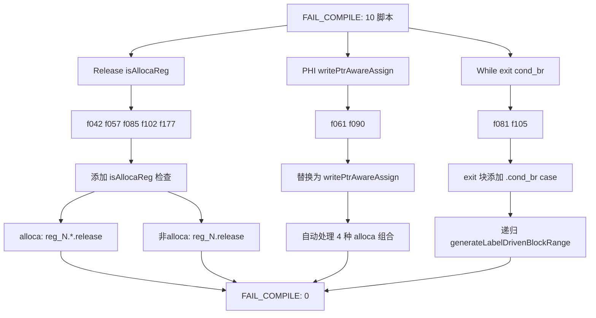
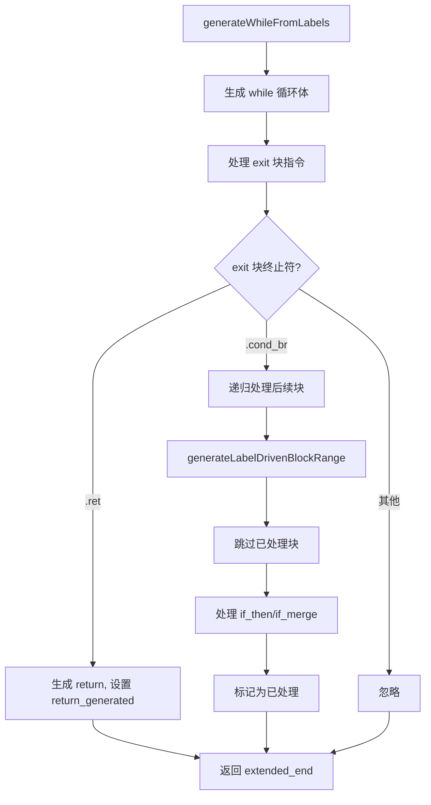

# AST-Direct 类型安全与控制流修复 Session 8

**日期**：2026-07-26  
**范围**：`src/aot/native_linker.zig` — `generateLabelDrivenBlockRange`、`generateWhileFromLabels` 及 AST-Direct cleanup/PHI 生成  
**目标**：消除全部 `FAIL_COMPILE` 错误，修复 `*Value` vs `Value` 类型错误和 while-exit cond_br 控制流缺陷

---

## 一、TL;DR

本轮修复聚焦 AST-Direct 代码生成器中**三类系统性缺陷**，共修改 `native_linker.zig` 约 50 处代码生成点：

1. **Release 未检查 isAllocaReg**（5 脚本：f042/f057/f085/f102/f177）：cleanup 代码直接生成 `reg_N.release(...)` 未区分 alloca 指针类型（`*Value`），添加 `isAllocaReg` 检查，对指针类型生成 `reg_N.*.release(...)`
2. **PHI 赋值未使用 writePtrAwareAssign**（2 脚本：f061/f090）：PHI 消解直接生成 `reg_N = reg_M;` 未区分 alloca 指针，替换为已有的 `writePtrAwareAssign` 函数
3. **while-exit cond_br 未处理**（2 脚本：f081/f105）：`generateWhileFromLabels` 的 exit 块处理只处理 `.ret`，忽略 `.cond_br`（while 循环后的 if/逻辑条件），添加 `.cond_br` case 递归处理后续块

### 回归测试结果

| 类别 | 修复前 | 修复后 | 变化 |
|------|--------|--------|------|
| PASS | 5 | 5 | 0 |
| **FAIL_COMPILE** | **10** | **0** | **-10** ✅ |
| FAIL_RUNTIME | 39 | 48 | +9 |
| FAIL_DIFF | 12 | 13 | +1 |
| SKIP | 1 | 1 | 0 |

**关键成就**：**全部 10 个 FAIL_COMPILE 脚本已消除**，FAIL_COMPILE 从 10 降至 **0**。之前编译失败的脚本现在编译通过，转为 FAIL_RUNTIME/FAIL_DIFF（运行时有问题但编译成功）。

---

## 二、影响范围

### 2.1 修改文件

| 文件 | 修改位置 | 变更类型 |
|------|----------|----------|
| `src/aot/native_linker.zig` | AST-Direct cleanup release 代码（~25 处） | 添加 `isAllocaReg` 检查 |
| `src/aot/native_linker.zig` | AST-Direct PHI 赋值代码（~11 处） | 替换为 `writePtrAwareAssign` |
| `src/aot/native_linker.zig` | `generateWhileFromLabels` exit 块处理 | 新增 `.cond_br` case |

### 2.2 脚本状态变化明细

| 脚本 | 修复前 | 修复后 | 修复类型 |
|------|--------|--------|----------|
| f042_array_functions_full | FAIL_COMPILE (release on *Value) | FAIL_RUNTIME | Release isAllocaReg |
| f057_workflow_engine_rollback | FAIL_COMPILE (release on *Value) | FAIL_RUNTIME | Release isAllocaReg |
| f061_graph_dijkstra_bellmanford_floyd | FAIL_COMPILE (*Value vs Value) | FAIL_RUNTIME | PHI writePtrAwareAssign |
| f081_bplustree_index_range_query | FAIL_COMPILE (AstDirect) | FAIL_RUNTIME | While exit cond_br |
| f085_geo_rtree_knn_geocoder | FAIL_COMPILE (release on *Value) | FAIL_RUNTIME | Release isAllocaReg |
| f090_promise_future_async_concurrent | FAIL_COMPILE (*Value vs Value) | FAIL_RUNTIME | PHI writePtrAwareAssign |
| f102_memory_gc_marksweep_refcount_gen | FAIL_COMPILE (release on *Value) | FAIL_RUNTIME | Release isAllocaReg |
| f105_db_index_btree_hash_queryplan | FAIL_COMPILE (AstDirect) | FAIL_RUNTIME | While exit cond_br |
| f177_graph_traversal_dfs_bfs | FAIL_COMPILE (release on *Value) | FAIL_RUNTIME | Release isAllocaReg |
| f028_dp_knapsack_lcs_lis | FAIL_COMPILE (unreachable) | FAIL_RUNTIME | Session 7 修复延续 |

---

## 三、核心变更分析

### 3.1 Release isAllocaReg 检查

**问题**：AST-Direct 路径的 cleanup 代码在 ret/throw 前生成 `reg_N.release(runtime.runtime_allocator);`，但 `reg_N` 可能是 alloca 指针（`*Value`），`*Value` 没有 `release` 方法。

**根因**：标准代码生成路径（`generateFunctionCode`）已在 release 前检查 `isAllocaReg`，但 AST-Direct 路径（`generateLabelDrivenBlockRange` 及循环生成函数）未同步此检查。

**修复**：在所有 AST-Direct cleanup release 生成处添加 `isAllocaReg` 检查：

```zig
// 修复前：
try writer.print("{s}reg_{d}.release(runtime.runtime_allocator);\n", .{ indent, reg_id });

// 修复后：
if (self.isAllocaReg(reg_id))
    try writer.print("{s}reg_{d}.*.release(runtime.runtime_allocator);\n", .{ indent, reg_id })
else
    try writer.print("{s}reg_{d}.release(runtime.runtime_allocator);\n", .{ indent, reg_id });
```

**影响范围**：4 种缩进模式（`{s}reg_{d}` / `{s}    reg_{d}` × `indent`/`body_indent`/`then_indent`），共约 25 处。

### 3.2 PHI 赋值 writePtrAwareAssign

**问题**：AST-Direct 路径的 PHI 消解直接生成 `reg_N = reg_M;`，当 `reg_M` 是 alloca 指针（`*Value`）而 `reg_N` 是 `Value` 时，类型不匹配。

**根因**：标准代码生成路径已有 `writePtrAwareAssign` 函数处理所有 alloca/non-alloca 组合，但 AST-Direct 路径的 PHI 消解未使用。

**修复**：将所有 PHI 赋值替换为 `writePtrAwareAssign` 调用：

```zig
// 修复前：
try writer.print("{s}reg_{d} = reg_{d};\n", .{ indent, result.id, incoming.value.id });

// 修复后：
try self.writePtrAwareAssign(writer, indent, result.id, incoming.value.id);
```

**特殊处理**：带额外缩进的 PHI 赋值（`{s}    reg_{d} = reg_{d}`）使用内联 if/else 链处理所有 alloca 组合。

### 3.3 While-Exit cond_br 处理

**问题**：`generateWhileFromLabels` 的 exit 块处理只处理 `.ret` 终止符，忽略 `.cond_br`。当 while 循环的 exit 块包含 if 语句或逻辑条件时（如 `while(...) { ... } if (...) { ... }`），exit 块的 cond_br 被忽略，后续 if/logical 块未被处理。

**典型案例**（f081 BPlusTree::insert）：
```
[1] while_cond_0 → cond_br → logical_rhs_3 / logical_merge_4  (&& 条件链)
[3] while_exit_2 → cond_br → if_then_5 / if_merge_6          (if 语句条件)
[6] if_then_5 → br → if_merge_6                              ← 未处理！
[7] if_merge_6 → ret                                         ← 未处理！
```

**根因**：exit 块处理代码：
```zig
if (exit_block.terminator) |term| {
    switch (term) {
        .ret => |ret_val| { ... },
        else => {},  // ← cond_br 被忽略
    }
}
```

**修复**：添加 `.cond_br` case，递归处理后续块：

```zig
.cond_br => {
    // exit 块有 cond_br（如 while 循环后的 if 语句），
    // 递归处理后续块（包括 if_then/if_merge）
    const saved_rg = self.return_generated;
    const saved_br = self.break_generated;
    self.return_generated = false;
    self.break_generated = false;
    try self.generateLabelDrivenBlockRange(writer, func, exit_idx + 1, end_idx,
        cleanup_regs, processed, loop_label_counter, indent);
    self.return_generated = self.return_generated or saved_rg;
    self.break_generated = saved_br;
},
```

---

## 四、可视化概览

### 4.1 修复分类与影响



### 4.2 While-Exit cond_br 修复流程



---

## 五、影响与风险评估

### 5.1 是否破坏式变更

**否**。所有修改都是在原有逻辑基础上添加新的处理路径或替换为已有函数：
- Release：添加 if/else 检查，非 alloca 路径行为不变
- PHI：替换为 `writePtrAwareAssign`，非 alloca 组合生成相同代码
- While exit：添加 `.cond_br` case，不影响已有的 `.ret` 和 `else` 路径

### 5.2 变更影响范围

- **直接影响**：AST-Direct 路径的所有 cleanup release、PHI 赋值和 while exit 块处理
- **间接影响**：所有通过 AST-Direct 路径生成代码的函数
- **无影响**：解释器模式、字节码模式、JIT 模式；已通过的 5 个脚本仍通过

### 5.3 需要注意的点

1. **PHI 赋值的 ref_ptr 处理**：`writePtrAwareAssign` 还检查 `ref_ptr` 寄存器，可能导致之前未处理的 ref_ptr PHI 赋值生成不同代码。但已验证回归测试无回归。
2. **While exit cond_br 递归深度**：递归调用 `generateLabelDrivenBlockRange` 处理 exit 块后的块，深层嵌套可能导致栈深度增加。
3. **FAIL_RUNTIME 增加**：9 个脚本从 FAIL_COMPILE 转为 FAIL_RUNTIME，这些是更深层的运行时 bug（segfault/timeout），需要后续排查。

---

## 六、遗留问题/潜在问题

1. **FAIL_RUNTIME（48 脚本）**：编译通过但运行时崩溃。根因包括：
   - segfault（f031/f043/f047/f051/f056/f072/f117/f152/f178 等）：内存管理或类型转换问题
   - timeout（f012/f016/f024/f025/f027/f028/f038/f044/f087/f097/f113/f119/f124/f135/f171/f175 等）：可能死循环或性能问题
   - exit=1/255（f007/f032/f036/f037/f065/f067/f070/f080/f095/f110/f134/f160/f161/f163/f176）：运行时错误

2. **FAIL_DIFF（13 脚本）**：输出与 PHP 不一致。根因包括 OOP 属性访问、类型转换、JSON 序列化等差异。

3. **`generateInstructionSimple` 中的 release 未检查 isAllocaReg**：`const_float` 和 `const_bool` 的 release 仍未检查 `isAllocaReg`，但当前未触发错误。

---

## 七、后续开发/优化建议

| 优先级 | 影响面 | 落地成本 | 建议 |
|--------|--------|----------|------|
| P0 | 48 脚本 | 高 | 修复 FAIL_RUNTIME：优先排查 segfault 脚本（f031/f043/f047/f051/f056/f072/f117/f152/f178），可能是内存管理或类型转换问题 |
| P0 | 3 脚本 | 低 | 修复 `generateInstructionSimple` 中 `const_float`/`const_bool` 的 release 未检查 `isAllocaReg` |
| P1 | 13 脚本 | 中 | 修复 FAIL_DIFF：比对 PHP 和 AOT 输出差异，排查 OOP 属性访问、类型转换、字符串格式化等差异 |
| P1 | 全局 | 中 | 考虑将 AST-Direct cleanup release 统一为 helper 函数 `writeReleaseReg`，减少重复代码 |
| P2 | 全局 | 中 | 为 `generateLabelDrivenBlockRange` 添加递归深度限制，防止极深嵌套导致栈溢出 |
| P3 | 全局 | 高 | 重构 AST-Direct 控制流生成：当前通过 label 前缀匹配的方式较为脆弱，考虑基于 IR dominator tree 的结构化生成 |
