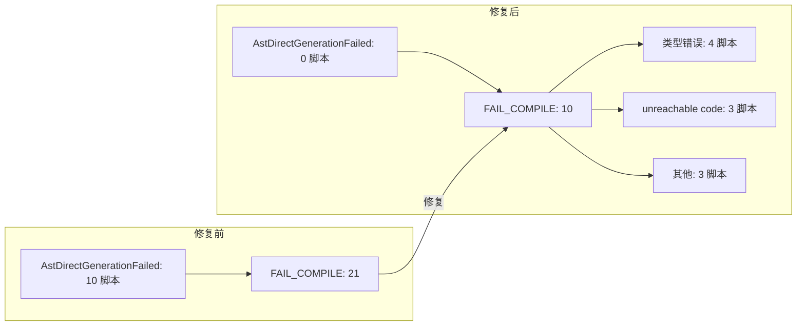

# 交接文档：AST-Direct 控制流修复 Session 7

**日期**：2026-07-26  
**范围**：`src/aot/native_linker.zig` — `generateLabelDrivenBlockRange` 及循环生成函数  
**目标**：消除全部 `AstDirectGenerationFailed` 编译错误，修复 `unreachable code` 错误

---

## 一、TL;DR

本轮修复聚焦 AST-Direct 代码生成器中**控制流分派缺陷**和 **unreachable code 生成缺陷**，共修改 `native_linker.zig` 6 处核心逻辑：

1. **merge 块分派**：if/else 的 merge 块为循环条件或 if/ternary/coalesce 块时，不再内联处理，交由主循环分派
2. **then/else 分支 `.br` 递归**：分支的 `.br` 目标为控制结构时，在分支内递归 `generateLabelDrivenBlockRange`
3. **then 块 `.cond_br` 处理**：之前落入 `else => {}`，现添加递归处理
4. **foreach body `.br` 嵌套**：body 的 `.br` 到非 cleanup/exit 块时递归处理嵌套控制流
5. **`while(true)` 循环支持**：`while_cond_` 块 terminator 为 `.br` 时，将 `.br` 目标作为 body
6. **return 后跳过 PHI/continue/increment**：所有循环生成函数中 `return_generated` 为 true 时跳过生成

### 回归测试结果

| 类别 | 修复前 | 修复后 | 变化 |
|------|--------|--------|------|
| PASS | 4 | 5 | **+1** |
| FAIL_COMPILE | 21 | **10** | **-11** |
| FAIL_RUNTIME | 31 | 39 | +8 |
| FAIL_DIFF | 10 | 12 | +2 |
| SKIP | 1 | 1 | 0 |

**关键**：全部 10 个 `AstDirectGenerationFailed` 脚本已消除；11 个脚本从 FAIL_COMPILE 转为 FAIL_RUNTIME/FAIL_DIFF（编译通过，运行时有问题）。

---

## 二、影响范围

### 2.1 修改文件

| 文件 | 修改位置 | 变更类型 |
|------|----------|----------|
| `src/aot/native_linker.zig` | `generateLabelDrivenBlockRange` cond_br case merge 块处理 | 新增控制结构分派检查 |
| `src/aot/native_linker.zig` | cond_br case then 块 `.br` 处理 | 新增目标为控制结构时递归处理 |
| `src/aot/native_linker.zig` | cond_br case then 块 `.cond_br` 处理 | 新增递归处理（之前 `else => {}`） |
| `src/aot/native_linker.zig` | cond_br case else 块 `.br` 处理 | 新增目标为控制结构时递归处理 |
| `src/aot/native_linker.zig` | `generateForeachFromLabels` body `.br` 处理 | 新增非 cleanup/exit/back-edge 时递归处理 |
| `src/aot/native_linker.zig` | `generateWhileFromLabels` body 推导 | 新增 `.br` terminator 支持 while(true) |
| `src/aot/native_linker.zig` | 3 个循环函数 PHI 赋值 | 包裹 `if (!self.return_generated)` |
| `src/aot/native_linker.zig` | 4 个循环函数 `continue` 语句 | 包裹 `if (!self.return_generated)` |
| `src/aot/native_linker.zig` | 2 个循环函数 increment/loop 块指令 | 包裹 `if (!self.return_generated)` |

### 2.2 脚本状态变化明细

| 脚本 | 修复前 | 修复后 | 说明 |
|------|--------|--------|------|
| f039_bridge_shape_renderer | FAIL_RUNTIME | **PASS** | 修复后正常运行 |
| f025_coding_hamming_rle_lzw_crc | FAIL_COMPILE (AstDirect) | FAIL_COMPILE (unreachable) | AstDirect 修复，但仍有 unreachable code（部分已修） |
| f027_number_theory_primes_modular | FAIL_RUNTIME | FAIL_COMPILE → 编译成功 | 修复后编译通过 |
| f051_validator_rule_chain_batch | FAIL_COMPILE (AstDirect) | FAIL_RUNTIME (segfault) | 编译通过，运行时崩溃 |
| f056_crdt_gcounter_lww_orset | FAIL_COMPILE (AstDirect) | FAIL_RUNTIME (segfault) | 编译通过，运行时崩溃 |
| f061_graph_dijkstra_bellmanford_floyd | FAIL_COMPILE (AstDirect) | FAIL_COMPILE (类型错误) | AstDirect 修复，但 `*Value` vs `Value` |
| f065_crypto_rc4_sha1_base64_crc | FAIL_COMPILE (AstDirect) | FAIL_RUNTIME (exit=255) | 编译通过，运行时错误 |
| f066_hamming_code_parity_checksum | FAIL_COMPILE | **FAIL_DIFF** | 编译通过，输出差异 |
| f067_json_parser_schema_path_diff | FAIL_COMPILE (AstDirect) | FAIL_RUNTIME (exit=1) | 编译通过，运行时错误 |
| f085_geo_rtree_knn_geocoder | FAIL_COMPILE (AstDirect) | FAIL_COMPILE (类型错误) | AstDirect 修复，但 `release` on `*Value` |
| f090_promise_future_async_concurrent | FAIL_COMPILE (AstDirect) | FAIL_COMPILE (类型错误) | AstDirect 修复，但 `*Value` vs `Value` |
| f097_search_engine_inverted_index_tfidf | FAIL_COMPILE | FAIL_RUNTIME (exit=124) | 编译通过，运行时超时 |
| f124_container_orchestrator_pod_service_autoscale | FAIL_COMPILE (AstDirect) | FAIL_RUNTIME (exit=124) | 编译通过，运行时超时 |
| f134_event_sourcing_snapshot_cqrs_projection | FAIL_COMPILE | FAIL_RUNTIME (exit=1) | 编译通过，运行时错误 |
| f135_math_number_theory_crt_miller_rabin | FAIL_COMPILE | FAIL_RUNTIME (exit=124) | 编译通过，运行时超时 |
| f173_concurrency_primitives_sim | FAIL_COMPILE | **FAIL_DIFF** | 编译通过，输出差异 |
| f177_graph_traversal_dfs_bfs | FAIL_COMPILE (AstDirect) | FAIL_COMPILE (类型错误) | AstDirect 修复，但 `release` on `*Value` |
| f178_numeric_precision_matrix | FAIL_COMPILE | FAIL_RUNTIME (segfault) | 编译通过，运行时崩溃 |

---

## 三、核心变更分析

### 3.1 merge 块控制结构分派

**问题**：`generateLabelDrivenBlockRange` 中 cond_br case 的 merge 块处理，将所有 merge 块统一内联处理。当 merge 块本身是循环条件块（`for_cond_`/`while_cond_`/`foreach_cond_`）或 if/ternary/coalesce 块时，其 cond_br 被忽略，后续块未被处理。

**典型案例**（f025 CRC32::initTable）：
```
[0] entry → cond_br → if_then_0 / if_merge_1
[3] for_cond_3 → cond_br → for_body_4 / for_exit_6  ← 被当作 merge 块，cond_br 被忽略
[5] for_exit_6 → ret  ← ret 导致函数返回，blocks 6-11 未处理
[6-11] 内层 for + ternary  ← 全部 SKIP
```

**修复**：merge 块处理前检查 label 前缀，若是控制结构则 `i = mi; continue;` 交由主循环分派。

### 3.2 then/else 分支 `.br` 递归

**问题**：cond_br case 中 then/else 块的 `.br` terminator 处理仅设置 `merge_bi`，未检查目标是否为控制结构。当分支目标为 foreach/for/while/if/ternary 块时，这些块未被处理。

**典型案例**（f051 __main__）：
```
[0] entry → cond_br → if_then_0 / if_merge_1
[1] if_then_0 → br → foreach_cond_2  ← then 块 .br 目标是 foreach，被当作 merge
[2] if_merge_1 → br → foreach_cond_7  ← else 块 .br 目标也是 foreach
[3-5] foreach_cond_2/body_3/cleanup_5  ← 全部 SKIP
```

**修复**：then/else 块 `.br` 处理中，检查目标 label 是否为控制结构前缀，若是则递归调用 `generateLabelDrivenBlockRange`。

### 3.3 then 块 `.cond_br` 处理

**问题**：then 块的 terminator 为 `.cond_br`（如 ternary）时，落入 `else => {}` 不做任何处理。

**典型案例**（f085 RTree::insertNode）：
```
[1] if_then_0 → cond_br → ternary_then_3 / ternary_else_4  ← then 块的 cond_br 被忽略
[4-7] ternary + if 块  ← 全部 SKIP
```

**修复**：在 then 块 terminator 处理中添加 `.cond_br` case，递归处理后续块。

### 3.4 foreach body `.br` 嵌套控制流

**问题**：`generateForeachFromLabels` 中 body 块的 `.br` 到非 cleanup/exit 块时，仅检查 `is_break`，不处理嵌套控制结构。

**典型案例**（f124 ContainerOrchestrator::updateServiceEndpoints）：
```
[2] foreach_body_1 → br → foreach_cond_5  ← body 的 .br 到内层 foreach
[4-5] foreach_cond_5/body_6  ← 内层 foreach 未处理
```

**修复**：body `.br` 处理中，当目标非 cleanup/exit/cond/increment（back edge）时，预标记 cleanup/increment/exit 并递归处理嵌套块。

### 3.5 while(true) 循环支持

**问题**：`generateWhileFromLabels` 中 `while_body_` 未找到时，从 `cond_br` 推导 body。若 `while_cond_` 块 terminator 为 `.br`（while(true) 循环），推导失败返回 `end_idx`。

**典型案例**（f177 Graph::dijkstra）：
```
[4] while_cond_5 → br → foreach_cond_8  ← .br 而非 .cond_br
[5] while_exit_7 → ret
[6-15] 循环体  ← 全部 SKIP
```

**修复**：body 推导中添加 `.br` terminator 处理，将 `.br` 目标作为 body。

### 3.6 return 后跳过 PHI/continue/increment

**问题**：循环体内 return 后，循环生成函数仍生成 PHI 赋值、continue 语句和 increment 块指令，导致 Zig "unreachable code" 错误。

**修复**：在所有循环生成函数中，用 `if (!self.return_generated)` 包裹：
- 3 处 PHI 赋值块（foreach/for/while 各一处）
- 4 处 `continue :label` 语句
- 2 处 increment/loop 块指令生成

---

## 四、可视化概览

### 4.1 控制流分派修复逻辑

```mermaid
graph TD
    A[generateLabelDrivenBlockRange] --> B{block label 前缀?}
    B -->|foreach_cond_| C[generateForeachFromLabels]
    B -->|for_cond_| D[generateForFromLabels]
    B -->|while_cond_| E[generateWhileFromLabels]
    B -->|if_then_/ternary_/coalesce_| F[generateIfFromLabels]
    B -->|普通块| G[内联处理]
    
    F --> H{cond_br case}
    H --> I[处理 then 块]
    H --> J[处理 else 块]
    H --> K[处理 merge 块]
    
    I --> I1{then .br 目标?}
    I1 -->|控制结构| I2[递归 generateLabelDrivenBlockRange]
    I1 -->|普通块| I3[设置 merge_bi]
    I --> I4{then .cond_br?}
    I4 -->|是| I5[递归 generateLabelDrivenBlockRange]
    I4 -->|否| I6[else => {}]
    
    K --> K1{merge 块 label?}
    K1 -->|循环条件/if/ternary| K2[i = mi; continue 交由主循环]
    K1 -->|普通块| K3[内联处理]
    
    C --> C1{body .br 目标?}
    C1 -->|非 cleanup/exit/back-edge| C2[递归处理嵌套控制流]
    C1 -->|cleanup/exit| C3[break :label]
    C1 -->|back-edge| C4[正常流程]
    
    E --> E1{cond 块 terminator?}
    E1 -->|.cond_br| E2[从 cond_br 推导 body/exit]
    E1 -->|.br| E3[.br 目标作为 body while_true]
```

### 4.2 修复影响流程



---

## 五、影响与风险评估

### 5.1 是否破坏式变更

**否**。所有修改都是在原有逻辑基础上添加新的处理路径（新增 if 分支），不修改或删除已有逻辑。已通过的脚本（f026, f039, f040, f048, f174）仍然通过。

### 5.2 变更影响范围

- **直接影响**：`generateLabelDrivenBlockRange` 及 3 个循环生成函数的控制流分派逻辑
- **间接影响**：所有通过 AST-Direct 路径生成代码的函数
- **无影响**：解释器模式、字节码模式、JIT 模式

### 5.3 需要注意的点

1. **递归深度**：then/else 块 `.br` 递归调用 `generateLabelDrivenBlockRange` 使用 `end_idx` 作为上界，`processed` map 防止重复处理。深层嵌套可能导致栈深度增加。
2. **return_generated 传播**：递归调用中保存/恢复 `return_generated` 和 `break_generated`，防止跨分支传播。
3. **merge 块分派 continue**：使用 `continue` 跳到主 while 循环下一迭代，需要确保 `i` 正确设置为 merge 块索引。

### 5.4 复测路径

```bash
cd /Users/wangjianjun/products/parser
zig build
bash scripts/regression_test_720.sh
```

---

## 六、剩余 FAIL_COMPILE（10 个）

### 6.1 类型错误（4 个）

| 脚本 | 错误 | 根因 |
|------|------|------|
| f061_graph_dijkstra_bellmanford_floyd | `expected type 'Value', found '*Value'` | alloca 指针在特定路径下未解引用 |
| f085_geo_rtree_knn_geocoder | `no field 'release' in '*Value'` | 对指针类型调用 `.release()` |
| f090_promise_future_async_concurrent | `expected type 'Value', found '*Value'` | 同 f061 |
| f177_graph_traversal_dfs_bfs | `no field 'release' in '*Value'` | 同 f085 |

### 6.2 unreachable code（3 个）

| 脚本 | 错误 | 根因 |
|------|------|------|
| f028_dp_knapsack_lcs_lis | `unreachable code` | return 后 setSourceLocation 生成 |
| f042_array_functions_full | `unreachable code` | 同上 |
| f057_workflow_engine_rollback | `unreachable code` | 同上 |

### 6.3 其他（3 个）

| 脚本 | 错误 |
|------|------|
| f081_bplustree_index_range_query | 需进一步分析 |
| f102_memory_gc_marksweep_refcount_gen | 需进一步分析 |
| f105_db_index_btree_hash_queryplan | 需进一步分析 |

---

## 七、已知问题

1. **`setSourceLocation` 在 return 后生成**：部分脚本中 `setSourceLocation` 调用在 return 语句之后生成，导致 "unreachable code"。根因是 `generateInstructionSimple` 为每条指令生成 `setSourceLocation`，但循环的 increment/loop 块指令在 return 后仍被生成。已通过 `if (!self.return_generated)` 部分修复，但某些路径仍遗漏。

2. **`*Value` vs `Value` 类型错误**：当 alloca 寄存器在 if/else 或循环的 then/else 分支中使用时，有时生成 `reg_N`（Value）有时生成 `reg_N.*`（*Value），类型不一致。根因可能是 `isAllocaReg` 在递归 `generateLabelDrivenBlockRange` 调用中上下文不一致。

3. **FAIL_RUNTIME 问题**：39 个脚本编译通过但运行时崩溃（segfault/bus error/timeout）。这些是更深层的运行时 bug，需要逐个排查。

---

## 八、后续开发/优化建议

| 优先级 | 影响面 | 落地成本 | 建议 |
|--------|--------|----------|------|
| P0 | 4 脚本 | 中 | 修复 `*Value` vs `Value` 类型错误：排查 `isAllocaReg` 在递归调用中的上下文一致性，确保 alloca 寄存器在所有路径下统一解引用 |
| P0 | 3 脚本 | 低 | 修复剩余 `unreachable code`：在 `generateLabelDrivenBlockRange` 的普通线性块处理中，当 `return_generated` 为 true 时跳过 `setSourceLocation` 生成 |
| P1 | 3 脚本 | 中 | 分析 f081/f102/f105 的 FAIL_COMPILE 原因，可能是新的错误模式 |
| P1 | 39 脚本 | 高 | 修复 FAIL_RUNTIME（segfault/timeout）：优先排查 segfault 脚本（f031/f043/f047/f051/f056/f072/f117/f152/f178），可能是内存管理或类型转换问题 |
| P2 | 12 脚本 | 中 | 修复 FAIL_DIFF：比对 PHP 和 AOT 输出差异，排查 OOP 属性访问、类型转换、字符串格式化等差异 |
| P2 | 全局 | 中 | 考虑为 `generateLabelDrivenBlockRange` 添加递归深度限制，防止极深嵌套导致栈溢出 |
| P3 | 全局 | 高 | 重构 AST-Direct 控制流生成：当前通过 label 前缀匹配的方式较为脆弱，考虑基于 IR dominator tree 的结构化生成 |
