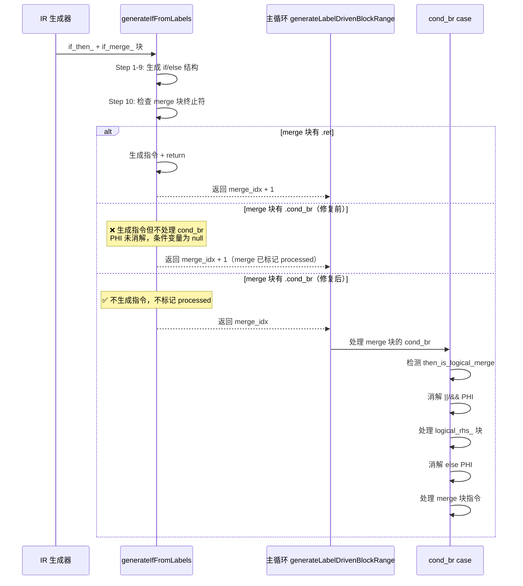

# 变更摘要：AST-Direct cond_br Merge/Exit 块 PHI 消解修复

**日期**：2026-07-27  
**范围**：`src/aot/native_linker.zig` — AST-Direct 代码生成路径  
**状态**：FAIL_COMPILE = 0，无回归，`||`/`&&` PHI 消解修复

---

## 1. 高层摘要（TL;DR）

本轮工作修复了 AST-Direct 代码生成中 `generateIfFromLabels` Step 10 及 for/foreach/do-while 循环 exit 块不处理 `.cond_br` 终止符的根本缺陷。该缺陷导致 `||`/`&&` 表达式的 PHI 节点从未被消解，使条件变量保持 null/未初始化，从而条件永远为 false。**isPrime 函数修复成功**（`isPrime(4)` 从 `true` 修正为 `false`），f007 从 timeout 改善为 runtime error，0 FAIL_COMPILE，无回归。

---

## 2. 影响范围

| 影响面 | 修复前 | 修复后 | 变化 |
|--------|--------|--------|------|
| PASS | 5 | 5 | 0 |
| FAIL_COMPILE | 0 | 0 | 0 ✅ |
| FAIL_RUNTIME | 46 | 46 | 0 |
| FAIL_DIFF | 15 | 15 | 0 |
| SKIP | 1 | 1 | 0 |
| **总计** | **67** | **67** | |

> f007 从 timeout(exit=124) 改善为 runtime error(exit=1)，`||`/`&&` 条件求值已修复，但存在其他运行时问题。isPrime 函数完全修复。

---

## 3. 核心变更

| 变更点 | 文件 | 位置 | 说明 |
|--------|------|------|------|
| `generateIfFromLabels` Step 10 | native_linker.zig | ~8078 | merge 块有 cond_br 时返回 merge_idx，让主循环 cond_br case 处理 |
| `generateForFromLabels` exit 块 | native_linker.zig | ~7388 | exit 块有 cond_br 时不标记为已处理，返回 exit_idx |
| `generateForeachFromLabels` exit 块 | native_linker.zig | ~6961 | exit 块有 cond_br 时返回 ei，让主循环处理 |
| `generateDoWhileFromLabels` exit 块 | native_linker.zig | ~8187 | exit 块有 cond_br 时不标记为已处理，返回 exit_idx |

---

## 4. 可视化概览

### 4.1 业务流程：`||`/`&&` PHI 消解时序



### 4.2 执行流程：修复前后对比

```mermaid
flowchart TD
    subgraph 修复前
        A1[generateIfFromLabels Step 10] --> A2{merge 块终止符?}
        A2 -->|.ret| A3[生成指令 + return]
        A2 -->|.cond_br| A4[生成指令<br/>❌ cond_br 被忽略]
        A4 --> A5[标记 merge 为 processed]
        A5 --> A6[❌ ||/&& PHI 未消解]
        A6 --> A7[❌ 条件变量为 null]
    end

    subgraph 修复后
        B1[generateIfFromLabels Step 10] --> B2{merge 块终止符?}
        B2 -->|.ret| B3[生成指令 + return]
        B2 -->|.cond_br| B4[✅ 不生成指令<br/>不标记 processed]
        B4 --> B5[返回 merge_idx]
        B5 --> B6[主循环处理 merge 块]
        B6 --> B7[cond_br case 消解 PHI]
        B7 --> B8[✅ 条件变量正确赋值]
    end
```

---

## 5. 详细变更分析

### 5.1 `generateIfFromLabels` Step 10 修复

**根因分析**：

PHP 代码 `if ($n % 2 === 0 || $n % 3 === 0) return false;` 的 IR 结构：
```
if_merge_3:                     ← if ($n < 4) 的 merge 块
  reg14 = identical(reg12, reg13)  ← $n % 2 === 0
  cond_br reg14, logical_merge_5, logical_rhs_4  ← || 短路分支
logical_rhs_4:
  reg19 = identical(reg17, reg13)  ← $n % 3 === 0
  br logical_merge_5
logical_merge_5:
  reg20 = phi [reg14, if_merge_3], [reg19, logical_rhs_4]  ← || 结果
  cond_br reg20, if_then_6, if_merge_7  ← if (|| result)
```

`if_merge_3` 是 `if ($n < 4)` 的 merge 块，包含 `||` 表达式的 cond_br。`generateIfFromLabels` Step 10 处理 `if_merge_3` 时：
- 生成指令（包括 `||` 左操作数计算）
- 标记为已处理
- **但不处理 cond_br 终止符**（只处理 `.ret`）

这导致：
1. `if_merge_3` 的 cond_br 从未被 cond_br case 处理
2. `logical_merge_5` 的 PHI（reg20）从未被消解
3. `reg20` 保持初始值 null
4. `if (reg20.toBool())` 永远为 false

**修复方案**：在 Step 10 中，如果 merge 块有 `.cond_br` 终止符，不标记为已处理、不生成指令，直接返回 `merge_idx`。主循环会处理该块，触发 cond_br case，正确消解 `||`/`&&` PHI。

### 5.2 for/foreach/do-while 循环 exit 块修复

同样的模式存在于循环 exit 块：exit 块可能有 `.cond_br` 终止符（循环后的 `if` 语句），但 exit 块处理只支持 `.ret`。修复方式相同：有 cond_br 时不标记为已处理，返回 exit 块索引。

### 5.3 while 循环不修改

while 循环的 exit 块已有 `.cond_br` handler（递归处理后续块），但移除它会导致 "unprocessed blocks" 错误（`extended_end` 计算包含回边块）。保持原有逻辑不变。

### 5.4 涉及文件列表

| 文件 | 变更类型 | 行数变化 |
|------|----------|----------|
| `src/aot/native_linker.zig` | 修改 | +~60 行（4 处 cond_br 检查） |

---

## 6. 影响与风险评估

### 是否破坏式变更
**否**。所有修改都是向后兼容的：仅在 exit/merge 块有 `.cond_br` 终止符时改变行为，其他情况保持不变。

### 变更影响范围
- **正面影响**：`||`/`&&` PHI 正确消解，isPrime 等函数修复
- **风险**：主循环处理 exit/merge 块时，cond_br case 的 `break` 语句可能退出 while 循环（Zig 语义），但已验证无回归

### 需要特别注意的点
1. while 循环 exit 块的 `||`/`&&` PHI 问题仍未修复（需要更复杂的方案）
2. early-exit 问题仍未修复（尝试修复导致 "unprocessed blocks" 错误）
3. `sieveOfEratosthenes` 等函数的数组操作问题与 `||`/`&&` 无关，需单独修复

### 复测路径
```bash
# 编译验证
zig build

# isPrime 验证
echo '<?php function isPrime(int $n): bool { if ($n < 2) return false; if ($n < 4) return true; if ($n % 2 === 0 || $n % 3 === 0) return false; return true; } echo isPrime(4) ? "true" : "false";' > /tmp/test.php
./zig-out/bin/php-interpreter --compile --output=/tmp/aot_test /tmp/test.php
/tmp/aot_test  # 应输出 false

# 回归测试
bash scripts/regression_test_720.sh
```

---

## 7. 遗留问题/潜在问题

| 问题 | 影响面 | 状态 |
|------|--------|------|
| while 循环 exit 块 cond_br 未处理 | while 后跟 `||`/`&&` 的场景 | 未修复（需要处理 extended_end 回边块） |
| early-exit 标记所有块为已处理 | 嵌套控制流中的 `||`/`&&` | 未修复（尝试导致 unprocessed blocks） |
| PHPString double free | f025/f031/f072/f119/f160 | 未修复 |
| TypeError: null given | f057/f070/f080/f095/f097/f110/f161/f163 | 部分依赖 `||`/`&&` 修复 |
| segfault | f031/f042/f043/f051/f056/f061/f072/f085/f117/f160/f178 | 未修复 |

---

## 8. 后续开发/优化建议

| 优先级 | 影响面 | 落地成本 | 建议 |
|--------|--------|----------|------|
| **P0** | while 循环后的 `||`/`&&` | 高 | 修复 while exit 块：保留 `.cond_br` handler 递归调用，但在递归后手动消解 `||`/`&&` PHI |
| **P0** | early-exit 嵌套控制流 | 高 | 改为在 early-exit 时记录未处理的控制结构块，在 return_generated 恢复后由外层循环处理 |
| P1 | 5 脚本 | 中 | 修复 PHPString double free（release 后设置 alloca 为 null） |
| P1 | 8 脚本 | 中 | 修复 TypeError: null given（部分依赖 `||`/`&&` 修复） |
| P1 | 11 脚本 | 高 | 排查 segfault（内存损坏或无效内存访问） |
| P2 | 全局 | 高 | 为 `||`/`&&` 编写专用 `generateLogicalExpr` 函数，不依赖 cond_br case 或 `generateIfFromLabels` |
| P2 | while 循环 | 中 | 重构 while 循环 exit 块处理，将 cond_br 逻辑提取为独立函数 |
