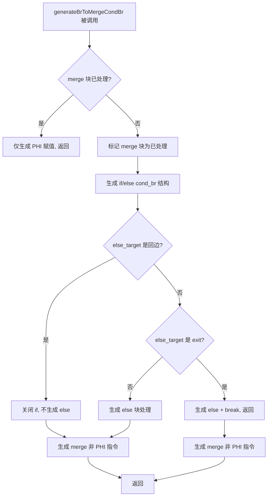

# AST-Direct BrToMergeCondBr 回边检查与 merge 块处理修复

## 1. 高层摘要（TL;DR）

修复了 `generateBrToMergeCondBr` 函数中三个关键问题：
1. **回边标签缺失**：`foreach_increment_`、`for_increment_`、`while_increment_` 未被识别为循环回边，导致增量块被错误地当作 else 块处理，引发双重增量执行和无限循环
2. **merge 块双重处理**：merge 块（如 `logical_merge_`、`if_merge_`）被 `generateBrToMergeCondBr` 和上层 else 块处理逻辑重复处理，导致 cond_br 目标块（如 `foreach_increment_`）被重复生成
3. **预标记时机错误**：循环自身的 increment/cleanup/exit 块的预标记在 then/else 处理之后执行，未能防止 then/else 内的递归调用错误处理这些块

**回归测试结果**：PASS=16（不变），FAIL_COMPILE 2→1（-1），FAIL_RUNTIME 24→23（-1），FAIL_DIFF 24→26（+2）。产出输出的脚本从 40 增至 42（+2）。

## 2. 影响范围

| 影响面 | 描述 |
|--------|------|
| 文件 | `src/aot/native_linker.zig` |
| 函数 | `generateBrToMergeCondBr`、`generateForeachFromLabels`、`generateForFromLabels`、`generateWhileFromLabels` |
| 测试脚本 | f160（编译修复）、f171（超时修复）、f176（超时修复）、f044（保持 FAIL_DIFF）、f117（保持 FAIL_DIFF） |
| 回归 | f124（FAIL_DIFF→segfault，非 PHI 指令在 then 分支上下文生成的副作用） |

## 3. 核心变更

| 变更点 | 位置 | 描述 |
|--------|------|------|
| 回边标签扩展 | `generateBrToMergeCondBr` ~L7843 | 添加 `for_increment_`、`while_increment_`、`foreach_increment_` 到回边检查列表 |
| merge 块标记 | `generateBrToMergeCondBr` ~L7770 | 标记 merge 块为已处理，防止上层 else 块处理逻辑重复处理 |
| 非 PHI 指令生成 | `generateBrToMergeCondBr` ~L7869/7932/7872 | 在 if/else 关闭后生成 merge 块的非 PHI 指令（正确上下文） |
| 预标记提前（foreach） | `generateForeachFromLabels` ~L7290 | 将 increment/cleanup/exit 预标记移到 then/else 处理之前 |
| 预标记提前（for） | `generateForFromLabels` ~L8157 | 将 loop/exit 预标记移到 then/else 处理之前 |
| 预标记提前（while） | `generateWhileFromLabels` ~L8720 | 将 exit 预标记移到 then/else 处理之前 |

## 4. 可视化概览

## 5. 详细变更分析

### 5.1 回边标签扩展

**问题**：`generateBrToMergeCondBr` 在检查 cond_br 的 else_target 是否是循环回边块时，只检查了 `for_cond_`、`for_loop_`、`while_cond_`、`while_body_`、`foreach_cond_`、`foreach_loop_`、`do_while_cond_`，遗漏了 `for_increment_`、`while_increment_`、`foreach_increment_`。

**影响**：当 cond_br 的 else_target 是 `foreach_increment_` 块时，该块被错误地当作普通 else 块处理，导致增量代码在 else 分支中生成。当条件为 true 时（then 分支执行），增量被跳过 → 无限循环。

**修复**：在回边检查列表中添加三个标签前缀。

### 5.2 merge 块标记为已处理

**问题**：`generateBrToMergeCondBr` 处理了 merge 块的 cond_br（生成 if/else 结构），但未标记 merge 块为已处理。上层调用者（如 `generateForeachFromLabels` 的 else 块处理）再次处理该 merge 块，导致：
1. PHI 被重复消解
2. cond_br 的 `generateLabelDrivenBlockRange` 调用处理了不应处理的块（如 `foreach_increment_`）

**修复**：在 `generateBrToMergeCondBr` 中标记 merge 块为已处理（`processed.put(merge_idx, {})`）。

### 5.3 非 PHI 指令在 if/else 后生成

**问题**：标记 merge 块为已处理后，上层 else 块处理逻辑跳过该块，导致 merge 块的非 PHI 指令（副作用）丢失。

**修复**：在 `generateBrToMergeCondBr` 的 if/else 结构关闭后（三个退出路径：else_is_be、normal、exit block），生成 merge 块的非 PHI 指令。

### 5.4 预标记提前

**问题**：`generateForeachFromLabels`/`generateForFromLabels`/`generateWhileFromLabels` 的 cond_br case 中，循环自身的 increment/cleanup/exit 块的预标记在 then/else 处理之后执行。then/else 内的 `generateLabelDrivenBlockRange` 或 `generateBrToMergeCondBr` 调用可能错误处理这些块。

**修复**：将预标记移到 then/else 处理之前。

## 6. 影响与风险评估

| 维度 | 评估 |
|------|------|
| 破坏式变更 | 否（仅影响 AOT 代码生成路径） |
| 回归风险 | f124 从 FAIL_DIFF 变为 segfault（非 PHI 指令在 then 分支上下文生成的副作用） |
| 复测路径 | `fuzzy_scripts_720/run_regression.sh` |
| 注意事项 | f024 的嵌套 foreach out-of-order 块布局问题仍未解决（需要单独处理） |

## 7. 遗留问题

1. **f024 嵌套 foreach out-of-order**：内层 foreach 循环的块在外层 foreach cleanup 之后，导致 `generateForeachFromLabels` 无法正确识别和处理嵌套循环
2. **f124 segfault**：非 PHI 指令在 then 分支上下文生成可能导致引用未定义变量。需要在 else 块处理逻辑中生成 merge 块的非 PHI 指令（而非在 `generateBrToMergeCondBr` 中）
3. **剩余 23 个超时脚本**：需要逐一分析超时原因

## 8. 后续开发建议

| 优先级 | 建议 | 影响面 | 落地成本 |
|--------|------|--------|----------|
| P0 | 修复 f124 segfault：将非 PHI 指令生成从 `generateBrToMergeCondBr` 移到 else 块处理逻辑 | f124 恢复 FAIL_DIFF | 中 |
| P0 | 修复 f024 嵌套 foreach out-of-order 块布局 | f024 不再超时 | 高 |
| P1 | 分析剩余 23 个超时脚本的共性根因 | 多个脚本改善 | 中 |
| P1 | 考虑将 `generateLabelDrivenBlockRange` 的 cond_br case 中的 merge 块处理统一化 | 代码可维护性 | 中 |
| P2 | 添加单元测试覆盖 `generateBrToMergeCondBr` 的回边检查逻辑 | 防止回归 | 低 |
