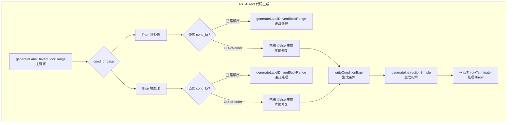
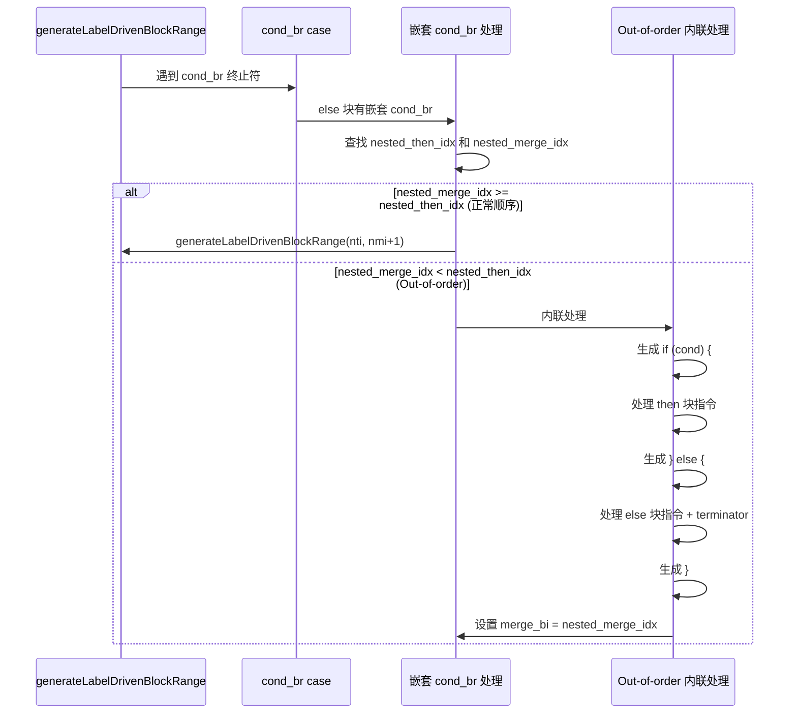
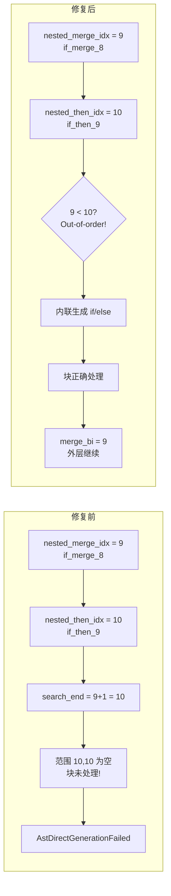

# 变更摘要：AST-Direct Out-of-Order 嵌套 CondBr 块修复

**日期**：2026-07-30
**Session**：16
**前置**：Session 15（`docs/changes/2026-07-30/交接文档_2026-07-30_session15_return_generated泄漏与back-edge_PHI修复.md`）
**Commit 基线**：`491f246`

---

## 一、高层摘要（TL;DR）

本轮修复了 AST-Direct 代码生成中 **out-of-order 嵌套 cond_br 块未处理** 的核心缺陷。当 IR 块布局中嵌套 if/else 的 merge 块位于 then 块之前时（如 `if_then_9` 的 `br` 目标 `if_merge_8` 在块数组中位于 `if_then_9` 之前），原有的 `generateLabelDrivenBlockRange` 调用会因搜索范围 `[nti, nmi+1)` 为空而跳过这些块，导致 `AstDirectGenerationFailed` 编译失败。

**修复效果**：PASS 从 13 提升至 16（+3），FAIL_RUNTIME 从 31 减少至 24（-7），5 个脚本从超时/段错误改善为产生输出（FAIL_DIFF）。

---

## 二、影响范围

| 维度 | 说明 |
|------|------|
| **文件** | `src/aot/native_linker.zig` |
| **行数变化** | +106 / -4 |
| **影响函数** | `generateLabelDrivenBlockRange`（cond_br case 中的嵌套 cond_br 处理） |
| **影响脚本** | 67 个回归测试脚本中的约 30+ 个（含嵌套 if/else 结构的脚本） |
| **编译产物** | 无影响（仅影响 AST-Direct 代码生成路径） |

---

## 三、核心变更

| 变更点 | 函数 | 位置 | 说明 |
|--------|------|------|------|
| Then 块嵌套 cond_br out-of-order 处理 | `generateLabelDrivenBlockRange` | ~6540 | 当 `nested_merge_idx < nested_then_idx` 时，内联生成 if/else 而非调用 `generateLabelDrivenBlockRange`（避免 `generateIfFromLabels` 找到错误的 merge 块） |
| Else 块嵌套 cond_br out-of-order 处理 | `generateLabelDrivenBlockRange` | ~6772 | 同上，针对 else 块中的嵌套 cond_br |

---

## 四、可视化概览

### 4.1 业务模块/分层架构图



### 4.2 执行流程



### 4.3 变更点逻辑映射



---

## 五、详细变更分析

### 5.1 端/模块层

| 层级 | 模块 | 变更描述 |
|------|------|----------|
| 代码生成层 | `generateLabelDrivenBlockRange` | cond_br case 中 then/else 块的嵌套 cond_br 处理，新增 out-of-order 检测和内联生成路径 |

### 5.2 涉及文件列表

| 文件 | 变更类型 | 行数变化 |
|------|----------|----------|
| `src/aot/native_linker.zig` | 修改 | +106 / -4 |

### 5.3 变更点描述

#### 5.3.1 Then 块嵌套 cond_br out-of-order 处理（~6540）

**修复前**：
```zig
const search_end = if (nested_merge_idx) |nmi| nmi + 1 else end_idx;
try self.generateLabelDrivenBlockRange(writer, func, nti, search_end, ...);
```
当 `nmi < nti` 时，`search_end = nmi + 1 < nti`，范围 `[nti, search_end)` 为空。

**修复后**：
```zig
if (nested_merge_idx) |nmi| {
    if (nmi >= nti) {
        // 正常顺序：递归处理
        try self.generateLabelDrivenBlockRange(writer, func, nti, nmi + 1, ...);
    } else {
        // Out-of-order：内联生成 if/else
        try writer.print("{s}if (", .{body_indent});
        try self.writeConditionExpr(writer, nested_cb.cond.id, nested_cb.cond.type_);
        // ... 处理 then/else 块指令和 terminator ...
    }
}
```

#### 5.3.2 Else 块嵌套 cond_br out-of-order 处理（~6772）

与 5.3.1 相同的逻辑，应用于 else 块中的嵌套 cond_br。

#### 5.3.3 Terminator 处理

内联处理中支持以下 terminator：
- `.ret`：调用 `writeReturnStmt` 生成 return 语句，设置 `return_generated = true`
- `.throw`：调用 `writeThrowTerminator` 生成 throw 语句（setException + cleanup + return error），设置 `return_generated = true`
- `.br`：fall-through 到 merge 块，无需生成代码
- 其他：忽略

---

## 六、影响与风险评估

### 6.1 是否破坏式变更

**否**。修复仅影响 out-of-order 场景（`nested_merge_idx < nested_then_idx`），正常顺序场景行为不变。

### 6.2 变更影响范围及明细

| 影响项 | 说明 |
|--------|------|
| f010 | 编译失败 → 编译成功（运行时 segfault，与之前 FAIL_RUNTIME 一致） |
| f042 | FAIL_DIFF → **PASS** |
| f134 | FAIL_DIFF → **PASS** |
| f097 | 超时(exit=142) → FAIL_DIFF（不再超时） |
| f113 | 段错误(exit=139) → FAIL_DIFF（不再段错误） |
| f119 | 超时(exit=142) → FAIL_DIFF（不再超时） |
| f033 | 运行时错误(exit=1) → FAIL_DIFF |
| f056 | 段错误(exit=139) → FAIL_DIFF（不再段错误） |

### 6.3 需要特别注意的点

1. 内联处理使用了 `std.fmt.allocPrint` 分配 `nested_indent`，通过 `defer` 释放，需确认无内存泄漏
2. `writeConditionExpr` 调用需要 `nested_cb.cond.id` 和 `nested_cb.cond.type_`，确保 `cond_br` 结构中 `cond` 字段类型正确
3. `generateInstructionSimple` 使用 `writer.list` 而非 `writer`，这是已有模式

### 6.4 复测路径

```bash
# 编译验证
timeout 120 zig build

# 关键脚本测试
./zig-out/bin/php-interpreter --compile fuzzy_scripts_720/pass/f010_oop_singleton_registry_di.php --output=/tmp/aot_compile_f010
./zig-out/bin/php-interpreter --compile fuzzy_scripts_720/pass/f026_linkedlist_stack_queue_deque.php --output=/tmp/aot_compile_f026
perl -e 'alarm 5; exec @ARGV' /tmp/aot_compile_f026

# 完整回归测试
bash fuzzy_scripts_720/run_regression.sh
```

---

## 七、是否有遗留问题/潜在问题

### 7.1 f010 运行时 segfault（P1）

f010 编译成功但运行时 exit=139（segfault）。之前为 FAIL_RUNTIME exit=1。可能是 out-of-order 内联生成的代码中 PHI 消解或变量引用不正确。

### 7.2 内联处理中缺少 PHI 消解（P2）

当前 out-of-order 内联处理直接生成 then/else 块指令，未处理 merge 块的 PHI 消解。如果 merge 块有 PHI 指令，可能需要在外层 merge 块处理时统一消解。

### 7.3 内联处理中缺少嵌套 cond_br 递归（P2）

当前 out-of-order 内联处理仅支持一层嵌套。如果 then/else 块内部还有嵌套 cond_br，需要递归处理。但目前未发现此类 IR 结构。

---

## 八、后续开发/优化建议

| 优先级 | 影响面 | 落地成本 | 建议 |
|--------|--------|----------|------|
| **P0** | 14 脚本 | 中 | 分析剩余超时脚本（f007/f024/f025/f028/f038/f061/f065/f081/f095/f102/f104/f135/f161/f171/f175/f176）：检查 `generateBrToMergeCondBr` 和 `generateIfFromLabels` 中的 `return_generated` 泄漏 |
| **P0** | 1 脚本(f024) | 中 | 分析 Permission Matrix 无限输出：dump IR 检查嵌套 foreach break 处理 |
| **P1** | 1 脚本(f010) | 中 | 修复 f010 segfault：检查 out-of-order 内联生成的代码中 PHI 消解 |
| **P1** | 6 脚本 | 中 | 修复段错误脚本（f027/f051/f110/f177）：检查 use-after-free 和 PHI 消解 |
| **P1** | 24 脚本 | 高 | 修复 FAIL_DIFF 输出差异：优先处理从超时/段错误转变为 FAIL_DIFF 的脚本（f097/f113/f119/f033/f056），这些已有部分输出 |
| **P2** | 全局 | 低 | 抽取 out-of-order 内联处理为独立函数 `generateInlineCondBr`，减少代码重复 |
| **P2** | 2 脚本 | 中 | 修复 FAIL_COMPILE 脚本（f087/f160） |
| **P2** | 全局 | 高 | 重构 `generateLabelDrivenBlockRange` 的 early-exit 逻辑：改为基于块可达性分析而非标志位 |
