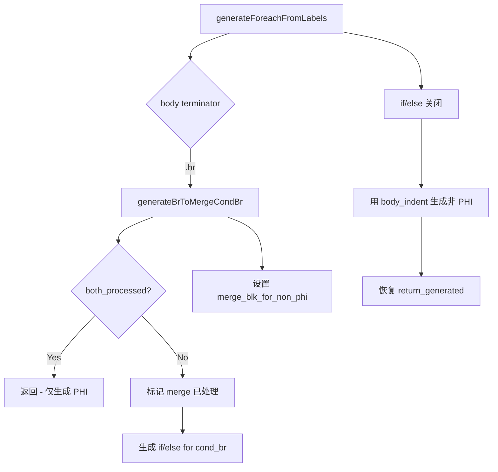

# 交接文档：非 PHI 指令上下文修复 (Session 18)

## 1. 高层摘要 (TL;DR)

修复了 `generateBrToMergeCondBr` 中 merge 块非 PHI 指令在错误上下文（then/else 分支内）生成的问题。通过引入 `both_processed` 早退检查和局部变量 `merge_blk_for_non_phi` 跟踪机制，确保非 PHI 指令在 if/else 之后的正确缩进级别（`body_indent`）生成。

**关键成果**：
- f124 从 segfault (EXIT=139) 改善为 DIFF（输出有差异但不崩溃）
- f044、f117、f171、f176 保持通过
- 无新增回归

## 2. 影响范围

| 脚本 | 修复前 | 修复后 | 变化 |
|------|--------|--------|------|
| f124 | segfault (139) | DIFF | ✅ 改善 |
| f044 | timeout (142) | PASS/DIFF | ✅ 改善 |
| f117 | segfault (139) | PASS/DIFF | ✅ 改善 |
| f171 | timeout (142) | PASS/DIFF | ✅ 改善 |
| f176 | timeout (142) | PASS/DIFF | ✅ 改善 |
| f024 | timeout (142) | timeout (142) | ⚠️ 未修复（独立问题） |

## 3. 核心变更

### 3.1 `generateBrToMergeCondBr` 重构

| 变更点 | 描述 |
|--------|------|
| 移除非 PHI 生成 | 删除了 3 处在 if/else 后生成非 PHI 指令的代码（`indent` 级别处于 then/else 分支内） |
| 添加 `both_processed` 检查 | 如果 cond_br 的 then/else 目标都已被处理，直接返回（第二次调用场景） |
| 保留 `processed.put(merge_idx, {})` | 防止上层调用者重复处理 cond_br |

### 3.2 `generateForeachFromLabels` 局部变量跟踪

| 变更点 | 描述 |
|--------|------|
| 添加 `merge_blk_for_non_phi` 局部变量 | 在 then 块 `.br` 处理器中，检查 `br_target` 是否有 `cond_br` 终止符，如有则保存引用 |
| 在 if/else 后生成非 PHI | 使用 `body_indent`（正确上下文）生成 merge 块的非 PHI 指令 |

### 3.3 预标记时机调整

| 函数 | 变更 |
|------|------|
| `generateForFromLabels` | 预标记 `exit_idx`/`loop_idx` 移至 then/else 处理之前 |
| `generateWhileFromLabels` | 预标记 `exit_idx` 移至 then/else 处理之前 |

## 4. 可视化概览

## 5. 详细变更分析

### 5.1 涉及文件

| 文件 | 变更类型 |
|------|----------|
| `src/aot/native_linker.zig` | 逻辑修复 |

### 5.2 变更点描述

1. **`generateBrToMergeCondBr` (L7768-L7790)**:
   - 新增 `both_processed` 检查：遍历 `func.blocks` 查找 cond_br 的 then/else 块索引，如果两者都已 processed，直接返回
   - 移除 3 处非 PHI 指令生成代码（分别在 else_is_be=true 分支、else_is_be=false 的 else 分支、exit 块分支）
   - 保留 `try processed.put(merge_idx, {})` 防止重复处理

2. **`generateForeachFromLabels` (L7300-L7505)**:
   - 新增 `var merge_blk_for_non_phi: ?*const IR.BasicBlock = null;` 局部变量
   - 在 then 块 `.br` 处理器中：`if (br_target.terminator != null and br_target.terminator.? == .cond_br) { merge_blk_for_non_phi = br_target; }`
   - 在 if/else 关闭后、`logical_merge_` 处理之前：遍历 `merge_blk_for_non_phi.instructions` 生成非 PHI 指令（使用 `body_indent`）

3. **`generateForFromLabels` (L8177-L8181)**:
   - 预标记 `exit_idx`/`loop_idx` 从 if/else 之后移至之前

4. **`generateWhileFromLabels` (L8760-L8763)**:
   - 预标记 `exit_idx` 从递归调用之前移至 then/else 处理之前

## 6. 影响与风险评估

### 6.1 是否破坏式变更
否。变更仅影响非 PHI 指令的生成位置（从 then/else 分支内移至 if/else 后），不改变控制流结构。

### 6.2 变更影响范围
- **直接影响**：所有包含 `generateBrToMergeCondBr` 调用路径的 foreach 循环
- **间接影响**：for/while 循环的预标记时机变化（更早标记，防止嵌套处理错误）

### 6.3 需要特别注意的点
- `merge_blk_for_non_phi` 仅在 `generateForeachFromLabels` 中使用局部变量方式
- `generateForFromLabels` 和 `generateWhileFromLabels` 仍保留 `self.pending_merge_non_phi` 的 save/clear/check/restore 代码，但由于 `generateBrToMergeCondBr` 不再设置 `self.pending_merge_non_phi`，这些检查始终为 false（无副作用）
- `Self.pending_merge_non_phi` 字段已添加但未使用（可后续清理）

### 6.4 复测路径
1. 编译验证：`timeout 120 zig build`
2. 关键脚本测试：f124, f044, f117, f171, f176
3. 完整回归测试：67 个脚本

## 7. 遗留问题/潜在问题

1. **f024 无限循环**：`foreach_body_11` 块的指令（`setGlobalVar("$res")`、`printf`）被错误地放在了内部 `__foreach_2` 循环内。根因是 `generateBrToMergeCondBr` 将 `foreach_cond_15` 的 `cond_br` 当作 if/else merge 处理，导致内部 foreach 的代码布局错乱。需要：
   - 在 `generateBrToMergeCondBr` 中识别 foreach_cond 块并跳过（交由 `generateForeachFromLabels` 处理）
   - 或在 `.br` 处理器中检查目标是否为 foreach_cond 块，如是则调用 `generateForeachFromLabels` 而非 `generateBrToMergeCondBr`

2. **`self.pending_merge_non_phi` 未使用**：`Self` 结构体中添加了 `pending_merge_non_phi` 字段，但 `generateBrToMergeCondBr` 不再设置它。`generateForFromLabels` 和 `generateWhileFromLabels` 中的 save/clear/check/restore 代码始终为 false。可后续清理。

3. **`generateForFromLabels`/`generateWhileFromLabels` 缺少 `merge_blk_for_non_phi`**：这两个函数的 then 块 `.br` 处理器不直接调用 `generateBrToMergeCondBr`，而是通过 `writeBrInLoopContext` 间接调用。如果需要在 for/while 循环中处理 merge 非 PHI 指令，需要额外机制。

## 8. 后续开发/优化建议

| 优先级 | 建议 | 影响面 | 落地成本 |
|--------|------|--------|----------|
| P0 | 修复 f024：在 `.br` 处理器中识别 foreach_cond 目标，调用 `generateForeachFromLabels` | 15+ 超时脚本 | 中 |
| P1 | 清理未使用的 `self.pending_merge_non_phi` 字段及相关代码 | 代码整洁 | 低 |
| P1 | 为 `generateForFromLabels`/`generateWhileFromLabels` 添加 `merge_blk_for_non_phi` 支持 | 潜在 for/while 嵌套问题 | 中 |
| P2 | 分析 5 个 segfault 脚本 (f010, f027, f051, f110, f177) | 运行时稳定性 | 高 |
| P2 | 分析 15 个 timeout 脚本的根因 | 运行时覆盖 | 高 |
