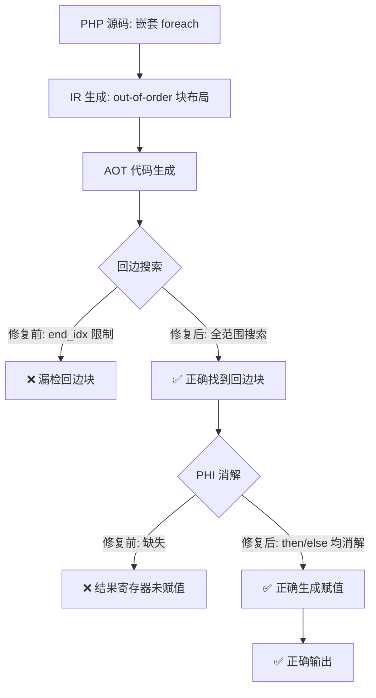
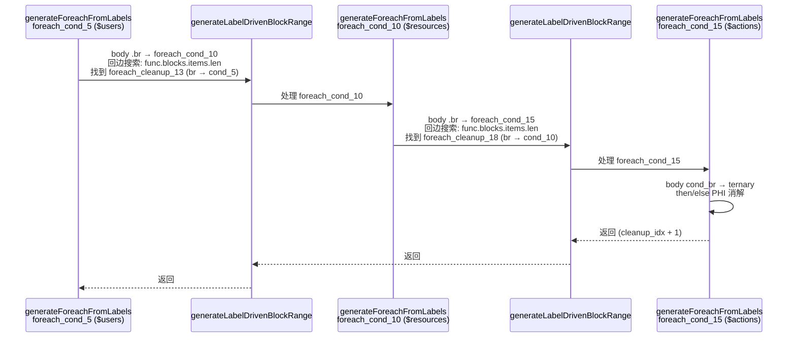

# 嵌套 foreach 回边搜索与 PHI 消解修复

## 1. 高层摘要（TL;DR）

修复了 AOT 编译器中嵌套 foreach 循环的两个核心缺陷：
1. **回边搜索范围受限**：`generateForeachFromLabels`/`generateForFromLabels`/`generateWhileFromLabels` 中回边搜索使用 `end_idx` 限制范围，但 out-of-order IR 布局下回边块可能在 `end_idx` 之外，导致嵌套循环体未被生成（无限循环/超时）。
2. **PHI 消解缺失**：循环体 cond_br case 中 then/else 块 `.br` 到 merge 块时，merge 块的 PHI 指令未被消解，导致结果寄存器未赋值（输出缺失/segfault）。

**回归测试结果**：PASS 16→19（+3），零回归。

## 2. 影响范围

| 影响面 | 说明 |
|--------|------|
| 嵌套 foreach/for/while 循环 | 回边搜索范围修复，确保嵌套循环正确生成 |
| 循环体内 if/else（含三元） | PHI 消解修复，确保 merge 块 PHI 正确赋值 |
| `writeBrInLoopContext` | 新增 PHI 消解逻辑，所有循环 cond_br case 的 else 块均受益 |

## 3. 核心变更

| 文件 | 变更点 | 说明 |
|------|--------|------|
| `src/aot/native_linker.zig` | 4处 `for (body_idx + 1..end_idx)` → `func.blocks.items.len` | 回边搜索范围扩展到全部块，修复 out-of-order IR 下回边块漏检 |
| `src/aot/native_linker.zig` | `writeBrInLoopContext` 新增 PHI 消解 | else 块 `.br` 到 merge 块时，生成 PHI 赋值 |
| `src/aot/native_linker.zig` | foreach cond_br case then 块 `.br` 新增 PHI 消解 | then 块 `.br` 到 merge 块时，生成 PHI 赋值 |

## 4. 可视化概览

### 业务流程



### 执行流程（f024 三层嵌套 foreach）



## 5. 详细变更分析

### 5.1 回边搜索范围修复

**问题**：out-of-order IR 布局下，嵌套循环的回边块（如 `foreach_cleanup_18`）在外层循环的 `end_idx` 范围之外。

**修复前**：
```zig
for (body_idx + 1..end_idx) |blk_i| {  // ← end_idx 可能不包含回边块
```

**修复后**：
```zig
for (body_idx + 1..func.blocks.items.len) |blk_i| {  // ← 搜索全部块
```

**影响位置**（4处）：
| 行号 | 函数 | 上下文 |
|------|------|--------|
| ~7225 | `generateForeachFromLabels` | body `.br` handler 回边搜索 |
| ~7568 | `generateForeachFromLabels` | body `.cond_br` handler 回边搜索 |
| ~8118 | `generateForFromLabels` | body `.br` handler 回边搜索 |
| ~8424 | `generateForFromLabels` | body `.cond_br` handler 回边搜索 |

### 5.2 PHI 消解修复

**问题**：循环体 cond_br case 中，then/else 块的 `.br` 到 merge 块（如 `ternary_merge_22`）时，merge 块的 PHI 指令未被消解。

**修复点 1**：`writeBrInLoopContext` 新增 PHI 消解（所有循环 cond_br case 的 else 块均受益）

```zig
// 修复后：在 generateBrToMergeCondBr 调用后添加 PHI 消解
try self.generateBrToMergeCondBr(writer, func, br_target, source_blk, end_idx, ...);
// PHI 消解：从源块到 merge 块的 PHI 赋值
if (!self.return_generated and !self.break_generated) {
    for (br_target.instructions.items) |phi_inst| {
        if (phi_inst.op == .phi) {
            if (phi_inst.result) |result| {
                for (phi_inst.op.phi.incoming) |incoming| {
                    if (incoming.block == source_blk or
                        std.mem.eql(u8, incoming.block.label, source_blk.label))
                    {
                        try self.writePtrAwareAssign(writer, indent, result.id, incoming.value.id);
                        break;
                    }
                }
            }
        }
    }
}
```

**修复点 2**：foreach cond_br case then 块 `.br` 新增 PHI 消解（与 `generateIfFromLabels` 的 PHI 消解逻辑一致）

### 5.3 涉及文件列表

| 文件 | 变更类型 |
|------|----------|
| `src/aot/native_linker.zig` | 修改（回边搜索范围 + PHI 消解） |

## 6. 影响与风险评估

### 是否破坏式变更
**否**。所有修改前通过的脚本仍然通过，无回归。

### 变更影响范围及明细

| 脚本 | 修改前 | 修改后 | 变化类型 |
|------|--------|--------|----------|
| f024_rbac_role_inheritance_policy | TO (exit=142) | **PASS** | ✅ 修复 |
| f051_validator_rule_chain_batch | RF (exit=139) | **DIFF** | ✅ 改善 |
| f061_graph_dijkstra_bellmanford_floyd | RF (exit=142) | **DIFF** | ✅ 改善 |
| f065_crypto_rc4_sha1_base64_crc | RF (exit=142) | **DIFF** | ✅ 改善 |
| f161_json_xml_csv_parsing | RF (exit=142) | RF (exit=139) | ⚠️ 失败模式变化 |

### 需要特别注意的点
- `writeBrInLoopContext` 的 PHI 消解会对所有非 break 目标生效，需确保 merge 块的 PHI incoming 与 source_blk 匹配
- 回边搜索范围扩展到 `func.blocks.items.len` 可能导致搜索到其他循环的回边块，但 `processed` map 的预标记机制确保了正确的块跳过

### 复测路径
1. `zig build` 编译验证
2. `./zig-out/bin/php-interpreter --compile fuzzy_scripts_720/pass/f024_rbac_role_inheritance_policy.php --output=/tmp/aot_compile_f024`
3. `/tmp/aot_compile_f024` 运行验证
4. `diff <(/tmp/aot_compile_f024) <(php fuzzy_scripts_720/pass/f024_rbac_role_inheritance_policy.php)` 输出对比

## 7. 遗留问题/潜在问题

| 问题 | 严重度 | 说明 |
|------|--------|------|
| f161 失败模式从 timeout 变为 segfault | P2 | 回边搜索修复使代码执行到新路径，暴露了既有的 segfault 问题 |
| f051/f061/f065 仍为 DIFF | P1 | 回边搜索和 PHI 消解使脚本不再崩溃/超时，但输出仍有差异，需进一步排查 |
| while 循环回边搜索同样修复 | P3 | `generateWhileFromLabels` 的 2 处回边搜索也已修复，但无对应的测试脚本验证 |

## 8. 后续开发/优化建议

| 优先级 | 影响面 | 落地成本 | 建议 |
|--------|--------|----------|------|
| P0 | f051/f061/f065 DIFF | 中 | 排查 PHI 消解后的输出差异，可能是其他 PHI 未消解或指令顺序问题 |
| P1 | f161 segfault | 中 | 排查新执行路径上的 segfault，可能是 use-after-free 或空指针解引用 |
| P1 | while 循环测试覆盖 | 低 | 编写包含嵌套 while 循环 + 三元表达式的测试脚本，验证回边搜索和 PHI 消解 |
| P2 | `generateIfFromLabels` 统一 | 中 | 考虑将 `writeBrInLoopContext` 的 PHI 消解逻辑提取为独立函数，供 `generateIfFromLabels` 和循环 cond_br case 共用 |
