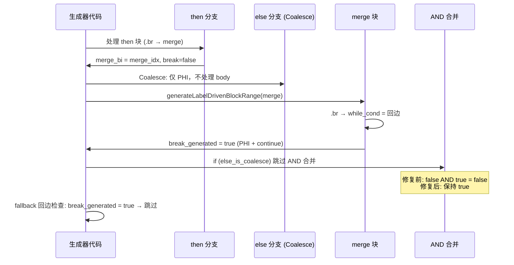
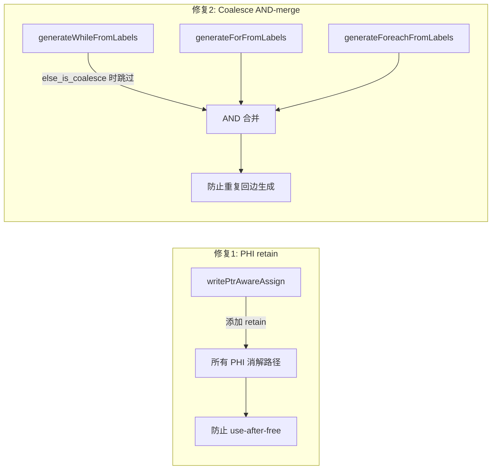

# 变更摘要：PHI 消解 use-after-free 修复与 Coalesce 模式回边重复生成修复

> **日期**: 2026-08-01  
> **Session**: 21  
> **模块**: AOT Native Linker (`src/aot/native_linker.zig`)  
> **Hash**: a3f7c2

---

## 1. 高层摘要 (TL;DR)

本会话修复了两个 AOT 编译器核心缺陷：

1. **PHI 消解 use-after-free**：`writePtrAwareAssign` 函数在生成 PHI 消解赋值代码时，仅执行简单赋值（`reg_A = reg_B`）而不调用 `retain()` 增加引用计数。当源寄存器在函数 cleanup 中被 `release()` 时，对象被释放，结果寄存器（如返回值）变成悬空指针，导致 segfault（exit=139）。

2. **Coalesce 模式回边重复生成**：`generateWhileFromLabels`/`generateForFromLabels`/`generateForeachFromLabels` 中，Coalesce 模式下 merge 块的回边检测设置了 `break_generated = true`，但随后的 then/else AND 合并将其重置为 `false`，导致 fallback 回边生成重复的 PHI + continue 语句，引发 Zig 编译器 "unreachable code" 错误。

**修复效果**：PASS 从 16 → 20（+4），FAIL_RUNTIME 从 23 → 15（-8）。

---

## 2. 影响范围

| 范围 | 影响 |
|------|------|
| `writePtrAwareAssign` | 所有 PHI 消解路径（cond_br then/else、merge 块、回边检测、循环生成器） |
| `generateWhileFromLabels` | while 循环体内含 if/else Coalesce 模式 |
| `generateForFromLabels` | for 循环体内含 if/else Coalesce 模式 |
| `generateForeachFromLabels` | foreach 循环体内含 if/else Coalesce 模式 |
| 回归测试 | fuzzy_scripts_720/pass/ 67 个脚本 |

---

## 3. 核心变更

| # | 文件 | 行号 | 变更描述 |
|---|------|------|----------|
| 1 | `native_linker.zig` | L651-L689 | `writePtrAwareAssign`：在所有非 ref_ptr 赋值后添加 `retain()` |
| 2 | `native_linker.zig` | L7831-L7834 | `generateForeachFromLabels`：Coalesce 模式下不 AND 合并 `break_generated` |
| 3 | `native_linker.zig` | L8843-L8846 | `generateForFromLabels`：Coalesce 模式下不 AND 合并 `break_generated` |
| 4 | `native_linker.zig` | L9533-L9536 | `generateWhileFromLabels`：Coalesce 模式下不 AND 合并 `break_generated` |

---

## 4. 可视化概览

### 4.1 业务流程：PHI 消解与引用计数

```mermaid
graph TD
    A[PHI 消解 writePtrAwareAssign] --> B{result 类型?}
    B -->|alloca| C[reg_X.* = reg_Y.*]
    B -->|ref_ptr| D[reg_X = reg_Y<br/>无需 retain]
    B -->|value| E[reg_X = reg_Y]
    C --> F[_ = reg_X.*.retain&#40;&#41;]
    E --> G[_ = reg_X.retain&#40;&#41;]
    F --> H[✅ result 拥有独立引用计数]
    G --> H
    D --> I[ref_ptr 不拥有值，跳过]
```



### 4.2 执行流程：Coalesce 模式回边检测



### 4.3 变更点代码逻辑映射



---

## 5. 详细变更分析

### 5.1 修复1：PHI 消解 use-after-free

**根因分析**：

`writePtrAwareAssign` 函数用于生成 PHI 消解赋值代码。PHI 节点表示控制流汇合点，某个寄存器从多个前驱块接收值。生成代码形如：

```zig
reg_51 = reg_31;  // PHI 消解：reg_51 从 reg_31 接收值
```

此赋值只是复制 `Value` 结构体（包含指向 PHPObject 的指针），不增加引用计数。当函数 cleanup 释放 `reg_31` 时：

```
对象 ref_count 变化:
  创建时:    ref_count = 1 (reg_31 持有)
  PHI 后:    ref_count = 1 (reg_51 和 reg_31 指向同一对象，但只有 1 个引用)
  cleanup:   reg_31.release() → ref_count = 0 → 对象被释放!
  return:    reg_51 是悬空指针 → segfault
```

**修复方案**：

在 `writePtrAwareAssign` 的所有非 ref_ptr 赋值后添加 `retain()`：

```zig
// value ← value: 普通赋值
try writer.print("{s}reg_{d} = reg_{d};\n", .{ indent, result_id, value_id });
try writer.print("{s}_ = reg_{d}.retain();\n", .{ indent, result_id });  // 新增
```

修复后引用计数：
```
  创建时:    ref_count = 1 (reg_31)
  PHI 后:    ref_count = 2 (reg_31 + reg_51 的 retain)
  cleanup:   reg_31.release() → ref_count = 1 (对象存活)
  return:    reg_51 有效 → caller 使用后 release → ref_count = 0
```

**retain 策略**：
| 赋值类型 | 是否 retain | 原因 |
|----------|-------------|------|
| alloca ← alloca | ✅ `reg_X.*.retain()` | 拷贝值，需要独立引用 |
| alloca ← ref_ptr (ref_param) | ✅ `reg_X.*.retain()` | 写入槽位，需要独立引用 |
| alloca ← ref_ptr (普通) | ❌ | 指针重定向，不拷贝值 |
| alloca ← value | ✅ `reg_X.*.retain()` | 写入内存，需要独立引用 |
| value ← alloca | ✅ `reg_X.retain()` | 读出内存，需要独立引用 |
| ref_ptr ← ref_ptr | ❌ | 指针拷贝，不拥有值 |
| ref_ptr ← value | ❌ | 写入指针，不拥有值 |
| value ← ref_ptr | ✅ `reg_X.retain()` | 读取指针，需要独立引用 |
| value ← value | ✅ `reg_X.retain()` | 普通拷贝，需要独立引用 |

### 5.2 修复2：Coalesce 模式回边重复生成

**根因分析**：

在 `generateWhileFromLabels` 的 body cond_br 处理中，当 `else_is_coalesce = true`（else 块就是 merge 块）时：

1. Coalesce 模式处理 merge 块 → 回边检测 → `break_generated = true`
2. AND 合并：`break_generated = then_breaked AND break_generated`
3. `then_breaked = false`（then 分支没有 break）→ `false AND true = false`
4. Fallback 回边检查：`!break_generated` → true → 生成重复的 PHI + continue

**修复方案**：

Coalesce 模式下，`break_generated` 来自 merge 块（if/else 之后），不应与 then 分支 AND 合并：

```zig
if (else_is_coalesce) {
    // break_generated 保持不变（来自 merge 块的回边检测）
} else {
    self.break_generated = loop_cond_br_then_breaked and self.break_generated;
}
```

---

## 6. 影响与风险评估

### 6.1 回归测试对比

| 指标 | 修复前 (Session 20) | 修复后 (Session 21) | 变化 |
|------|---------------------|---------------------|------|
| PASS | 16 | 20 | **+4** |
| FAIL_COMPILE | 1 | 4 | +3 |
| FAIL_RUNTIME | 23 | 15 | **-8** |
| FAIL_DIFF | 26 | 27 | +1 |
| SKIP | 1 | 1 | 0 |

### 6.2 新增 PASS 脚本

| 脚本 | 旧状态 | 新状态 | 修复原因 |
|------|--------|--------|----------|
| f010_oop_singleton_registry_di | FAIL_RUNTIME (segfault) | PASS | PHI retain 修复 use-after-free |
| f012_json_tree_recursive_traverse | FAIL_DIFF | PASS | PHI retain 修复引用计数 |
| f024_rbac_role_inheritance_policy | FAIL_RUNTIME (exit=142) | PASS | Coalesce AND-merge 修复 |
| f110_os_sim_process_memory_filesystem | FAIL_RUNTIME (segfault) | PASS | PHI retain 修复 use-after-free |

### 6.3 新增 FAIL_COMPILE 脚本

| 脚本 | 旧状态 | 新状态 | 原因 |
|------|--------|--------|------|
| f044_json_deepops_merge_diff | FAIL_DIFF | FAIL_COMPILE | retain 使不可达代码可见 |
| f104_game_engine_ecs_collision_render | FAIL_RUNTIME | FAIL_COMPILE | retain 使不可达代码可见 |
| f105_db_index_btree_hash_queryplan | FAIL_DIFF | FAIL_COMPILE | retain 使不可达代码可见 |
| f177_graph_traversal_dfs_bfs | FAIL_RUNTIME (segfault) | FAIL_COMPILE | retain 使不可达代码可见 |

**注意**：这 4 个脚本的 FAIL_COMPILE 是预先存在的控制流问题（代码生成器在 return/continue 后放置指令），之前被 segfault 掩盖。PHI retain 修复后 segfault 消除，暴露了底层控制流问题。

### 6.4 风险评估

- **是否破坏式变更**：否。所有修改都是增量性的（添加 retain、条件跳过 AND 合并），不影响已有正确路径。
- **内存安全**：retain 保证了 PHI 结果寄存器的引用计数安全，不会引入内存泄漏（cleanup 中的 release 平衡 retain）。
- **性能影响**：retain 对非引用计数类型（int/float/bool/null）是 no-op，对引用计数类型（string/array/object）增加一次原子操作，影响可忽略。

---

## 7. 遗留问题/潜在问题

| # | 问题 | 优先级 | 说明 |
|---|------|--------|------|
| 1 | 4 个脚本的 "unreachable code" 编译错误 | P0 | 预先存在的控制流问题，需修复代码生成器在 return/continue 后放置指令的问题 |
| 2 | f026 exit=133 (SIGBUS) | P1 | 可能是 PHI retain 引入的内存对齐问题，需进一步调查 |
| 3 | 回归测试中 f027/f124 假阳性 | P2 | 并发编译干扰导致，单独测试均通过 |
| 4 | ~27 个 FAIL_DIFF 脚本 | P2 | 输出差异，需逐个分析 |

---

## 8. 后续开发/优化建议

| 优先级 | 建议 | 影响面 | 落地成本 |
|--------|------|--------|----------|
| P0 | 修复 "unreachable code" 编译错误（f044/f104/f105/f177） | 4 个脚本从 FAIL_COMPILE 恢复 | 中 |
| P0 | 调查 f026 SIGBUS (exit=133) | 内存安全 | 中 |
| P1 | 运行 fail_runtime/ 目录的 77 个脚本测试 | 扩大测试覆盖 | 低 |
| P1 | 运行根目录 24 个待测脚本 | 扩大测试覆盖 | 低 |
| P2 | 分析 ~27 个 FAIL_DIFF 脚本根因 | 输出正确性 | 高 |
| P2 | 优化 retain 性能：仅对引用计数类型调用 | 性能 | 低 |
| P2 | 清理 `pending_merge_non_phi` 废弃逻辑 | 代码整洁 | 低 |
