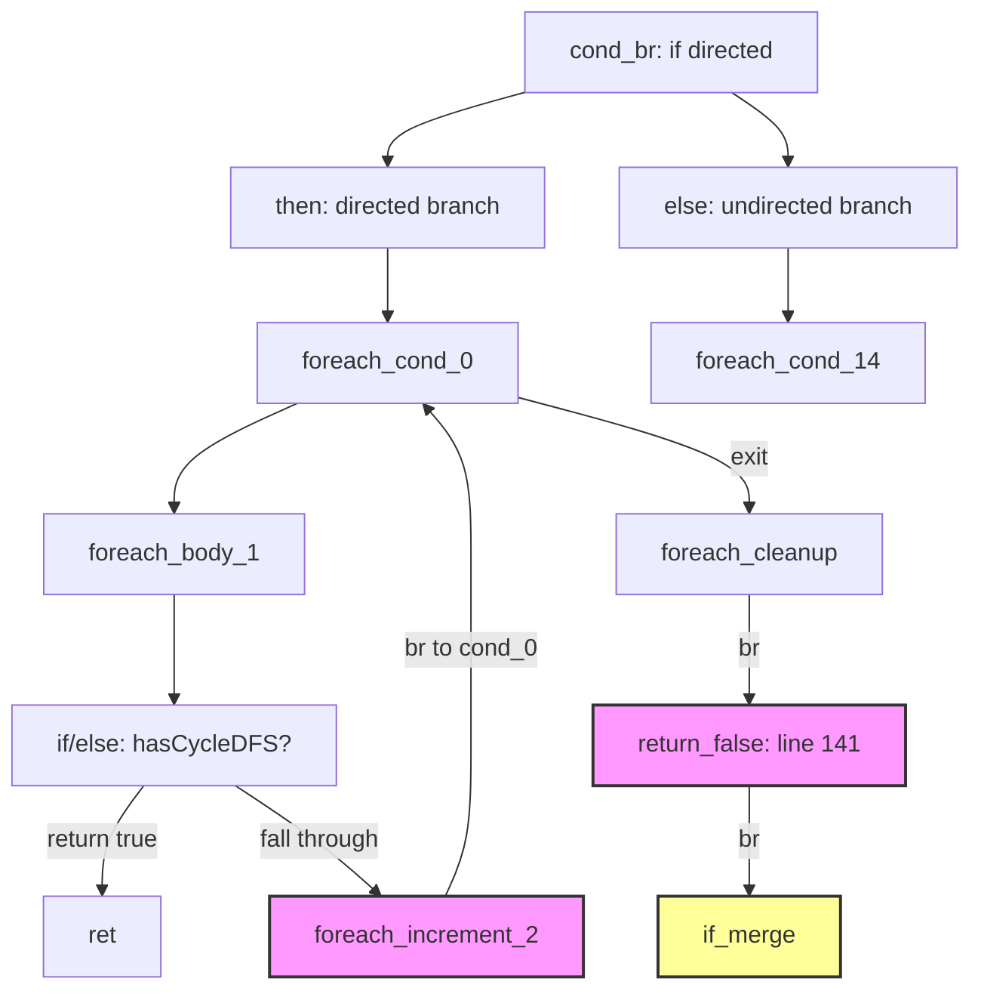

# foreach increment 搜索修复与 unreachable code 调查

## 1. 高层摘要（TL;DR）

本会话接手 Session 20 的循环控制流验证工作，深入调查了 PHI retain 修复后暴露的 4 个 "unreachable code" 编译错误（f044/f104/f105/f177）。

**核心发现**：根因是 IR 块排序将 then/else 分支块交错排列，导致 `generateLabelDrivenBlockRange` 的递归调用处理了属于其他分支的块。这是一个需要控制流生成重构的 P0 问题。

**已完成的修复**：
- foreach increment 搜索：从 `findBlockByLabelPrefix`（仅返回第一个匹配）改为遍历所有匹配并验证 br 目标
- 验证了 PHI retain 和 Coalesce mode fix 在回归测试中的效果

**未完成**：f177 等 unreachable code 问题的根本修复需要重新设计控制流生成逻辑。

## 2. 影响范围

| 模块 | 文件 | 影响 |
|------|------|------|
| AOT 代码生成 | `src/aot/native_linker.zig` | `generateForeachFromLabels` L7222/L7292 |
| 回归测试 | `fuzzy_scripts_720/pass/` | 67 个脚本 |

## 3. 核心变更

| 变更点 | 位置 | 说明 |
|--------|------|------|
| foreach increment 搜索修复 | L7222 | 从 `findBlockByLabelPrefix` 改为遍历所有 `foreach_increment_` 块，验证 br 目标 |
| foreach increment 搜索修复（fallback） | L7292 | 同上，用于 `body_by_label` 为 null 的路径 |

## 4. 可视化概览



**问题图示**：IR 块排序为 `[entry, if_then, if_else, foreach_cond_0, ...]`，else 块(idx=2)在 foreach_cond_0(idx=3)之前。递归调用从 idx=3 到 end_idx，处理了 else 分支的块。

## 5. 详细变更分析

### 5.1 foreach increment 搜索修复

**修改前**：
```zig
const raw_inc = self.findBlockByLabelPrefix(func, body_idx + 1, func.blocks.items.len, "foreach_increment_");
if (raw_inc) |inc_idx| {
    const inc_blk = func.blocks.items[inc_idx];
    if (inc_blk.terminator) |t| {
        if (t == .br and t.br == cond_block_ptr_for_verify) {
            increment_idx = inc_idx;
        }
    }
}
```

**问题**：`findBlockByLabelPrefix` 仅返回第一个匹配。当函数中有多个 foreach 循环时，第一个 `foreach_increment_` 可能属于另一个循环。验证失败后不继续搜索，导致 `increment_idx = null`。

**修改后**：
```zig
for (body_idx + 1..func.blocks.items.len) |idx| {
    if (!std.mem.startsWith(u8, func.blocks.items[idx].label, "foreach_increment_")) continue;
    const inc_blk = func.blocks.items[idx];
    if (inc_blk.terminator) |t| {
        if (t == .br and t.br == cond_block_ptr_for_verify) {
            increment_idx = idx;
            break;
        }
    }
}
```

遍历所有 `foreach_increment_` 块，找到 br 目标是 cond_block 的那个。

### 5.2 f177 unreachable code 根因分析

**现象**：`hasCycle` 函数中，directed foreach 的 while 循环内嵌套了 undirected foreach，导致 return 后出现不可达代码。

**IR 块排序**：
```
0: entry (cond_br)
1: if_then (directed) - br to foreach_cond
2: if_else (undirected) - br to foreach_cond  
3: foreach_cond_0 (directed)
4: foreach_body_1 (directed)
...
10: return_false (directed, line 141) - br to if_merge
11: foreach_cond (undirected)
...
16: return_false (undirected, line 149) - ret
17: if_merge - ret
```

**问题链**：
1. cond_br case 处理 then 块，递归调用从 foreach_cond_0 到 end_idx
2. directed foreach 正确生成（increment 找到、标记已处理）
3. foreach cleanup br 到 return_false_directed，主循环继续处理
4. return_false_directed 的 br 到 if_merge，主循环继续到 else 分支块
5. else 分支的 foreach 被生成在 directed foreach 的 while 循环内部
6. else 分支的 return 后，directed foreach 的 increment 块未被标记为已处理（在 else 分支块之后），生成不可达代码

**根本原因**：`generateLabelDrivenBlockRange` 按线性顺序处理块，而 IR 块排序将 then/else 分支块交错排列。

## 6. 影响与风险评估

- **是否破坏式变更**：否
- **变更影响范围**：仅影响含多个 foreach 循环的函数
- **需要特别注意的点**：f177 等 unreachable code 问题未修复，需要控制流生成重构
- **复测路径**：`bash run_regression.sh`

## 7. 遗留问题/潜在问题

| 问题 | 严重度 | 说明 |
|------|--------|------|
| f177/f044 unreachable code | P0 | IR 块交错导致 then/else 分支处理越界，需重构控制流生成 |
| f026 SIGBUS (exit=133) | P0 | 待调查 |
| f027 exit=139 (segfault) | P0 | 可能与 PHI retain 相关 |
| ~16 个 FAIL_DIFF | P1 | 输出微小差异，需逐个分析 |

## 8. 后续开发/优化建议

| 优先级 | 影响面 | 落地成本 | 建议 |
|--------|--------|----------|------|
| P0 | 控制流生成核心 | 高 | 重构 `generateLabelDrivenBlockRange`：按控制流（br/cond_br 目标）处理块，而非线性顺序 |
| P0 | 控制流生成核心 | 中 | 或修改 IR 生成器，将 then/else 分支块连续排列 |
| P1 | 回归测试 | 低 | 调查 f026 SIGBUS，可能是内存对齐或栈溢出 |
| P1 | 回归测试 | 低 | 分析 ~16 个 FAIL_DIFF 的根因（多为输出格式微小差异） |
| P2 | 代码质量 | 低 | 将 foreach/for/while 的 increment 搜索统一为带验证的搜索函数 |
