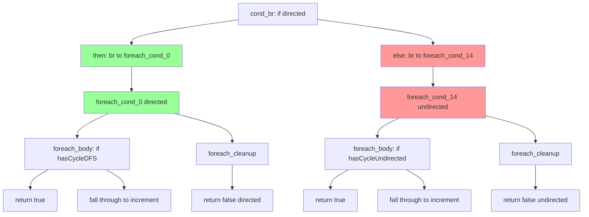

# unreachable code 修复：else_branch_start 范围限制 + cond 块标记

## 1. 高层摘要（TL;DR）

修复了 f177 等脚本中 AOT 编译产生的 "unreachable code" 编译错误。根因是 `generateLabelDrivenBlockRange` 的 cond_br case 中，then 分支的递归调用使用 `end_idx`（全部块范围），导致处理了属于 else 分支的块（如外层 if/else 中 else 分支的 foreach 循环），在错误的位置生成了循环代码。

## 2. 影响范围

| 影响面 | 说明 |
|--------|------|
| f177_graph_traversal_dfs_bfs | ✅ 修复（unreachable code → 编译通过） |
| f044/f104/f105 | ⚠️ 仍有 unreachable code（不同模式：foreach/for/while 内部 cond_br） |
| 其他脚本 | 无回归（改动仅限于 cond_br then 分支递归调用范围限制） |

## 3. 核心变更

| 文件 | 变更点 | 说明 |
|------|--------|------|
| `src/aot/native_linker.zig` L6594-6614 | then 分支递归调用范围限制 | 计算 else 分支的 br 目标作为 `then_end`，限制递归调用不处理 else 分支块 |
| `src/aot/native_linker.zig` L7324-7326 | foreach cond 块标记 | `try processed.put(cond_idx, {})` 防止主循环重复处理 |
| `src/aot/native_linker.zig` L8376-8378 | for cond 块标记 | 同上 |
| `src/aot/native_linker.zig` L9120-9122 | while cond 块标记 | 同上 |

## 4. 可视化概览



**问题流程**：then 分支递归调用 `generateLabelDrivenBlockRange(blk_i=3, end_idx)` → 内部遇到 foreach_cond_14（else 分支）→ 在 directed foreach 内部生成 undirected foreach → unreachable code

**修复流程**：then 分支递归调用 `generateLabelDrivenBlockRange(blk_i=3, then_end=14)` → 范围限制不包含 else 分支块 → cond_br case 正确处理 else 分支

## 5. 详细变更分析

### 5.1 else_branch_start 范围限制

```zig
// 计算 else 分支的起始位置（else 块的 br 目标）
var else_branch_start: ?usize = null;
if (else_bi) |ei| {
    const else_blk = func.blocks.items[ei];
    if (else_blk.terminator) |et| {
        if (et == .br) {
            for (0..func.blocks.items.len) |idx| {
                if (func.blocks.items[idx] == et.br) {
                    else_branch_start = idx;
                    break;
                }
            }
        }
    }
}
const then_end = if (else_branch_start) |es| @min(end_idx, es) else end_idx;
try self.generateLabelDrivenBlockRange(writer, func, blk_i, then_end, ...);
```

**原理**：else 块的 br 目标是 else 分支代码的起始位置。通过将递归调用范围限制到 `then_end`（else 分支起始位置），防止 then 分支处理 else 分支的块。

### 5.2 cond 块标记

在 `generateForeachFromLabels`、`generateForFromLabels`、`generateWhileFromLabels` 中添加：
```zig
try processed.put(cond_idx, {});
```

**原理**：cond 块由循环生成函数处理，但未被标记为已处理。当 cond_br case 的 then 分支递归调用返回后，主循环的 `i += 1` 可能指向 cond 块，导致重复处理。

## 6. 影响与风险评估

- **是否破坏式变更**：否
- **变更影响范围**：仅影响 cond_br case 中 then 分支 br 到控制结构的递归调用路径
- **需要特别注意的点**：`else_branch_start` 仅在 else 块有 .br 终止符时计算，其他终止符类型（如 .ret）不限制范围
- **复测路径**：f177 编译 + 运行 → 验证输出正确

## 7. 遗留问题

| 问题 | 优先级 | 说明 |
|------|--------|------|
| f044/f104/f105 unreachable code | P0 | 不同的 unreachable code 模式，可能需要在 `generateForeachFromLabels` 内部 cond_br case 中应用类似的范围限制 |
| f026 SIGBUS | P0 | 运行时崩溃，需独立调查 |

## 8. 后续开发建议

| 优先级 | 建议 | 影响面 | 落地成本 |
|--------|------|--------|----------|
| P0 | 在 `generateForeachFromLabels`/`generateForFromLabels`/`generateWhileFromLabels` 的 cond_br case 中应用 `else_branch_start` 范围限制 | f044/f104/f105 | 中 |
| P1 | 重构 `generateLabelDrivenBlockRange` 为基于控制流图的处理，而非线性块遍历 | 全部 unreachable code 问题 | 高 |
| P2 | 添加 IR 块排序约束，确保 if/else 分支块不交错 | 从源头消除问题 | 高 |
