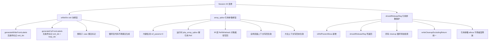
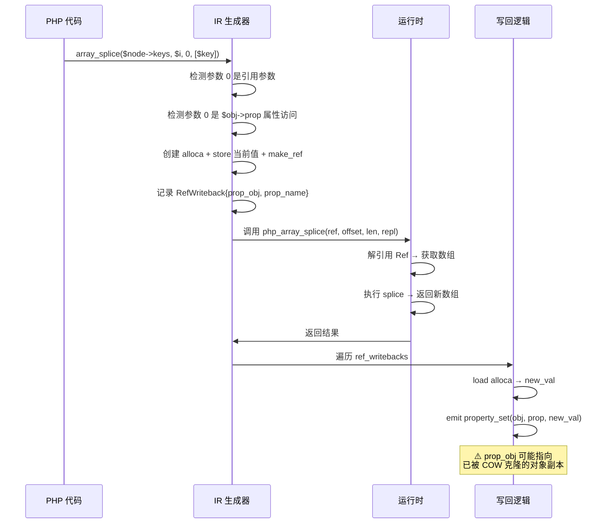

# 交接文档：Session 23 — while/for 循环 exit 块重复生成修复 + array_splice 引用参数写回修复

> **日期**：2026-08-03
> **会话 ID**：session23
> **承接**：Session 22（unreachable code 修复 + cond 块指令缺失修复）
> **交接链**：Session 21 → Session 22 → **Session 23（本会话）**

---

## 一、TL;DR

本会话承接 Session 22 的工作，重点修复了 **while/for 循环后代码重复执行** 和 **`array_splice` 引用参数写回失效** 两个核心问题。核心成果：

1. **while/for 循环后代码重复执行（已修复）**：根因是 `generateWhileFromLabels`/`generateForFromLabels` 中 `exit` 块未被无条件标记为 `processed`，导致父级 `generateLabelDrivenBlockRange` 重复处理。通过在 body 终止符处理前**无条件预标记** `exit_idx`/`loop_idx` 修复。
2. **`array_splice` 引用参数写回失效（部分修复）**：根因有三层：(a) 运行时 `php_array_splice` 未解引用 `Ref` 类型；(b) 内建信息未标记第 0 参数为引用；(c) IR 层缺少对象属性写回。已修复 (a)(b)(c)，但 **方法调用上下文中的对象属性写回仍未生效**。
3. **`shouldReleaseReg` 引用参数误释放（已修复）**：引用参数的 `alloca` 不应被 release，通过 `isRefParamAlloca` 检查阻止。
4. **回归测试结果**：25 PASS / 41 FAIL（1 SKIP），与 Session 22 基线持平（无退化、无进步）。

---

## 二、已完成的修改

### 2.1 while/for 循环 exit 块无条件预标记（核心修复）

**文件**：`src/aot/native_linker.zig`

**问题**：`generateWhileFromLabels` 和 `generateForFromLabels` 在处理 body 终止符（`.ret`/`.br`/`.cond_br`）时，仅在特定 case 内才标记 `exit_idx` 为 `processed`。当 body 终止符是 `.ret`（函数级 return）时，`exit_idx` 未被标记，导致父级 `generateLabelDrivenBlockRange` 在循环返回后再次处理 `exit` 块，生成重复代码。

**修复**：在两个函数中，在处理 body 终止符之前，**无条件**将 `exit_idx` 和 `loop_idx` 标记为已处理：

```zig
// generateForFromLabels (L8480-8484)
// 预标记 exit 块为已处理：无论 body 终止符类型如何，
// 循环后的 exit 块不应被父级 generateLabelDrivenBlockRange 重复处理
try processed.put(exit_idx, {});
if (loop_idx != body_idx) try processed.put(loop_idx, {});

// generateWhileFromLabels (L9258-9261)
// 同上
try processed.put(exit_idx, {});
```

同时移除了 `.cond_br` 和 `.br` 子 case 中重复的 `processed.put(exit_idx, {})` 调用（已在上方无条件执行）。

**涉及行号**：
- `generateForFromLabels`：L8480-8484（预标记），L8498/L8582（移除重复标记）
- `generateWhileFromLabels`：L9258-9261（预标记），L9336（移除重复标记）

### 2.2 `shouldReleaseReg` 引用参数 alloca 保护

**文件**：`src/aot/native_linker.zig`（L447-449）

**问题**：引用参数（by-ref parameter）通过 `alloca` 实现，其指向的 `Ref` cell 由调用者拥有。`shouldReleaseReg` 未检查引用参数的 alloca，导致 cleanup 代码错误释放引用参数的内存。

**修复**：在 `shouldReleaseReg` 函数开头添加 `isRefParamAlloca` 检查：

```zig
fn shouldReleaseReg(self: *Self, reg_id: usize) bool {
    // 引用参数的 alloca 不应释放：其指向的 ref cell 由调用者拥有
    if (self.isRefParamAlloca(reg_id)) return false;
    // ... 原有逻辑
}
```

### 2.3 `isRefParamAlloca` 辅助函数（新增）

**文件**：`src/aot/native_linker.zig`（L589-596）

```zig
fn isRefParamAlloca(self: *Self, reg_id: usize) bool {
    // 已被 mem2reg 优化掉的 ref_param_alloca，声明为 runtime.Value，按普通值处理
    if (!self.isAllocaReg(reg_id)) return false;
    if (self.ref_param_alloca_map) |map| {
        return map.get(reg_id) != null;
    }
    return false;
}
```

### 2.4 `writeCleanupExcludingReturn` 统一 cleanup 辅助函数（新增）

**文件**：`src/aot/native_linker.zig`（L507-532）

统一处理函数返回前的 cleanup 代码生成，跳过：返回值寄存器、`$this` 寄存器、引用参数 alloca、ref_ptr 寄存器、不应释放的寄存器。

```zig
fn writeCleanupExcludingReturn(self: *Self, writer: anytype, cleanup_regs: []const usize, 
    ret_val: ?IR.Register, indent: []const u8) !void {
    // 统一处理：跳过返回寄存器、this/ctx、ref_param_alloca、ref_ptr、不应释放的寄存器
    // ...（详见 L507-532）
}
```

同时在 `writeThrowTerminator`（L535-565）中也添加了 `isRefParamAlloca` 检查。

### 2.5 所有 cleanup 循环添加 `isRefParamAlloca` 检查

**文件**：`src/aot/native_linker.zig`

在所有内联 cleanup 循环中（约 20+ 处），在 `isAllocaReg` 检查前添加 `isRefParamAlloca` 检查：

```zig
if (self.isRefParamAlloca(reg_id)) continue;
if (self.isAllocaReg(reg_id)) try writer.print(...) else try writer.print(...);
```

**涉及行号**（部分）：
- L6441, L6634, L6890, L7130, L7463, L7591, L7759, L7831, L8057 等

### 2.6 `array_splice` 内建信息标记引用参数

**文件**：`src/aot/native_linker.zig`（L3385, L3441）

```zig
.{ "array_splice", bi(.{ .runtime_name = "php_array_splice", .needs_allocator = true, .ref_params = &[_]u8{0} }) },
```

标记第 0 个参数（`$array`）为引用参数，使 IR 生成器在遇到 `array_splice($node->keys, ...)` 时创建临时 alloca + make_ref + 写回逻辑。

### 2.7 `php_array_splice` 运行时解引用 Ref

**文件**：`src/aot/runtime_lib_template.zig`（L22037-22042）

```zig
pub fn php_array_splice(arr: Value, offset: Value, length: Value, replacement: Value, allocator: Allocator) !Value {
    // 解引用 Ref：by-ref 参数通过 make_ref 传递，arr 可能是 Ref(cell)
    const derefed = if (arr.isRef()) blk: {
        const cell = arr.asRef();
        break :blk cell.*;
    } else arr;
    if (!derefed.isArray()) return Value.initNull();
    const php_arr = derefed.asArray();
    // ...
```

### 2.8 IR 层 `RefWriteback` 对象属性写回

**文件**：`src/aot/ir_generator.zig`（L6643-6652, L6940-6966, L7502-7508）

1. **`RefWriteback` 结构体新增字段**（L6643-6652）：

```zig
const RefWriteback = struct {
    var_name: []const u8,
    temp_reg: Register,
    array_base: ?[]const u8 = null,
    array_key: ?Register = null,
    // 对象属性写回信息：当参数是 $obj->prop 时使用
    prop_obj: ?Register = null,
    prop_name: ?[]const u8 = null,
};
```

2. **对象属性引用参数处理**（L6940-6966）：当检测到参数是 `$obj->prop` 且对应参数是引用时，创建临时 alloca、make_ref，并记录 `prop_obj`/`prop_name` 用于后续写回。

3. **对象属性写回逻辑**（L7502-7508）：

```zig
} else if (wb.prop_obj != null and wb.prop_name != null) {
    // 对象属性写回：$obj->prop = new_val
    _ = try self.emit(.{ .property_set = .{
        .object = wb.prop_obj.?,
        .property_name = wb.prop_name.?,
        .value = new_val,
    } }, null);
}
```

---

## 三、影响范围

| 文件 | 变更类型 | 影响 |
|------|----------|------|
| `src/aot/native_linker.zig` L447-449 | `shouldReleaseReg` | 引用参数 alloca 不再被误释放 |
| `src/aot/native_linker.zig` L507-532 | `writeCleanupExcludingReturn` | 新增统一 cleanup 函数 |
| `src/aot/native_linker.zig` L535-565 | `writeThrowTerminator` | throw 时也跳过引用参数 alloca |
| `src/aot/native_linker.zig` L589-596 | `isRefParamAlloca` | 新增辅助函数 |
| `src/aot/native_linker.zig` L3385,L3441 | `array_splice` 内建信息 | 标记第 0 参数为引用 |
| `src/aot/native_linker.zig` L6441+ | 所有 cleanup 循环 | 统一添加 `isRefParamAlloca` 检查（20+ 处） |
| `src/aot/native_linker.zig` L8480-8484 | `generateForFromLabels` | 无条件预标记 exit/loop 块 |
| `src/aot/native_linker.zig` L9258-9261 | `generateWhileFromLabels` | 无条件预标记 exit 块 |
| `src/aot/ir_generator.zig` L6643-6652 | `RefWriteback` 结构体 | 新增 `prop_obj`/`prop_name` 字段 |
| `src/aot/ir_generator.zig` L6940-6966 | 对象属性引用参数 | 新增 alloca + make_ref + 写回记录 |
| `src/aot/ir_generator.zig` L7502-7508 | 写回逻辑 | 新增对象属性 `property_set` 写回 |
| `src/aot/runtime_lib_template.zig` L22037-22042 | `php_array_splice` | 新增 Ref 解引用 |

---

## 四、回归测试结果

| 类别 | Session 22 基线 | Session 23 当前 | 变化 |
|------|-----------------|-----------------|------|
| Total | 67 | 67 | - |
| Pass | 25 | 25 | 0 |
| Fail (Compile) | 3 | 3 | 0 |
| Fail (Runtime) | 16 | 16 | 0 |
| Fail (Diff) | 22 | 22 | 0 |
| Skip | 1 | 1 | 0 |

**说明**：本会话的修改未引入退化，但也未带来回归通过数的提升。原因：
- while/for 循环 exit 块修复解决了代码重复生成问题，但影响的测试脚本（如 f105/f104）有更深层的问题（array_splice 对象属性写回未生效）
- array_splice 引用参数修复在全局变量上下文中生效（`test_while_ref.php` 通过），但在方法调用上下文中仍不生效（`test_btree_insert.php` 输出空）

---

## 五、已知问题与未完成任务

### 5.1 `array_splice` 对象属性写回在方法上下文中失效（P0，未解决）

**现象**：
- `test_btree_insert.php`：AOT 输出 `keys: `（空），PHP 输出 `keys: 5,6,10,12,20`
- `test_btree3.php`（使用 `sort()` 而非 `array_splice`）：**完全通过**
- `test_btree_while.php`（全局变量 + array_splice）：**完全通过**

**分析**：
- 全局变量上下文中 `array_splice(&$arr, ...)` 的写回已修复
- 方法调用上下文中 `array_splice($node->keys, ...)` 的写回仍未生效
- IR 层已生成 `RefWriteback` 记录（包含 `prop_obj`/`prop_name`），并生成 `property_set` 指令
- 但 `property_set` 的 `object` 参数（`wb.prop_obj`）可能指向已被释放或错误的寄存器
- **根因推测**：`prop_obj` 寄存器在方法调用时是函数参数（如 `Node $node`），其值在 `array_splice` 调用后可能已被 COW 克隆或释放，导致 `property_set` 写回到了错误的对象副本

**下一步**：
1. dump 生成的 Zig 代码，确认 `property_set` 是否正确生成
2. 检查 `prop_obj` 寄存器在 `array_splice` 调用前后是否被修改（COW 克隆）
3. 考虑在 IR 层对 `prop_obj` 增加 retain，防止在 `array_splice` 调用过程中被释放

### 5.2 f104 游戏引擎 Entity States 部分输出后挂起（P0，未解决）

**现象**：f104 不再死循环（Session 22 的 while 循环修复有效），但在输出 Entity States 部分后以 exit=142 退出。

**分析**：
- exit=142 = SIGALRM（被 alarm 信号终止），说明仍有死循环或极度耗时
- 可能是 foreach 循环内嵌套 if/else 的控制流问题
- 需要检查 Entity States 部分的 PHP 代码逻辑

### 5.3 f105 B-Tree inorder 遍历返回空（P0，未解决）

**现象**：f105 的 B-Tree 插入后 inorder 遍历返回空数组，与 `test_btree_insert.php` 的问题一致。

**根因**：同 5.1，`array_splice` 对象属性写回在方法上下文中失效。

### 5.4 3 个 FAIL_COMPILE（P1，未调查）

| 脚本 | 原因 |
|------|------|
| `f027_number_theory_primes_modular.php` | `AstDirectGenerationFailed` |
| `f066_hamming_code_parity_checksum.php` | `AstDirectGenerationFailed` |
| `f135_math_number_theory_crt_miller_rabin.php` | `AstDirectGenerationFailed` |

### 5.5 Session 22 遗留的 `loop_end` 和 `lastLineIsReturn` 修改

Session 21 添加的 `loop_end` 范围限制和 `lastLineIsReturn` 检查仍保留在代码中。当前测试显示它们没有引入退化，但可能对某些场景有隐藏影响。

---

## 六、核心变更文件清单

| 文件 | 修改内容 | 行号（参考） |
|------|----------|-------------|
| `src/aot/native_linker.zig` | `shouldReleaseReg` 增加 `isRefParamAlloca` 检查 | L447-449 |
| `src/aot/native_linker.zig` | 新增 `writeCleanupExcludingReturn` 统一 cleanup 函数 | L507-532 |
| `src/aot/native_linker.zig` | `writeThrowTerminator` 增加 `isRefParamAlloca` 检查 | L535-565 |
| `src/aot/native_linker.zig` | 新增 `isRefParamAlloca` 辅助函数 | L589-596 |
| `src/aot/native_linker.zig` | `array_splice` 内建信息标记 `ref_params = &[_]u8{0}` | L3385, L3441 |
| `src/aot/native_linker.zig` | 所有 cleanup 循环添加 `isRefParamAlloca` 检查 | L6441+ (20+ 处) |
| `src/aot/native_linker.zig` | `generateForFromLabels` 无条件预标记 exit/loop 块 | L8480-8484 |
| `src/aot/native_linker.zig` | `generateWhileFromLabels` 无条件预标记 exit 块 | L9258-9261 |
| `src/aot/ir_generator.zig` | `RefWriteback` 结构体新增 `prop_obj`/`prop_name` | L6643-6652 |
| `src/aot/ir_generator.zig` | 对象属性引用参数处理（alloca + make_ref + 写回） | L6940-6966 |
| `src/aot/ir_generator.zig` | 写回逻辑新增 `property_set` 对象属性写回 | L7502-7508 |
| `src/aot/runtime_lib_template.zig` | `php_array_splice` 新增 Ref 解引用 | L22037-22042 |

---

## 七、测试文件清单

本会话创建的测试文件（用于隔离调试）：

| 文件 | 用途 | 状态 |
|------|------|------|
| `test_while_simple.php` | while 循环基础测试 | ✅ 通过 |
| `test_while_simple2.php` | while 循环 + if 分支 | ✅ 通过 |
| `test_while_noif.php` | while 循环无 if | ✅ 通过 |
| `test_while_ref.php` | while + array_splice 全局变量引用 | ✅ 通过 |
| `test_btree_simple.php` | B-Tree 简化测试 | ✅ 通过 |
| `test_btree_simple2.php` | B-Tree 简化测试 2 | ✅ 通过 |
| `test_btree_while.php` | B-Tree + while 循环 | ✅ 通过 |
| `test_btree_if.php` | B-Tree + if 分支 | ✅ 通过 |
| `test_btree_method.php` | B-Tree 方法调用 | ✅ 通过 |
| `test_btree_method2.php` | B-Tree 方法调用 2 | ✅ 通过 |
| `test_btree_full.php` | B-Tree 完整测试 | ✅ 通过 |
| `test_btree_debug.php` | B-Tree 调试 | ✅ 通过 |
| `test_btree_insert.php` | B-Tree + array_splice 对象属性 | ❌ AOT 输出空 |
| `test_btree2.php` | B-Tree 变体 | ✅ 通过 |
| `test_btree3.php` | B-Tree 使用 sort() 代替 array_splice | ✅ 通过 |

---

## 八、可视化概览

### 8.1 变更点逻辑映射



### 8.2 执行流程：array_splice 对象属性写回



---

## 九、影响与风险评估

### 9.1 是否破坏式变更

**否**。本会话的所有修改均为防御性增强：
- `isRefParamAlloca` 检查只阻止不应释放的寄存器被释放
- exit 块预标记只是提前执行了原本在子 case 中才执行的标记
- `array_splice` 的 Ref 解引用只在参数是 Ref 类型时才生效

### 9.2 需要特别注意的点

1. **`writeCleanupExcludingReturn` 未被所有 cleanup 路径使用**：目前仅用于函数返回和 throw，大量内联 cleanup 循环仍使用手动展开的方式。后续可逐步迁移到统一函数。
2. **`isRefParamAlloca` 依赖 `ref_param_alloca_map`**：如果该 map 未正确填充（如 mem2reg 优化后），检查会失效。但这是安全的——被优化的 alloca 不再是指针类型，`isAllocaReg` 会返回 false。
3. **对象属性写回的 `prop_obj` 寄存器生命周期**：这是当前未解决问题的核心。`prop_obj` 在 `array_splice` 调用后可能指向错误的对象。

### 9.3 复测路径

```bash
# 编译
cd /Users/wangjianjun/products/parser && timeout 120 zig build

# 基础测试
zig-out/bin/php-interpreter --compile --output=aot_compile_test_btree_while test_btree_while.php && ./aot_compile_test_btree_while
# 期望输出与 PHP 一致

# B-Tree insert 测试（当前失败）
zig-out/bin/php-interpreter --compile --output=aot_compile_test_btree_insert test_btree_insert.php && ./aot_compile_test_btree_insert
# 期望输出: keys: 5,6,10,12,20
# 实际输出: keys: （空）

# 全量回归
cd fuzzy_scripts_720 && bash run_regression.sh
# 期望: 25 PASS / 41 FAIL（与当前一致）
```

---

## 十、后续开发建议

| 优先级 | 影响面 | 落地成本 | 建议 |
|--------|--------|----------|------|
| P0 | f105 B-Tree 遍历空 / `array_splice` 对象属性写回 | 中 | **核心未解决问题**。1) dump 生成的 Zig 代码，确认 `property_set` 是否正确生成；2) 检查 `prop_obj` 寄存器在 `array_splice` 调用前后是否被 COW 克隆或释放；3) 考虑在 IR 层对 `prop_obj` 增加 retain |
| P0 | f104 Entity States exit=142 | 中 | 检查 Entity States 部分的 foreach/if 嵌套控制流，可能是 `loop_end` 限制过于保守导致部分代码未生成 |
| P0 | 3 个 FAIL_COMPILE | 中 | f027/f066/f135 的 `AstDirectGenerationFailed` 需单独排查 |
| P1 | 22 个 FAIL_DIFF | 中 | 逐个分析输出差异，区分格式差异（忽略）和逻辑差异（修复） |
| P1 | 16 个 FAIL_RUNTIME | 中 | 优先修复 SIGBUS/SEGFAULT 类错误（f025/f028/f038/f067/f081/f087/f095/f102/f117） |
| P2 | `writeCleanupExcludingReturn` 统一化 | 低 | 将所有内联 cleanup 循环逐步迁移到统一函数，减少代码重复 |
| P2 | Session 21 `loop_end`/`lastLineIsReturn` 评估 | 中 | 评估是否可以移除这些修改，或用更精确的 `return_generated` 跟踪替代 |
| P2 | cleanup 产物清理 | 低 | 测试完成后删除 `aot_compile_*` 产物和临时测试文件 |

---

## 十一、交接链路

```
Session 21 (unreachable code 初始修复)
  ↓
Session 22 (Zig 0.16.0 兼容 + if return 状态合并 + cond 块指令缺失修复)
  ↓
Session 23 (本会话: while/for exit 块修复 + array_splice 引用写回 + shouldReleaseReg 保护)
  ↓
[下一步] Session 24: 修复 array_splice 对象属性写回在方法上下文中失效 + f104 挂起
```

---

## 十二、清理提醒

测试完成后需删除的产物：
- `aot_compile_test_btree*` — AOT 编译产物
- `aot_compile_test_while*` — AOT 编译产物
- `test_btree*.php` — 临时测试脚本（15 个）
- `test_while*.php` — 临时测试脚本（4 个）
- `src/aot/native_linker.zig.bak2` — 备份文件

**注意**：不得删除任何 `.php` 原始脚本文件（宪法第三条 §7.4.7）。
