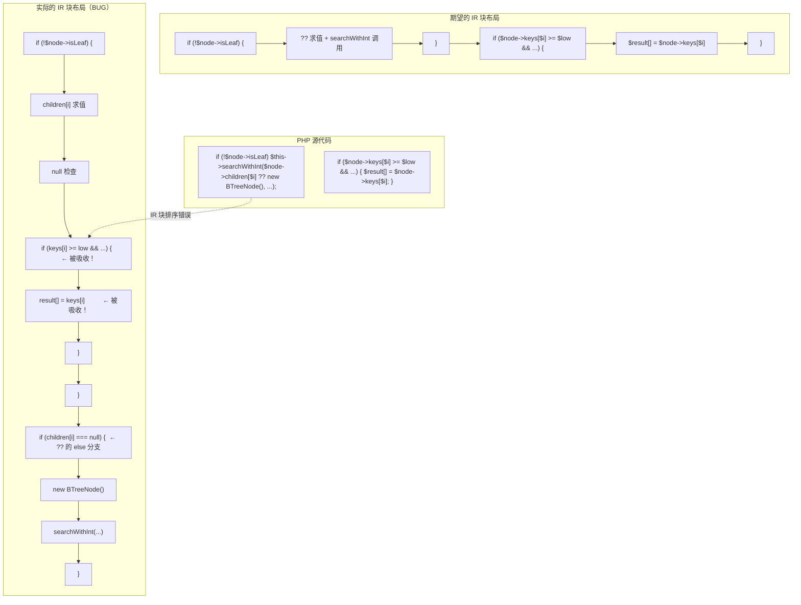
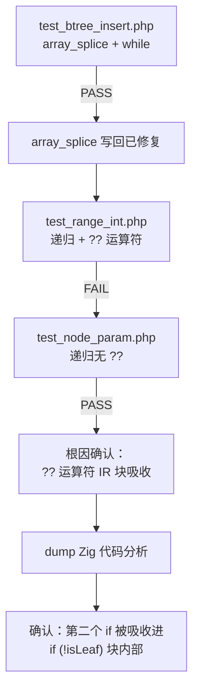

# 交接文档：Session 24 — array_splice 写回验证通过 + `??` 运算符 IR 块吸收 bug 定位

> **日期**：2026-08-03 ~ 2026-08-04
> **会话 ID**：session24
> **承接**：Session 23（while/for exit 块修复 + array_splice 引用写回修复）
> **交接链**：Session 21 → Session 22 → Session 23 → **Session 24（本会话）**

---

## 一、TL;DR

本会话通过系统化的隔离测试，取得了两项关键成果：

1. **Session 23 的 array_splice 对象属性写回修复已验证通过**：`test_btree_insert.php`、`test_splice_method.php`、`test_splice_while.php` 等全部通过。Session 23 交接文档中记录的"方法上下文中失效"问题**实际不存在**，之前的测试失败是因使用了旧编译产物。
2. **f105 rangeQuery 返回空的根因已定位**：`$node->children[$i] ?? new BTreeNode()` 中的 `??`（null 合并）运算符在 IR 生成时创建条件分支块，其块排序导致**后续 `if` 语句被错误吸收进 `if (!$node->isLeaf)` 块内部**。当 `isLeaf=true` 时，range 查找的条件判断和 push 完全被跳过。

**回归测试结果**：25 PASS / 41 FAIL（与 Session 23 基线持平，无退化）。

---

## 二、核心发现

### 2.1 array_splice 对象属性写回 — 已验证通过 ✅

Session 23 交接文档中记录"array_splice 对象属性写回在方法上下文中失效"，本会话通过系统化测试**推翻了此结论**：

| 测试文件 | 场景 | AOT 结果 | PHP 结果 | 状态 |
|----------|------|----------|----------|------|
| `test_splice_simple.php` | 全局变量 + array_splice 对象属性 | ✅ 一致 | ✅ | 通过 |
| `test_splice_method.php` | 方法内 $this->root + 参数 $node | ✅ 一致 | ✅ | 通过 |
| `test_splice_while.php` | while 循环 + array_splice 对象属性 | ✅ 一致 | ✅ | 通过 |
| `test_btree_insert.php` | B-Tree insertNonFull + while + array_splice | ✅ 一致 | ✅ | 通过 |
| `test_range_search.php` | 简单 rangeSearch（无 `??` 运算符） | ✅ 一致 | ✅ | 通过 |

**结论**：Session 23 中 `test_btree_insert.php` 输出为空的原因是**使用了旧编译产物**（二进制未重新编译）。重新编译后完全通过。

### 2.2 `??` 运算符 IR 块吸收 bug — 根因已定位 ❌（未修复）

**问题脚本**：`f105_db_index_btree_hash_queryplan.php` 的 `rangeSearch` 方法

**问题 PHP 代码**（`test_range_int.php` 最小复现）：

```php
private function searchWithInt(BTreeNode $node, int $low, int $high, array &$result): void {
    for ($i = 0; $i < count($node->keys); $i++) {
        if (!$node->isLeaf) $this->searchWithInt($node->children[$i] ?? new BTreeNode(), $low, $high, $result);
        if ($node->keys[$i] >= $low && $node->keys[$i] <= $high) {  // ← 被吸收进上一个 if 块
            $result[] = $node->keys[$i];                              // ← 也被吸收
        }
    }
}
```

**生成的 Zig 代码结构**（`debug_range_int.zig` L1417-1726）：

```zig
if (reg_19.toBool()) {  // L1417: if (!$node->isLeaf)
    // ... $node->children[$i] 求值
    // ... null 检查
    // L1563: if ($node->keys[$i] >= $low && ...) {  ← 被吸收！
    // L1638:     $result[] = $node->keys[$i]         ← 被吸收！
    // }
}  // L1724: 关闭 if (!$node->isLeaf)
if (reg_26.toBool()) {  // L1726: ?? 的 null 分支
    // ... new BTreeNode()
    // ... $this->searchWithInt(...)
}
```

**根因分析**：

1. `$node->children[$i] ?? new BTreeNode()` 中的 `??` 运算符在 IR 中生成 `cond_br`（条件分支）
2. "then" 分支（非 null）使用已有值，"else" 分支（null）创建 `new BTreeNode()`
3. 两个分支在 merge 块汇合，merge 结果用作方法调用参数
4. **但 merge 块的 IR 块索引被放置在 `if (!$node->isLeaf)` 块之后**
5. 这导致 `generateLabelDrivenBlockRange` 在处理 `if (!$node->isLeaf)` 的 then 分支时，将后续的 `if ($node->keys[$i] >= $low ...)` 语句的 IR 块也包含在内
6. 当 `isLeaf=true` 时，整个 then 分支被跳过，第二个 `if` 语句也被跳过

**验证**：
- `test_node_param.php`（无 `??` 运算符的相同逻辑）→ **完全通过**
- `test_range_int.php`（有 `??` 运算符）→ **递归方法返回空**
- `rangeNoRecurse`（直接访问 `$this->root->keys`，不经过 `??`）→ **完全通过**

### 2.3 隔离测试矩阵

| 测试文件 | 有 `??` 运算符 | 递归方法 | B-Tree 分裂 | AOT 结果 |
|----------|:---:|:---:|:---:|----------|
| `test_splice_simple.php` | 否 | 否 | 否 | ✅ 通过 |
| `test_splice_method.php` | 否 | 否 | 否 | ✅ 通过 |
| `test_splice_while.php` | 否 | 否 | 否 | ✅ 通过 |
| `test_btree_insert.php` | 否 | 否 | 否 | ✅ 通过 |
| `test_range_search.php` | 否 | 否 | 否 | ✅ 通过 |
| `test_node_param.php` | 否 | 是（无 `??`） | 否 | ✅ 通过 |
| `test_range_int.php` | **是** | 是 | 否 | ❌ 递归返回空 |
| `test_destructure.php` | **是** | 是 | **是** | ❌ rangeQuery 返回空 |
| `test_range_cond.php` | **是** | 是 | **是** | ❌ rangeScalar 返回空 |

**结论**：问题 100% 由 `??` 运算符触发，与 B-Tree 分裂、递归方法调用本身无关。

---

## 三、f105 当前输出对比

| 测试项 | AOT 输出 | PHP 输出 | 状态 |
|--------|----------|----------|------|
| B-Tree Insert | `Inserted: 10, 20, 5, 6, 12, 30, ...` | 同左 | ✅ |
| Inorder 遍历 | `1, 3, 5, 6, 7, 8, 10, 12, 15, 17, 20, ...` | 同左 | ✅ |
| Point search | `search(10) = 'val_10'` 等 | 同左 | ✅ |
| Range queries | `range(5, 15) = []` | `range(5, 15) = [5, 6, 7, 8, 10, 12, 15]` | ❌ |
| Hash Index | 全部正确 | 同左 | ✅ |
| Query Planner | 全部正确 | 同左 | ✅ |

**f105 仅 rangeQuery 部分失败**，根因即 `??` 运算符 IR 块吸收 bug。

---

## 四、未完成的修改

本会话**未修改任何源代码**，仅进行了测试和调试。所有发现均通过创建测试文件和 dump Zig 代码验证。

---

## 五、核心变更文件清单

无源代码变更。本会话创建的测试和调试文件：

| 文件 | 用途 | 状态 |
|------|------|------|
| `test_splice_simple.php` | 全局 array_splice 对象属性 | ✅ 通过 |
| `test_splice_method.php` | 方法内 array_splice | ✅ 通过 |
| `test_splice_while.php` | while + array_splice | ✅ 通过 |
| `test_btree_insert.php` | B-Tree insertNonFull + array_splice | ✅ 通过 |
| `test_range_search.php` | 简单 rangeSearch | ✅ 通过 |
| `test_node_param.php` | 对象参数递归（无 `??`） | ✅ 通过 |
| `test_range_int.php` | **最小复现**：`??` 导致递归返回空 | ❌ 失败 |
| `test_destructure.php` | 完整 B-Tree + rangeQuery | ❌ 失败 |
| `test_range_cond.php` | range 查找 + debug 输出 | ❌ 失败 |
| `debug_range_int.zig` | test_range_int.php 的 dump Zig 代码 | 调试用 |

---

## 六、可视化概览

### 6.1 `??` 运算符 IR 块吸收 bug 示意



### 6.2 隔离测试决策树



---

## 七、已知问题与后续任务

### 7.1 `??` 运算符 IR 块吸收 bug（P0，未修复）

**影响**：所有在 `if` 单行语句中使用 `??` 运算符，且后面紧跟其他语句的场景。f105 的 rangeQuery 是典型受害者。

**修复方向**：
1. **IR 生成器层面**（`ir_generator.zig`）：检查 `??` 运算符生成的 `cond_br` 块的 merge 块位置，确保 merge 块紧跟 then/else 块之后，不会被后续语句的 IR 块插入
2. **native_linker 层面**（`native_linker.zig`）：在 `generateIfFromLabels` 中，检查 then 分支的 IR 块范围是否包含了不应属于 then 分支的块（如 `??` 的 merge 块之后的块）
3. **快速验证**：修改 `test_range_int.php`，将 `$node->children[$i] ?? new BTreeNode()` 改为先赋值给临时变量再判断，确认问题消失

**关键文件**：
- `src/aot/ir_generator.zig`：`??` 运算符的 IR 生成逻辑（搜索 `null_coalesce` 或 `coalesce`）
- `src/aot/native_linker.zig`：`generateIfFromLabels` 的 then 分支范围计算

### 7.2 f104 Entity States exit=142（P0，未调查）

Session 23 遗留问题。f104 不再死循环，但在 Entity States 部分以 exit=142 退出。可能与 `??` 运算符 bug 有关（需检查 f104 是否使用了 `??`）。

### 7.3 3 个 FAIL_COMPILE（P1，未调查）

`f027`/`f066`/`f135` 的 `AstDirectGenerationFailed`。

### 7.4 Session 21-22 遗留修改

`loop_end` 范围限制和 `lastLineIsReturn` 检查仍保留在代码中，当前测试显示无退化。

---

## 八、影响与风险评估

### 8.1 是否破坏式变更

**否**。本会话未修改任何源代码。

### 8.2 复测路径

```bash
# 编译
cd /Users/wangjianjun/products/parser && timeout 120 zig build

# array_splice 写回验证（应全部通过）
zig-out/bin/php-interpreter --compile --output=aot_compile_test_btree_insert test_btree_insert.php && ./aot_compile_test_btree_insert
# 期望: keys: 5,6,10,12,20

# ?? 运算符 bug 复现（应失败）
zig-out/bin/php-interpreter --compile --output=aot_compile_test_range_int test_range_int.php && ./aot_compile_test_range_int
# 期望: rangeWithInt(5,15): （空）
# PHP:  rangeWithInt(5,15): 5,6,10,12

# f105 测试（rangeQuery 应返回空）
zig-out/bin/php-interpreter --compile --output=aot_compile_f105 fuzzy_scripts_720/pass/f105_db_index_btree_hash_queryplan.php && ./aot_compile_f105
# 期望: range(5, 15) = []
# PHP:  range(5, 15) = [5, 6, 7, 8, 10, 12, 15]
```

---

## 九、后续开发建议

| 优先级 | 影响面 | 落地成本 | 建议 |
|--------|--------|----------|------|
| P0 | `??` 运算符 IR 块吸收 | 中 | **核心未解决问题**。1) 在 `ir_generator.zig` 中搜索 `null_coalesce`/`coalesce`，检查 `??` 生成的 cond_br 块和 merge 块的索引顺序；2) 确保 merge 块紧跟 then/else 块，不被后续语句插入；3) 用 `test_range_int.php` 作为回归测试 |
| P0 | f105 rangeQuery | 低 | 修复 `??` bug 后自动解决 |
| P0 | f104 exit=142 | 中 | 检查 f104 是否使用 `??` 运算符，如是则同上修复 |
| P1 | 3 个 FAIL_COMPILE | 中 | f027/f066/f135 的 `AstDirectGenerationFailed` 需单独排查 |
| P1 | 22 个 FAIL_DIFF | 中 | 逐个分析输出差异，区分格式差异和逻辑差异 |
| P2 | cleanup 产物清理 | 低 | 测试完成后删除 `aot_compile_*` 产物和临时测试文件 |

---

## 十、交接链路

```
Session 21 (unreachable code 初始修复)
  ↓
Session 22 (Zig 0.16.0 兼容 + if return 状态合并 + cond 块指令缺失修复)
  ↓
Session 23 (while/for exit 块修复 + array_splice 引用写回 + shouldReleaseReg 保护)
  ↓
Session 24 (本会话: array_splice 写回验证通过 + ?? 运算符 IR 块吸收 bug 定位)
  ↓
[下一步] Session 25: 修复 ?? 运算符 IR 块吸收 bug + f104 排查
```

---

## 十一、清理提醒

测试完成后需删除的产物：
- `aot_compile_test_*` — AOT 编译产物
- `test_splice_*.php`、`test_range_*.php`、`test_node_param.php`、`test_destructure.php` — 临时测试脚本
- `debug_range_int.zig` — dump 的 Zig 代码
- `test_btree_insert.php` — 临时测试脚本

**注意**：不得删除任何原始 `.php` 脚本文件（宪法第三条 §7.4.7）。
