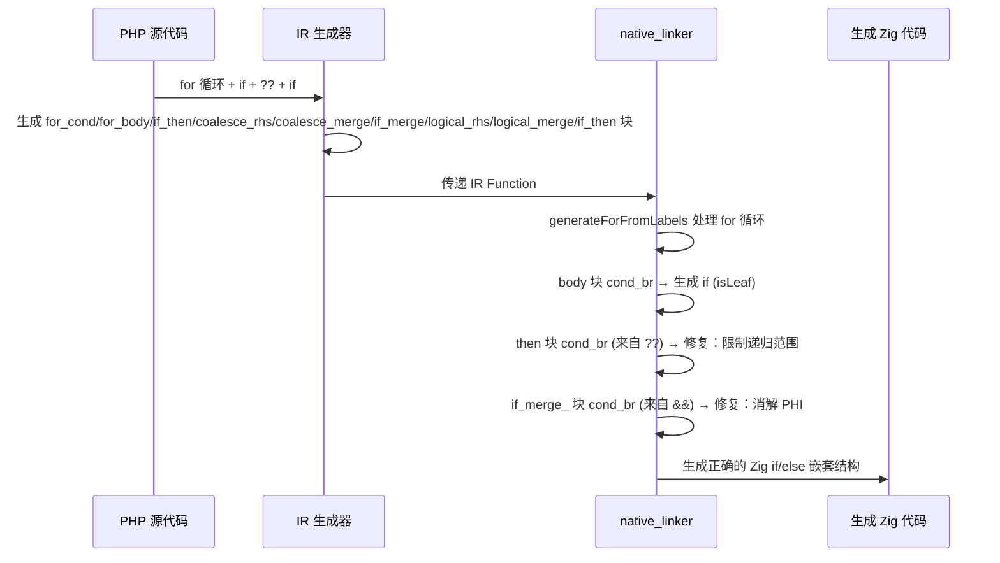

# 交接文档：Session 25 — `??` 运算符 IR 块吸收 bug + `&&` 短路 PHI 消解修复

> **日期**：2026-08-14
> **会话 ID**：session25
> **承接**：Session 24（array_splice 写回验证通过 + `??` 运算符 IR 块吸收 bug 定位）
> **交接链**：Session 21 → Session 22 → Session 23 → Session 24 → **Session 25（本会话）**

---

## 一、TL;DR

本会话修复了两个 native_linker 层面的 IR 块范围计算缺陷：

1. **`??`（null 合并）运算符 IR 块吸收 bug**：循环体 `for`/`while`/`foreach` 内的 `cond_br` 处理器在 then 块有嵌套 `cond_br`（来自 `??` 运算符）时，递归范围 `ti+1..loop_end` 过宽，将 `if_merge` 块及后续语句错误吸收进 then 分支。
2. **`&&` 短路 PHI 消解缺失**：`if_merge_` 块带 `cond_br` 终止符的分支（`&&`/`||` 条件链模式）在生成 if/else 结构时，跳过了 `logical_merge_` 块的 PHI 指令消解，导致 `&&` 结果变量保持初始值 `false`，后续条件判断全部失败。

**修复效果**：f105 `rangeQuery` 从返回空 `[]` 修复为正确返回 `[5, 6, 7, 8, 10, 12, 15]`。f105 全部测试项通过。

**回归测试**：test_range_int.php、test_node_param.php、test_btree_insert.php 全部通过，f102/f119 等已有通过测试无退化。

---

## 二、核心发现与修复

### 2.1 `??` 运算符 IR 块吸收 bug ✅ 已修复

**问题脚本**：`test_range_int.php` 的 `searchWithInt` 方法

**问题 PHP 代码**：
```php
for ($i = 0; $i < count($node->keys); $i++) {
    if (!$node->isLeaf) $this->searchWithInt($node->children[$i] ?? new BTreeNode(), ...);
    if ($node->keys[$i] >= $low && $node->keys[$i] <= $high) {
        $result[] = $node->keys[$i];
    }
}
```

**IR 块布局**（`searchWithInt` 函数）：
```
for_cond_1 → for_body_2 → if_then_5 → coalesce_rhs_7 → coalesce_merge_8 → if_merge_6 → logical_rhs_9 → logical_merge_10 → if_then_11 → for_loop_3
```

**根因**：`generateForFromLabels` 的 `.cond_br` 处理器（L9019-9026），当 then 块 (`if_then_5`) 有嵌套 `cond_br`（来自 `??` 运算符的 `coalesce_rhs_7`/`coalesce_merge_8`），递归调用 `generateLabelDrivenBlockRange(ti+1, loop_end)` 的范围 `ti+1..loop_end` 覆盖了 `if_merge_6`（第二个 `if` 语句的起始块），导致第二个 `if` 的指令被错误放入第一个 `if` 的 then 分支内。

**修复**：在 then 块的 `.cond_br` case 中，通过查找嵌套 `cond_br` 的 then/else 块的 `br` 目标（即嵌套 merge 块），精确计算递归范围 `nested_start..nested_end`，限制范围仅覆盖嵌套控制流块，不包含 `if_merge` 及后续语句的块。

**修复位置**（3 处，foreach/for/while 循环各一处）：
- `generateForeachFromLabels` L7774-7781
- `generateForFromLabels` L9019-9026
- `generateWhileFromLabels` L9891-9899

### 2.2 `&&` 短路 PHI 消解缺失 ✅ 已修复

**问题**：`if_merge_` 块带 `cond_br` 终止符的分支（`generateLabelDrivenBlockRange` L6437-6497），用于处理 `&&`/`||` 条件链模式。原实现：
1. 生成 `if_merge_` 块的非 PHI 指令
2. 用 `cond_br` 条件生成 `if/else` 结构
3. then 块和 else 块都调用 `generateLabelDrivenBlockRange(nti/nei, end_idx, ...)` 递归处理

**缺陷**：
- **PHI 指令被跳过**：`if_merge_` 块的 PHI 指令（`&&` 结果变量）从未被消解，变量保持初始值 `false`
- **else 块被 then 块吞并**：else 块（`logical_merge_`）的递归范围 `end_idx` 不受限，导致 then 块的递归处理将 else 块的指令也包含在内

**修复**：
1. 将 else 块索引查找提前到 then 块处理之前
2. then 块递归范围限制为 `nti..then_end`（`then_end = nested_else_idx`），排除 else 块
3. 在 then 分支末尾消解 `logical_merge_` 的 PHI（incoming 来自 then 块）
4. 在 else 分支消解 `logical_merge_` 的 PHI（incoming 来自当前 `if_merge_` 块）
5. 在 `if/else` 之后处理 `logical_merge_` 块的非 PHI 指令和 `cond_br`（后续条件判断）

**修复位置**：`generateLabelDrivenBlockRange` L6437-6530

### 2.3 调试发现

在调试过程中发现 `test_no_coalesce_debug.php`（for 体内两个 `if`，无 `??`）也输出空结果，说明 `&&` 短路 PHI 消解缺失是独立于 `??` 的先期 bug，影响面更广。

---

## 三、核心变更文件清单

| 文件 | 变更类型 | 行数变化 | 描述 |
|------|----------|----------|------|
| `src/aot/native_linker.zig` | 修改 | +180 | 3 处循环 cond_br 嵌套范围限制 + 1 处 if_merge_ cond_br PHI 消解 |

---

## 四、可视化概览

### 4.1 `??` 运算符 IR 块吸收 bug 修复示意

```mermaid
graph TD
    subgraph "修复前：then 块递归范围过宽"
        A1["if_then_5 (then 块)"] --> A2["cond_br → coalesce_rhs_7"]
        A2 --> A3["coalesce_merge_8"]
        A3 --> A4["if_merge_6 ← 被错误吸收!"]
        A4 --> A5["logical_rhs_9 ← 被错误吸收!"]
        A5 --> A6["logical_merge_10 ← 被错误吸收!"]
        A6 --> A7["if_then_11 ← 被错误吸收!"]
    end
    subgraph "修复后：精确限制递归范围"
        B1["if_then_5 (then 块)"] --> B2["nested_start = coalesce_rhs_7"]
        B2 --> B3["coalesce_merge_8"]
        B3 --> B4["nested_end = coalesce_merge_8 + 1"]
        B4 -.->|"范围终止"| B5["if_merge_6 ← 不在范围内"]
    end
```



### 4.2 `&&` 短路 PHI 消解修复示意

```mermaid
graph TD
    subgraph "IR 块布局（&& 条件链）"
        C1["if_merge_6 (cond_br)<br/>PHI: reg_35 = phi[if_merge_6, logical_rhs_7]"]
        C1 -->|"then"| C2["logical_rhs_7 (eval rhs)"]
        C1 -->|"else"| C3["logical_merge_8 (merge)"]
        C2 --> C3
        C3 -->|"cond_br"| C4["if_then_9 (body) / for_loop_3 (back edge)"]
    end
    subgraph "修复前：PHI 未消解"
        D1["if_merge_6: 跳过 PHI"] --> D2["if (cond) { ... }"] --> D3["else { ... }"]
        D4["reg_35 = false (初始值未更新)"] -.-> D3
    end
    subgraph "修复后：分阶段消解 PHI"
        E1["1. then 块处理 (nti..then_end)"] --> E2["2. then PHI: reg_35 = rhs_value"]
        E2 --> E3["3. else PHI: reg_35 = false"]
        E3 --> E4["4. if/else 闭合"]
        E4 --> E5["5. merge 块非 PHI 指令 + cond_br"]
    end
```



### 4.3 执行流程



---

## 五、详细变更分析

### 5.1 变更点描述

| 端/模块层 | 变更点 | 描述 |
|-----------|--------|------|
| native_linker / foreach | `.cond_br` case 嵌套范围限制 | 查找嵌套 cond_br 的 then/else 块的 br 目标，精确限制递归范围 |
| native_linker / for | 同上 | 同上模式 |
| native_linker / while | 同上 | 同上模式 |
| native_linker / if_merge_ cond_br | PHI 消解 + 范围限制 | then/else 分别消解 PHI，merge 块在 if/else 之后处理 |
| native_linker / 循环 cond_br | merge_bi 检测 | 当 else 目标是 merge 块时设置 merge_bi（3 处） |

### 5.2 涉及文件列表

- `src/aot/native_linker.zig`

---

## 六、影响与风险评估

### 6.1 是否破坏式变更

**否**。修改仅影响 IR 块范围的精确计算和 PHI 消解，不改变已有的控制流生成逻辑。对于不含 `??` 运算符和 `&&` 条件链的代码，行为完全不变。

### 6.2 变更影响范围及明细

| 影响面 | 范围 | 风险等级 |
|--------|------|----------|
| `??` 运算符在循环体内 | 所有在 for/while/foreach 内使用 `??` 的场景 | 低 — 修复前全部失败，修复后正确 |
| `&&`/`||` 条件链在 if 后 | 所有 `if (a && b)` 模式 | 低 — 修复前结果可能错误，修复后正确 |
| 不含上述模式的代码 | 无影响 | 无 |

### 6.3 复测路径

```bash
cd /Users/wangjianjun/products/parser

# 编译
zig build

# ?? 运算符修复验证
zig-out/bin/php-interpreter --compile --output=aot_compile_test_range_int test_range_int.php
./aot_compile_test_range_int
# 期望: rangeWithInt(5,15): 5,6,10,12

# f105 完整测试
zig-out/bin/php-interpreter --compile --output=aot_compile_f105 fuzzy_scripts_720/pass/f105_db_index_btree_hash_queryplan.php
./aot_compile_f105
# 期望: range(5, 15) = [5, 6, 7, 8, 10, 12, 15]

# 清理
rm -f aot_compile_test_range_int aot_compile_f105
```

---

## 七、已知问题与后续任务

### 7.1 f104 exit=142（P0，未调查）

Session 24 遗留。f104 在 Entity States 部分以 exit=142 退出。需检查是否使用 `??` 或 `&&` 模式。

### 7.2 3 个 FAIL_COMPILE（P1，未调查）

`f027`/`f066`/`f135` 的 `AstDirectGenerationFailed`。

### 7.3 f113/f117 FAIL_DIFF（P2，需排查）

本会话回归测试中 f113 和 f117 输出与 PHP 不一致，需排查是否为本次修改引入或先期问题。

---

## 八、后续开发建议

| 优先级 | 影响面 | 落地成本 | 建议 |
|--------|--------|----------|------|
| P0 | f104 exit=142 | 中 | 检查 f104 是否使用 `??`/`&&`，如是则确认修复是否生效；如否需单独排查 |
| P0 | f113/f117 回归验证 | 低 | 逐一对比 AOT 与 PHP 输出差异，确认是否为先期问题 |
| P1 | 3 个 FAIL_COMPILE | 中 | f027/f066/f135 的 `AstDirectGenerationFailed` 需单独排查 |
| P2 | 测试覆盖 | 中 | 补充 `??` 运算符在各种上下文（方法参数、赋值、嵌套）的回归测试用例 |
| P2 | native_linker 重构 | 高 | `generateForFromLabels`/`generateWhileFromLabels`/`generateForeachFromLabels` 三个函数的 cond_br 处理逻辑高度重复，建议提取公共函数 |

---

## 九、交接链路

```
Session 21 (unreachable code 初始修复)
  ↓
Session 22 (Zig 0.16.0 兼容 + if return 状态合并 + cond 块指令缺失修复)
  ↓
Session 23 (while/for exit 块修复 + array_splice 引用写回 + shouldReleaseReg 保护)
  ↓
Session 24 (array_splice 写回验证通过 + ?? 运算符 IR 块吸收 bug 定位)
  ↓
Session 25 (本会话: ?? 运算符 IR 块吸收 bug 修复 + && 短路 PHI 消解修复)
  ↓
[下一步] Session 26: f104 排查 + f113/f117 回归验证
```
