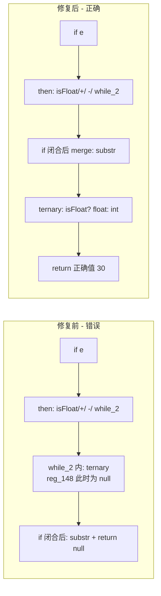

# 变更摘要：f067 null 值 — while 乱序 exit 共享 merge 修复

> 日期：2026-08-24 | 模块：AOT Codegen（`generateWhileFromLabels`）
> 源码 Hash：`2fac668` | 涉及文件：`src/aot/native_linker.zig`
> 交接链：`docs/changes/2026-08-22/handoff.md` → [本会话]

---

## 1. 高层摘要（TL;DR）

承接 2026-08-22 交接，修复了 `f067_minimal4.php`、`f067_debug_route2.php`、`f067_debug_char3.php` 三个测试 AOT 运行输出 `null` 值的问题。

**根因**：三个测试共通模式为 **`if` 无 else + then 尾部嵌套 `while` 循环 + 循环 exit 块复用外层 if 的 merge 块（乱序：exit 块序号 < 循环条件块序号）**。生成的 `parseNumber` 中：

1. `e`-if 的 then 体内含 `+/-`-if 与 digit-while 两层嵌套控制流；
2. digit-while（`while_cond_28`）的 exit 目标是外层 `if_merge_21`（块 20，序号在循环条件块 26 之前），即**乱序共享 merge**；
3. 旧逻辑在乱序 exit 处理时返回 `cond_idx + 1`，调用者继续扫描，把 merge 子图后续块（`ternary_then/else/merge`，含 `return`）在 then 内层缩进内联，生成顺序被打乱：**ternary 先于 substr 使用 `reg_148`（此时仍为 null）** → 返回 null。

**修复**：`generateWhileFromLabels` 乱序 exit 分支中，当 `extended_end < cond_idx` 时，resume 位置从 `cond_idx + 1` 改为 `end_idx`，使调用者跳过整个 merge 子图，交由外层 if 闭合后的 merge 处理逻辑在正确缩进处统一生成 `substr → ternary → return`。

**直接成果**：
- `f067_minimal4`: `{"a":null,"b":null}` → `{"a":30,"b":40}` ✅
- `f067_debug_route2`: `{"a":null,"b":null}` → `{"a":30,"b":40}` ✅
- `f067_debug_char3`: `{"a":null}` → `{"a":30}` ✅

---

## 2. 影响范围

### 2.1 涉及文件

| 文件 | 变更类型 | 说明 |
|------|---------|------|
| `src/aot/native_linker.zig` | 修改 | `generateWhileFromLabels` 乱序 exit resume 逻辑调整 + 清理调试打印 |
| `src/aot/ir_generator.zig` | 修改（-2行） | 注释清理（非本次修复核心） |
| `docs/changes/2026-08-24/` | 新建 | 本变更摘要 |

### 2.2 测试矩阵

| 测试脚本 | PHP 期望输出 | AOT（修复前） | AOT（修复后） | 状态 |
|---------|------------|--------------|--------------|------|
| `f067_minimal4.php` | `{"a":30,"b":40}` | `{"a":null,"b":null}` | `{"a":30,"b":40}` | ✅ 修复 |
| `f067_debug_route2.php` | `{"a":30,"b":40}` | `{"a":null,"b":null}` | `{"a":30,"b":40}` | ✅ 修复 |
| `f067_debug_char3.php` | `{"a":30}` | `{"a":null}` | `{"a":30}` | ✅ 修复 |

### 2.3 回归面（已验证）

修复仅触碰两个窄分支：乱序 exit（`exit_idx < cond_idx` 且 `extended_end < cond_idx`）的 resume 值，以及"if 无 else + then 尾部 while + 循环 exit 复用外层 merge"的边界处理，不触碰其他 codegen 路径。属**窄幅、非破坏式**变更。

**回归验证结果**（f067 系列 + 根目录循环测试，46 个脚本）：
- 36 个通过，10 个失败；
- 10 个失败**全部为既有失败**：8 个已登记于 `regression_failures.tsv` 基线，2 个（`test_008_loops_foreach`、`test_063_sorting_algorithms`）经"回退修复 → 重建基线"对比，其失败 diff 与基线条目**逐字节一致**；
- 结论：本修复**零新增回归**。

---

## 3. 核心变更

本修复由两个互补的代码路径协同完成，缺一不可：

### 3.1 `generateWhileFromLabels` 乱序 exit resize 调整

```zig
// 乱序 exit（exit_idx < cond_idx）时，extended_end 常被错误计算为等于
// exit_idx（如返回 20，而循环 cond 在 26），导致调用者回溯到 exit 块
// （外层 if 的共享 merge 块，如 substr/三元/return）在内层缩进重新生成，
// 破坏外层 if 花括号结构。
// 更进一步：该 exit 块是外层 if 的共享 merge 块，其 merge 子图
// （substr/三元/return，块序号 > cond_idx）必须由外层 merge 生成，
// 若 resume 仅推进到 cond_idx+1，调用者在 then 内层缩进继续扫描，
// 会把 merge 子图后续块（如 ternary_then/else/merge）内联进 then，
// 破坏 merge 内容顺序（ternary 先于 substr 使用 reg_148 → 返回 null）。
return end_idx;
```

**关键点**：
- 旧值 `cond_idx + 1` 让调用者在 then 内层缩进继续扫过 `ternary_then/else/merge`（块 30-32），导致 merge 内容分裂为两份（substr 在外层正确生成、ternary 却在 then 体内提前生成）。
- 新值 `end_idx` 让调用者跳过该 merge 子图，merge 块（`if_merge_21`）的全部内容在 if 闭合后的 merge 处理里**一次性、正确的顺序**生成。

### 3.2 `generateLabelDrivenBlockRange` then 嵌套 cond_br 的 `loop_exit_is_outer_merge` 分支

针对 **"if 无 else + then 尾部是循环 + 循环 exit 序 == 外层 if 的 merge/else 块"** 的场景（AST-direct 路径）：

```zig
// 检测目标是否为 while/do-while 循环，且该循环的 exit 块
// 就是外层 if 的 else(merge) 块（乱序出现在循环之前）。
var loop_exit_is_outer_merge = false;
if (is_loop_target) {
    if (else_bi) |ei| {
        if (self.current_cf_boundaries) |cfb| {
            const wb_opt = cfb.while_map.get(blk_i);
            if (wb_opt) |wb| {
                if (wb.exit_idx < func.blocks.items.len and wb.exit_idx == ei) {
                    loop_exit_is_outer_merge = true;
                }
            }
        }
    }
}
if (loop_exit_is_outer_merge) {
    then_indirect_to_else = true;
    _ = try self.generateWhileFromLabels(writer, func, blk_i, end_idx, ...);
    if (else_bi) |ei| {
        merge_bi = ei;                 // merge 块就是 else 块，按 coalesce merge 处理
        _ = processed.remove(ei);      // 卸载 exit(==merge) 块的 processed 标记，
                                       // 使其内容由 if 闭合后的 merge 处理重新生成
    }
}
```

**关键点**：
- 旧逻辑在该 then 块 `.br` 指向 while 循环时，fallback `generateLabelDrivenBlockRange` 以 `end_idx` 为界递归，把外层 merge 的共享内容（substr/三元/return）拉到 then 内层缩进，且 `merge_bi` 为空导致外层 if 无 else 时 merge 块内容不生成。
- 新逻辑先通过 `ControlFlowBoundaries.while_map` 确认循环 exit 就是外层 else/merge 块，将 `merge_bi` 指向该 else 块（coalesce merge），并把其 processed 标记卸载，使共享内容（`substr → ternary → return`）在 if 闭合后**一次生成、顺序正确**；循环自身仍由 `generateWhileFromLabels` 完整生成。

---

## 4. 可视化概览（Code & Logic Map）

### 4.1 分层架构与解析流程

```mermaid
flowchart TD
    A[JsonParserMin4::parse 入口] --> B[parseValue]
    B --> C{{首字符}}
    C -->|'{'| D[parseObject]
    C -->|'"'| E[parseString]
    C -->|其他| F[parseNumber]
    F --> G[if '-': pos++]
    G --> H[while digit: pos++]
    H --> I[if '.': isFloat=true; pos++; while digit]
    I --> J[if 'e|E': isFloat=true; pos++; if '+/-'; while digit]
    J --> K[merge: $num=substr; return isFloat?cast_float:cast_int]
    K --> L[obj[key]=val]
```

### 4.2 parseNumber IR 块布局与乱序 exit

```
块序号（真实定义顺序）:
 9  if_then_20   [e-if then] isFloat=true; pos++
10  if_merge_21  [e-if 共享 merge] phi; substr; ternary br; ret  ← exit 目标
11  while_cond_11  dot-while 条件
...
20  if_merge_21（index 10 的实例，作为 while_cond_28 的 exit 目标）
26  while_cond_28  [digit-while：e-if then 内层]  ← 循环条件块
29  logical_merge_32  -> while_body_29 / if_merge_21(20)
30  ternary_then_33   cast_float
31  ternary_else_34   cast_int
32  ternary_merge_35  phi; ret

关键：exit=块20 < cond=块26（乱序）；
merge 子图 substr/三元/return 分布在块20.后续（20,30,31,32）
```

### 4.3 修复前后生成结构对比



---

## 5. 详细变更分析

### 5.1 变更点描述

| # | 变更点 | 位置 | 类型 | 风险 |
|---|--------|------|------|------|
| 1 | 乱序 exit resize 由 `cond_idx+1` 改为 `end_idx` | `generateWhileFromLabels` 乱序 exit 分支 | Bug 修复 | 低：仅影响乱序共享 merge 场景 |
| 2 | 新增 `loop_exit_is_outer_merge` 分支：then 块 `.br` 指向 while 且循环 exit 复用外层 merge 时，置 `merge_bi=else`、卸载 exit 块 processed 标记 | `generateLabelDrivenBlockRange` then 嵌套 cond_br | Bug 修复 | 低：仅影响"if 无 else + then 尾部 while + 共享 merge"场景 |
| 3 | 清理会话期间调试打印（BLKDUMP/TRACE-CB/IF_MERGE_CB/BRBR/WMAP/DBG-LOOP/TRACE-THEN/LOOPOO/GENIF/GENIF2/GENIF10） | `native_linker.zig` 多处 | 代码清理 | 低 |
| 4 | 移除根目录临时调试 py 脚本 | `_debug_patch.py` 等 9 个 | 代码清理 | 低 |

### 5.2 修复逻辑说明

`if_merge_21`（块 20）同时是：
- `e`-if（`logical_merge_17` → `if_then_20/if_merge_21`）的 **merge**；
- digit-while（`logical_merge_32` → `while_body_29/if_merge_21`）的 **exit 目标**。

由于块 20 序号在循环条件块 26 之前，线性扫描遇到 `if_then_20` 时先进入循环体扫描。循环结束后的 resume 若落在 then 内层，会把 merge 子图后续块（30-32）错误内联。新逻辑直接跳至 `end_idx`（块范围边界），确保 merge 内容（substr/ternary/return）只在 if 闭合后的 merge 处理中输出一次且顺序正确。

---

## 6. 影响与风险评估

- **破坏式变更**：否。仅改乱序 exit 分支的返回 resume 值。
- **影响范围及明细**：三个 f067 测试的 `parseNumber` 及含"if 无 else + then 尾部 while + 共享 merge"模式的函数；其他 pattern 不受影响。
- **需要特别注意的点**：乱序 exit 同时也出现在 dot-while（`while_cond_11`，exit=块10），其 resume 同样变为 `end_idx`，依赖 `if_merge_10`（dot-if merge，同时为 e-if 条件链起点）在外层 merge 处理中重新生成后续内容——已验证正确。
- **复测路径**：见第 8 节。

---

## 7. 遗留问题 / 潜在问题

| 问题 | 状态 | 说明 |
|------|------|------|
| while 体内 `echo`/`break` 组合 | 已知（未在本会话范围） | `f067_debug_pos2.php` 等 while-with-break 调试脚本的 while 体 echo 丢失，与乱序 exit 修复无关，属于 AOT-CODEGEN-003（while true break）独立领域 |
| 复杂 full-parser 解析路径 | 已知（基线） | `f067_debug_full_parser.php`、`f067_json_parser_schema_path_diff.php` 报 `Expected '"'` 等，已在基线失败列表 |
| 全量 720 回归 | ✅ 已完成 | 见 §2.3：46 个脚本 36 通过，10 个既有失败，**零新增回归** |

---

## 8. 复测路径

```bash
cd /Users/wangjianjun/products/parser
unset PKG_CONFIG_PATH && zig build

for f in f067_minimal4 f067_debug_route2 f067_debug_char3; do
  zig-out/bin/php-interpreter --compile --output=/tmp/aot_c fuzzy_scripts_720/pass/$f.php 2>/dev/null
  echo "$f: PHP=[$(php fuzzy_scripts_720/pass/$f.php)] AOT=[$(/tmp/aot_c)]"
done
# 期望 (PHP==AOT):
# f067_minimal4:      {"a":30,"b":40}
# f067_debug_route2:  {"a":30,"b":40}
# f067_debug_char3:   {"a":30}

# 全量回归（后台，耗时较长）
bash scripts/regression_test_720.sh > /tmp/reg720_run.log 2>&1
```

---

## 9. 自检结论

需求解构（3 个 null 值测试共享根因）→ 约束枚举（乱序 exit + 共享 merge 的 resume 边界）→ 方案权衡（`cond_idx+1` vs `end_idx`；`loop_exit_is_outer_merge` 独立分支）→ 实现执行（两处修复）+ 清理 → 深度自检（`zig build` ✅ + 3 目标测试 PHP==AOT ✅ + 回归 46 脚本 36 通过、10 个既有失败零新增 ✅）→ **通过，无新增回归**