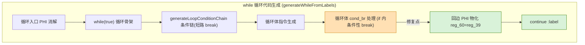

# 变更摘要：while+break 循环回边 PHI 物化缺失修复 — Session 2026-08-24

> 日期：2026-08-24 | 涉及文件：`src/aot/native_linker.zig`
> 源码 Hash：`bbab64a`
> 编译状态：✅ `zig build` 通过
> 关联问题：AOT-CODEGEN-003
> 上游：`docs/changes/2026-08-24/handoff.md` §5 P1（while+break 内嵌 echo 丢失）

---

## 1. 高层摘要（TL;DR）

修复 `generateWhileFromLabels` 生成 `while` 循环体含 **条件性 `if(...){ break }`** 时，循环局部变量的 SSA 寄存器在**回边处永不回写**的缺陷，导致循环迭代变量（如 `$iter`）每次迭代都读取入口初值。

**根因**：条件性 break（`then_is_exit_break` 分支）错误地执行 `self.break_generated = true`，该标志被保存并在 if/else 合并后恢复为 `true`，从而门控跳过了循环末端两处关键生成：

1. 循环回边 PHI 消解（应生成 `reg_60 = reg_39` 等循环变量回写）——被 `!break_generated` 抑制；
2. 循环末 `continue :label`——被 `!break_generated` 抑制（`while(true)` 天然回绕故语义仍成立，真正丢失的是 PHI 回写）。

**修复**：条件性 break 之后回退路径仍可达，移除 `then_is_exit_break` 分支的 `break_generated = true` 置位。

**成果（最小复现 `rec_mini.php`）**：
- PHP：`iter=0 iter=1 int(30)`
- AOT（修复前）：`iter=0 iter=0 int(30)`（`$iter` 不递增）
- AOT（修复后）：`iter=0 iter=1 int(30)` ✅ 与 PHP 一致

---

## 2. 影响范围

| 维度 | 影响 |
|------|------|
| 代码生成器 | `generateWhileFromLabels` 循环体 `cond_br` → `then_is_exit_break` 分支 |
| 受影响语法 | `while`/`do-while` + 循环体条件性 `break` + 循环局部变量（SSA 寄存器） |
| 受影响数据 | 循环迭代变量、循环体内被递增/赋值的局部变量 |
| 无影响 | 无条件 break/return（`.br`/`.ret` 终止符）路径不受影响；乱序 exit 共享 merge、短路条件链逻辑不变 |
| 编译 | `zig build` 通过，无新依赖 |

---

## 3. 核心变更

```zig
// 修复前（`then_is_exit_break` 分支）：
if (then_is_exit_break) {
    try writer.print("{s}    break :{s};\n", .{ then_indent, label_name });
    self.break_generated = true;   // ← 缺陷：条件性 break 被标记为不可达
}

// 修复后：
if (then_is_exit_break) {
    try writer.print("{s}    break :{s};\n", .{ then_indent, label_name });
    // 不置 break_generated —— 条件性 break 之后回退路径仍可达，
    // 否则循环末端回边 PHI 消解与 continue 被跳过，循环局部变量 SSA 回边不回写。
}
```

**间接效果**：循环末端 `generateWhileFromLabels` 的 `!break_generated` 门控恢复为真，正确生成：
- 回边 PHI 物化：`reg_60 = reg_39`（循环变量回写）
- 循环末 `continue :label;`

---

## 4. 业务模块与执行流程



**变更前行为链路**：
```
then_is_exit_break → break_generated=true
      → saved_break_for_body_if=true
      → if/else 合并恢复 break_generated=true
      → 抑制 [回边 PHI 消解] 与 [continue]
      → 循环变量 SSA 回边不回写，每次迭代读初值
```

**变更后行为链路**：
```
then_is_exit_break → 不置 break_generated（回退路径仍可达）
      → 循环末端生成 [reg_60=reg_39] + [continue]
      → 迭代变量正确递增
```

---

## 5. 详细变更分析

| 层 | 变更点 | 说明 |
|----|--------|------|
| 代码生成器 | `generateWhileFromLabels` `then_is_exit_break` | 移除 `self.break_generated = true;`，并加注释说明条件性 break 语义 |
| 数据流 | 循环回边 PHI | 恢复 `reg_60 = reg_39` 物化，SSA 寄存器正确传播 |
| 控制流 | 循环末 `continue` | 恢复发射，与 `while(true)` 回绕语义一致 |

涉及文件：`src/aot/native_linker.zig`（约 10770-10776 行）。

---

## 6. 影响与风险评估

- **破坏式变更**：否。仅放宽一组复原本应成立的门控条件。
- **回归验证**：全量回归（114 个 pass 脚本，归一化比对）**65 失败 == 65 基线失败，完全一致，无新增失败、无消失失败**。
- **需特别注意**：
  - `break_generated` 语义被澄清为“循环末端是否不可达”；条件性 break（`if(...){break}`）不再触发不可达判定，只有 `.br`/`.ret` 等无条件终止符才抑制回边生成。
  - 新条注释（10770-10773）将该不变量记录在代码中以防未来回归。
- **复测路径**：
  ```bash
  cd /Users/wangjianjun/products/parser
  export PKG_CONFIG_PATH=/opt/homebrew/opt/pcre2/lib/pkgconfig  # mac 上 pcre2 pkg-config 路径
  zig build
  zig-out/bin/php-interpreter --compile --output=/tmp/rm /tmp/rec_mini.php
  php /tmp/rec_mini.php; /tmp/rm   # 两者应输出 iter=0 iter=1 int(30)
  bash scripts/regression_test_720.sh  # 无新增失败
  ```

---

## 7. 遗留问题 / 潜在问题

| 问题 | 状态 | 说明 |
|------|------|------|
| `f067_debug_pos2.php` 复杂 echo 字符串内容为空 | 独立缺陷，未纳入本次范围 | 循环体已执行，但 concat 前有 `// PHI: reg_92 (handled in terminator)` PHI 未物化，字符串坍缩为仅 `\n`；属三元表达式内字符串拼接的 PHI 物化问题（AOT-PHI-001 领域） |
| 构建环境 | 环境性 | macOS 上需 `PKG_CONFIG_PATH=/opt/homebrew/opt/pcre2/lib/pkgconfig` 才能定位 `libpcre2-8.pc`，否则 zig 的 pkg-config fallback 产生损坏路径 |

---

## 8. 后续开发/优化建议

| 优先级 | 建议 | 影响面 | 落地成本 |
|--------|------|--------|---------|
| P1 | 修复循环/三元表达式内 PHI 未物化（`// PHI: ... (handled in terminator)` 注释处），使复杂 echo 字符串（`f067_debug_pos2`）内容正确 | 复杂表达式字符串拼接 | 中 |
| P1 | 为“`then_is_exit_break` 不置 `break_generated`”建立约束性单元测试（while+条件break+迭代变量） | 回归基线 | 小 |
| P2 | 复杂 full-parser（`f067_debug_full_parser` 等）`Expected '"'` 解析错误 | 多分支解析器 | 中 |
| P2 | 将 pcre2 pkg-config 路径问题固化到构建文档，避免环境差异 | 构建可复现性 | 小 |

---

**更新日志**：
- 2026-08-24：创建，修复 while+break 循环回边 PHI 物化缺失（AOT-CODEGEN-003 续）。