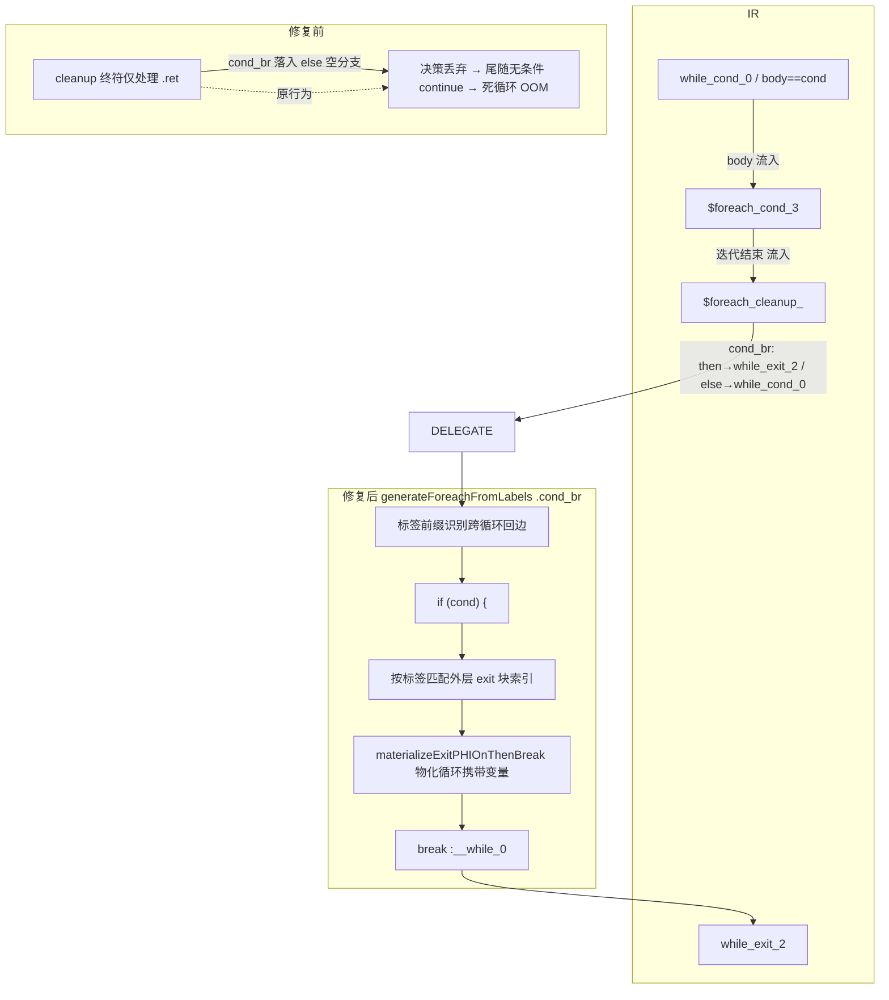
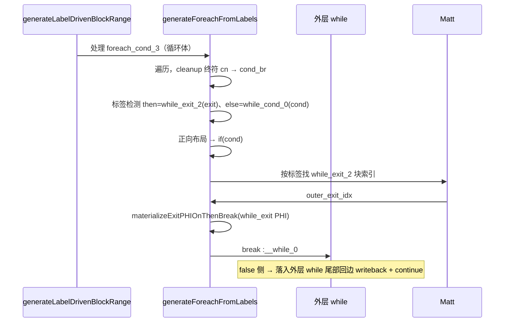

# 变更摘要：嵌套 foreach 于 while(true) 内 cond_br 回边展平为空分支死循环修复

> 日期：2026-08-25 | 模块：AOT 代码生成（native_linker.zig） | 关键 commit：`293962a`

## 1. 高层摘要（TL;DR）

修复 AOT 编译下 **嵌套 `foreach` 位于 `while(true)` 循环体内**时，因 `foreach_cleanup` 块的终止符是**指向外层 while 出口/回边的 `cond_br`**，被 `generateForeachFromLabels` 的终符处理误落入空分支，导致外层 while 的 `break` 判定被丢弃、循环尾部无条件 `continue`、陷入死循环并最终 OOM（`f177_graph_traversal_dfs_bfs.php` exit=137）。

根因是跨循环控制流的"责任交界"落在本只有 `.ret` 处理逻辑的 cleanup 终符处理器上。修复：在 cleanup 终符处理中新增 `.cond_br` 分支，用标签前缀识别"指向外层循环 exit/cond 的跨循环条件回边"，委托生成 `if(cond){ 物化外层 exit 循环携带 PHI; break :外层 }`，false 侧自然落入外层 while 尾部的回边 writeback + `continue`（else=cond）。

## 2. 影响范围

| 维度 | 影响说明 |
|------|----------|
| 代码生成器 | `self.generateForeachFromLabels` 的 cleanup 终符处理器（`generateLabelDrivenBlockRange` 内） |
| 触发形态 | `while(true){ ... foreach(...){...} if($c) break; }` 类嵌套结构 |
| 修复文件 | `src/aot/native_linker.zig`（+69 行为本修复；另 -51 行为调试残留清理） |
| 关联缺陷 | `f177_graph_traversal_dfs_bfs.php`（RUN-time exit=137 死循环） |
| 无效路径 | 单层 `while`/`foreach`、纯本地回边不触发此分支，逻辑不受影响 |

## 3. 核心变更

| # | 位置 | 变更 |
|---|------|------|
| 1 | cleanup 终符 `.cond_br` 分支（新增） | 识别跨循环回边：then/else 标签一个为 `while_exit_/for_exit_/foreach_exit_/do_while_exit_`，另一个为循环回边标签（`*_cond_/*_body_/*_increment_` 等） |
| 2 | 条件方向判定 | 正向布局（then→exit、else→cond）→ 条件为真时 break；反向布局 → 取反条件再 break |
| 3 | 外层 exit PHI 物化 | 用标签匹配外层 exit 块索引（**绕过被边界映射误解析的 `saved_exit_block`**），调用 `materializeExitPHIOnThenBreak` 物化循环携带变量后再 `break :外层` |

> 关键设计：不依赖 `saved_exit_block/saved_cond_block`——实测外层 while 的 `current_loop_cond_block` 会被边界映射误解析为嵌套 foreach 的 cond（`foreach_cond_3`），故以**标签前缀**识别外层归属。

## 4. 可视化概览（Code & Logic Map）

## 5. 详细变更分析

| 层 | 涉及内容 |
|----|----------|
| 业务层 | 支持"外层 while + 内层 foreach + 外层 break 判定落于 foreach_cleanup"的合法 PHP 控制流 |
| 代码层 | `src/aot/native_linker.zig`：① 继承 `dd27b06` 的 `body_idx` 决解修复（while(true) 的 `body_idx` 保持为 `cond_idx`，使嵌套 foreach 交由 `generateForeachFromLabels` 独立生成，而非被外层 while 内联展平）；② 本次 `293962a` cleanup 终符新增 `.cond_br` 分支（跨循环回边委托）；③ `3185489` 清理调试残留日志 |
| 修复路径 | `IR 布局 → cleanup 终符 cond_br → 标签判定 → 条件 break + PHI 物化` |

## 6. 影响与风险评估

- **是否破坏式变更**：否。新增的 `.cond_br` 分支仅在 cleanup 终符为 cond_br 且两目标分属外层 exit/回边时触发；其余路径保持原行为。
- **变更影响范围**：`while(true){...foreach{...}...if(cond) break;}` 嵌套形态；`f177` 从 RUN-time 死循环预期转为可正常跑通。
- **特别注意点**：
  1. 外层 exit 块索引凭**标签匹配**而非 `saved_exit_block`，因为边界映射会把外层 cond 误解析为内层 foreach cond；
  2. PHI 物化必须在 `break` 之前发出，否则外层循环携带变量读回回边残留旧值；
  3. 反向布局（then=cond、else=exit）需要取反条件，避免 `break` 时机反转。
- **复测路径**：`fuzzy_scripts_720/tmp/repro_wbreak.php`（w1 与 w2 双用例）AOT 编译运行应输出 `w1 ok i=3 / w2 ok i=3 / END`；`f177_graph_traversal_dfs_bfs.php` 应不再 exit=137。

## 7. 遗留问题 / 潜在问题

- 跨循环委托目前只覆盖 `while/for/foreach/do_while` 前缀；`switch` 内嵌于 `while(true)` 的 `break`（跳出指针指向外层 while exit）理论上有类似交界，但当前不在缺陷 B 触发路径内，未纳入本修复范围（属 AOT 已知待验证清单）。

## 8. 后续开发 / 优化建议

| 优先级 | 影响面 | 落地成本 | 建议 |
|--------|--------|----------|------|
| P1 | `switch` + `while(true)` 嵌套 break | 中 | 验证 `switch` 内 `break` 指向外层 while exit 时是否触发同类空分支；必要时复用本 `.cond_br` 委托模式 |
| P2 | 生成代码可维护性 | 低 | 将跨循环回边识别（exit/回边标签前缀集合 + 方向判定）抽为共享小工具 fn，供 `while/for/foreach/do_while` 四类终符处理器复用 |
| P2 | 覆盖率 | 低 | 将 `repro_wbreak.php`（嵌套 foreach + 外层 break）纳入 `fuzzy_scripts_720/pass/` 永久回归集，防止回退 |