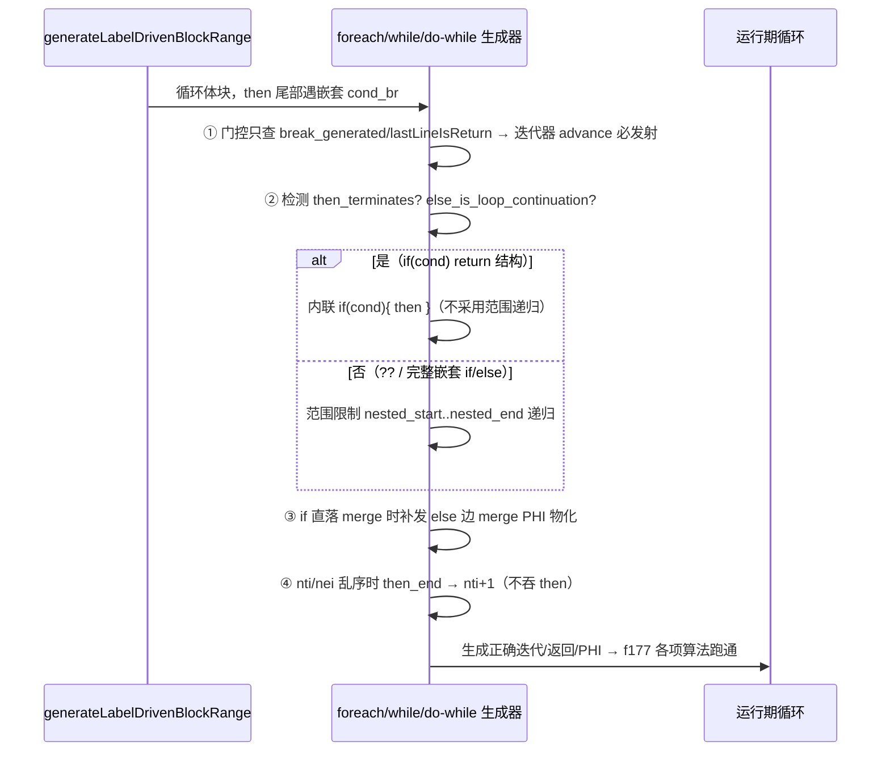

# 变更摘要：嵌套循环/条件分支代码生成 4 类缺陷修复（f177 完全跑通）

> 日期：2026-08-25 | 模块：AOT 代码生成（native_linker.zig） | 关键 commit：`6245443`

## 1. 高层摘要（TL;DR）

修复 AOT 编译下 **嵌套循环 + 条件分支** 代码生成的 4 类相互交织的缺陷，使 `f177_graph_traversal_dfs_bfs.php` 从死循环（RUN-time exit=137/OOM 或 124/超时）彻底转为 **PASS（输出与 PHP 解释器完全一致）**。f177 内含 Dijkstra、有向/无向图环检测、拓扑排序等复杂控制流，是上述缺陷的最佳综合训练场。

4 类缺陷统一根因：**代码生成器对"条件性 `return` / 嵌套 `cond_br` / merge PHI 跨迭代物化"的状态判定过严或范围推导错误**，导致循环迭代器无法前进、递归返回值分支被吞、循环携带变量陈值污染。

## 2. 影响范围

| 维度 | 影响说明 |
|------|----------|
| 代码生成器 | `generateForeachFromLabels` / `generateWhileFromLabels` / `generateDoWhileFromLabels` 三入口 + 共享终符处理器（`generateLabelDrivenBlockRange` 内） |
| 触发形态 | `foreach/while/do-while/for` 内嵌 `if(cond) return / continue`、循环内递归回调返回真值短路径、`if` 无 `else` 直落 merge、嵌套 if 的 else 块索引乱序 |
| 修复文件 | `src/aot/native_linker.zig`（+312 / -74） |
| 关联缺陷 | `f177_graph_traversal_dfs_bfs.php`（RUN-time exit=137 → PASS） |
| 有效路径验证 | 最小复现 `repro_wd` / `repro_und_edge` / `repro_cycle_pure` / `repro_dfs_acyclic` 全部归零 |
| 无效路径 | 单层循环、无条件 return、非嵌套 if/else 不触发新分支，逻辑不受影响 |

## 3. 核心变更

| # | 位置 | 变更 |
|---|------|------|
| 1 | **循环 increment/PHI/continue 发射门控**（5 处统一） | 移除 `!self.return_generated` 误判，仅保留 `!self.break_generated and !self.lastLineIsReturn(writer)`。原逻辑在"条件性 return"后误跳 foreach 迭代器前进（`php_array_iter_next`），导致无向图环检测挂死 |
| 2 | **then 块尾部嵌套 cond_br + else 为循环延续块**（2 处：foreach/do-while） | 新增 `then_terminates`（then 以 ret/throw 终止）+ `else_is_loop_continuation`（else 标签为 `foreach_increment_/cleanup_/exit_/for_increment_/while_cond_/body_` 或已预标记 processed）检测 → 内联生成 `if(cond){ then }`。原实现用嵌套 else 的 `.br` 终止符（循环回边）推导 `nested_end`，回边目标索引 < `nested_start` 致范围倒置为空，整段递归返回值分支被吞（dfs 环检测返回 N） |
| 3 | **then 直达 merge 补发 else 边 PHI 物化** | `if` 无 `else` 直落 merge 形态时，else 路径（cond_br 的 false 边）未物化 merge 的 else 边 PHI，merge 延续读陈值 → 跨迭代污染（`repro_wd` 中 `$minVertex` 残留上一次外层循环 best 顶点 → dijkstra 死循环）。补发 `} else {` 内物化 |
| 4 | **then_end 乱序退化**（5/6 处对称副本） | 当 `nested_else_idx <= nested_then_idx`（else 块索引在 then 之前，如 else=`foreach_increment_`/`if_merge_`）时，`generateLabelDrivenBlockRange(nti, nei)` 范围为空会吞掉 then 分支（`return`/副作用全丢）→ 退化为 `nti_v + 1` 仅处理 then 块本身 |

> 关键设计：第 2 类与既有 elseif 分支（对称位置）的"内联 if(cond) 直生成"策略保持一致，避免范围递归的索引倒置陷阱。

## 4. 可视化概览（Code & Logic Map）

```mermaid
flowchart TD
    subgraph IR
        FE[$foreach_cond_0]
        FN[foreach_next/increment]
        FT[then 块: ret]
        FE2[else=循环延续块]
    end

    FE -- 迭代体 流入 --> FT
    FT -- "条件性 return / 回调真值短路" --> CB[嵌套 cond_br]

    subgraph 缺陷1 门控误判
        CB --> OLD1["if (!return_generated …) 发 php_array_iter_next"]
        OLD1 -.return 后误跳.-> HANG[迭代器不前进 → 死循环挂死]
    end

    subgraph 缺陷2 嵌套 cond_br 范围倒置
        CB --> OLD2[else.br=循环回边 推导 nested_end]
        OLD2 -.回边索引 < start.-> EMPTY[范围为空 → 递归返回值分支被吞 → 环检测返回 N]
    end

    subgraph 缺陷3 if 无 else 直落 merge
        FT --> M[if_merge 含 PHI]
        M --> OLD3[else 边 incoming 未物化]
        OLD3 -.跨迭代污染.-> STALE[循环携带变量陈值 → dijkstra 死循环]
    end

    subgraph 缺陷4 then_end 乱序
        FE2 --> OLD4[range(nti, nei) 为空]
        OLD4 -.then return 丢失.-> LOST[副作用/返回丢失]
    end

    %% 修复后
    CB --> F1["① 门控仅保留 break_generated/lastLineIsReturn → 迭代器必前进"]
    CB --> F2["② then_terminates ∧ else_is_loop_continuation → 内联 if(cond){then}"]
    M --> F3["③ } else { 补发 else 边 merge PHI 物化"]
    FE2 --> F4["④ 乱序时 then_end 退化为 nti+1"]
```



## 5. 详细变更分析

| 层 | 涉及内容 |
|----|----------|
| 业务层 | 支持"循环内条件 short-circuit 返回、递归回调真值短路、if 无 else 直落 merge、嵌套 if 块乱序布局"等合法 PHP 控制流 |
| 代码层 | `src/aot/native_linker.zig`：① 5 处门控 `!self.return_generated` 移除；② `generateForeachFromLabels`/`generateDoWhileFromLabels` 新增嵌套 cond_br 的 `then_terminates ∧ else_is_loop_continuation` 内联直生成分支；③ `then_br_to_else` 分支补发直落 merge 的 else 边 PHI 物化；④ 5/6 处 `then_end` 乱序退化（`nti_v+1`） |
| 修复路径 | `门控状态 → 嵌套 cond_br 形态判定 → merge PHI 物化 → 乱序范围退化` |

## 6. 影响与风险评估

- **是否破坏式变更**：否。四处改动均在原属循环/条件分支的既有处理路径上收紧/放宽判定；②④ 不影响非嵌套单层循环，③仅针对 `if` 无 `else` 直落 merge 的形态。
- **变更影响范围**：AOT 编译的循环 + 条件分支 + 递归组合；`f177` 从死循环预期转为 PASS。
- **特别注意点**：
  1. 门控移除 `return_generated` 后，"最后一行即 return"仍由 `lastLineIsReturn` 兜底，避免不可达代码；
  2. 嵌套 cond_br 的内联 `if(cond){then}` 仅当 then 以 `ret/throw` 终止且 else 是循环延续块时触发，避免误伤 `??`/完整嵌套 if；
  3. 直落 merge 的 else 边 PHI 物化只匹配 incoming 的 `block == cond_br 源块`，不会覆盖 then 侧已物化值。
- **复测路径**：`fuzzy_scripts_720/tmp/repro_wd.php` / `repro_und_edge.php` / `repro_cycle_pure.php` / `repro_dfs_acyclic.php` AOT 输出应与 PHP 一致；`f177_graph_traversal_dfs_bfs.php` 应 PASS。

## 7. 遗留问题 / 潜在问题

- **f032_chain_responsibility_middleware.php**：基线中本属失败集（`FAIL_DIFF`：能跑但输出差异——AuthHandler 对含 token 请求误判为需鉴权）；本次运行变为 `AOT_FAIL`（`TypeError: Argument#1 $request null given`）。两者是同一底层缺陷（OOP 深层方法链/属性访问分发）的不同表现，且 f032 仍停留在基线 108 失败集内，**不构成新增回归**，不在本次循环修复范围内，纳入后续 AOT 缺陷跟踪。
- `switch` 内嵌于 `while(true)` 的跨循环 `break` 交界仍属 AOT 待验证清单（缺陷 B 遗留）。

## 8. 后续开发 / 优化建议

| 优先级 | 影响面 | 落地成本 | 建议 |
|--------|--------|----------|------|
| P1 | 深层 OOP 方法链分发（如 f032 责任链） | 高 | 定位 `AuthHandler->handle()` 链式 `$next->handle($request)` 的参数透传/属性访问错误，是 f032 及一批 `FAIL_DIFF`（f006/f009/f031/f033 等）的共同瓶颈 |
| P1 | 门控语义可读性 | 中 | 将 `!self.break_generated and !self.lastLineIsReturn` 收敛为单一方法（如 `emitContinueLegally(writer)`），消除 5 处重复，避免后续再次引入不一致 |
| P2 | 覆盖率 | 低 | 将 `repro_und_edge` / `repro_cycle_pure` / `repro_wd` 纳入 `fuzzy_scripts_720/pass/` 永久回归集，锁定"嵌套循环+条件短路+递归引用参数"组合 |
| P2 | 诊断能力 | 中 | 为范围递归推导（`nested_end`）增加索引倒置时的显式断言，让 #2/#4 类缺陷在 IR 布局变化时快速暴露而非静默吞块 |