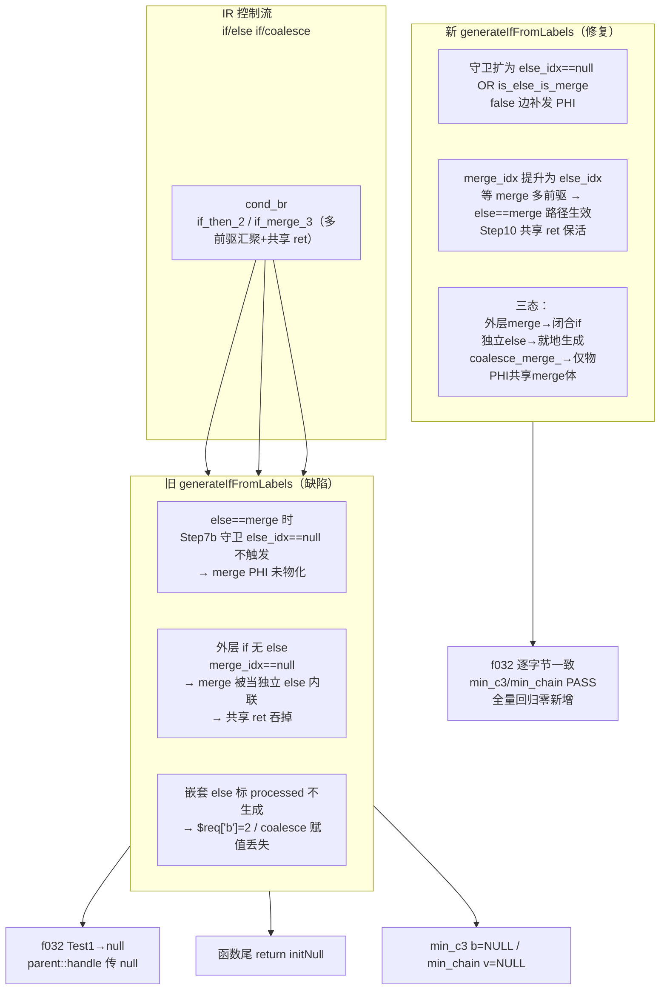
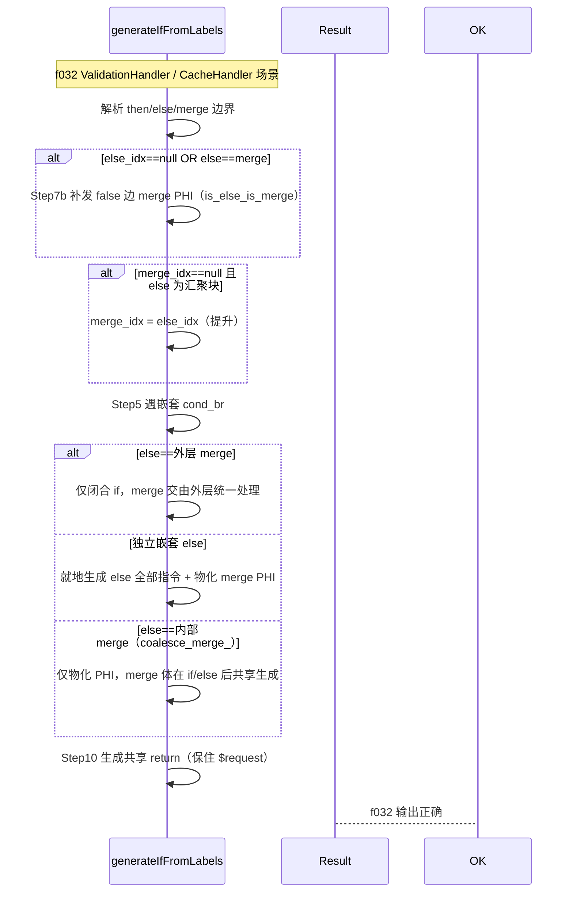

# 变更摘要：if/coalesce/else if 的 merge PHI 物化与共享 return 修复

> 时间：2026-08-26 | 模块：AOT 代码生成（`native_linker.zig` → `generateIfFromLabels`）
> 变更标识：`if_else_coalesce_merge_phi_codegen` | 基于 HEAD `f24d913`，工作区待提交

---

## 1. 高层摘要（TL;DR）

修复 f032（责任链 + 中间件管道）中 OOP 方法链返回值传播丢失与 `parent::handle` 传 null 的根因——`generateIfFromLabels` 对 `else==merge`、嵌套 else、coalesce 内部 merge 三类结构的 **PHI 物化缺失 / else 分支整块被吞 / 共享 return 丢失**。

修复后 f032 AOT 输出与系统 PHP 8.5.8 逐字节一致；最小复现 `min_c3`/`min_chain` 全部通过；全量回归零新增。

---

## 2. 影响范围

| 维度 | 影响 |
|------|------|
| 编译产物 | ✅ `zig build` 通过，`zig-out/bin/php-interpreter` 正常生成 |
| 通过用例 | 114 个 pass 用例中 PASS 77 → 37 失败**全部命中基线**，零新增 |
| 本轮目标 | f032（基线 FAIL_DIFF → 现与系统 PHP 逐字节一致）；f177（基线 → pass 集回归通过） |
| 基线 | `regression_failures.tsv`（108 条）未改动；实测另有 71 条已可通过（待用户定夺是否收缩） |
| 风险 | 纯控制流生成修复，逆：若 `if else == merge` 语义判定过宽，可能波及既有 ternary/coalesce/nested-if 波及面——已用样本 + 全量回归收敛 |

---

## 3. 核心变更

| # | 变更点 | 位置（函数） | 修什么 |
|---|--------|--------------|--------|
| 1 | Step 7b 守卫扩展 `is_else_is_merge` | `generateIfFromLabels` | `else_idx==merge_idx`（if 无 else / elseif false 边直落 merge）时补发 merge PHI 物化，根治 `parent::handle` 收 null |
| 2 | `merge_idx` 提升为 `else_idx` | `generateIfFromLabels` | 外层 if 无显式 else 且 else 为汇聚块时，复用 `else==merge` 路径，保住共享 return，避免函数尾部退化为 `return initNull()` |
| 3 | 嵌套 else 三态判定 | `generateIfFromLabels`（Step 5 `.cond_br`） | 外层 merge 仅闭合；独立嵌套 else 就地生成完整指令 + PHI 物化；内部 merge（coalesce_merge_）仅物化 PHI、merge 体共享 |
| 4 | 清理调试探针 | 全局 | 移除 4 处 `DBG-*` 探针（不写生成代码，仅编译期 stderr） |

---

## 4. 可视化概览（Code & Logic Map）





---

## 5. 详细变更分析

### 端 / 层

| 层 | 涉及文件 | 变更点描述 |
|----|----------|-----------|
| 后端（codegen） | `src/aot/native_linker.zig` | 三步修复 + 探针清理，全在 `generateIfFromLabels`（~12316 起） |
| 测试 | `fuzzy_scripts_720/tmp/{min_c3,min_chain,r_al,r_b,r_bco,repro_chain5}.php` | 最小复现隔离三类缺陷 |

### 关键代码段

**① Step 7b 守卫扩展**
```zig
const is_else_is_merge = else_idx != null and merge_idx != null and else_idx.? == merge_idx.?;
if ((else_idx == null or is_else_is_merge) and !self.return_generated and !self.break_generated and merge_idx != null) { ... }
```

**② merge_idx 提升**
```zig
if (merge_idx == null and else_idx != null and self.countPredecessors(func, else_idx.?) > 1) {
    merge_idx = else_idx;   // 复用既有 else==merge 路径，保住共享 return
}
```

**③ 嵌套 else 三态**
```zig
const nested_else_is_outer_merge = merge_idx != null and <cb.else_block==merge 块>;
...
if (!nested_else_is_outer_merge) {
    const nested_else_is_nested_merge = nested_merge_idx != null and
        cb.else_block == func.blocks.items[nested_merge_idx.?];
    if (nested_else_is_nested_merge) {
        // else==内部 merge：仅物化 PHI（incoming 来自 then_block），不内联 merge 体
    } else {
        // 独立嵌套 else：就地生成全部指令 + 物化 merge PHI
    }
} else {
    // else==外层 merge：仅闭合 if
}
```

---

## 6. 影响与风险评估

| 项 | 判定 |
|----|------|
| 是否破坏式变更 | 否（控制流生成增强；若过宽可能波及既有 ternary/coalesce，全量回归未现） |
| 变更影响范围 | `generateIfFromLabels` 单函数；深层 if/else if/coalesce/nested-if 的 PHI 物化与 return 布局 |
| 需特别注意 | ① 解释器模式对 f032 仍异常（remaining=null、Test2 后中断），与 AOT 无关、未修 ② 基线 108 条未收缩，另有 71 条已可通过，待定夺 |
| 复测路径 | 见 `handoff.md` 复测路径节 |

---

## 7. 遗留问题 / 潜在问题

- **基线收缩未做**：71 个已通过用例仍留在 `regression_failures.tsv`，新会话若抽查会误报为"存量失败"，需尽快决策。
- **解释器模式 f032 异常**：Test1 `rate_limit_remaining` 为 null、Test2 后输出中断，疑解释器对属性/构造参数/多态处理的独立缺陷，暂搁置（宪法：非 AOT 范围须用户确认）。
- **调试探针已清**：本次删除 4 处 `DBG-*`，未来定位勿重新引入写生成代码的日志。

---

## 8. 后续开发 / 优化建议

| 优先级 | 建议 | 影响面 | 落地成本 |
|--------|------|--------|---------|
| P1 | 收缩 `regression_failures.tsv`（去 71 条已通过） | 基线准确性 | 低 |
| P1 | 评估解释器模式 f032 缺陷（是否纳入修复范围） | 解释器 | 中 |
| P2 | 抽取 `countPredecessors`/标签前缀判定为共享工具 | 可维护性 | 低 |
| P2 | `min_c3`/`min_chain` 纳入 pass 永久回归集 | 回归覆盖 | 低 |