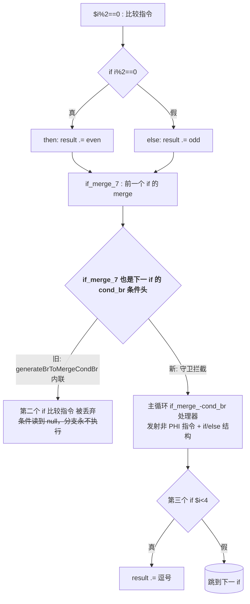
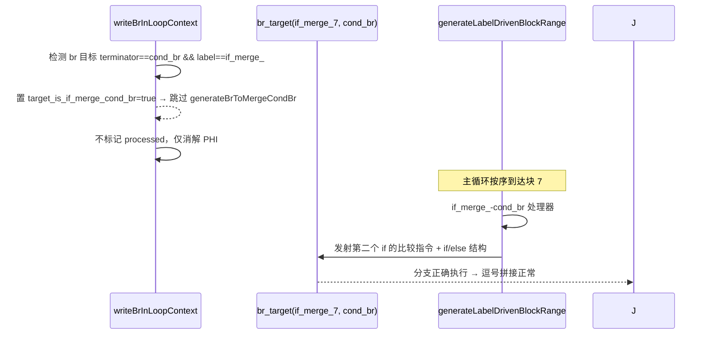

# AOT-PHI-001 修复变更摘要：循环内多个顺序 if 修改同一变量的 Phi 赋值缺陷

**日期**: 2026-08-26
**模块**: AOT 代码生成器（native_linker.zig）
**问题 ID**: AOT-PHI-001
**Base**: 01e76d9（含诊断探针提交之后）

---

## 1. 高层摘要（TL;DR）

循环内多个顺序 if 修改同一变量时，第二个 if 的条件比较指令被代码生成器整体丢弃，导致分支永不执行、字符串拼接丢失（`evenoddevenoddeven` 而非 `even,odd,even,odd,even`）。

根因：前一个 if 的 else 分支末尾 `.br` 目标 `if_merge_` 块（带 `cond_br` 终止符，是【顺序下一个 if 的条件头】），被 `writeBrInLoopContext` 通过 `generateBrToMergeCondBr` 错误内联进当前分支，该路径从不发射目标块的【非 PHI 指令】。

修复：在 `writeBrInLoopContext` 添加守卫 `target_is_if_merge_cond_br`，拦截此内联，保持目标块未 processed，交由主循环 `generateLabelDrivenBlockRange` 的 if_merge_-cond_br 处理器原生生成。

验证：主用例、变体 B、全量回归 108 例**无新增失败**，20 个历史失败因此在累积提交中一并转 PASS。

## 2. 影响范围

| 维度 | 说明 |
|------|------|
| 修复文件 | `src/aot/native_linker.zig`（`writeBrInLoopContext`，守卫 +20 行；主循环探针移除 +5 行） |
| 影响模式 | 仅 AOT 代码生成；解释器/字节码/JIT 不受影响 |
| 触发条件 | 循环体内存在 ≥2 个顺序 if 修改同一变量，且前一 if 的 merge 与下一 if 的 cond 复用同一 IR 块 |
| 破坏式变更 | 否（行为仅修复方向，不改变已正确路径） |

## 3. 核心变更

| 变更点 | 位置 | 描述 |
|--------|------|------|
| 新增守卫 | `writeBrInLoopContext` else 分支 | `target_is_if_merge_cond_br`：br 目标是 `if_merge_` 块且带 `cond_br` 终止符时跳过 `generateBrToMergeCondBr` 内联 |
| 控制流归属 | 同上 | 目标块保持未 processed，交给主循环 if_merge_-cond_br 处理器（发射非 PHI 指令 + if/else 结构） |
| 白名单 | 同上 | 仅 `logical_merge_` 等短路 merge 仍走原内联路径（`generateBrToMergeCondBr` 设计场景） |
| 探针清理 | 主循环/入口 | 移除 `[[LDR ...]]`、`[[6941 FIRE]]` 等 5 处调试探针 |

## 4. 可视化概览

## 5. 详细变更分析

### 涉及文件
- `src/aot/native_linker.zig`（唯一源码变更，+20 / -5）
- `fuzzy_scripts_720/tmp/repro_phi001.php`、`repro_phi001b.php`（新增复现/验证用例）
- `docs/known-issues/AOT-PHI-001-nested-if-phi-bug.md`（状态 → 已修复）
- `fuzzy_scripts_720/regression_report.md`、`regression_failures.tsv`（回归基线刷新）

### 变更点描述
**`writeBrInLoopContext`（约 913 行处）**：原 `else` 分支无条件调用 `generateBrToMergeCondBr` 内联 merge 块。新逻辑在调用前评估 `target_is_if_merge_cond_br`：
- 真：跳过内联（目标块是顺序下一 if 的条件头，内联会导致该 if 嵌套进当前分支的缩进/depth，且非 PHI 指令永不发射）。
- 假：保持原行为（`logical_merge_` 等短路 merge）。

## 6. 影响与风险评估

- **破坏式变更**：否。
- **验证路径**：主用例 `repro_phi001.php` → `even,odd,even,odd,even` 与 PHP 逐字节一致；变体 B `repro_phi001b.php` → `zeroE.otherO.otherE.otherO` 一致；`repro_seq_if.php` 无回归。
- **全量回归**：108 例，Pass 69 / Fail(Compile) 0 / Fail(Runtime) 15 / Fail(Diff) 21 / Skip 3。对比基线：**新增失败 = 空**；20 个历史失败在累积提交中转 PASS（含 f032、f177）。
- **注意点**：守卫基于标签前缀 `if_merge_` + `cond_br` 终止符判定，与 `logical_merge_` 短路路径区分；若未来 IR 生成器改变 merge 块标签规则需同步。

## 7. 遗留 / 潜在问题

- 回归基线 `regression_failures.tsv` 仍含大量复杂脚本失败（递归、闭包、对象、Fiber 等，部分属 AOT 范围外）。是否从基线移除 71 passing 项此前已推迟，本批未处理。
- 解释器模式在部分脚本（如 f032）存在独立缺陷，按宪法仅聚焦 AOT，未扩散处理。

## 8. 后续开发 / 优化建议

| 优先级 | 建议 | 影响面 | 落地成本 |
|--------|------|--------|----------|
| P1 | 将顺序 if 共块（merge==下一 cond）的判别从「标签前缀」升级为「基于 IR 块结构/支配关系」，提升稳健性 | 代码生成正确性 | 中 |
| P1 | 冲刷回归基线：将已转 PASS 的 20 例及持续 PASS 项从 `regression_failures.tsv` 移除，避免误读 | 回归报告可信度 | 低 |
| P2 | 为 `generateBrToMergeCondBr` 内联路径补充单元级 IR→Zig 快照测试，锁定短路径 merge 行为 | 防回归 | 中 |