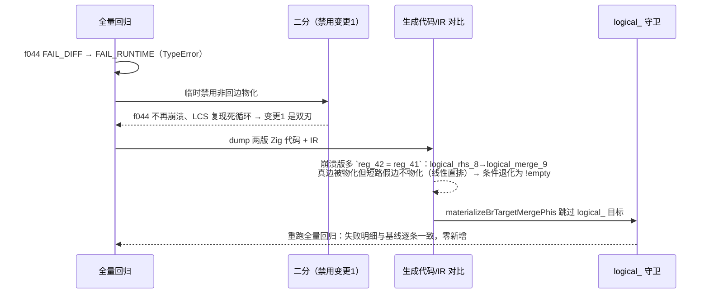

# f028 嵌套 if/elseif 循环死循环修复摘要与交接文档

> 日期：2026-08-29 08:19 | 提交：`c6e3d37` | 变更标识：`f028_nested_else_phi_loop_backedge`
> 涉及文件：`src/aot/native_linker.zig`（+129/-9）
> 上级交接：`docs/changes/2026-08-29/handoff.md`（本会话同日上半段产出，探针清理前的工作快照）
> 关联已知问题：`AOT-CODEGEN-003`（部分修复）；f028（2026-08-25 登记缺陷 B，本轮关闭）

---

## 1. 高层摘要（TL;DR）

承接 `handoff.md` 待办，本轮完成探针清理、重编复测、全量回归、提交，并在全量回归中**发现并修复了修复自身引入的一个新回归**：

1. **f028 死循环修复**（`repro_lcs_repro.php`，LCS 回溯）三处变更保留并完整提交：
   - `generateWhileFromLabels` 的 `loop_last_be` 迭代扩展（间接回边判定）；
   - 新增 `materializeBrTargetMergePhis`：非回边「线性块 → merge 块」边的 PHI 物化（补 ELSE 侧缺口）；
   - 嵌套 then（elseif 真分支）补外层 merge 循环携带 PHI 物化。
2. **探针清理**：5 类探针（`[[LDR/MBTM/WHELSEB/WINESTELSE/S7_PHI]]`，10 处）全部删除。
3. **新回归 f044 的发现与修复**：全量回归发现 `f044_json_deepops_merge_diff.php` 由基线 `FAIL_DIFF` 变为 `FAIL_RUNTIME`（TypeError 崩溃）。二分定位为「非回边 br 物化」对 `logical_merge_`（&&/|| 短路链汇聚块）目标生效所致——短路链当前被线性直排发射、cond_br 假边不物化，补物化真边后短路合并值退化为单一操作数 `!empty($value)`，非空字符串误入递归分支。修复：`materializeBrTargetMergePhis` 跳过 `logical_` 前缀目标。修复后重跑全量回归：**失败明细与基线逐条一致，零新增**。
4. **收尾**：`/tmp` 四个调试产物目录清理（移入废纸篓）；回归基线 `regression_failures.tsv` 恢复为 108 条未收缩状态。

**成果**：`c6e3d37` 提交完成，f028/PHI-001 复现用例与全量回归（108 用例）全部验证通过。

---

## 2. 影响范围

| 端/模块 | 影响文件 | 影响描述 |
|---------|---------|---------|
| AOT 代码生成器 | `src/aot/native_linker.zig`（+129/-9，已提交 `c6e3d37`） | `generateWhileFromLabels`（回边范围迭代扩展、嵌套 then 外层 merge 物化）、`generateLabelDrivenBlockRange`（`.br` 非回边物化 + `br_was_backedge` 标记）、新增 `materializeBrTargetMergePhis`（含 `logical_` 守卫） |
| 回归基线 | `fuzzy_scripts_720/regression_failures.tsv` | 未改动（108 条），回归后已恢复 |
| 测试复现 | `fuzzy_scripts_720/tmp/repro_lcs_repro.php`、`repro_phi001.php` 等 | 未纳入 pass 永久集（P2 待办） |

**破坏式变更**：否。纯代码生成器分支逻辑增强，不改变 IR 结构、运行时与 ABI。

---

## 3. 核心变更

| # | 变更点 | 位置 | 作用 |
|---|--------|------|------|
| 1 | `loop_last_be` 迭代扩展 | `generateWhileFromLabels` | 单次扫描只能定位直接回边块；IR 生成器把嵌套 if/elseif 子块后置到直接回边块之后。迭代判定「直接回边 + 间接回边（目标落在已确定循环范围内）」直至稳定，`loop_end` 覆盖全部嵌套分支 |
| 2 | `materializeBrTargetMergePhis` | 新增辅助函数 | 消解「线性块 → merge 块」边的 PHI（按 incoming 块指针/标签匹配，首匹配写回）；仅对含 phi 目标生效；**`logical_` 前缀目标跳过**（见 #5） |
| 3 | `.br` 非回边物化 | `generateLabelDrivenBlockRange` | `br_was_backedge` 标记：回边已物化 cond 块 PHI 则跳过；非回边调用 #2 补 ELSE 侧（嵌套 else 汇入 `if_merge_`、`if_merge_` 再汇入外层 merge）缺口 |
| 4 | 嵌套 then 外层 merge 物化 | `generateWhileFromLabels` | elseif 真分支 br 到嵌套 merge、嵌套 merge 再 br 到外层 merge 时，对称补外层循环携带 PHI 物化，否则退出变量读陈值死循环 |
| 5 | `logical_` 守卫（f044 回归修复） | `materializeBrTargetMergePhis` | &&/|| 短路链汇聚块当前由线性直排路径发射，cond_br 假边不物化（既有缺口，f044 基线 FAIL_DIFF 的根因）；若补物化真边，短路合并值被污染为单一操作数（`reg_42 = reg_41` 即 `!empty`），非空字符串误入递归 → TypeError。跳过此类目标后回到基线行为 |

---

## 4. 可视化概览（Code & Logic Map）

### f028 控制流与修复点（repro_lcs_repro.php 回溯 while）

```mermaid
flowchart TD
    WC[while_cond_12<br/>i>0 && j>0] --> WB[while_body<br/>if s1[i-1]===s2[j-1]]
    WB -->|true| IT20[if_then_20<br/>result.=; i--; j--]
    WB -->|false| IE18[if_else_18 / elseif]
    IE18 -->|true| IT20b[elseif 真分支<br/>i--]
    IE18 -->|false| IE21[if_else_21<br/>j--]
    IT20 --> IM22[if_merge_22]
    IT20b --> IM22
    IE21 --> IM22
    IM22 --> IM19[if_merge_19<br/>PHI: $i/$j 汇聚]
    IM19 -->|回边| WC
    IM19 -->|guard| WEXIT[while_exit]

    subgraph FIX1["#1 迭代扩展 loop_last_be"]
        IE21 -.原被 loop_end 吞掉.-> IM19
    end
    subgraph FIX2["#2/#3 非回边 br 物化"]
        IE21 -.materialize.-> IM22
        IM22 -.materialize.-> IM19
    end
    subgraph FIX3["#4 嵌套 then 外层物化"]
        IT20b -.外层 merge PHI.-> IM19
    end
```

### f044 回归时序（发现 → 二分 → 定位 → 守卫）



---

## 5. 详细变更分析

| 层 | 文件 | 变更点 |
|----|------|--------|
| 代码生成 | `src/aot/native_linker.zig` | 第 3 节 #1–#5；探针 10 处全部删除（`[[LDR/MBTM/WHELSEB/WINESTELSE/S7_PHI]]`） |
| 诊断产物 | `/tmp/aot_lcs_test{,2}`、`/tmp/aot_lcs_v3`、`/tmp/phi_v3` | 移入废纸篓（可恢复） |
| 文档 | `docs/changes/2026-08-29/handoff.md` | 本摘要为其待办的闭环 |

### 验证结果

| 用例 | 结果 |
|------|------|
| `repro_lcs_repro.php`（f028） | ✅ `length=4 seq='BCAB'`，与 PHP 一致 |
| `repro_phi001.php` / `repro_phi001b.php` | ✅ 与 PHP 一致 |
| `f044_json_deepops_merge_diff.php` | ✅ 回到基线行为（FAIL_DIFF，无崩溃） |
| 全量回归（`run_regression.sh`，108 用例，`f*.php`） | ✅ PASS=72、FAIL=36（含 3 SKIP），**失败类型+脚本名与基线 108 条逐条一致，零新增** |
| 编译器构建 | ✅ `zig build`（ReleaseSafe，本会话未复现含空格路径问题） |

---

## 6. 影响与风险评估

- **破坏式变更**：否。
- **风险点 1**：`logical_` 守卫是收敛性妥协——短路链（&&/||）假边物化缺口依然存在（f044 基线 FAIL_DIFF 的根因），只是从「条件恒 false」保持在基线状态，未根治。待短路链分支发射修复后应放开守卫并复测。
- **风险点 2**：`materializeBrTargetMergePhis` 按 incoming 首匹配写回；异常 IR（多 incoming 引同一 source）可能重复赋值，当前等价合法路径。
- **风险点 3**：迭代扩展 `loop_last_be` 为尽力扫描，3 层以上嵌套 + 间接回边组合需回归覆盖验证。
- **注意**：`repro_lcs_backtrack_only.php` 自身在 PHP 下即 TypeError（返回类型声明错误），是遗留调试脚本，不影响修复结论，勿纳入回归集。
- **复测路径**：

```bash
cd /Users/wangjianjun/products/parser
T=$(mktemp -d)
./zig-out/bin/php-interpreter --compile --no-debug-info --output="$T/aot_compile_lcs" fuzzy_scripts_720/tmp/repro_lcs_repro.php
diff <("$T/aot_compile_lcs" 2>/dev/null) <(php fuzzy_scripts_720/tmp/repro_lcs_repro.php)   # 期望无输出
./zig-out/bin/php-interpreter --compile --no-debug-info --output="$T/aot_compile_p1" fuzzy_scripts_720/tmp/repro_phi001.php
diff <("$T/aot_compile_p1" 2>/dev/null) <(php fuzzy_scripts_720/tmp/repro_phi001.php)       # 期望无输出
rm -rf "$T"
```

---

## 7. 遗留问题 / 潜在问题

| 优先级 | 事项 | 说明 |
|--------|------|------|
| P1 | &&/|| 短路链分支发射修复 | f044 FAIL_DIFF 根因：短路 cond_br 被线性直排、假边不物化；修复后可放开 `logical_` 守卫 |
| P1 | 基线收缩决策 | 基线 108 条中约 71 条历史会话实测已通过（8-26 交接已提），待用户定夺 |
| P2 | `repro_lcs_repro.php` / `repro_phi001.php` 纳入 `pass/` 永久回归集 | 防复发（本轮回归未纳入） |
| P2 | `AOT-CODEGEN-003` 剩余部分 | while(true) break 缺失，验证是否与本轮同源 |
| P2 | `repro_lcs_backtrack_only.php` 脚本自身 TypeError | 遗留调试脚本，修正或删除（需用户确认） |

---

## 8. 后续开发 / 优化建议

| 优先级 | 建议 | 影响面 | 落地成本 |
|--------|------|--------|---------|
| P1 | 修复短路链发射：`logical_merge_` 的 cond_br 应生成真实 `if/else` 分支并在两侧物化 phi（根治 f044），随后移除 `logical_` 守卫 | 正确性（&&/\|\| 语义） | 中 |
| P1 | 「回边范围判定」抽共享工具函数，供 while/for/foreach/do_while 复用 | 可维护性 | 低 |
| P1 | 「merge PHI 物化」收敛单一入口（按边），消除 then/else 不对称缺口 | 正确性 | 中 |
| P2 | 嵌套 if/elseif 循环携带变量结构化测试（3 层嵌套、混合 break/continue/return） | 回归覆盖 | 中 |
| P2 | `ternary_merge_`/`params_merge` 等其它汇聚块审计，确认线性直排路径是否还有同类未物化边 | 正确性 | 中 |
