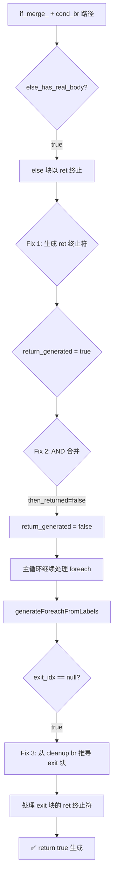

# 变更摘要：if/foreach 控制流三重缺陷修复

**日期**: 2026-08-30  
**模块**: `src/aot/native_linker.zig`  
**修复脚本**: `f033_state_pattern_order_machine.php`, `f051_validator_rule_chain_batch.php`

---

## 1. 高层摘要 (TL;DR)

修复了 `if_merge_` + `cond_br` 路径中 else 块以 ret 终止时终止符未生成、`return_generated` 状态错误传播、以及 foreach 无 `foreach_exit_` 标签时 exit 块未处理三个关联缺陷。这三个缺陷共同导致 `transition()` 函数返回 NULL 而非 `true`，使 `f033` 状态机脚本输出错误。

---

## 2. 影响范围

| 脚本 | 修复前 | 修复后 |
|------|--------|--------|
| f033_state_pattern_order_machine.php | FAIL_DIFF (返回 NULL) | ✅ PASS |
| f051_validator_rule_chain_batch.php | FAIL_DIFF | ✅ PASS |
| 其余 12 个失败脚本 | 不变 | 不变 (零新增) |

---

## 3. 核心变更

| # | 位置 | 变更描述 |
|---|------|----------|
| Fix 1 | 行 7158-7184 | `else_has_real_body=true` 路径中，else 块以 ret/throw 终止时，生成 cleanup + return 语句 |
| Fix 2 | 行 7237-7243 | `else_has_real_body=true` 时，`return_generated` 合并逻辑从 OR 改为 AND |
| Fix 3 | 行 10100-10136 | `generateForeachFromLabels` 中 `exit_idx=null` 时，从 cleanup 块 br 推导 exit 块并处理 |

---

## 4. 可视化概览

---

## 5. 详细变更分析

### Fix 1: else 块 ret 终止符生成

**问题**: `else_has_real_body=true` 路径（行 7150-7187）只生成 else 块的指令，不处理终止符。当 else 块以 ret 终止（如 `if(isset) {...} else { return true; }`），ret 语句丢失。

**修复**: 在行 7160 之后（指令生成完毕后），添加 `eb.terminator` 的 ret/throw 处理，包括 cleanup regs 释放和 return 语句生成。

### Fix 2: return_generated AND 合并

**问题**: Fix 1 生成 ret 后 `return_generated=true`，但 then 块以 br 终止（未 ret）。OR 合并导致 `return_generated=true`，主循环跳过 foreach 循环。

**修复**: `return_generated = then_returned and else_returned`。只有两条路径都 ret 时，后续代码才不可达。

### Fix 3: foreach exit 块处理

**问题**: IR 生成器不为 foreach 循环创建 `foreach_exit_` 块时，`exit_idx=null`，cleanup 块之后的 ret 块（如 `return true`）未被处理。`return_generated=true`（来自 foreach body 的 `return false`）导致主循环批量标记后续块为 processed 并跳过。

**修复**: `exit_idx=null` 时，从 cleanup 块的 br 终止符推导 exit 块，移除 processed 标记，保存/恢复 `return_generated`，用 `generateLabelDrivenBlockRange` 处理。

---

## 6. 影响与风险评估

- **是否破坏式变更**: 否
- **变更影响范围**: `if_merge_` + `cond_br` 路径的 `else_has_real_body=true` 分支 + `generateForeachFromLabels` 的 `exit_idx=null` 路径
- **复测路径**: `f033_state_pattern_order_machine.php` + `repro_f033_c.php` 的 AOT 输出与 PHP 解释器一致

---

## 7. 遗留问题

- `f033` 之外仍有 12 个失败脚本（非本次修复范围）
- `f061` segfault 可能与递归 + foreach 相关，需独立排查

---

## 8. 后续建议

| 优先级 | 建议 | 影响面 | 落地成本 |
|--------|------|--------|----------|
| P1 | 排查 `f061_graph_dijkstra_bellmanford_floyd.php` 的 segfault | 递归+foreach 路径 | 中 |
| P1 | 排查 `f070`/`f134` event sourcing 的 history 差异 | 事件溯源+快照 | 中 |
| P2 | 排查 `f065` SHA1 哈希值差异 | 内置函数实现 | 低 |
| P2 | 统一 `return_generated` 的 save/restore 策略到所有循环函数 | 代码生成健壮性 | 高 |
