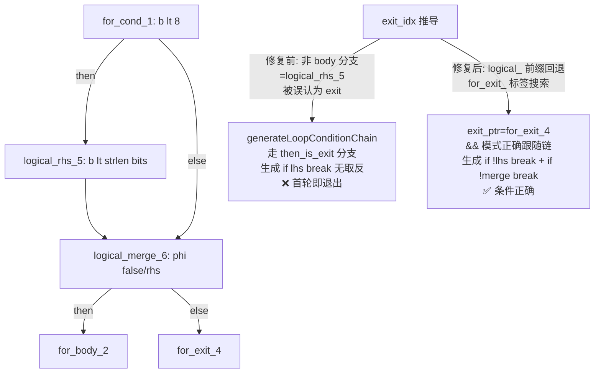
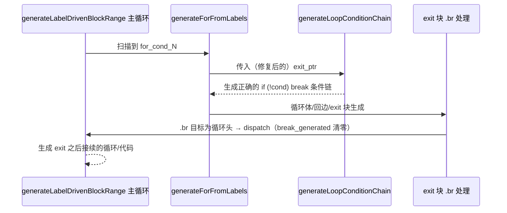

# 变更摘要：break_generated 语义冲突 + 条件链 exit 误判 + 恢复被误删的条件链生成代码（f027/f025/f028）

> 日期：2026-09-19 | 涉及文件：`src/aot/native_linker.zig`
> 编译状态：✅ `zig build` 通过
> 回归状态：✅ 全量 85 脚本回归 PASS 59，零新增回归（f027/f028 转 PASS，f025/f113 从超时/崩溃转 FAIL_DIFF）
> 上级交接链：
> - `docs/changes/2026-08-31/handoff_session6.md`（会话 6：f061 isset continue 修复）
> - 本文档

---

## 1. 高层摘要（TL;DR）

本会话接收会话 6 交接的 f061 遗留任务并审查进度，实际成果：

1. **f061 遗留 P0 已解决**：会话 6 未沉淀文档的循环头守卫等修复已使 f061 完整脚本逐字节 PASS（AOT 输出与 PHP 解释器完全一致），两个最小复现脚本（f061_no_continue / f061_min_dijkstra2）均 PASS。
2. **全量回归发现 f027 新增回归（PASS→FAIL_DIFF）并根治**：根因为 `break_generated` 标志的"continue 已生成"与"后续代码不可达"两种语义冲突，导致 exit 块之后接续的循环（sieve 收集循环）被整体吞掉。
3. **f025 Hamming decode 死循环根治**：`generateForFromLabels` 的 exit_idx 推导未排除 `&&/||` 短路条件链块，导致 `generateLoopConditionChain` 生成**取反错误**的 break 条件（循环首轮即退出）。
4. **恢复会话 6 未提交修改中意外丢失的 6 个条件链 if 前缀 print**：这些行丢失导致循环条件含短路链时生成**残缺 Zig 代码**（编译失败）或**语义颠倒**的 break。
5. f028（FAIL_COMPILE）连带转 PASS，f025/f085/f177/f113 从超时/崩溃转为 FAIL_DIFF（新暴露可攻坚的输出差异）。

## 2. 影响范围

| 维度 | 说明 |
|------|------|
| 模块 | AOT 编译器 - 原生代码生成器（native_linker.zig） |
| 函数 | `generateForFromLabels`（exit 块 .br dispatch、exit_idx 推导）、`generateLoopConditionChain`（6 个 break 分支恢复） |
| 脚本影响 | f027（回归修复）、f028（连带 PASS）、f025（Hamming/RLE 段修复）、所有"循环条件含 &&/||"及"for exit 后接续循环"的 PHP 脚本 |
| 运行时 | 无（纯代码生成器修复，runtime_lib_template.zig 未改动） |
| 兼容性 | 无破坏式变更；生成代码的正确性提升（残缺/颠倒的 break 条件恢复正常） |

## 3. 核心变更

| # | 变更点 | 位置（约） | 内容 | 归因 |
|---|--------|-----------|------|------|
| 1 | exit 块 .br dispatch 前 break_generated 清零 | generateForFromLabels exit 块 `.br` 处理（~11755） | dispatch generateLabelDrivenBlockRange 前置 `self.break_generated = false`，函数返回由 defer 恢复入口值兜底 | continue 生成路径设置 break_generated=true（"continue 已生成"语义），dispatch 主循环误判为"不可达"吞掉后续循环 |
| 2 | exit_idx 推导排除短路链块 | generateForFromLabels exit_idx 推导（~10444） | cond_br 的 then/else 指向 `logical_` 前缀块时不再当作 exit，回退 `for_exit_` 标签搜索 | 循环条件含 &&/|| 时非 body 分支是 logical_rhs_/logical_merge_ 而非 exit，误判导致 generateLoopConditionChain 收到错误 exit_ptr |
| 3 | 恢复 6 个条件链 if 前缀 print | generateLoopConditionChain"直接指向 body/exit"6 分支（~13046） | 恢复 `try writer.print("{s}if (!(", ...)` / `("{s}if (" ...)` 及 2 条注释 | 会话 6 未提交修改中意外丢失（git diff HEAD 佐证），导致生成 `reg_8.toBool())) {` 残缺 Zig 语句或无 break 条件 |

## 4. 可视化概览（Code & Logic Map）

### 4.1 缺陷 1：break_generated 语义冲突（f027 sieve）

```mermaid
flowchart TD
    A[for_cond_3 外层循环条件] -->|cond_br| B[for_body_4 循环体]
    B -->|if sieve i| C[if_then_7 → 内层筛除 for]
    B -->|else| D[if_merge_8 PHI + 增量]
    D -->|.br 回边| E[主循环 .br case<br/>生成 continue :__for_0<br/>设置 break_generated=true]
    E --> F[for_exit_6 exit 块<br/>primes=[] 初始化]
    F -->|.br for_cond_14| G{dispatch 收集循环}
    G -->|修复前: break_generated=true<br/>主循环判定不可达 直接 return| H[❌ 收集循环丢失<br/>sieve 返回 null]
    G -->|修复后: break_generated=false<br/>exit 块在 continue 后语义可达| I[✅ 收集循环正常生成]
```

### 4.2 缺陷 2：条件链 exit 误判（f025 Hamming decode）



### 4.3 变更点执行时序（上层到底层）



## 5. 详细变更分析

### 5.1 涉及文件

| 文件 | 修改类型 | 说明 |
|------|---------|------|
| `src/aot/native_linker.zig` | 修改 | 3 处修复 + 8 行恢复（详见第 3 节） |

### 5.2 f027 根因链（IR → 生成的 Zig 代码）

```text
IR: for_exit_6: ... br for_cond_14（收集循环头）
生成（修复前）:
    reg_43 = runtime.Value.initArray(...);        // $primes = []（exit 指令生成了）
}                                                  // 外层 for 结束，收集循环整体缺失
return runtime.Value.initNull();                   // 兜底返回 null → count(null)=0
生成（修复后）:
    ... 收集循环 __for_1: while(true) { ... } 正常生成
```

### 5.3 f025 根因链（生成代码对比）

```text
修复前（残缺/颠倒）:
    reg_8 = try runtime.php_lt(reg_97, reg_7);
reg_8.toBool())) {            ← 6 个 print 丢失后的残缺语句（编译失败）
    或
    if (reg_5.toBool()) break; ← then_is_exit 误判路径（无取反，首轮退出）

修复后（完整正确）:
    reg_8 = try runtime.php_lt(reg_97, reg_7);
    if (!(reg_8.toBool())) {
        break :__for_0;
    }
```

### 5.4 诊断方法沉淀

- `--dump-ir` / `--dump-zig-path` 双层对照：先看 IR 块结构，再看生成 Zig 代码
- ListWriter 写入审计（临时 trace，已移除）：定位 print 丢失型缺陷
- `sample <pid>` 采样：区分"死循环"与"内存分配风暴"（f025 LZW 实测为 mmap 风暴）

## 6. 影响与风险评估

| 项 | 评估 |
|----|------|
| 是否破坏式变更 | 否。三处修复均为"恢复正确语义/恢复丢失代码"，缩小了生成代码的错误面 |
| 变更影响范围 | 所有 for/while 循环条件含 &&/|| 的脚本；所有 for exit 后接续循环的脚本；无 runtime 改动 |
| 需要特别注意的点 | 恢复的 6 个 print 与 HEAD 逐字一致（git diff 校验 `{s}if (!(` 计数 8=8）；`break_generated = false` 仅影响 dispatch 内部，函数返回由 defer 恢复入口值 |
| 复测路径 | `zig build` → `bash scripts/regression_test_720.sh`（85 脚本）→ 专项验证 f027/f028/f025/f061/f033/f051/f042/f104 |

## 7. 遗留问题 / 潜在问题

| 优先级 | 事项 | 说明 |
|--------|------|------|
| P0 | FAIL_DIFF 16 项逐个攻坚 | 本次新增可攻坚面：f025（剩 LZW decompress）、f085、f177、f113（崩溃→输出差异） |
| P1 | **嵌套 else-if 链 PHI 合并缺陷**（f025 LZW decompress 根因） | elseif 路径的变量赋值（如 `$entry = $w . $w[0]` → reg_73）未纳入 merge 块 PHI 消解（merge 只取 isset 路径的 reg_72），导致 elseif 路径的赋值丢失。另发现 echo 中 `??` 运算符生成空 if/else 体（显示层）及该场景下 mmap 分配风暴 |
| P1 | 超时项 f007/f038/f095/f178 | exit=124/142，需逐个确认算法复杂度 vs 死循环 |
| P2 | f124/f135 崩溃（139/133） | 信号崩溃待定位 |
| P2 | 其他 FAIL_DIFF 共性分析 | f097/f117（TF-IDF 类）、f070/f134（EventSourcing 类）、f006/f009/f031/f065/f087/f151/f160/f163 |

## 8. 后续开发 / 优化建议

| 优先级 | 影响面 | 落地成本 | 建议 |
|--------|--------|---------|------|
| P0 | 所有含 elseif 链的 PHP 脚本 | 中 | 攻坚嵌套 else-if 链 merge PHI 合并：在 cond_br 处理的 else 块（嵌套 if）路径中，将 elseif-then 路径的赋值纳入 merge PHI incoming（f025 LZW 是现成复现） |
| P1 | 所有输出差异脚本 | 低 | 建立"首个差异行"自动定位工具（diff 首行 + 对应 PHP 源行号），加速 FAIL_DIFF 分类 |
| P1 | 诊断效率 | 低 | 将 ListWriter 写入审计固化为可选环境变量开关（`AOT_TRACE_WRITES=1`），本次临时 patch 的高频痛点 |
| P2 | 代码健康 | 低 | `generateLoopConditionChain` 存在与 `generateWhileFromLabels` 内类似的条件链逻辑，后续可评估统一；`break_generated` 标志的双语义（不可达 vs continue 已生成）建议拆分为独立标志 |
| P2 | 回归覆盖 | 低 | 会话 6 的未提交修改曾意外丢失 6 行生成逻辑且无测试拦截，建议为核心生成路径增加"生成代码语法完整性"冒烟用例（如最小 && 循环条件用例入回归集） |
