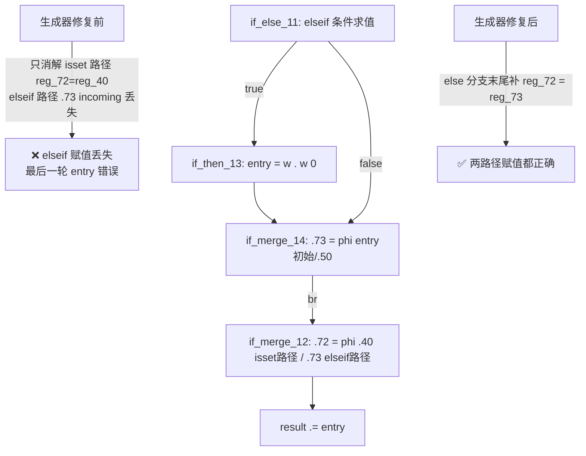

# 变更摘要：f025 elseif 链 PHI 消解修复 + f087 嵌套短路链展开（会话 8）

> 日期：2026-09-19 | 涉及文件：`src/aot/native_linker.zig`
> 编译状态：✅ `zig build` 通过
> 回归状态：✅ 85 脚本 PASS 60（+1：f025 转 PASS），零新增回归
> 上级交接链：
> - `docs/changes/2026-09-19/break_generated语义与条件链exit误判修复_f027f025.md`（会话 7）
> - 本文档

---

## 1. 高层摘要（TL;DR）

本会话继续攻坚会话 7 交接的 P0 目标——**f025 LZW decompress 的 elseif 链 merge PHI 合并缺陷**，并连带修复了 f087 的嵌套短路链缺陷：

1. **f025 完整转 PASS**（FAIL_RUNTIME → PASS）：修复 elseif 链中 elseif 路径的变量赋值未纳入 merge 块 PHI 消解的缺陷。
2. **f087 差异 8 处 → 2 处**：修复嵌套短路链（`&&` 右侧的 `||` 链）的 merge phi 未消解、rhs 块错位发射的问题。
3. **发现并修复了会话 7 遗留的文件损坏**：工作区 native_linker.zig 曾因 `readlines()+'\n'.join()` 脚本缺陷导致全文件空行翻倍（+29122 行噪音），本次以 staged 版本为基底重建工作区，git diff 恢复干净（283+/7-）。

## 2. 影响范围

| 维度 | 说明 |
|------|------|
| 模块 | AOT 编译器 - 原生代码生成器（native_linker.zig） |
| 函数 | `generateForFromLabels`（cond_br case else 分支）、`generateLabelDrivenBlockRange`（then terminator `.cond_br` 分支）、`generateForeachFromLabels`（else_is_be 分支） |
| 脚本影响 | f025（转 PASS）、f087（差异减半）；所有"if/elseif 链路径赋值"与"&&/|| 嵌套短路链"场景 |
| 运行时 | 无改动 |
| 工程健康 | 工作区文件空行翻倍损坏修复，git diff 可读性恢复 |

## 3. 核心变更

| # | 变更点 | 位置（约） | 内容 | 成果 |
|---|--------|-----------|------|------|
| D | elseif 链 merge PHI 消解 | generateForFromLabels cond_br case 的 else 处理末尾（~11490） | else 路径经嵌套 if/elseif 汇合到嵌套 merge 块（如 if_merge_14）后 br 回外层 merge 时，在 else 分支末尾补发外层 merge phi 中来自该嵌套 merge 块的 incoming 消解 | f025 LZW decompress 的 `$entry = $w . $w[0]`（elseif 路径）不再丢失，**f025 完整 PASS** |
| E1 | 嵌套短路链展开 | generateLabelDrivenBlockRange then terminator `.cond_br` 分支入口 | 检测 then 目标是 logical_merge_ 且 else 目标是 logical_rhs_（&& 右侧的 || 链），直接展开为 `if (cond) { merge←cond边 } else { <rhs 指令>; merge←rhs边 }`，标记两块 processed | C 链（`$p->a === $action \|\| $p->a === '*'`）的 merge phi（reg_33）正确消解，rhs 块不再错位发射 |
| E2 | 嵌套链外层 merge then 边补消解 | 同上分支末尾 | 嵌套 merge 块被标记 processed 后，其 .br 触发的外层 merge phi then 边消解（reg_34 = reg_33）需补发；外层 merge 块经嵌套 merge 块的 .br 终止符取得（本层 merge_bi 尚未赋值） | && 合并的 then 边值恢复，整体条件不再恒 false |
| F | foreach else_is_be 对称预防 | generateForeachFromLabels else_is_be 分支 | then 非 break（ret/throw 终止）且 else 是回边时清 return_generated，让收尾增量发射继续 | 预防性（f087 实际路径未走到，见遗留） |
| G | 工作区文件修复 | 全文件 | 以 staged 版本（会话 6 完成状态）为基底 + 重新应用会话 7 修复 A/B，消除 29122 行空行噪音 | git diff 恢复 283+/7- 的可读状态 |

## 4. 可视化概览（Code & Logic Map）

### 4.1 缺陷 D：elseif 链 PHI 丢失（f025 LZW decompress）



### 4.2 缺陷 E：嵌套短路链（f087 hasPermission）

```text
IR:  logical_rhs_7: .28 = (a===action); br .28, logical_merge_10, logical_rhs_9
     logical_rhs_9: .32 = (a==='*');    br logical_merge_10
     logical_merge_10: .33 = phi [.28,.32]

修复前生成:  reg_28 = identical(C);
             // PHI: reg_33 ← 占位注释，未消解！
             reg_34 = reg_33;            ← 读到 null → 条件恒 false
             ...D 的评估错位发射到 return 之后...

修复后生成:  reg_28 = identical(C);
             if (reg_28.toBool()) { reg_33 = reg_28; }
             else { <D 指令>; reg_33 = reg_32; }
             reg_34 = reg_33;            ← then 边值正确
```

### 4.3 变更执行流程

```mermaid
sequenceDiagram
    participant Loop as generateLabelDrivenBlockRange 主循环
    participant SC as then terminator .cond_br（新增短路链分支）
    participant M as 外层 merge phi 消解
    Loop->>SC: then 块 terminator 是嵌套短路链 cond_br
    SC->>SC: 展开 if (cond) {merge←cond边} else {rhs; merge←rhs边}
    SC->>M: 补发外层 merge 的 then 边 incoming（经嵌套 merge 的 .br 取得）
    M-->>Loop: merge 值正确，条件链完整
```

## 5. 详细变更分析

### 5.1 涉及文件

| 文件 | 修改类型 | 规模 |
|------|---------|------|
| `src/aot/native_linker.zig` | 修改 | 283+/7-（相对 HEAD，含会话 7 修复 A/B） |
| `fuzzy_scripts_720/regression_failures.tsv` / `regression_report.md` | 回归刷新 | 两次全量回归 |
| `fuzzy_scripts_720/tmp/f087_min*.php` | 新增复现脚本 | f087 诊断现场（7 个渐进复现） |

### 5.2 f025 根因与修复验证

| 场景 | 修复前 | 修复后 |
|------|--------|--------|
| f025_lzw_min.php（decompress 5 codes） | ababbaba ❌ | ababbabab ✅ |
| f025 完整脚本 | FAIL_RUNTIME/FAIL_DIFF | ✅ 逐字节一致 |
| Hamming/RLE/LZW/CRC 全链 | LZW decompress 错误 | ✅ 全部正确 |

### 5.3 f087 诊断现场（供下一会话续接）

- **已解决**：嵌套短路链 merge phi 未消解 + rhs 块错位（E1/E2），f087 差异从 8 处减至 2 处（Alice/Carol 权限全部恢复正确）
- **残留**（Bob 的 article:write / comment:read 继承，2 处）：
  - 复现：`fuzzy_scripts_720/tmp/f087_min6.php`（AOT=true,false,false,false / PHP=true,true,true,false）
  - 现象：foreach 内 `if ((A||B) && (C||D)) return true;` **首轮不命中后循环直接退出**（无第二轮、无 children 递归）
  - 已排除：增量发射条件满足（打印确认 `brk=false lastIsRet=false inc_idx=14 ninsts=3`）但指令未出现在产物中；`generateForeachFromLabels` 收尾打印只出现 1 次（两个 foreach 应各一次），且插入的 tail 打印（entry/收尾各点）部分未出现在输出中——**插入位置与实际执行路径不匹配**，需要 ListWriter 写入审计（会话 7 曾临时实现）精确追踪发射序列
  - 关键疑点：第一个 foreach 的增量指令（reg_37 = iter_next(reg_59)）完全缺失；exit 块（foreach_cond_13，第二 foreach 头）有 cond_br 终止符触发 `return ei` 提前返回（~10091），跳过收尾的可能性待排除

## 6. 影响与风险评估

| 项 | 评估 |
|----|------|
| 是否破坏式变更 | 否。所有修复均为"补发缺失的 PHI 消解/恢复正确的短路结构" |
| 变更影响范围 | elseif 链路径赋值、嵌套短路链场景；回归 85 脚本零回归 |
| 需要特别注意的点 | E1/E2 的展开分支覆盖"then 目标=logical_merge_ 且 else 目标=logical_rhs_"模式（&& 右侧 ||）；对称的"then 是 logical_rhs_ 且 else 是 logical_merge_"（&& 左侧）由 f044 已有的 sc_is_and/sc_is_or 路径覆盖，未触碰 |
| 复测路径 | `zig build` → `bash scripts/regression_test_720.sh` → 专项 f025/f087/f027/f028/f061/f033/f051 |

## 7. 遗留问题 / 潜在问题

| 优先级 | 事项 | 说明 |
|--------|------|------|
| P0 | f087 残留 2 处差异 | foreach 内 ret+回边场景的增量发射丢失，现场见 5.3 节；建议下一会话用 ListWriter 写入审计定位发射序列 |
| P0 | FAIL_DIFF 其余 15 项 | f006/f009/f031/f065/f070/f097/f113/f117/f134/f151/f160/f163/f177 + f087 残留 |
| P1 | FAIL_RUNTIME 9 项 | f007/f038/f095/f178（超时）、f037/f067/f161、f113/f124/f135 中的崩溃项 |
| P2 | `lastLineIsReturn` 启发式 | 在嵌套结构下不可靠（检查 writer 全文尾行而非当前控制流位置），f087 诊断中疑似参与拦截，可评估替换为控制流标志 |

## 8. 后续开发 / 优化建议

| 优先级 | 影响面 | 落地成本 | 建议 |
|--------|--------|---------|------|
| P0 | f087 及同类循环内 ret 场景 | 中 | 用 ListWriter 写入审计（临时 trace 手段已在会话 7 验证可行）追踪第一个 foreach 的发射序列，定位增量指令的缺失环节 |
| P1 | 诊断效率 | 低 | 将写入审计固化为环境变量开关（`AOT_TRACE_WRITES=1`），避免每次临时 patch |
| P1 | 回归覆盖 | 低 | 本会话的 f025_lzw_min / f087_min6 / f025_decode_min5 等最小复现质量高，建议筛选入回归集 |
| P2 | 代码健康 | 高 | generateForeachFromLabels/generateForFromLabels/generateWhileFromLabels 三者的 cond_br case 存在大量近似重复（else_is_be/else_is_coalesce/merge 消解各有细微差异），长期应抽取统一框架；短期每次修改需三处对称核对 |
