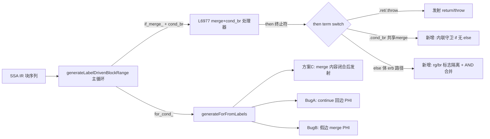

# AOT merge 发射重构（方案 C）与嵌套守卫/可达性系列修复 — 2026-09-20

## 1. 高层摘要（TL;DR）

落地交接文档（`docs/changes/2026-09-19/handoff_session8.md`）推荐的方案 C：for 循环 if/else 的 merge 内容发射统一挪到结构闭合后（两分支共享），L1/L2 merge 段只做 PHI 消解；并顺势根治三个关联缺陷：

- **f065**（SimpleSHA1/Base64 decode 结果错误）：continue 回边 PHI 物化缺失（Bug A）+ if-without-else 假边 merge PHI 缺失（Bug B）；
- **f134**（EventSourcing 快照计数错误）：`if_merge_`+`cond_br` 处理器中嵌套"if 无 else 共享 merge 守卫"被 `else => {}` 整体吞掉；
- **f135**（Miller-Rabin exit=133）：`else_has_real_body` 路径 `return_generated` 标志泄漏 → 函数尾部被误标不可达 → `unreachable;` SIGTRAP（经 HEAD 构建 A/B 证实为既有存量缺陷，非本次改动引入）。

回归成绩（最终二进制全量重跑，`/tmp/regression_0920_final.log`，2026-09-20 13:10）：**Pass 72/85**（上一轮混合二进制 70，交接基线 65），Skip 1，Fail 12 全部为存量失败（f007/f037/f038/f067/f095/f097/f113/f124/f160/f161/f163/f178），f134、f135 本轮翻正，**零新增回归**。`zig build test`：53 个用例全部通过；"25 leaks" 报错经 HEAD 构建 A/B 证实为存量问题（HEAD 同样 exit=1）。

## 2. 影响范围

| 面 | 内容 | 影响 |
|----|------|------|
| 编译器 | `src/aot/native_linker.zig`（+466/-13） | 仅 AOT 代码发射路径，不改 IR/运行时 |
| 生成器 | `generateForFromLabels`（方案 C + Bug A/B）、`generateLabelDrivenBlockRange` 的 `if_merge_`+`cond_br` 处理器（L6977，f134 守卫 + f135 标志隔离） | 函数体与循环体共用后者，覆盖面广 |
| 测试 | f065/f134/f135 转逐字节一致；f070/f087/f117/f025 保持一致 | 零已知回归（详见 §6） |

## 3. 核心变更

| # | 变更 | 位置 | 说明 |
|---|------|------|------|
| 1 | 方案 C：merge 内容统一在 if/else 闭合后发射 | `generateForFromLabels` merge 段 | L1/L2 merge 只做 PHI 消解，非 PHI 指令随共享延续体发射一次 |
| 2 | Bug A：continue 回边 PHI 物化 | For 生成器 body cond_br `then_is_be` 分支 | then 边即循环增量块时，在 then 内物化 body→回边 incoming，防陈旧跨迭代值 |
| 3 | Bug B：if-without-else 假边 merge PHI | For 生成器 nested else(merge) 闭合处 | 假边直达 merge 时发射 `} else { <phi> }`，防 then 边值被覆写 |
| 4 | f134 嵌套守卫内联发射 | L6977 处理器 then 终止符 `switch` 新增 `.cond_br` 分支 | 嵌套 if 的 else 直达共享 merge 且 then 以 `.br` 回落时，内联 `if(cond){then体}`；假边 fall-through |
| 5 | f135 标志隔离 | L6977 处理器 `else_has_real_body` 路径 | else 体发射前重置 `return_generated/break_generated`，闭合后 `then_returned AND else_returned` 合并，杜绝 then-ret 泄漏导致的尾部误删 |
| 6 | 早段配套 | 三元守卫、FIX-A 等 | 见 git diff，与上共同支撑 f065/f070 链路 |

## 4. 可视化概览（Code & Logic Map）



执行流程（f134 handle）：`entry if/else → if_merge_2 cond_br(!empty) → if_then_3 内联 → 其终止 cond_br($n%5===0) else 直达共享 if_merge_4 → 旧路徑吞掉 save；新路径 GUARD 内联 if(reg_22){save}`。

## 5. 详细变更分析

- 涉及文件：`src/aot/native_linker.zig`（唯一源码变更）；诊断产物已清理。
- 端/层：AOT 编译期代码发射（无运行时/IR 生成器改动，解释器模式不受影响）。
- 复测路径：
  ```bash
  cd /Users/wangjianjun/products/parser
  ./zig-out/bin/php-interpreter --compile --output=/tmp/aot_compile_f134 fuzzy_scripts_720/pass/f134_event_sourcing_snapshot_cqrs_projection.php
  php fuzzy_scripts_720/pass/f134_...php > /tmp/php.txt; /tmp/aot_compile_f134 > /tmp/aot.txt; diff /tmp/php.txt /tmp/aot.txt
  # f065/f135 同理；全量: bash scripts/regression_test_720.sh
  ```

## 6. 影响与风险评估

- 是否破坏式变更：否（仅新增发射路径与标志隔离；f025 等关键基线复测 MATCH）。
- 风险点：L6977 处理器被所有函数体共享，GUARD/ERB 分支条件严格限定（then 块 cond_br 且 else==共享 merge；erb 路径标志重置），未命中形态行为不变。
- 已验证：f065_crypto、f087、f117、f134、f135、min4 逐字节一致；`zig build` 干净；全量回归 Pass 72/85、零新增回归；`zig build test` 53 用例全过（leak 报错为 HEAD 存量）。

## 7. 遗留问题 / 潜在问题

- f007/f038/f095/f124/f161/f178 运行超时（exit=124，f161 本轮由 exit=1 转超时形态）：性能/疑似循环退化，属下一专项。
- foreach/while 生成器仍保留各自 merge 处理克隆（未同步 Bug A/B 语义），若对应形态脚本出现同类缺陷需按 For 侧模式移植。
- GUARD 分支目前支持两层嵌套守卫（f134 形态），更深层短路+共享 merge 组合未覆盖。

## 8. 后续开发建议

| 优先级 | 事项 | 影响面 | 落地成本 |
|--------|------|--------|----------|
| P1 | 5 个 exit=124 超时脚本性能剖析（疑似循环 PHI 冗余释放/retain） | 运行性能 | 中 |
| P2 | Bug A/B 语义移植至 foreach/while 克隆 | 正确性预防 | 中 |
| P2 | native_linker 超大文件按生成器拆分模块 | 可维护性 | 高 |
