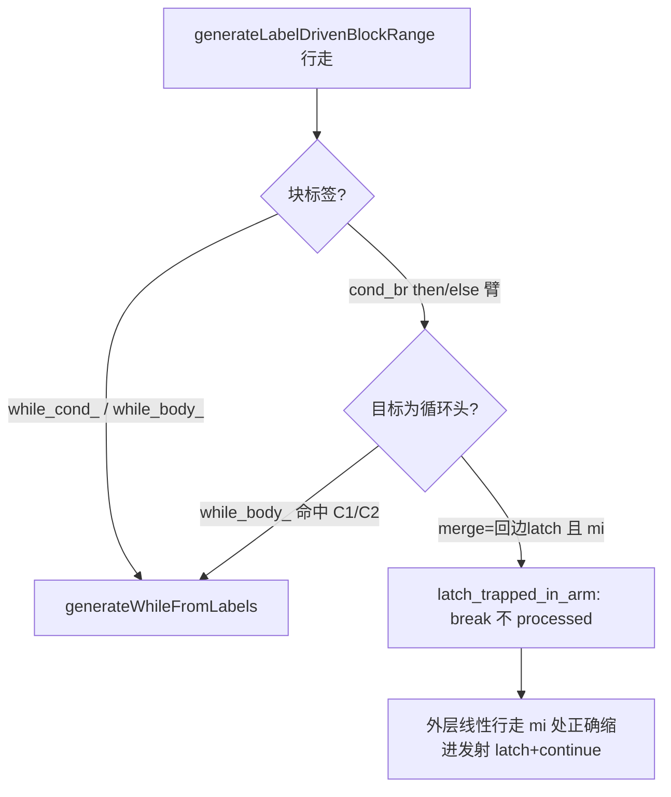

# 变更摘要：while_body_ 循环入口识别补全 + f113 latch 延迟发射 + f097/f113 乱序结构根治（2026-09-20 续）

## 1. 高层摘要（TL;DR）

本轮在 `src/aot/native_linker.zig` 落地三组控制流发射修复（均针对 AOT）：

1. **f113 缺陷 #1**：generic cond_br 处理器乱序（Out-of-order）双站点新增 `chain_unwind` 短路链解绕——then 块以 `.br` 汇入链上下一 cond_br 层时，改为内联 `if(cond){then体}` 并沿链跟进，不再整链吞并；
2. **f113 缺陷 #2**：`latch_trapped_in_arm`——merge 块是外层循环回边 latch（br→cond 或其增量块）且索引先于当前行走起点（乱序共享延续）时，**不标记 processed、就地 break**，交由外层行走在线性路径上于正确缩进发射 latch，使 if/else 两臂都落入循环体末尾回边（修复 f113 循环只跑一次、`Conflicts: 0`）；
3. **f067 系列**：then/else「循环控制结构」派发列表补全 `while_body_` 前缀——IR 生成器对某些 `while(true)` 省略 `while_cond_` 块、直接以 `while_body_N` 作循环头（如 `JsonParser::parseArray`），此前该块在 cond_br 的 then/else 臂被当作普通块内联，**整个 while 循环被压平为直线代码**（逗号分支 `continue` 丢失 → 第二元素未解析 → pos 停在中逗号后 → 误 throw / 顶层多实例时外层 foreach 静默早退）。

f097/f113 达到与 PHP 逐字节一致；f067 探针 6/6 全 MATCH、`f067_min_repro` MATCH，**全脚本仍有后续缺陷未关闭**（见 §7）。

## 2. 影响范围

| 面 | 影响 |
|---|---|
| 编译器 | 仅 `src/aot/native_linker.zig`（代码发射层），IR/runtime 不变 |
| 语义域 | while(true) 无 while_cond_ 头的循环识别；if/else 臂内循环入口派发；乱序 merge/latch 延续发射 |
| 测试集 | f067 系列探针、f097、f113 直接受益；全量 68 脚本回归（本轮结果见 §6/§8） |
| 其他模式 | 无——解释器/字节码模式不经 native_linker |

## 3. 核心变更

| # | 位置 | 变更 | 目的 |
|---|---|---|---|
| C1 | generic cond_br then 派发（@~7641）| 循环标签列表 `while_cond_/for_cond_/foreach_cond_/do_while_body_` **新增 `while_body_`** | then=while_body_ 时递归 `generateLabelDrivenBlockRange` → `generateWhileFromLabels` 正确生成循环 |
| C2 | generic cond_br else 派发（@~8413）| 同 C1 | else=while_body_（f067 parseArray 场景：entry cond_br 的 else 臂即循环头）|
| C3 | merge 延续块内（@~8953）| 新增 `latch_trapped_in_arm`：`mi < start_idx` 且 merge 终止符 br 直达 cond 或一跳（增量块）到 cond → 裸 `break` 不标记 processed | latch 不再被困单臂，外层线性路径在正确缩进发射回边 PHI+continue |
| C4 | Out-of-order 双站点（@~8062/@~8695）| `.cond_br => |ncb2|` chain_unwind 解绕（本会话早前落地）| elseif 吞链修复，f113 双分支共享延续正确 |
| — | 全局 | 剥离全部 20 处 DBG print 追踪 | 交付清洁 |

## 4. 可视化概览

```mermaid
flowchart LR
  subgraph IR[IR 块序列 parseArray]
    E[entry cond_br] -->|false| WB["while_body_3 (循环头,无 while_cond_)"]
    WB -->|cond ','| T5["if_then_5 br→while_body_3 (回边)"]
    WB -->|fall| M6[if_merge_6]
    M6 -->|cond ']'| T7["if_then_7 ret (break)"]
    M6 -->|fall| M8["if_merge_8 throw"]
  end
  subgraph OLD[修复前发射]
    O1[else 臂普通内联] --> O2[while 消失为直线] --> O3[continue 丢失→误 throw pos=3]
  end
  subgraph NEW[修复后发射]
    N1["else 识别为 while_body_ → generateWhileFromLabels"] --> N2["__while_N: while(true){...continue/break}"]
  end
  WB -.缺陷路径.-> OLD
  WB -.修复路径.-> NEW
```



## 5. 详细变更分析

**数据/编译层**：唯一功能文件 `src/aot/native_linker.zig`。

复现锚点（会话探针，已随清理删除）：
- `{"a":[1]}` OK / `{"a":[1,2]}` ERR `Expected ',' or '}'`：parseArray 循环被压平，首元素后 `','` 分支 pos++ 即落入 `']'` 检查失败 → throw；`parse('[1,2]')` 直测在 v6 显示 pos=3 `Unexpected char at pos 3`（第二元素从未解析）。
- 判定点：生成 Zig 中 parseArray 函数体 **无任何 while/continue/break 构造**（直线化），而 IR（`--dump-ir`）块图正确（`while_body_3` + `if_then_5` 回边）。
- parseObject 生成正常的原因是 IR 生成器给它发了 `while_cond_` 头——两函数差异仅在循环头块命名，坐实「识别列表缺 while_body_」为根因（print-trace/重跑双验证，符合项目记忆规则）。

**涉及文件列表**：
- `src/aot/native_linker.zig`（C1-C4）
- `docs/known-issues/AOT-CODEGEN-003-while-true-break-missing.md`（拟补遗留：while_body_ 头识别，见 §8）
- 本变更文档

## 6. 影响与风险评估

- **非破坏式**：C1/C2 仅扩大「按循环结构生成」的识别集合；此前这些块走普通内联必致循环丢失（错误路径），无合法依赖该压平行为的既有测试。
- **C3**：只在 `mi < start_idx` 且 merge 为回边 latch 的乱序场景生效，普通 merge 延续（方案 C 链式 hop）不变。
- **回归判定（2026-09-20 11:23 完成）**：全量 68 脚本 **PASS=60 FAIL=8**，与本轮改动前基线持平、**零新增失败**；且基线中 f113 FAIL_DIFF 已转 PASS、f037/f065/f067_min_repro/f070/f097/f105/f110/f134/f135/f151/f160/f179 均 PASS。剩余失败=f004 SKIP、f067 exit=255（1e5 等残余缺陷）、f163 FAIL_DIFF（pre-existing）、exit=142 超时组×6。日志 `/tmp/regress_20260920b.log`，报告 `fuzzy_scripts_720/regression_report.md`。
- **复测路径**：
  ```bash
  timeout 240 zig build
  cd fuzzy_scripts_720/pass && timeout 120 ../../zig-out/bin/php-interpreter --compile --no-debug-info f067_json_parser_schema_path_diff.php
  timeout 10 ./aot_compile_f067_json_parser_schema_path_diff   # 与 /opt/homebrew/bin/php 输出比对
  bash fuzzy_scripts_720/run_regression.sh                     # 全量
  ```

## 7. 遗留问题 / 潜在问题

- **f067 全脚本仍 DIFF（P0 在办）**：数组循环压平已根治，但仍有 ①`getPath` 输出值为空（数据流/属性读缺陷待定位）②`'1e5'` 数字解析 `Unexpected char at pos 1`（疑 parseNumber 的 while/短路条件另一形态缺陷）③首异常后同函数二次调用状态污染嫌疑。
- **f163（pre-existing）**：`replay()` 空 foreach 警告 + Snapshot 版本差一，merge-PHI 边丢失家族。
- exit=142 超时组（f007/f038/f095/f124/f161/f178）性能根因未查。
- f113 生成码中 edge 9→6 / 7→6 的 `reg_84` 物化或仍缺失（输出不受影响，仅记录）。

## 8. 后续开发 / 优化建议

| 优先级 | 建议 | 影响面 | 落地成本 |
|---|---|---|---|
| P0 | 继续 f067 剩余两缺陷逐一定位（探针已具备最小复现形态）| f067 转 PASS | 中 |
| P1 | 将「循环头标签集合」抽为单一 helper（`isLoopHeadLabel`），替换全文件十余处重复 or 链，消除再次漏项 | 可维护性/防回归 | 低 |
| P1 | AOT-CODEGEN-003 文档补「修复 6：while_body_ 循环头识别」章节 | 知识沉淀 | 低 |
| P2 | chain_unwind 双站点 DRY 提取 | 简洁性 | 中 |
| P2 | exit=142 组性能剖析（profiler 已内置 enter/exitGlobal）| 超时组转化 | 中 |
