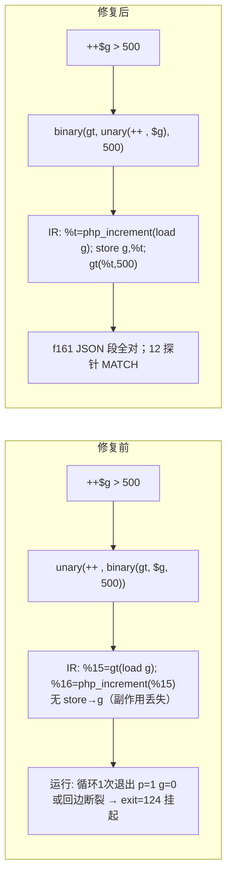

# f161 前缀自增结合性解析缺陷修复（缺陷A）+ 缺陷B 剖析交接

## 1. 高层摘要（TL;DR）

- **根因**：`src/compiler/parser.zig` 前缀 `++`/`--` 的操作数用 `parseExpression(0)` 解析，把整条二元表达式吞进自增：`++$g > 500` 被解析为 `++($g > 500)`。自增副作用打到临时值上、`$g` 写回丢失，`> 500` 变成对外层比较结果的二次判定。
- **修复**：操作数截断界从 `0` 改为 `70`（与 `!`/`minus` 的 69 界同族，但 **不** 吸收 `**`）：只允许访问链（`-> :: [] () `，优先级 ≥100 及 parseUnaryPostfix 无条件链）进入操作数，任何二元运算符都断在自增之外。
- **验证**：12 个 f161 系列探针全部逐字节 MATCH（含结合性矩阵 `++$g>500`、`--$h<0`、`++$m*2`、`++$p**2`、`++$k . "-s"`）；定点复验 f033/f038/f044/f061/f067/f095/f113/f124/f163 均 MATCH，零回归。
- **f161 现状**：JSON 段全对；XML 段仍挂起——暴露出**独立的 native_linker 缺陷B**（见 §8，`f161_c3_probe_tmp.php` 最小复现），修复 13 的臂尾复活仅 gate 在 `for_cond_`，`while_cond_` 存在同型缺口。

## 2. 影响范围

| 层 | 文件 | 影响 |
|---|---|---|
| 前端（共享） | `src/compiler/parser.zig` parseUnary `.plus_plus/.minus_minus` 分支 | 所有 `++$var <binop> …` / `--$var <binop> …` 形态的 AST 形状由 `unary(++, binary)` 纠正为 `binary(unary, …)` |
| AOT IR | `ir_generator.zig`（未改动） | 纠正后 `generateUnaryExpr` 的写回 switch 命中的目标从 binary_expr（落入 `else => {}`，静默丢失）变为 variable/property/array/static（正常写回） |
| 解释器 | tree-walk（共享 parser） | 同获正确语义（副作用为共享前端的必然结果，与 AOT 方向一致） |

## 3. 核心变更

```zig
// src/compiler/parser.zig  parseUnary()
.plus_plus, .minus_minus => {
    const token = self.curr;
    self.nextToken();
    // 与 !/minus 不同：PHP 文法要求前缀 ++/-- 操作数是变量（访问链 ≥100），
    // 连 ** 都不吸收：实测 `++$p ** 2` = (++$p)**2 → 9（$p=3），
    // 而 ++($p**2) 会得 5。70 截断同时保证
    // `++$g > 500` 解析为 `(++$g) > 500` 而非 `++($g > 500)`
    // （后者把自增副作用打到临时值上、丢失 $g 写回）。
    const expr = try self.parseExpression(70);
    return self.createNode(.{ .tag = .unary_expr, .main_token = token, .data = .{ .unary_expr = .{ .op = tag, .expr = expr } } });
},
```

界值论证（`parseExpression` 循环条件为 `next_p <= precedence → break`）：

| 运算符 | 优先级 | 70 界下行为 | PHP 实测语义 |
|---|---|---|---|
| `-> :: [] ()` 访问链 | 100/110（+parseUnaryPostfix 无条件） | 吸收 | `++$obj->m()` 合法目标 ✔ |
| `\|\>` pipe | 90 | 吸收 | 罕见，维持可解析 |
| `**` | 70 | **断** | `++$p**2` = (++$p)**2 → 9 ✔（实测钉死） |
| `* / %` | 60 | 断 | `++$m*2` = 4 ✔ |
| `+ - .` | 50 | 断 | `++$k . "-s"` = "1-s" ✔ |
| 比较 `< > ==` | 35–40 | 断 | `++$g > 500` ✔ |
| `&& \|\| ?: =` | ≤20 | 断 | ✔ |

## 4. 可视化概览



```mermaid
flowchart TD
  P[parseUnary] -->|++/--| Q["parseExpression(70)"]
  Q -->|curr 优先级 ≤70| R[断：操作数=变量访问链]
  Q -->|curr ≥100 访问链| S[吸收进操作数]
  R --> T[unary_expr(++, variable) → IR 正常写回]
  S --> T
```

## 5. 详细变更分析

| 项 | 内容 |
|---|---|
| 涉及文件 | `src/compiler/parser.zig`（唯一，+7/−4 行含注释） |
| 探针 | `fuzzy_scripts_720/tmp/f161_{m6,m6a,m6b,m6b_fn,m7,m8,m8a,m8b,c1,c2,c3,pp,xp,latch,w}_probe_tmp.php`（.php 永久保留） |
| 缺陷A最小复现 | `f161_pp_probe_tmp.php`（5 组结合性矩阵） |
| 缺陷B最小复现 | `f161_c3_probe_tmp.php`（while + 外层 if-else + then 臂内单语句 if(break) + merge 携带方法调用） |
| 复测路径 | `--compile` 后 `timeout 10` 运行，与 `/opt/homebrew/bin/php` 逐字节比对 |

## 6. 影响与风险

- **非破坏式**：纠正的是错误 AST 形状；原 `parseExpression(0)` 下所有被二元尾吞掉的 `++` 目标本来就落入 `else => {}` 丢写回（必错），不存在依赖旧错误形状的合法脚本。
- 风险点：`++$a |> f()`（pipe 90>70 被吸收）与 PHP 真实行为可能有微差——语料内无此形态，登记观察。
- 树形解释器共享此 parser，同步获得正确语义（§五精神：本缺陷即 AOT 编译链缺陷，修复路径唯一）。
- 复验矩阵：12 探针 + f033/f038/f044/f061/f067/f095/f113/f124/f163 定点 MATCH；**68 脚本全量回归未跑（待缺陷B收敛或交付前统一执行）**。

## 7. 遗留问题

1. **缺陷B（#16）**：f161 XML 段 native_linker 臂丢失——证据链：
   - dump-zig：外层 `if (reg_19.toBool())` 真臂只发射了内层条件计算（`reg_23 = identical(pos,4)`），随后无分支、无 `$out[]=$this->tick()`、无 pos++ latch；tick 的 method.call 全函数缺失。
   - walker trace：`CS0066 GLDR(nti+1=6, then_end=6)` 空走 → 嵌套 then/merge 块排在名义 outer merge 之后（OOO 布局），不在臂区；`CS0067 GLDR(6,10)` 发射 6,7；`CS0070 GLDR(3,8)` 头块含 ret → `TRSKIP i=3..7` bulk-mark；块 8-10 被静默标记 processed（编译成功但内容未发射）。
   - 修复13 的 BFS 复活 gate 在 `for_cond_` 前缀，`while_cond_` 同型缺口 → 推广复活逻辑或按 P1 统一 merge 边发射 helper。
2. **#14**：f007 caesar 臂丢失（且当前形态为输出半程后 60s 挂起，`user 10.9s / sys 49.1s`，疑 syscall 风暴，剖析时注意与挂死区分）。
3. **f178**：仍 exit=124，未剖析（echo 标记法同套路）。
4. **#12/#13**、fwrite(STDERR) AOT 丢失立卡、native_linker traces+CS 剥离、68 全量回归。

## 8. 后续开发建议

| 优先级 | 事项 | 影响面 | 落地成本 |
|---|---|---|---|
| P0 | 缺陷B：while 区臂尾穿越复活（推广修复13 / 统一 helper） | f161 闭环、f178/f007 可能同族 | 高（native_linker 深水区） |
| P0 | 交付前：剥离 traces+CS → `timeout 600 zig build` → 定点复验 → 68 全量回归 | 全局 | 中 |
| P1 | 把 GIFL/while/for 三处 merge 边发射统一为单 helper（消除第 6 处盲区） | 可维护性 | 高 |
| P2 | pipe `\|>` 与 `++` 结合性语料验证 | 极小 | 低 |
