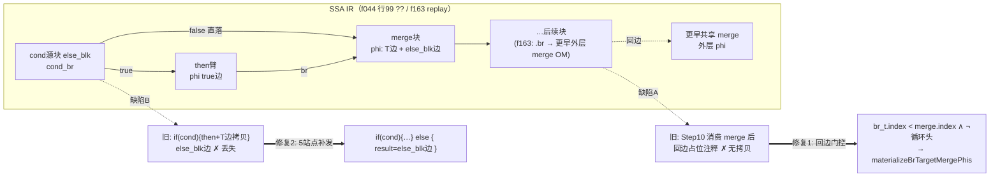
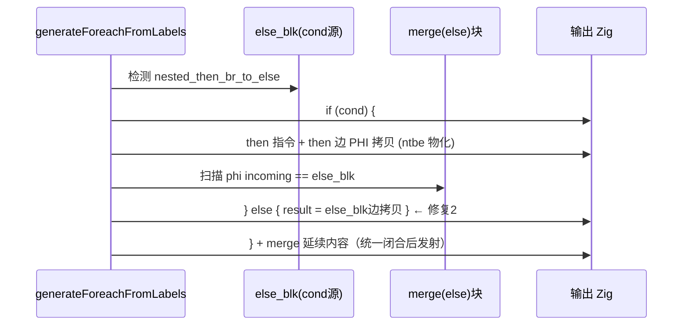

# f163/f044 merge 边物化双缺口修复（GIFL Step-10 回边 + 循环生成器 false 边直落）

**日期**: 2026-09-21
**基线 commit**: `908a3a0`
**变更文件**: `src/aot/native_linker.zig`（工作区未提交，`git diff --stat` = +860 / −82，含前序会话未提交的支撑代码；本轮新增净改动为 Step-10 回边门控与 5 站点 false 边补发，约 130 行）
**回归结论**: 68 脚本 **62 PASS / 0 FAIL_COMPILE / 5 FAIL_RUNTIME(exit=124) / 0 FAIL_DIFF / 1 SKIP** —— 与基线预期完全一致，f163 转 PASS，FAIL_DIFF 组清零，零新增失败

---

## 1. 高层摘要（TL;DR）

PASS 组最后两个残留问题 f163（FAIL_DIFF）与 f044（隐性侥幸通过）同根同源：**结构化代码生成在 merge 块被"就地消费"后，丢失了按控制流边物化 PHI 拷贝的职责**。本轮落地两个正交修复：

1. **缺陷 A（f163）**：`generateIfFromLabels` Step 10 将 merge 块置 `processed` 后，本块 `.br` 指向**更早共享 merge** 的回边只剩占位注释，无人按边补写 → 新增回边门控 `br_t.index < merge_block.index` 且非循环头目标时就地调用 `materializeBrTargetMergePhis`；
2. **缺陷 B（f044）**：foreach/for/while 生成器 `nested_then_br_to_else` 处理器只物化 merge PHI 的 then 边 incoming，**从不发射 cond 源块直达 merge 的 false 边拷贝** → 在 5 个站点 then 臂闭合前补发 `} else { result = incoming }`。

f044 此前的"通过"是两条陈旧边**互相抵消的假象（stale-false coincidence）**；缺陷 A 落地后假象破裂，缺陷 B 真修使两寄存器各自忠实，f044 三次独立编译运行均逐字节一致。v3 栈门控（`active_gifl_merges`）作为失败尝试整体回滚并记录在案。

## 2. 影响范围

| 维度 | 描述 |
|------|------|
| 模块 | AOT 代码生成（native_linker 结构化发射层），不涉及 IR/优化器/运行时 |
| 语法面 | ① if/else 臂尾 `??`/三元/`&&`/`\|\|` 汇入**更早**共享 merge 块；② 循环体内嵌套 if 且嵌套 then 以 `.br` 直达外层 merge（else 消失形态）+ merge 含来自 cond 源块的 PHI |
| 正向收益 | f163 `EventStore::replay`（FAIL_DIFF→PASS）；f044 `??`/`&&` 混合校验路径消除跨迭代陈旧读 |
| 风险面 | Step-10 门控仅在**回边**（目标块 index 更早）时发物化，前向边维持旧行走；false 边补发无命中 PHI 时不发空 else，完全保持旧发射形态 → 对 62 个既有 PASS 脚本零扰动（回归实证） |

## 3. 核心变更

| # | 变更 | 位置（工作区） | 性质 |
|---|------|--------------|------|
| 1 | GIFL Step 10 `.br` case 回边门控 + `materializeBrTargetMergePhis` 按边物化（`is_loop_head_target` 双探：`isLoopHeadLabel` ∨ `current_loop_cond_block` 恒等；`br_t.index < merge_block.index` 才发） | `native_linker.zig` @~15960 | 新增 |
| 2 | `nested_then_br_to_else` 5 站点 false 边直落补发（then 臂尾、闭合 `}` 前扫 merge phi incoming==else_blk 的边，`fe_emitted` 惰性开 else） | @~11033 / @~11265 / @~13239 / @~14447 / @~14629（foreach/for/while 臂） | 新增 |
| 3 | 回滚 v3 栈门控：删除 `active_gifl_merges` 字段、GIFL push/defer-pop、Step-10 `on_active_merge` 循环 | @295 / @15192-15200 / Step-10 | 回滚 |
| 4 | 移除全部调试探针（WPA-DBG 栈探针、T2E-DBG/T2E-DBG2、NESTCB-DBG） | 全文 | 清理 |
| 5 | 已知问题文档新增「修复 8」全章节（含失败尝试与定位手段备忘） | `docs/known-issues/AOT-CODEGEN-003` | 文档 |

> 第 6 候选站点 @~12996（「方案 C：嵌套 merge 已被外层 if 认领」变体）内部结构不同，本轮未打点、维持原行为，已在文档标注为观察项。

## 4. 可视化概览

### 4.1 缺陷与修复点 Mermaid 逻辑映射



### 4.2 发射时序（修复后，f044 行 99 场景）



### 4.3 分层定位

```
IR (phi/块 index) → native_linker 结构化发射
  ├─ generateIfFromLabels Step10（本轮修复1）
  └─ generate{Foreach,For,While}FromLabels · nested_then_br_to_else（本轮修复2 ×5）
```

## 5. 详细变更分析

| 层 | 文件 | 说明 |
|----|------|------|
| 代码生成 | `src/aot/native_linker.zig` | 唯一源码变更；Step-10 `.br` 回边门控 + `writePtrAwareAssign` 按边物化；5 站点 else 补发块（约 26 行/站点，结构一致） |
| 文档 | `docs/known-issues/AOT-CODEGEN-003-while-true-break-missing.md` | 修复 8 章节：根因/代码/失败尝试/验证/定位备忘（ReleaseSafe `std.debug.captureCurrentStackTrace` 栈探针钉死 @11097 调用点，静态猜点两次落空后的决定性手段） |
| 数据层 | 无 | — |
| 测试资产 | `fuzzy_scripts_720/tmp/f163_repro_tmp.php` | 最小复现（诊断用，不在 68 套件）；replay 部分本轮已修复，closure 部分残留见任务 #13 |

**复测路径**：
1. `timeout 600 zig build`；
2. `timeout 120 zig-out/bin/php-interpreter --compile --output=/tmp/aot_compile_f163 fuzzy_scripts_720/pass/f163_event_driven_dispatch_bus.php`，`timeout 10` 运行与 `/opt/homebrew/bin/php` 输出 `cmp` 逐字节一致；f044 同样 3 次独立编译复测；
3. `bash scripts/regression_test_720.sh` 全量 68 脚本。

## 6. 影响与风险评估

| 项 | 评估 |
|----|------|
| 是否破坏式 | 否。两处修复均为"仅在旧代码**丢边**时补发拷贝"，未改动任何既有发射路径的块行走与 processed 语义 |
| 影响范围 | Step-10 回边物化：仅 `br_t.index < merge_block.index` 且非循环头；false 边：仅 merge phi incoming 命中 else_blk 时，否则零输出 |
| 需特别注意 | ① 冲写风险已由"前向目标不发"规避（顺序行走会消费前向边）；② 循环头目标由 latch 自带物化，双发会冲写，已用 `isLoopHeadLabel ∨ current_loop_cond_block` 双探排除；③ 第 6 站点（方案 C 变体）未打点，若后续出现同类 false 边症状优先核查该处 |
| 性能 | 生成代码每条边至多增加少量寄存器拷贝（原语义必需的物化），编译期开销可忽略 |

## 7. 遗留 / 潜在问题

| # | 问题 | 状态 |
|---|------|------|
| 1 | closure 内乱序布局：`if_merge_3`（含 ret）先于臂尾 coalesce 链，merge 被吞进 else 臂、dep 路径走缺省 null 返回（`f163_repro_tmp.php` 复现，HEAD 同样失败，属预存缺陷） | 任务 #13，暂观察（非官方套件） |
| 2 | exit=124 超时组 f007/f038/f124/f161/f178 | 任务 #7 |
| 3 | 编译期非确定性（optimizer mem2reg 指针键哈希迭代序 → SSA id 漂移） | 任务 #12 |
| 4 | f004 SKIP（PHP 解释器侧 exit=255，非 AOT） | 固有基线 |

## 8. 后续开发建议

| 优先级 | 建议 | 影响面 | 落地成本 |
|--------|------|--------|----------|
| P1 | 把"merge phi 逐 incoming 边核对发射"抽成统一校验辅助（每臂收口时验证 incoming 全覆盖），替代逐站点手写补发块，根治第 6 站点类盲区 | native_linker 6+ 调用点 | 中 |
| P1 | exit=124 超时组剖析（f007/f038/f124/f161/f178 采样热点，怀疑陈旧边引发的近无限迭代） | 5 脚本可用性 | 中 |
| P2 | 任务 #13 closure 乱序布局缺陷（merge-with-ret 先于臂尾块的 RPO 例外路径） | 深层嵌套三元+return | 中-高 |
| P2 | 编译确定性：mem2reg 工作表改稳定序（注册序索引），消除跨 run id 漂移 | 可复现构建/回归比对 | 低-中 |
| P2 | 回归脚本沉淀"逐字节一致"为硬门禁（cmp 失败即 FAIL_DIFF），并把 f163_repro_tmp 类有效最小复现晋升入套件 | 测试资产 | 低 |
