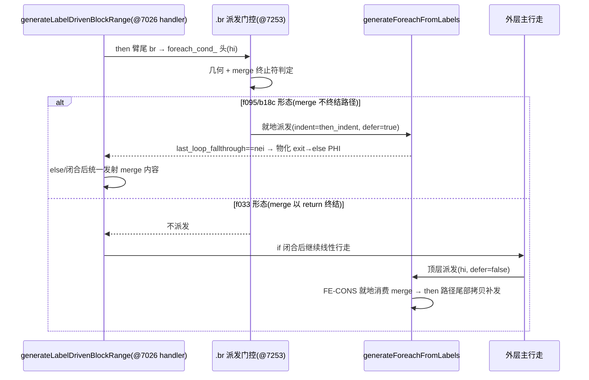

# 臂逃逸循环派发与 f033 地形门控修复（f095 两段根治 + trace 剥离）

**日期**: 2026-09-21 | **基线 commit**: `908a3a0` | **模块**: `src/aot/native_linker.zig`（AOT 代码生成 · 标签驱动行走）

---

## 1. 高层摘要（TL;DR）

f095（编译器优化模拟脚本）两段式根治完成：第一段为循环退出边 PHI 物化（ConstantPropagation 计数被覆盖），第二段为 **if 臂尾 br→循环头的臂内就地派发**（根治嵌套 foreach 逃逸出 if 体后在已释放迭代器上无条件执行的 use-after-free 段错误）。第二段派发引入 f033（状态机）回归，经三二进制对照与 trace 定位后，以 **merge 块终止符判据的地形门控** 收敛：merge 以 `ret/throw` 终结路径时禁止抢先派发（交回主行走旧路径），否则保持派发（防 else 抬升行走吞并 then 臂循环块）。全部调试脚手架（49 处 trace print、`writePtrAwareAssign` 的 `@src()` 参数管线共 105 调用点、`wpa_tag` 上下文标记）已完全剥离，干净二进制通过全部验证：**68 脚本回归 61 PASS、零新增失败**，f095/f033/f113/f067（含 min_repro）全部转 PASS 且逐字节一致。

## 2. 影响范围

| 维度 | 影响 |
|---|---|
| 正确性 | f095 段错误/元素丢失、f033 状态更新丢失双双修复；f067/f113 连带转 PASS |
| 性能 | 无运行时影响（纯代码生成期派发判定）；剥离 trace 后编译期 stderr 打印开销归零 |
| 兼容性 | 不破坏 HEAD 已验证形态（f065/f097/f134/f135 等保持 PASS） |
| 风险面 | 门控判据基于块几何 + 终止符类型，同构形态（f033/f095 几何全等）下才需判据区分，属高危演化点，已在 known-issues 登记「失败尝试，勿重试」 |

## 3. 核心变更

| # | 变更 | 位置 | 说明 |
|---|---|---|---|
| 1 | 循环退出边 PHI 物化（f095 第一段） | `generateExitPHIAssignments` 两处新增调用（exit_idx==null 消费分支 / for_loop_、foreach_increment_ 提前返回分支） | cleanup→外层循环增量边（81←80、72←71）不再整体丢弃 |
| 2 | `writeBrInLoopContext` 门控 | `loop_head_dispatched` 判据 | 防循环头已派发时重复发射 |
| 3 | if_merge_+cond_br 处理器 `.br` 臂内派发 | @~7253 | then 臂尾 br 指向 foreach/for/while 头（`while_body_` 亦识别）时，在 then 缩进就地派发对应 FromLabels 生成器；`defer_loop_fallthrough=true` 保护共享 merge；出口即 merge 时 `materializeBrTargetMergePhis` 物化 exit→else 边 PHI |
| 4 | f033 地形门控 | @~7290 | `ah_merge_in_terrain = nti<nei<end ∧ nei<hi ∧ merge 终止符∈{ret,throw}` → 跳过派发；f095/b18c 保持派发 |
| 5 | 调试脚手架剥离 | 全文件 | 49 print + 6 标记赋值 + 2 字段 + 签名恢复 + 105 调用点回改；HEAD 签名 `writePtrAwareAssign(self, writer, indent, result_id, value_id)` 复原 |

## 4. 可视化概览

```mermaid
flowchart TB
    subgraph 生成期标签驱动行走
        A[if_merge_ 块 + cond_br<br/>@7026 处理器] --> B[then 臂: 指令 + 终止符 switch]
        B --> C{.br 目标 = 循环头?}
        C -- 否 --> Z[原有路径]
        C -- 是 --> D{头块在臂范围 (nti,then_end)?}
        D -- 是 --> E[交回臂内线性行走派发]
        D -- 否 --> F{地形门控:<br/>nti<nei<end ∧ nei<hi<br/>∧ merge 以 ret/throw 终结?}
        F -- 命中(f033) --> G[跳过派发 → 主行走旧路径<br/>else 抬升止于 return,<br/>if 闭合后 FE 正常派发+就地消费 merge]
        F -- 未命中(f095/b18c) --> H[臂内抢先派发 FromLabels 生成器<br/>defer_loop_fallthrough=true<br/>出口=merge 时物化边 PHI]
    end
```



## 5. 详细变更分析

- **端/模块层/数据层**: 仅 AOT 代码生成层（`native_linker.zig`），无运行时库、无 IR 生成器改动。
- **涉及文件**: `src/aot/native_linker.zig`（唯一源文件）、`docs/known-issues/AOT-CODEGEN-003-while-true-break-missing.md`（修复 7 + f067 残留闭环）、本文档。
- **判据推演关键证据**（f033 vs f095 几何全等：`nti=8/16, nei=9/17, hi=10/18, end=15/21`）：
  - f033 merge@9 = 尾部 `$this->current=…; return true`，`.ret` 终结 → else 抬升止于 return；
  - f095 merge@17 = if#2 的 cond_br 延续 → else 抬升 `[17,21)` 吞掉 then 臂 foreach@18-20 → args-foreach 发射进 false 臂 → `used['diff']` 丢失 → dce=7、`diff=const(-7)` 被误删（症状与 trace 完全吻合）。
- **剥离审计**: 剥离前后 diff 275 行，删除侧仅 trace/wpa 管线，恢复侧仅 HEAD 签名与调用点回改，`zig build` 干净通过后五例逐字节复测。

## 6. 影响与风险评估

- **非破坏式变更**：仅新增派发门控与臂内路径，HEAD 行为在无嵌套循环的 if 形态下逐字节不变（回归证实零消失失败）。
- **需特别注意**：
  1. 地形门控依赖 merge 终止符类型，若未来出现「merge 以 br 指向远处但不应吞并」的新形态，判据需细化为「else 抬升行走实际可达 hi」的动态判定；
  2. `defer_loop_fallthrough` 与 FE-CONS 抑制（@~11848 `ni<cond_idx`）成对生效，改动任一侧必须双例联测（f033+f095）；
  3. 「臂内补发 merge 内容拷贝」方案已被证伪（f095 死循环 / f033 双尾），登记于 known-issues，勿重试。
- **复测路径**：`scripts/regression_test_720.sh`（68 脚本，系统 PHP 为 ground truth）；定点五例 `f033/f095/b18c_tmp/f067/f067_min_repro` 逐字节比对；三探针 `f067_num_probe/f067_or_hop/f067_nested_if`（or_hop2 仅 PHP 警告噪声）。

## 7. 遗留问题 / 潜在问题

| 问题 | 状态 |
|---|---|
| f163_event_driven_dispatch_bus FAIL_DIFF | 基线预存在，同家族（乱序共享延续/merge 边物化），待独立会话 |
| exit=124 超时组 f007/f038/f124/f161/f178 | 性能根因待定位（正确性无关） |
| f004 SKIP（PHP 侧 exit=255） | 非 AOT 问题，维持 SKIP |
| 工作树大量未提交变更 | 按惯例由用户自行 commit；本会话未做任何提交 |

## 8. 后续开发 / 优化建议

| 优先级 | 建议 | 影响面 | 落地成本 |
|---|---|---|---|
| P1 | 抽取 `isLoopHeadLabel(label)` helper，替换 ~13 处重复的标签前缀 or 链（含本次 @7260 新增一处），杜绝再次漏项（如历史上的 `while_body_` 漏项） | native_linker 全文件 | 低 |
| P1 | 把 @7253 臂内派发与 `generateIfFromLabels` @15319、@8136 三处同族派发 DRY 成单一 `dispatchLoopInArm(...)` 过程 | 三处派发点 | 中 |
| P2 | 地形门控升级为动态判定：对 `[nei,end)` 试走一遍统计「是否会吞并未处理循环块」，替代终止符类型近似 | f033/f095 家族泛化 | 中高 |
| P2 | f163 定位（同家族既有精确定位画像）→ exit=124 组性能剖析（先编译期/运行期二分） | 回归 63→65+ | 中 |
