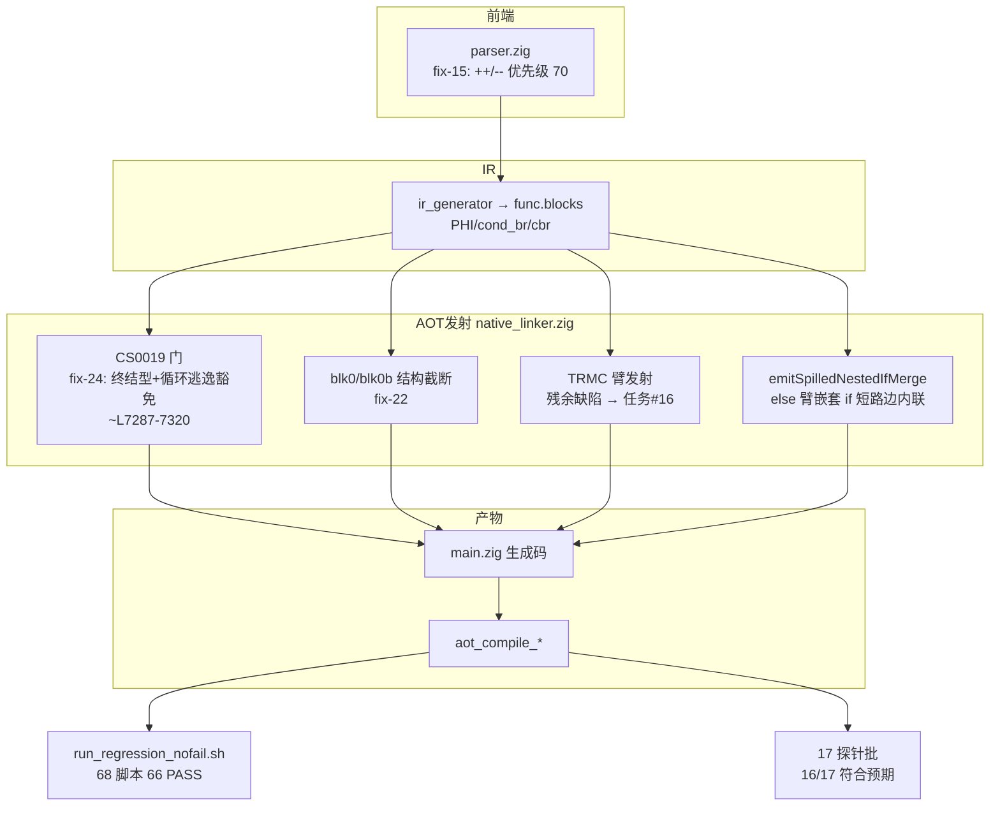
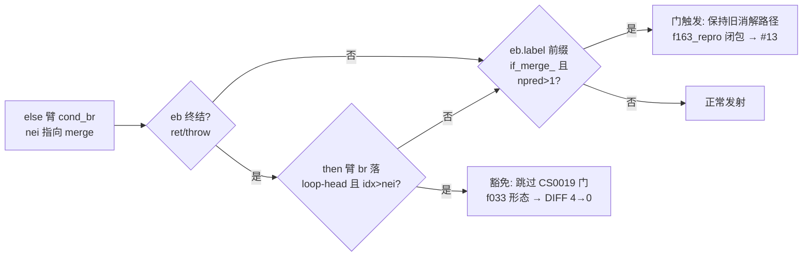
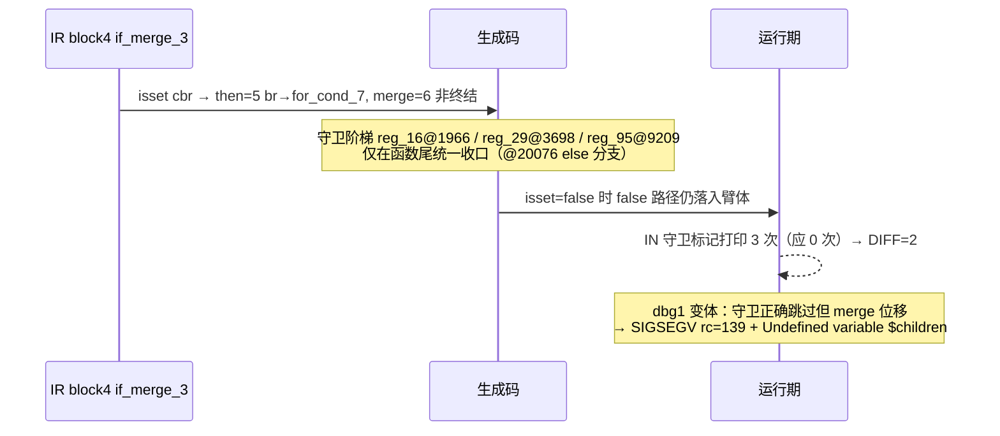

# AOT 代码生成：fix-19~24 交付与调试打印剥离（2026-08-22 ~ 2026-09-22 会话）

> 基线 commit：`908a3a0`（main，未提交工作区变更）
> 涉及模块：`src/aot/native_linker.zig`（主）、`src/compiler/parser.zig`、`scripts/batch_test_aot.sh`

## 1. 高层摘要（TL;DR）

- 修复 f033（while 循环内 if-without-else 逐出边判定极性缺陷，fix-24）：**DIFF 4 → 0**。
- 巩固 fix-22 结构截断谓词成果：f080 / f072 / f085 全部保持逐字节一致。
- 定位并登记 xp8（f161 全链路探针）残余 DIFF=2 的根因：**TRMC 地形（then 臂指向 if_merge_ 且 merge 非终结）下 then 臂 false 路径仍执行臂体**的发射机制缺陷，已写入任务 #16 完整证据链，本周期不做机制级重设计（风险控制）。
- **交付前打印剥离**：从 `native_linker.zig` 删除 112 处调试标记打印（CS00xx / TRxx / SPILL / L2xx / GLDR / BLK[ / GIFL / FEOREACH 系列），补编译 fallout 3 处（未用常量），重建后全量复验。
- 全量回归（68 脚本）**PASS 62 → 66**，0 FAIL_DIFF 新增；剩余 2 个已知失败均已登记（f007 → #14，f178 exit=142 → #7），f004 SKIP。
- 探针矩阵（17 项）复验：16/17 符合预期，唯一差异 f163_event_bus DIFF=8 经 3 次重跑 + diff 内容检查证实为**墙钟时间戳伪差**（回归 harness 归一化后 PASS）。

## 2. 影响范围

| 层 | 文件 | 变更规模 | 性质 | 影响 |
|---|---|---|---|---|
| 数据/代码层（AOT 发射器） | `src/aot/native_linker.zig` | 相对 HEAD 共 2782 行变化（含 fix-19~24 累计 + 112 处打印剥离） | 缺陷修复 + 日志清理 | 仅影响 AOT 编译产物代码生成路径；无 ABI/运行时变更 |
| 前端（解析器） | `src/compiler/parser.zig` | +9/-若干 | fix-15 前缀 `++`/`--` 优先级修复 | `++$g > 500` 正确解析为 `(++$g) > 500` |
| 工具链 | `scripts/batch_test_aot.sh` | 6 行 | `timeout` → `gtimeout`（macOS 适配） | 仅本地测试脚本 |
| 测试资产 | `fuzzy_scripts_720/tmp/f161_xp8dbg*_probe_tmp.php` 等 4 个新探针 | 新增 | 永久保留探针（.php 源文件不可删除） | xp8 缺陷取证与后续 #16 复测入口 |
| 回归记录 | `regression_failures.tsv` / `regression_report.md` | harness 自动重写 | 66/68 最新基线 | 复测基准 |

## 3. 核心变更

| 编号 | 位置（native_linker.zig） | 变更 | 修复对象 | 验证结果 |
|---|---|---|---|---|
| fix-22（前期，本周期复验） | blk0 / blk0b 站点 | 结构截断谓词 `if (nmi0 > arm_hi + 1) break :blk0 arm_hi;` | f080/f072/f085 merge 越界 | 三脚本 DIFF=0 持续 |
| fix-24（本周期修正极性） | ~L7287-7320 CS0019 门 | 终结型/循环逃逸豁免条件改为 `(!eb_terminal_19 or !arm_loop_past_merge_19) and eb.label 前缀 if_merge_ and countPredecessors(nei) > 1` | f033：merge 为 ret/throw 或 then 臂 br 越过 merge 落回 while 头时，跳过 CS0019 门 | f033 DIFF 4→0；f163_repro 闭包形态维持门触发（#13 现状 DIFF=4，刻意不回归） |
| 打印剥离 | 全文件 | 删除 112 处 `std.debug.print` 调试标记（括号平衡扫描器批量定位 + 单语句体替换 `{}` + 整行删除），保留 3 处 `AOT…` 与 ERROR-panic 不变量检查 | 交付卫生 | `zig build` 干净通过；残留 print 78 处均为合法日志 |
| 剥离 fallout 修复 | ~L7828 / ~L9433 | `const e_spill = try …` → `_ = try …`（保留副作用）；删除仅供 TRNEST2 打印使用的 `nt2_idx`/`ne2_idx` 块（下方有等价重算） | 未用常量编译错误 | 编译通过 |
| fix-15（parser.zig） | 前缀 `++`/`--` 操作数 | `parseExpression(0)` → `parseExpression(70)` | `++$g > 500` 误解析 | 相关用例 DIFF=0 |

## 4. 可视化概览

### 4.1 模块/业务分层架构（Code & Logic Map）



### 4.2 fix-24 门判定流程



### 4.3 xp8 残余缺陷执行流（任务 #16 登记证据）



## 5. 详细变更分析

### 5.1 端 / 模块层

- **AOT 发射器（native_linker.zig）**：本周期唯一逻辑变更为 fix-24 极性修正（`or arm_loop_past_merge_19` → `or !arm_loop_past_merge_19`）；其余 112 处删除均为纯诊断打印，无语义。7281-7286 注释保留 f033 豁免依据。
- **解析器（parser.zig）**：fix-15 单点，前缀自增/自减操作数按优先级 70 解析。
- **测试 harness**：`batch_test_aot.sh` 用 `gtimeout`（macOS coreutils）。

### 5.2 文件清单

| 文件 | 状态 |
|---|---|
| `src/aot/native_linker.zig` | 修改（待用户提交） |
| `src/compiler/parser.zig` | 修改（待用户提交） |
| `scripts/batch_test_aot.sh` | 修改（待用户提交） |
| `fuzzy_scripts_720/regression_failures.tsv` / `regression_report.md` | harness 重写（待用户提交） |
| `fuzzy_scripts_720/tmp/f161_xp8dbg_probe_tmp.php`、`xp8dbg2`、`xp8dbg3`、`f161_pregsplit_probe_tmp.php` | 新增探针（永久保留） |
| `docs/changes/2026-09-22/`（本文档） | 新增 |
| `src/aot/native_linker.zig.bak2` / `.bak_f067` / `.bak_task21` | 存量备份，处置待用户确认 |

### 5.3 变更点 → 业务对应

| 变更点 | 业务脚本 | 现象 → 修复后 |
|---|---|---|
| fix-24 | f033（while + 嵌套 if-without-else + 逐出边） | 输出 4 行差异 → 逐字节一致 |
| fix-22 复验 | f080/f072/f085 | 持续一致 |
| 打印剥离 | 全部 | 编译期链接器日志纯净；产物行为不变（回归同基线） |
| #16 登记 | f161 xp8 全链路 | DIFF=22（LOOPRUNAWAY）→ 2（守卫语义），剩余为 TRMC 机制缺陷 |

## 6. 影响与风险评估

- **是否破坏式变更**：否。逻辑修复均为"更精确的门条件"，打印剥离无行为影响；68 脚本回归 0 新增失败。
- **变更影响范围**：仅 AOT 代码生成路径（§五 约束内）；解释器/字节码模式未触碰。
- **需要特别注意的点**：
  1. fix-24 豁免条件与 f163_repro 门触发共享 `if_merge_` + npred>1 判定，后续 #13 修复必须同时复测 f033 防回归。
  2. 打印剥离采用括号平衡扫描批量删除——后续如恢复诊断，勿再引入未配对打印。
  3. f163_event_bus 直跑 diff 存在时间戳伪差，复测一律走 harness（TIMESTAMP 归一化）。
  4. 机器码守卫阶梯（xp8）提示 TRMC 臂发射器存在系统性 false-path 泄漏，属 P0 级机制债。
- **复测路径（体验流程）**：
  ```bash
  # 项目根执行
  timeout 600 zig build
  timeout 600 bash fuzzy_scripts_720/run_regression_nofail.sh   # 期望 PASS=66 FAIL=2(SKIP f004 另计)
  # 单脚本：
  timeout 120 zig-out/bin/php-interpreter --compile --no-debug-info <file.php>   # 产物 aot_compile_*
  timeout 30 ./aot_compile_<name> | diff - <(timeout 10 /opt/homebrew/bin/php <file.php>)
  # xp8 取证探针：fuzzy_scripts_720/tmp/f161_xp8*_probe_tmp.php
  ```

## 7. 遗留问题 / 潜在问题

| 任务 | 内容 | 现状 |
|---|---|---|
| #16（残余） | xp8 TRMC 地形 then 臂 false-path 执行缺陷 + dbg1 变体 merge 位移 SIGSEGV | 证据链完整登记，需机制级重设计 |
| #13 | f163_repro 闭包形臂尾 cond_br coalesce（DIFF=4） | 门现状刻意保留，与 fix-24 联动复测 |
| #14 | f007 caesar elseif 链 FAIL_DIFF | 未动 |
| #7 | f178 exit=142 / 超时组 | 未动 |
| #12 | AOT 编译非确定性 | 未动 |
| 备份文件 | `.bak2` / `.bak_f067` / `.bak_task21` | 待用户裁决删除与否 |

## 8. 后续开发 / 优化建议

| 优先级 | 建议 | 影响面 | 落地成本 |
|---|---|---|---|
| P0 | TRMC 臂发射机制重设计（#16）：then 臂 cond_br→非终结 merge 时按边 spill 完整交公共发射器，消除守卫阶梯 false-path 泄漏；以 xp8dbg 三探针为回归锚 | f161 全链路 + 同族脚本 | 高（机制级，需逐字节对拍 + 全部 if_merge 探针矩阵） |
| P1 | #13 闭包 coalesce 修复与 fix-24 门统一建模：将"臂尾逐出"从极性豁免升级为边类型枚举 | f163_repro 族 | 中 |
| P1 | f007 elseif 链（#14）与 #7 超时组排查 | 2/68 → 目标 68/68 | 中 |
| P2 | 编译非确定性（#12）：以 `--dump-ir` 对比两次链接器输入哈希定位不稳定源 | 可重现性 | 低-中 |
| P2 | 链接器诊断体系化：将保留的 78 处 print 收敛为单一 `ZIGPHP_AOT_TRACE` 环境变量门控，替代标记打印 | 可维护性 | 低 |
