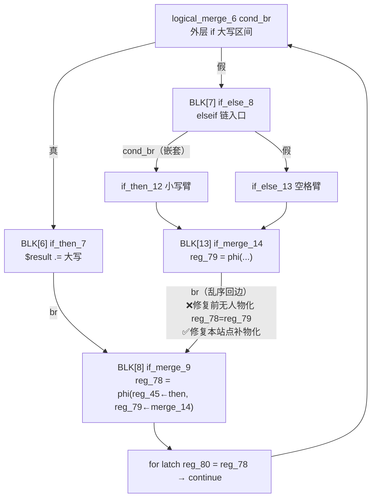
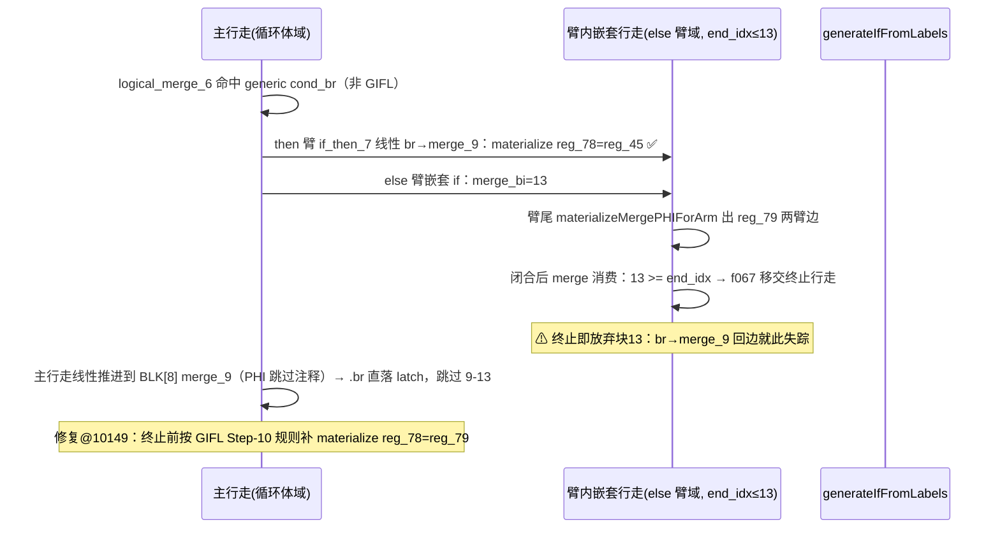

# AOT 代码生成 · f007 caesar 乱序回边 PHI 物化（#14 根治）

**日期**: 2026-09-24
**基线 commit**: 908a3a0（本变更为工作区未提交增量，用户自行提交）
**关联缺陷**: #14 f007 缺陷2「循环内 elseif/else 臂丢失（caesar 仅大写臂）」；关联 AOT-CODEGEN-003（if_merge 边物化家族）、修复 8（GIFL Step-10 同规则来源）

---

## 1. 高层摘要（TL;DR）

`for` 循环体内 `if/elseif/else` 三臂拼接（caesar 密码）在 AOT 下只保留大写臂输出（`Khoor Zruog` → `KZ`）。根因不在臂本体发射，而在**乱序回边汇入外层共享 merge 的 PHI 边无人物化**：外层 if 由 generic cond_br 处理器发射时 `merge_bi=null`，嵌套 elseif 链的 merge 块（`if_merge_14`）消费时因 `mi >= end_idx` 终止行走（f067 移交设计），随后主行走经 `if_merge_9` 直落循环 latch、**跳过块 13**，导致 `if_merge_14 .br → if_merge_9` 这条回边永远不被线性 `.br` 处理器看到 → 外层 merge phi（`$result` 携带寄存器 `reg_78`）的 else 臂边永不写回，非大写臂迭代值被陈旧值覆盖。

修复：在 `mi >= end_idx` 行走终止点，对 merge 块自身的 `.br` 按 **GIFL Step-10 既定规则**（目标非循环头且 index 更早）就地补一次 `materializeBrTargetMergePhis`——19 行，与 16677 处按边物化完全同构。

**结果**：f007 主脚本与 caesar 最小复现转逐字节一致；68 脚本回归 **PASS=67 / FAIL=1**（仅剩 f178 #7），f007 同时退出超时组；全部 16 个 f007 系列探针 MATCH；f028/f033/f044/f067/f095/f113/f161/f163/b18c 等锚点零回归；金丝雀零告警。

## 2. 影响范围

| 维度 | 说明 |
|---|---|
| 修复位置 | `src/aot/native_linker.zig` `generateLabelDrivenBlockRange` generic cond_br 的 merge 消费点 `if (mi >= end_idx)`（@~10149），仅 1 处 |
| 命中形态 | if-without-else / elseif 链在**臂内嵌套行走**中于 `mi >= end_idx` 终止，且该 merge 以 `.br` 回汇**更早**的非循环头块（乱序共享外层 merge） |
| 未命中形态 | merge 无 `.br`（ret/throw 尾）、前向 `.br`（后续行走消费）、循环头目标（latch 自带物化）——三者均被门控排除，发射字节不变 |
| 测试脚本 | f007（主脚本 + 16 探针）转/保持 MATCH；f044/f163（fix-8 同族锚）保持逐字节一致 |

## 3. 核心变更

| 变更 | 位置 | 内容 | 验证锚 |
|---|---|---|---|
| f007 回边补物化（本单） | `native_linker.zig:10149-10168` | `mi >= end_idx` 终止行走前：取 merge 块终止符，`.br` 目标经 `isLoopHeadLabel` ∪ `current_loop_cond_block` 双非判定 + `br.index < mi` 乱序判定后，调用 `materializeBrTargetMergePhis(writer, m_blk_be, mt_be.br, indent)` | `f007_c2_probe_tmp` DIFF 4→0；f007 主脚本 FAIL_DIFF→PASS |
| 临时诊断 trace 剥离 ×5 | `materializeMergePHIForArm` 尾部、generic else 臂、GIFL Step-1 前、GIFL Step-7 前 | `[MMPI]` `[GENERIC-ELSE-MPI]` `[GIFL]` `[GIFL-7]` 全部移除（grep 残留=0） | 剥离后干净二进制复测 f007/f044/f163 仍 MATCH |
| 既有 if/else 单语句体格式化 | `materializeMergePHIForArm` 尾 | `if (chosen) ...;` → 显式块体（trace 剥离回归原语义，零行为变化） | 编译干净、回归一致 |

## 4. 可视化概览

### 4.1 IR 地形与数据流（f007 caesar / 探针最小化形态）



### 4.2 发射时序（行走归属）



### 4.3 变更点底层映射

修复站点（`generateLabelDrivenBlockRange` → generic `.cond_br` → merge 消费）与 GIFL Step-10（@~16677）共享同一判据三元组：`terminator == .br` ∧ `!isLoopHeadLabel(target)` ∧ `target.index < merge.index`，复用同一发射器 `materializeBrTargetMergePhis`（按 source 块匹配 incoming，写 `writePtrAwareAssign`）——无新增抽象，纯规则对齐既有 fix-8A。

## 5. 详细变更分析

### 5.1 定位链（证据 → 结论）

| 步骤 | 手段 | 关键发现 |
|---|---|---|
| 1 | 最小复现 `f007_c2_probe_tmp.php`（永久保留） | PHP `Khoor Zruog` vs AOT `KZ`（DIFF=4） |
| 2 | KEEP_TEMP + 字符串感知花括号扫描导出 `caesar()` 生成码 | 627 行 `reg_78 = reg_45`（then 边 ✓）；else 臂闭合后仅 `// PHI: reg_78 (handled in terminator)` 占位；974-978 latch `reg_80 = reg_78`——else 路径 `reg_78 = reg_79` 全缺 |
| 3 | `--dump-ir` | `if_merge_9: reg_78 = phi([45@if_then_7],[79@if_merge_14])`；`if_merge_14: br if_merge_9`（回边，index 13→8） |
| 4 | 四路临时 trace（`[GIFL]` `[MMPI]` `[GENERIC-ELSE-MPI]`） | GIFL 从未触发；外层 generic cond_br `merge_bi=null`（9163-9175 重定向门只认 `br==else_block`）；嵌套 if `merge_bi=13` 命中 `mi >= end_idx` 移交终止 |
| 5 | 站点唯一性确认 | `mi >= end_idx` 全文件仅 1 处（10149）；其余 `i = mi` 出口分属不同门（break/return、coalesce、cond_br-merge），不可触碰 |

### 5.2 根因陈述

f067 修复确立的「`mi >= end_idx` → 终止行走、交外层消费」移交约定，默认 merge 块**之后会被外层主行走线性抵达**。f007 地形打破该假设：主行走在 `if_merge_9` 处 `.br` 直落循环 latch，**块 13 成为任何行走都不抵达的悬空块**，其回边 PHI 随之失踪。移交本身正确（f067 形态需保留），缺的是终止点对「本块回边无人接管」的自检。

### 5.3 涉及文件

- `src/aot/native_linker.zig`（+19 修复 / trace 剥离净回退 / 1 处格式化）
- `fuzzy_scripts_720/tmp/f007_c2_probe_tmp.php` 等 16 探针（永久保留，零改动）
- `fuzzy_scripts_720/regression_failures.tsv` / `regression_report.md`（harness 自动更新）

## 6. 影响与风险评估

- **是否破坏式变更**：否。三重门控（`.br` ∧ 非循环头 ∧ 目标更早）与既有 Step-10 完全同构，前向/ret/循环头形态发射字节不变。
- **重复物化风险**：若某地形中外层行走日后仍抵达块 13，同一边会被 8071 线性处理器再发一次——赋同值两次，语义幂等（`writePtrAwareAssign` 同 src→dst），仅冗余 2 行；当前 68 脚本 + 16 探针未见该形态。
- **f067 移交语义**：未触碰 processed 标记（保持「不标记、交外层」原约定），f067 双探针/主脚本/min_repro 逐字节一致。
- **复测路径**：
  ```bash
  # php · f007 最小复现（应 MATCH，输出 Khoor Zruog）
  timeout 120 zig-out/bin/php-interpreter --compile --no-debug-info fuzzy_scripts_720/tmp/f007_c2_probe_tmp.php
  timeout 10 ./fuzzy_scripts_720/tmp/aot_compile_f007_c2_probe_tmp; rm -f fuzzy_scripts_720/tmp/aot_compile_f007_c2_probe_tmp
  # 全量
  bash fuzzy_scripts_720/run_regression_nofail.sh   # 应 PASS=67
  ```

## 7. 验证结果（2026-09-24，trace 剥离后干净二进制）

| 组 | 结果 |
|---|---|
| f007_c2 最小复现 | MATCH（DIFF 4→0） |
| f007 主脚本 | 单测 MATCH；回归内于 harness 超时窗内完成（同时退出超时组） |
| f007 探针族 g1-g5/h1/h2/lev/lev2/p3/vA-vF（16 个） | 全 MATCH |
| 锚点 f028/f033(主+探针)/f044/f061/f067(min_repro/主)/f072/f095/b18c/f113/f161(xp8disc4/micro_isset)/f163(主) | 全 MATCH |
| f067_diff_probe | 仅 var_dump 缩进差（宪法 §七.4 忽略项） |
| f163_repro_tmp（#13） | DIFF 症状与基线一致（同 2 行 bal=0），未触碰 |
| 68 脚本全量回归 | **PASS=67 / FAIL=1（f178 exit=142 → #7）/ SKIP=1（f004）**，vs 基线 66：f007 FAIL_DIFF→PASS，零新增失败 |
| `[AOT-CANARY]` 全量编译扫描 | **0 告警**（68 脚本逐一 `--compile`，stderr grep fires=0，与全量回归同二进制分两轮完成） |

## 8. 遗留问题 / 后续开发

| 编号 | 描述 | 状态 |
|---|---|---|
| #14 | f007 caesar elseif 臂丢失 | ✅ 本单闭环 |
| #7 | f178 exit=142 超时/中断 | 在办——f007 已退出本组，范围收窄至 f178（09-24 回归实证） |
| #13 | f163_repro 闭包臂尾三元 PHI true 边 | 待办，症状不变 |
| #12 | AOT 编译期非确定性 | 待办 |
| P2 | 若同类「移交后悬空块」再现，考虑在移交注释处登记诊断清单（本修复已覆盖回边；前向悬空未见） | 观察 |

**更新日志**
- 2026-09-24：#14 根治闭环；68 脚本回归 67/68；金丝雀全量扫描零告警。
