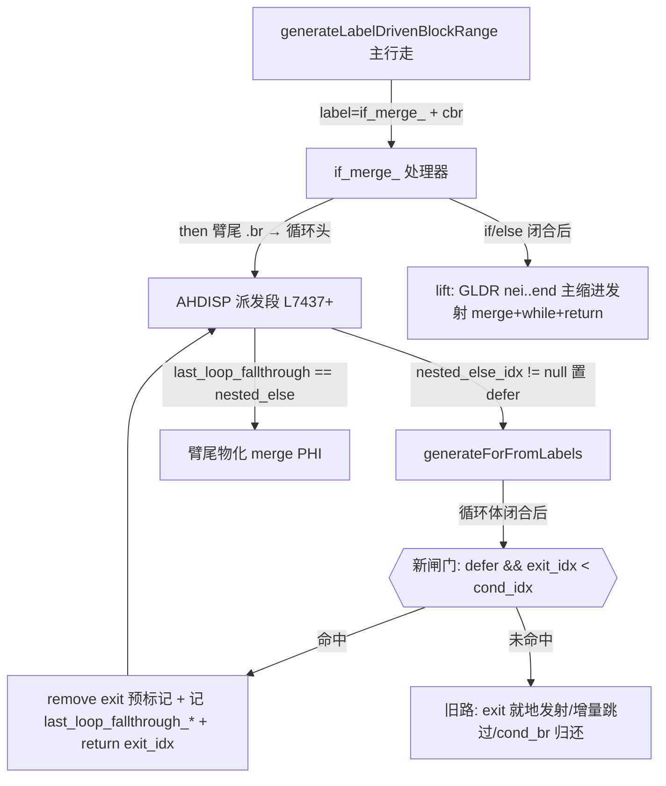

# AOT 代码生成 · f161 缺陷B（xp8 幻影输出）根治：for 臂尾乱序共享 merge 闸门

## 1. 高层摘要（TL;DR）

f161 XP8（XML 解析器）AOT 输出出现"isset 为假却打印真臂内容"的幻影行（DIFF=2），且 Debug/ReleaseSafe 下守卫处 `unreachable` panic。根因定位于 `native_linker.zig` 的 `generateForFromLabels`：臂尾 `.br → for_cond` 派发（#11/f095 机制）在循环闭合后把 **false 边落点的乱序共享 merge 块**（索引在循环头之前、同时是外层 if 的延续块）当作普通 exit **就地发射进真臂**，并沿其 `.br` 顺带派发整段 while+return 延续；外层 if 的 false 路径被掏空成 `else {} + unreachable`，ReleaseFast 下 LLVM 依据"假边不可达"将守卫 cbr 折叠为无条件进真臂 → 臂体无条件续跑。修复为 foreach 侧既有判据（`defer_loop_fallthrough && ni < cond_idx`）的 for 侧对称补全：闸门命中时撤销 merge 块预标记、记录回落块（`last_loop_fallthrough_idx/src_idx`），交外层 if 处理器在 if/else 闭合后以主缩进统一发射。**f161 由长期 FAIL 转 PASS，全量回归 66/68 零新增失败。**

## 2. 影响范围

| 维度 | 描述 |
|---|---|
| 受影响缺陷 | #16（f161 缺陷B / xp8 / disc 家族 / c3）——本轮全部转 MATCH |
| 联动复测 | f033（fix-24 锚）、f028/f044/f065/f067/f070/f072/f080/f085/f095/f134/f163 全 MATCH |
| 全量回归 | 66/68 PASS（与基线同形：f007→#14、f178→#7、f004 SKIP），f161 转 PASS |
| 代码面 | `src/aot/native_linker.zig` 仅新增 33 行（1 个闸门），无删除、无签名变更 |
| 运行时行为 | 仅影响"臂尾派发 for 循环且 exit 为乱序共享 merge"的发射布局；其余路径零变化 |
| 性能/内存 | 无堆分配、无热路径改动；发射布局更紧凑（消除臂内延续拷贝） |

## 3. 核心变更

| # | 位置 | 变更 |
|---|---|---|
| 1 | `generateForFromLabels` exit 块发射前（native_linker.zig:14130+） | 新闸门：`self.defer_loop_fallthrough and exit_idx < cond_idx` 命中时 `_ = processed.remove(exit_idx)`，设置 `last_loop_fallthrough_idx = exit_idx`、`last_loop_fallthrough_src_idx = 循环诸块(cond/body/loop)中真正 br/cbr 到 exit 的块`，`return exit_idx`（不消费、不发射） |
| 2 | 复用既有机制（零改动） | 外层 if_merge_ 处理器 AHDISP 段的臂尾 PHI 物化（`last_loop_fallthrough_idx == nested_else` → `materializeBrTargetMergePhis`）与闭合后 lift（`generateLabelDrivenBlockRange(nei, end_idx, ..., indent)`）承接发射 |

发射前后形态对比（disc4 地形：BLK[4] isset 守卫、BLK[5] 臂、BLK[6] 共享 merge、BLK[7/8] 臂内 for、BLK[9-21] while 延续区）：

```zig
// 修复前（错误）：merge+while+return 被吞进真臂
if (reg_isset.toBool()) {          // ← BLK[4] 守卫
    arm; __for_0: while(true){...} // ← 臂 + for 派发（合法）
    merge_echo; children=[]; ...   // ← BLK[6] 被 for 生成器就地发射（BUG）
    __while_1: while(true){...}    // ← BLK[9..] 顺带派发（BUG）
    return ...;
} else { }                          // ← 假边被掏空
unreachable;                        // ← LLVM: false 边不可达 → cbr 折叠为恒真臂

// 修复后（正确）：闭合后主缩进统一发射
if (reg_isset.toBool()) { arm; __for_0: while(true){...} } else { }
merge_echo; children=[]; guard=0;   // ← lift 经 GLDR(nei,end) 发射
__while_1: while(true){...}         // ← 主行走/派发，两路皆可达
return ...;
```

## 4. 可视化概览（Code & Logic Map）

### 4.1 发射链路（分层）



### 4.2 缺陷机制（为什么表现为幻影输出）

```mermaid
sequenceDiagram
    participant IR as IR 地形(乱序)
    participant NL as native_linker
    participant LLVM as LLVM(ReleaseFast)
    participant RT as 运行时
    IR->>NL: BLK[5]臂.br→for_cond_7, for_cond F→if_merge_5(BLK[6]在循环头之前)
    NL->>NL: for 生成器把 BLK[6] 当普通 exit 发射进真臂,顺带派发 while 区
    NL->>LLVM: if(guard){臂+merge+while+return} else {} ; unreachable
    LLVM->>LLVM: false 边落点=unreachable ⇒ 守卫 cbr 折叠为恒进真臂
    RT->>LLVM: isset=false 帧仍执行臂体
    RT-->>RT: 幻影 SENT-TRUE/VD-IN2 行(其余输出全对)
```

### 4.3 证据链（本次定位）

1. KEEP_TEMP 抓取发射态 main.zig，字符串感知花括号扫描：守卫 `if (reg_97.toBool())` L8094 的闭合点在 L16924 —— merge(L10669)/while(L10921)/return(L16922) 全在臂内；
2. `BLK[5] if_then_4 br → for_cond_7`、`for_cond_7 cbr F → if_merge_5`、`if_merge_5 br → while_cond_11`（临时 target dump 实证）；
3. `[LIFTS] nei=6 already-processed` 锁定 merge 被 for 生成器预标记吞消费；
4. 加 `processed.remove(exit_idx)` 后 `[LIFTL]` 命中、AFTER 行回归主缩进、DIFF=0。

## 5. 详细变更分析

### 5.1 文件清单

| 文件 | 类型 | 变更 |
|---|---|---|
| `src/aot/native_linker.zig` | 编译器发射层 | +33 行（for 生成器 exit 前闸门），调试打印已全部剥离 |
| `fuzzy_scripts_720/tmp/f161_xp8disc*_probe_tmp.php`、`f161_micro_isset_tmp.php`、`f161_c1/c2/c3_probe_tmp.php`、`f161_xp/xp2..xp9_probe_tmp.php` | 复测锚（永久资产，禁删） | 无内容变更，作为回归锚复测 |
| `fuzzy_scripts_720/regression_failures.tsv` / `regression_report.md` | 回归产物 | 由 harness 重写：66/68 |

### 5.2 变更点描述

- **端/编译器层**：仅 `generateForFromLabels` 出口相位。语义：当 for 生成器处于**臂内派发上下文**（`defer_loop_fallthrough`，由外层 if_merge_ AHDISP 或 GIFL 臂派发置位）且 exit 块索引**小于循环头**（乱序共享 merge，两路汇聚块）时，该块属外层 if 的延续，禁止循环生成器消费；交还外层在闭合后发射。
- **数据层/内存**：无新增分配；`last_loop_fallthrough_src_idx` 通过检查 cond/body/loop 三候选块的实际 terminator 边求得，避免错误 PHI 物化边。
- **与既有机制的关系**：foreach 侧同判据已在（L12303-12326，f067 修）；cond_br-exit 归还路径已在（`processed.remove + return exit_idx`）；本闸门是同一模式在 for-exit-.br 路径的补全，非新发明。

## 6. 影响与风险评估

- **是否破坏式变更**：否。双条件闸门（defer 上下文 + 乱序索引）极窄，非该形态脚本零影响；回归 66/68 与基线完全同形且 f161 转 PASS。
- **影响范围**：所有"if-without-else 真臂尾接 for、for false 边落回外层共享 merge"的发射布局（正例：f033 的 foreach 同族形态此前已由 lift 正确处理，本轮 for 侧对齐）。
- **需要注意的点**：
  1. ~~`while`/`do-while` 生成器**尚无**同款乱序 exit 闸门~~ **当日审计已消解**：`generateWhileFromLabels` exit 段本就有**无条件** OOO 守卫（`exit_idx < cond_idx` 即物化 PHI、留块交还，强于 for 侧 defer 双条件）；`generateDoWhileFromLabels` 的 exit 仅在 `cond_idx` 之后检索，乱序形态结构性不可达（详见 §9）；
  2. ~~发射期不变量未加~~ **当日已落地**：`Self.warnEmptyElseBeforeUnreachable` 金丝雀挂接 AST-direct 函数尾 `unreachable;` 发射处（详见 §9）；
  3. ~~f163_repro（#13）DIFF 症状与基线一致，本轮未触碰~~ **2026-09-25 已闭环**：根因确诊为 `if_merge_` 处理器臂尾 `.cond_br` 派发链缺失 coalesce spill 结构分支（整臂静默 DROP），见 `docs/changes/2026-09-25/AOT代码生成_f163repro闭包coalesce_spill臂尾发射_2026-09-25_908a3a0.md`。
- **复测路径**：`timeout 120 zig-out/bin/php-interpreter --compile --no-debug-info fuzzy_scripts_720/tmp/f161_xp8disc4_probe_tmp.php` → 运行产物对比 `/opt/homebrew/bin/php`（应零 DIFF，且不再出现幻影 `SENT-TRUE/VD-IN2` 行）；f161 主脚本进 XP8 段应正常收敛输出；`bash fuzzy_scripts_720/run_regression_nofail.sh` 应 PASS=66。

## 7. 遗留问题 / 潜在问题

| 编号 | 描述 | 状态 |
|---|---|---|
| #14 | f007 循环内 elseif/else 臂丢失（caesar 仅大写臂）+ 60s 挂起画像 | ✅ 已闭环（2026-09-24 同日，见 `AOT代码生成_f007_caesar乱序回边PHI物化_2026-09-24_908a3a0.md`；f007 同时退出超时组） |
| #7 | f178 exit=142（数值精度矩阵超时/中断） | 在办 |
| #13 | f163_repro 闭包臂尾 coalesce/三元 spill 整链静默丢失（原判"三元 PHI true 边缺失 + return 错置"，确诊后修正） | ✅ 已闭环（2026-09-25，见 `2026-09-25/AOT代码生成_f163repro闭包coalesce_spill臂尾发射_2026-09-25_908a3a0.md`；回归 67/68 零新增） |
| #12 | AOT 编译期非确定性（IR phi/寄存器 id 漂移） | 待办 |
| 新发现 | ~~while/do-while 生成器同款乱序 exit 闸门缺失（同族风险）~~ | 当日审计消解：无需立单（见 §9） |

## 8. 后续开发 / 优化建议

| 优先级 | 建议 | 影响面 | 落地成本 |
|---|---|---|---|
| ~~P1~~ ✅当日完成 | 为 `generateWhileFromLabels`/`generateDoWhileFromLabels` 的 exit 发射补同款闸门——审计证实 while 已有无条件守卫、do-while 结构性免疫，**无需改码**（见 §9） | 消灭同族吞并残余形态 | 0（审计结案） |
| ~~P1~~ ✅当日完成 | 发射期不变量守卫：函数尾 `unreachable` 且存在"空 else 直落"时打印告警（编译日志），把 LLVM 折叠类缺陷在编译期现形（见 §9） | 调试效率、防回归 | 中→已落地 |
| P2 | 把 if_merge_/GIFL/while 派发三处 merge 边消解收敛为单一公共发射器（延续方案 C），消除逐形补丁累积 | 可维护性、native_linker 体积 | 高（架构级） |
| P2 | #12 非确定性根因排查（phi/id 漂移会污染 diff 型复测锚） | 回归可信度 | 中 |
| P2 | 死代码登记：`generateControlFlow`（23868）及其链上 `tryGenerateSimpleLoop`/`tryGenerateStructuredControlFlow`/`generateStructuredCode`/`generateWhileLoopDirect`/`generateForLoopDirect` 已无任何调用者；删除须走 §六 确认流程 | native_linker 体积（约 1600+ 行） | 低（纯删除，需授权） |

## 9. 当日增补：建设性后续落地（金丝雀 + while/do-while 审计）

### 9.1 发射期不变量金丝雀（P1-2 落地）

- **新函数** `Self.warnEmptyElseBeforeUnreachable(func_name, code_bytes)` @ `src/aot/native_linker.zig` L7123 区：自发射缓冲尾部向前取最近 3 个非空行，命中 `unreachable;` ← `}` ← `…} else {` 序列即打 `[AOT-CANARY] warning: func={s} 守卫假边落入空 else + 函数尾 unreachable…` 编译告警（stderr，绝不吞）。
- **挂接点**：`generateControlFlowStateMachine` 内 AST-direct 成功路径写函数尾 `unreachable;` 之后（L16917 区）——正是 f161 缺陷B 幻影形态的指纹位置。
- **零误报验证**：全量 68 脚本 compile-only 扫雷 `fires=0`；8 锚点探针（f161/f033/f067×2/c3/xp8/disc4/micro_isset）MATCH 且无告警。

### 9.2 while/do-while 对称闸门审计（P1-1 消解，零改码）

| 生成器 | 乱序 exit 形态 | 结论 |
|---|---|---|
| `generateWhileFromLabels` | exit 段已有**无条件**守卫：`exit_idx < cond_idx` 即物化回落边 PHI、`processed.remove(exit_idx)`、留块交还外层（比 for 侧 defer 双条件覆盖面更大） | 无需补闸 |
| `generateDoWhileFromLabels` | exit 经 `findBlockByLabelPrefix(cond_idx+1, …, "do_while_exit_")` 检索，`exit_idx > cond_idx` 由构造保证；`do_while_body_` 臂派发路由至 while 生成器（带守卫） | 结构性免疫 |
| structured/状态机 exit 点（30402/30482/30271 区） | 所在函数链 `generateControlFlow`(23868) **零调用者**（死代码，见 §8 P2 登记）；活路径 `generateControlFlowStateMachine` 用 `while(true)+break` 展平，不产生"假边落空 else"形态 | 不构成风险 |

### 9.3 证据探针（正例）

`fuzzy_scripts_720/tmp/f161_whileOOO_probe_tmp.php`：disc4 探针同形、臂内 for 改写为 while。复测 **MATCH**（AOT 与 `/opt/homebrew/bin/php` 逐行一致、无幻影行、金丝雀静默），实证 while 侧既有守卫足以处理该地形。

### 9.4 终验（本轮交付态）

- `timeout 600 zig build` 通过；
- 全量回归 `run_regression_nofail.sh`：**PASS=66 / FAIL=2 / SKIP=1**，失败画像与基线完全同形（f007 FAIL_DIFF=#14、f178 exit=142=#7、f004 SKIP），**零新增回归**；
- 68 脚本编译期金丝雀扫雷：**fires=0**；
- 净代码变更：金丝雀 helper ~33 行 + 挂接 1 行，无删除、无行为变化（仅 stderr 诊断）。
