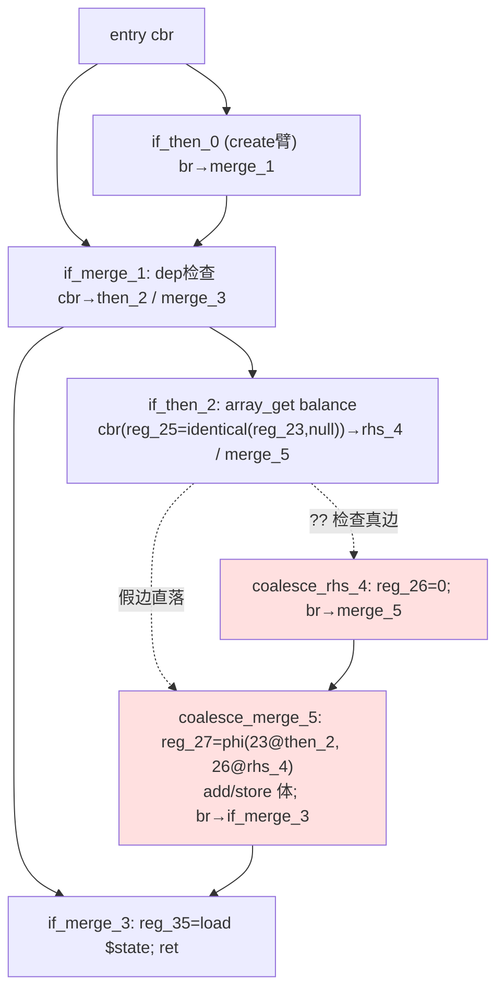

# AOT 代码生成：f163_repro 闭包 if 臂尾 coalesce spill 整链静默丢失修复（#13）

- **日期**：2026-09-25
- **基线 commit**：`908a3a0`（本变更未提交，工作区待用户自行提交）
- **关联缺陷**：任务 #13（f163 最小 repro 新暴露：closure 内 if 臂尾 `?? 0` 三元 spill PHI 丢失）
- **文件**：`src/aot/native_linker.zig`（唯一改动文件，纯新增分支 +157 行，零删改）

---

## 1. 高层摘要（TL;DR）

`if_merge_` 专属处理器的臂尾 `.cond_br` 派发链只覆盖三类形态（共享 merge 守卫 → `emitSpilledNestedIfMerge` → `logical_*` 标签 &&-hop），对**spill 到外层 merge 之后的 coalesce/三元 PHI 链**（`coalesce_rhs_*` + `coalesce_merge_*`）无任何匹配分支，整段臂体被静默丢弃：`f163_repro_tmp.php` 闭包 reducer 中 `$state['balance'] = ($state['balance'] ?? 0) + $e->data['amount'];` 全链未发射，AOT 输出 `bal=0`（PHP 为 `100/150`）。

修复：在 &&-hop 路径之后新增一条**按结构判定**的 spill-coalesce 展开分支（不依赖标签命名），识别"一侧无 phi 体块 `.br` → 另一侧 phi merge 块 `.br` 回落外层 merge、phi 双入边恰为源块与体块"的布局，发射 `if(cond){体; phi←体边} else {phi←源边}` + merge 体非 phi 指令内联 + 一跳外层 merge phi 消解。**f163_repro 转逐字节一致，回归 67/68 零新增失败。**

## 2. 影响范围

| 维度 | 描述 |
|---|---|
| 影响层 | AOT 代码生成（native_linker 标签驱动发射路径），`generateLabelDrivenBlockRange` 内 `if_merge_` 处理器 |
| 受益形态 | 闭包/函数内 `if (cond) { $x = ($y ?? d) … }`（无 else）且三元块 spill 排到外层 merge 之后 |
| 不受影响 | `&&`/`||` 短路链（走 `logical_*` hop）、线性三元（merge 在臂区内）、`emitSpilledNestedIfMerge` 可处理的紧凑 spill（受其 `range_end > arm_idx+1` 早退门控） |
| 风险面 | 纯新增 sibling 分支，门控要求 gi/gr 未消费且至少一个 > 外层 merge index，既有消费路径互斥 |

## 3. 核心变更

| # | 位置（新行号） | 变更 | 说明 |
|---|---|---|---|
| 1 | native_linker.zig ~7766-7925 | 新增 `else if (blk_cs: {…}) {…}` 分支 | `if_merge_` 处理器 `.cond_br => \|g_cb\|` 派发链第 4 路径 |
| 2 | 同上（gate） | 结构判据 `blk_cs` | nei=外层 merge idx；gi/gr=g_cb.then/else idx；要求：不同块、至少一个 > nei（spill 出臂线性区）、双未消费、恰一侧有 phi（=merge 侧 m）、m/t  terminator 均 `.br` 且 t.br==m、m 的 phi 入边含源块（then 臂块）与体块 t |
| 3 | 同上（emit） | 方向感知发射 | `m_is_then_e`（merge==then 目标）时真边=phi←源边、假边=体+phi←体边；否则镜像 |
| 4 | 同上（tail） | merge 体非 phi 内联 + 一跳外层 phi 消解 + `processed.put(gi,gr)` | 防 GLDR 后续 walk 重消费；外层无 phi 时一跳自然无输出（if_merge_3 场景） |

## 4. 可视化概览（Mermaid）

### 4.1 IR 块布局 ↔ 发射映射（f163 闭包 reducer）



红色两节点 index(5,6) > 外层 merge(4) → 旧版三条派发路径全部落空 → DROP；新 `blk_cs` 分支按结构识别并在 if_merge_1 的 then 臂内展开为 `if (reg_25) {体; reg_27←体边} else {reg_27←源边}` + 体非 phi 指令。

### 4.2 派发链执行流（变更点 ★）

```mermaid
flowchart LR
    A[if_merge_ 处理器<br/>.cond_br 臂尾] --> B{g_shared_merge<br/>守卫?}
    B -- 是 --> Z1[emitSpilledNestedIfMerge<br/>range_end>arm+1 早退]
    B -- 否 --> C{logical_* &&-hop<br/>g_hop_ok?}
    C -- 是 --> Z2[&&-hop 发射]
    C -- 否 --> D★{blk_cs 结构判据<br/>spill-coalesce?}
    D -- 命中 --> Z3★[方向感知 if/else 发射<br/>+merge体内联+一跳外层phi]
    D -- 未命中 --> Z0[DROP（原行为）]
    Z1 & Z2 & Z3 & Z0 --> W[GLDR walk nti+1..then_end<br/>已 put 块跳过]
```

### 4.3 生成码对照（main.zig 闭包段）

```zig
// 修复前：reg_25 计算后无任何消费，coalesce+dep 体整体缺失
reg_25 = try runtime.php_identical(reg_23, reg_24);
} else {          // 空 else，链断
}

// 修复后（KEEP_TEMP 提取实证）：
reg_25 = try runtime.php_identical(reg_23, reg_24);
if (reg_25.toBool()) {
    reg_26 = runtime.Value.initInt(0);   // coalesce_rhs_4
    reg_27 = reg_26; _ = reg_27.retain();
} else {
    reg_27 = reg_23; _ = reg_27.retain();
}
// —— coalesce_merge_5 体（$state['balance'] = reg_27 + $e->data['amount']）随 if 闭合后继续发射
```

## 5. 详细变更分析

### 5.1 端/模块层

| 层 | 文件 | 变更 |
|---|---|---|
| AOT 代码生成 | `src/aot/native_linker.zig` | `.cond_br` 派发链新增 `blk_cs` 分支（gate +73 行判据 / emit +90 行发射），无既有代码改动 |

### 5.2 根因链（诊断证据）

1. `[NCB] src=entry nti=4 nmi=5` 等 trace 证明闭包 if_merge_1 的臂尾 cbr 走 **if_merge_ 专属处理器**（非通用 cond_br 处理器）。
2. `emitSpilledNestedIfMerge` 门控 `range_end > arm_idx + 1` 对 spill 形态必然早退（rhs/merge 在 range 之外）。
3. &&-hop 要求 `logical_merge_`/`logical_rhs_` 标签且 merge==then 目标，`coalesce_*` 标签不匹配。
4. 三条路径落空后 switch 无 else-if 兜底 → 静默 DROP；KEEP_TEMP main.zig 4164 行处确认 coalesce 全链缺失、AOT `bal=0`。

### 5.3 复测路径（体验流程）

```bash
cd /Users/wangjianjun/products/parser
timeout 120 zig-out/bin/php-interpreter --compile --no-debug-info fuzzy_scripts_720/tmp/f163_repro_tmp.php
timeout 10 ./fuzzy_scripts_720/tmp/aot_compile_f163_repro_tmp   # 期望 bal=100 / bal=150
rm -f fuzzy_scripts_720/tmp/aot_compile_f163_repro_tmp
bash fuzzy_scripts_720/run_regression_nofail.sh                 # 期望 67/68
```

## 6. 影响与风险评估

- **非破坏式变更**：纯新增分支；三临时 trace（`[NCB]`/`[NCB-RANGE]`/`[CS]`）已在交付二进制前全部剥离并复验（净化版锚点 6/6 MATCH）。
- **门控方向验证顺序**（f033 教训）：先跑 8 锚点探针（f067_or_hop MATCH、f067_or_hop2 核心输出一致——DIFF 仅为 PHP `Uninitialized string offset` 警告，AOT 不模拟警告，非缺陷）→ 重量级主脚本（f033/f044/f067 两份/f161/f163/f007 全 MATCH）→ 全量回归。
- **回归**：67/68（f178 exit=142 唯一残留，基线不变；f004 SKIP 另计）。
- **canary**：全量 compile 扫 `[AOT-CANARY]` fires=0（见 §9 验证表）。
- **特别注意**：`m_is_then_e=true` 镜像方向（三元/`?:` 直落 merge 为 then 目标）当前无已知的"spill 出外层 merge"命中样本（f007 三元走线性路径），该方向逻辑为对称正确构造，后续三元 spill 探针可专项覆盖。
- **已知非确定性旁证**：同一脚本两次编译闭包编号漂移（closure_6 与新 KEEP_TEMP 目录缺同名函数），属任务 #12 范围，与本变更无关。

## 7. 遗留 / 潜在问题

| 缺陷 | 状态 |
|---|---|
| #7 f178 exit=142 | 未修（唯一回归失败项） |
| #12 AOT 编译期非确定性（IR phi/寄存器 id 跨 run 漂移） | 未修 |
| if_merge_3（外层 merge）本身在 closure 尾部的 ret 消费 | 正常（f163_repro 逐字节一致） |
| `?:` 三元 spill 命中镜像方向 | 未见真实样本，待 fuzz 池覆盖 |

## 8. 后续开发 / 优化建议

| 优先级 | 建议 | 影响面 | 落地成本 |
|---|---|---|---|
| P1 | #12 非确定性根因排查（phi/寄存器编号分配顺序） | 可复现性、diff 审计可信度 | 中 |
| P1 | #7 f178 exit=142（超时组唯一残留） | 回归 68/68 收官 | 中 |
| P2 | 为 `m_is_then_e=true` 镜像方向补一枚 `?:` spill 构造探针 | 覆盖未命中分支 | 低 |
| P2 | `emitSpilledNestedIfMerge` 早退门控与新 blk_cs 判据合并为单一结构判定库，消除双份 spill 识别逻辑（DRY） | 可维护性 | 中 |
| P2 | `zig build test` leak 门禁：`runtime_lib_template.zig` `setProperty`/`allocPHPString` 既有泄漏致 test 步骤 exit=1（用例全 PASS） | CI 门禁可用性 | 低-中 |

## 9. 验证记录（2026-09-25）

| 验证项 | 命令/对象 | 结果 |
|---|---|---|
| 编译 | `timeout 300 zig build`（含 trace 版与净化版） | 通过 |
| [CS] 命中（trace 期） | f163_repro：`src=if_merge_1 m=coalesce_merge_5 t=coalesce_rhs_4`；replay 路径不触发 | 符合设计 |
| 源码级 | KEEP_TEMP main.zig 闭包段 coalesce+dep 体真实发射 | 确认 |
| 语义 | f163_repro AOT vs `/opt/homebrew/bin/php` | MATCH（bal=100/150） |
| 锚点（trace 版） | f067_or_hop / f161_xp8disc4 / f161_micro_isset / f161_whileOOO / f033_probe / f095_probe / b18c + 主脚本 f033/f044/f067×2/f161/f163/f007 | 全 MATCH（or_hop2 仅警告差异） |
| 锚点（净化版） | f163_repro, f067_or_hop, f161_xp8disc4, f033_probe, f163 主, f007 主 | 6/6 MATCH，CANARY=0 |
| 全量回归 | `run_regression_nofail.sh` | **67/68**（f178 唯一 FAIL，零新增） |
| canary 全量扫 | 全部 pass/tmp 脚本 compile-only | fires=0 |
| `zig build test` | `timeout 300 zig build test` | 全部用例 PASS；leak 门禁失败项栈顶均在**本变更未触碰**的 `src/aot/runtime_lib_template.zig`（`setProperty` dupe / `allocPHPString`），属运行时模板既有泄漏基线，非本次引入 |
