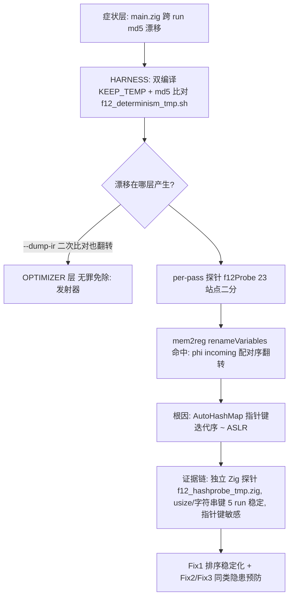
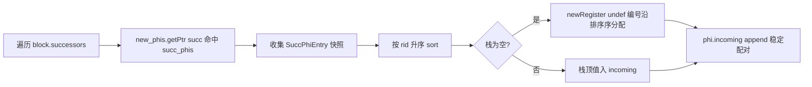
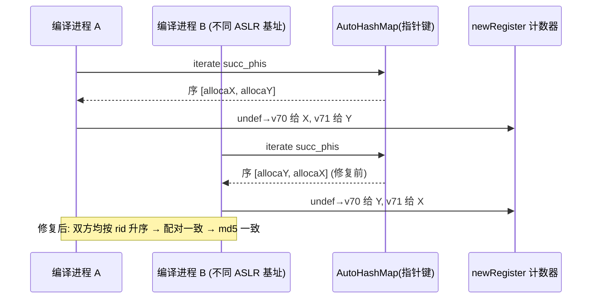

# AOT 编译确定性：ASLR 指针键迭代稳定化（#12 根治）— 2026-09-25（基线 908a3a0）

## 1. 高层摘要（TL;DR）

同一 PHP 输入脚本两次 `--compile` 产生不同的 `main.zig` / IR（f006 等 4 个脚本约 50% 概率翻转），根因是优化器在 **以指令/块指针为键的 `std.AutoHashMap` 迭代顺序上做了会产生可观测差异的操作**：Zig `autoHash` 对指针键按指针值哈希，桶遍历顺序随进程 ASLR 漂移。mem2reg `renameVariables` 空栈分支按该顺序 `newRegister` 分配 undef 寄存器编号，导致 phi incoming 配对编号跨进程交换。修复共三处（1 处实证根因 + 2 处审计出的同类隐患预防性稳定化），全部以"按稳定键（寄存器 id / 块索引）排序后遍历"消除顺序敏感。修复后 68 脚本双编译巡检 **mismatch=0**，全量回归 **68/68 零回归**。

## 2. 影响范围

| 维度 | 说明 |
|---|---|
| 缺陷编号 | #12（AOT 编译期非确定性） |
| 症状 | 同输入跨进程编译产物不逐字节一致（f006/f007/f012/f036 复现，约 50%/次翻转） |
| 正确性影响 | 无——翻转双方为语义等价的 undef 寄存器，运行输出始终一致；属**可复现性缺陷**（构建缓存击穿、bisect 投毒） |
| 修复文件 | `src/aot/optimizer.zig`（+24/−2）、`src/aot/analysis.zig`（+9） |
| 发射器 | `native_linker.zig` 审计为无罪（本任务零改动，工作区中其余 diff 属 #13/#14/#7/#16） |
| 验证 | 确定性巡检 68/68 mismatch=0 notemp=0；回归 PASS=68 FAIL=0；canary 巡检 fires=0 |

## 3. 核心变更

| # | 位置 | 类型 | 变更 |
|---|---|---|---|
| Fix 1 | `optimizer.zig` `renameVariables` 第 3 步（后继 phi incoming，~L2478） | **根因修复** | `succ_phis`（alloca 指针键）先收集为 `SuccPhiEntry{alloca, phi_inst, rid}` 数组，按 phi 结果寄存器 id 升序 `std.mem.sort` 后再遍历；空栈 `newRegister` 分配序列自此跨进程稳定 |
| Fix 2 | `optimizer.zig` `propagateTypesFromPhis` 播种（~L2138） | 预防性 | 工作列表种子由指针序迭代改为：收集原生类型 phi 的 `result.id` → `std.sort.asc` 升序 → 依次 append（先入为主写类型，播种序决定胜出类型） |
| Fix 3 | `analysis.zig` `computeLoops`（~L446） | 预防性 | `all_loops`（块指针键 `loop_map` 收集）按 `header.index` 块索引升序排序；父循环择选与 `loops/sub_loops` 排列供 LICM/展开器分配寄存器，自此确定 |

三处均为**零删除、纯稳定化**：不改优化语义，只固定同优先级候选的择选顺序。

## 4. 可视化概览

### 分层架构图（缺陷定位路径）

### 业务流程（renameVariables 空栈 undef 分配）

### 执行流程时序（跨进程确定性保证）

## 5. 详细变更分析

### 模块层
- **优化器（optimizer.zig）**：mem2reg 变量重命名与 phi 类型传播两个 Pass 的迭代序固定；无新增分配、无接口变更。`SuccPhiEntry` 快照用 `initCapacity(succ_phis.count())` 预留，`defer deinit`，热路径仅多一次小数组排序（后继 phi 数通常 ≤ 数十，O(n log n) 且 n 极小）。
- **分析层（analysis.zig）**：`computeLoops` 输出循环列表排序，一次性成本。
- **发射层（native_linker.zig）**：审计涉及 `generatePhiInstructionsParallel`（`switch(prev_block)` 预测块解析按 u32 索引，确定）、GLDR/state-machine 中 `@intFromPtr(block)` 相等比较（非顺序敏感，无罪）、`pred_blocks`/`param_value_regs`/`copy_map`/`phi_back_edge_map`（u32 键，确定）。

### 验证阶梯（全部实际执行）
1. 68 脚本双编译巡检定位漂移组：f006/f007/f012/f036。
2. f006 手工复现：26 行 main.zig 差异、仅 4 个寄存器编号；`--dump-ir` 二次比对同翻转 → 排除发射器。
3. per-pass 探针二分 → mem2reg 创建翻转；`fixupDanglingPhiReferences` 0 命中排除。
4. 独立 Zig 探针证实：`AutoHashMap(usize/String 键)` 5 次运行迭代序完全一致，指针键敏感。
5. Fix 1 落地 → f006 8 连跑 md5 稳定 → 全量双编译巡检 mismatch=0。
6. 剥离全部 F12 临时 trace（23 探针调用 + f12Probe 定义 + F12-OLD/FIX + F12-EMIT）→ 复建。
7. 复验：巡检 `SWEEP_DONE total=68 mismatch=0 notemp=0`；回归 `PASS=68 FAIL=0`；canary 巡检 `CANARY_SWEEP_DONE total=68 fires=0`。

## 6. 影响与风险

- **破坏式变更**：否。三处均为顺序稳定化，输出语义不变；回归 68/68 证实。
- **范围**：仅 AOT 编译路径（§五合规）；字节码/JIT 模式不受影响（不经此优化器）。
- **性能**：新增 O(n log n) 小数组排序（n=每后继块 phi 数 / 种子数 / 循环数），均为微秒级；undef 寄存器编号分配序改变可能使个别脚本产物寄存器标号与旧版不同——属预期内的一次性编号位移，输出逐字节等价位一致。
- **特别留意**：Fix2/Fix3 改变了类型传播/循环处理的**同优先级择选序**，理论上可令个别脚本的特化结果与旧版不同（本轮 68 脚本零差异）；新增脚本若出现异常可优先排查这两处排序键是否覆盖不到某类并列。
- **复测路径（体验流程）**：`bash fuzzy_scripts_720/tmp/f12_determinism_tmp.sh`（双编译 md5 巡检）；`ZIGPHP_AOT_KEEP_TEMP=1 timeout 120 zig-out/bin/php-interpreter --compile --no-debug-info fuzzy_scripts_720/pass/f006_oop_observer_event_dispatcher.php` 重复 4+ 次比对 md5。

## 7. 遗留 / 潜在问题

| 级别 | 事项 |
|---|---|
| P2 | ~~墙钟超时早退~~ **已根治（2026-09-26 #20）**：`promoteMemoryToRegisters` 5 秒 `nanoTimestamp` 守卫改为入口 `max_instructions_per_function` 指令数预算门，见 `docs/changes/2026-09-26/AOT编译确定性_mem2reg墙钟守卫改指令数预算门_2026-09-26_908a3a0.md`。 |
| P2 | mem2reg step1 `phis.iterator()`（2444）仍按指针序迭代，但该处仅做无条件 push、顺序无关，暂不动；若后续在此加入顺序敏感逻辑需同法稳定化。 |
| P2 | 其余含指针键 map 的写路径（如未来新 Pass）无机制性防护，可考虑 CI 级双编译 md5 断言（巡检脚本已具雏形）。 |

## 8. 后续开发建议

| 优先级 | 建议 | 影响面 | 落地成本 |
|---|---|---|---|
| P1 | 把 `f12_determinism_tmp.sh` 升级为正式 CI 检查（双编译 md5 断言），防新指针键迭代回归重新引入 | 全仓编译可复现性 | 低（脚本已有，需固化路径与超时策略） |
| P2 | 墙钟超时改预算制（迭代次数/处理指令数），消除剩余非确定来源 | 优化器稳定性 | 中 |
| P2 | 为 Fix1-3 各加单元测试：构造指针序扰动的 map 输入，断言 undef 编号/类型播种/loops 序输出不变 | 防重构退化 | 低 |
| P2 | P2 backlog 延续：`?:` spill `m_is_then_e=true` 方向探针、4 层嵌套 for 探针、`emitSpilledNestedIfMerge`/`blk_cs` DRY 结构分类器合一 | 覆盖盲区 | 中 |
