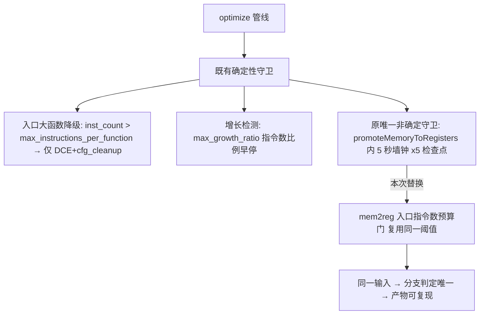
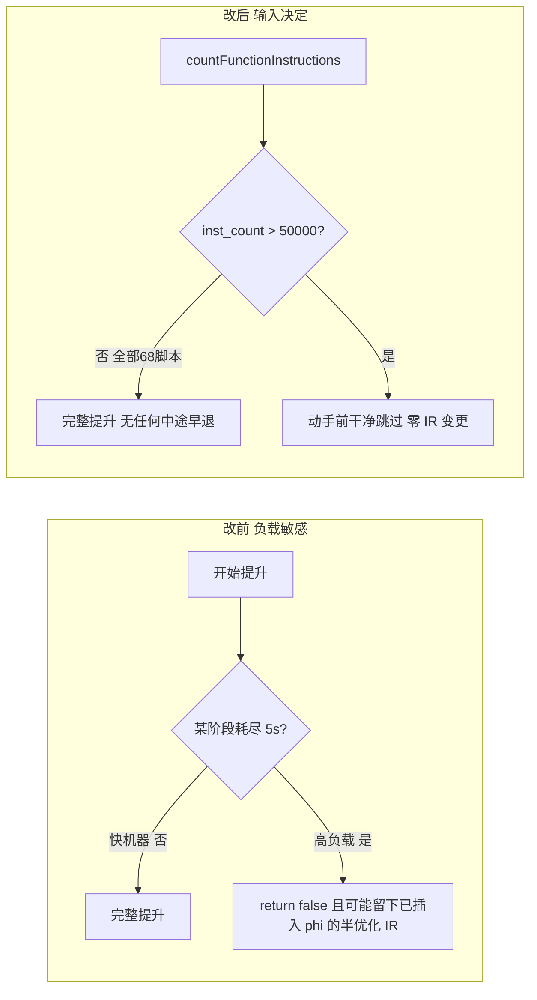
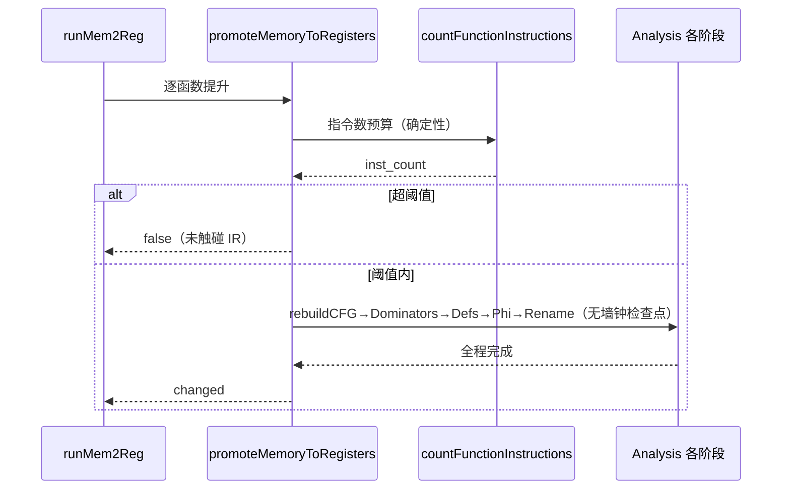

# AOT 编译确定性收官：mem2reg 墙钟守卫改指令数预算门（#20，#12 残留清零）— 2026-09-26（基线 908a3a0）

## 1. 高层摘要（TL;DR）

#12 根治了「同输入跨进程产物漂移」，但当时登记的最后一处非确定来源仍在：`promoteMemoryToRegisters` 用 **5 秒墙钟**（`nanoTimestamp` 差值）在 5 个阶段检查点做防挂死早退——同一输入在高低负载机器上可能一侧完整提升、另一侧超时 `return false`，破坏可复现构建。本次将墙钟守卫整体替换为**入口确定性预算门**：函数 IR 指令数超过既有配置阈值 `max_instructions_per_function`（默认 50000，release-small 档 30000）即跳过 mem2reg。零新增常量、零新增配置项；分支判定从此只由输入决定。附带消除原「阶段中途超时退出可能留下半优化 IR」的一致性隐患。验证阶梯全绿：确定性巡检 mismatch=0、全量回归 68/68、`zig build test` 与改前同型、canary fires=0。

## 2. 影响范围

| 维度 | 说明 |
|---|---|
| 任务编号 | #20（= #12 收尾登记的 P2 残留项） |
| 缺陷 | 墙钟超时早退与机器负载相关 → 编译产物不可复现（高负载下 mem2reg 可能被跳过，优化级别漂移） |
| 修复文件 | 仅 `src/aot/optimizer.zig`（净 −9 行：删 5 检查点 + 删 `nanoTimestamp` 私有助手，增 1 入口预算门） |
| 配置 | 复用 `OptimizeConfig.max_instructions_per_function`（既有字段，语义对齐 optimize()/optimizeFunction() 的大函数降级策略） |
| 行为差异 | 68 脚本全部函数 IR 远低于阈值 → 本轮产物与改前逐字节一致（回归证实）；仅对超阈值巨型函数：改前取决于机器快慢，改后确定性地跳过提升 |
| 其他模式 | 无涉（§五合规：仅 AOT 优化器路径） |

## 3. 核心变更

| # | 位置 | 类型 | 变更 |
|---|---|---|---|
| 1 | `promoteMemoryToRegisters` 入口 | **新增** | `inst_count = countFunctionInstructions(func)`；`inst_count > config.max_instructions_per_function` → `return false`（函数保留 allocas，发射端照常处理）。含中文注释说明墙钟→预算的确定性动机 |
| 2 | 原 L1810-2032 五处 `// Check timeout` | **删除** | `nanoTimestamp() - start_ns > 5s` 检查点全部移除（其中途退出点位于 phi 插入/重命名之间，存在半优化 IR 风险，一并消除） |
| 3 | `nanoTimestamp(self)` 私有 inline 助手 | **删除** | 唯一使用者为上述检查点，清零后成死代码，随手移除（同文件 `resetStats` 之后） |

## 4. 可视化概览

### 分层架构图（防挂死守卫演进）

### 业务流程（巨型函数处置对比）

### 执行流程时序

## 5. 详细变更分析

### 端/模块层
- **优化器层**：mem2reg 提升的进入判定从时间域映射到规模域。`countFunctionInstructions` 为既有 O(块×指令) 计数，代价可忽略。
- **配置层**：无新增字段；`.release-small` 预设的 30000 收紧值自动作用于新门（`optimizer.zig:221`）。
- **数据层**：无。

### 涉及文件列表
| 文件 | 变更 |
|---|---|
| `src/aot/optimizer.zig` | 入口预算门 +9（含 3 行注释）；删 5 检查点 −20；删 nanoTimestamp 助手 −8；本轮累计 diff +31/−39（含 #12 两处排序稳定化） |

### 验证阶梯（全部实际执行）
1. `timeout 300 zig build` exit=0。
2. 确定性巡检（68 脚本双编译 md5）：`SWEEP_DONE total=68 mismatch=0 notemp=0`。
3. 全量回归 `run_regression_nofail.sh`：`PASS=68 FAIL=0`（证明预算门在现有语料上零行为差异）。
4. `zig build test`：全 pass；泄漏组与改前完全同型（基线 runtime 单测对象头持有，见 §7）。
5. canary 编译巡检：`CANARY_SWEEP_DONE total=68 fires=0`。

## 6. 影响与风险

- **破坏式变更**：否。阈值内函数（现状全部）行为逐字节不变。
- **范围**：仅 AOT 优化器 mem2reg pass；解释器/字节码模式不经此路径。
- **性能**：预算门自身开销一次函数遍历（O(n)），相对 mem2reg 本体可忽略；省掉 5 次 syscall 级时钟读取（原 `clock_gettime`）反而是微优化。
- **需注意**：未来若出现合法巨型函数（>50k IR 指令）需要提升，应调 `max_instructions_per_function` 或为 mem2reg 增设独立字段，而非恢复墙钟；跳过提升只损失优化质量，不损失正确性（allocas 有既有发射路径）。
- **复测路径**：同 #12 阶梯——`fuzzy_scripts_720/tmp/f12_determinism_tmp.sh` + `run_regression_nofail.sh`；构造 >50k 指令函数验证确定性跳过（P2 探针，未在本轮覆盖）。

## 7. 遗留 / 潜在问题

| 级别 | 事项 |
|---|---|
| P2 | ~~大函数预算门的边界样本缺失~~ **已完成（2026-09-27 #21）**：三档压力探针实测，门发路径 md5 跨进程全等 + 二进制输出与 PHP truth 一致；生效阈值校准为 `.size`=30000。见 `docs/changes/2026-09-27/AOT编译确定性_预算门触发路径压力验证_2026-09-27_908a3a0.md`。 |
| P2 | `src/aot` 其他文件仍有可能的墙钟守卫（`profiler.zig`、`ir_generator.zig` 本轮 grep 未见 optimizer 之外的超时早退；profiler 计时属性能统计非编译决策，不构成不可复现）。 |
| 基线既有 | `test_runtime_comprehensive`/`test_runtime_cycle_gc` 27 处分配泄漏：经核实为 `PHPString.deinit`（runtime_lib_template.zig:1567-1573）**文档化的刻意对象头持有**（防 AOT 清理代码多次 release 引发 UAF），data 已正确释放；测试门禁要绿需测试侧豁免或生产语义重设计，二者均有风险，未经用户裁决不动（§六）。 |

## 8. 后续开发建议

| 优先级 | 建议 | 影响面 | 落地成本 |
|---|---|---|---|
| P1 | 确定性双编译 md5 断言固化为 CI 门禁（#12+#20 后产物应恒等） | 防全仓再入 | 低 |
| P2 | ~~>50k 指令压力探针~~ **DONE（2026-09-27 #21，见 2026-09-27 变更文档）** | 边界覆盖 | 已落地 |
| P2 | 评估 mem2reg 独立预算字段（与全局 max_instructions_per_function 解耦） | 调优粒度 | 低 |
| P2 | runtime 单测泄漏门禁方案（测试侧 allow-leak 白名单 vs 对象头回收重构）需用户裁决 | 测试门禁 | 中-高 |
