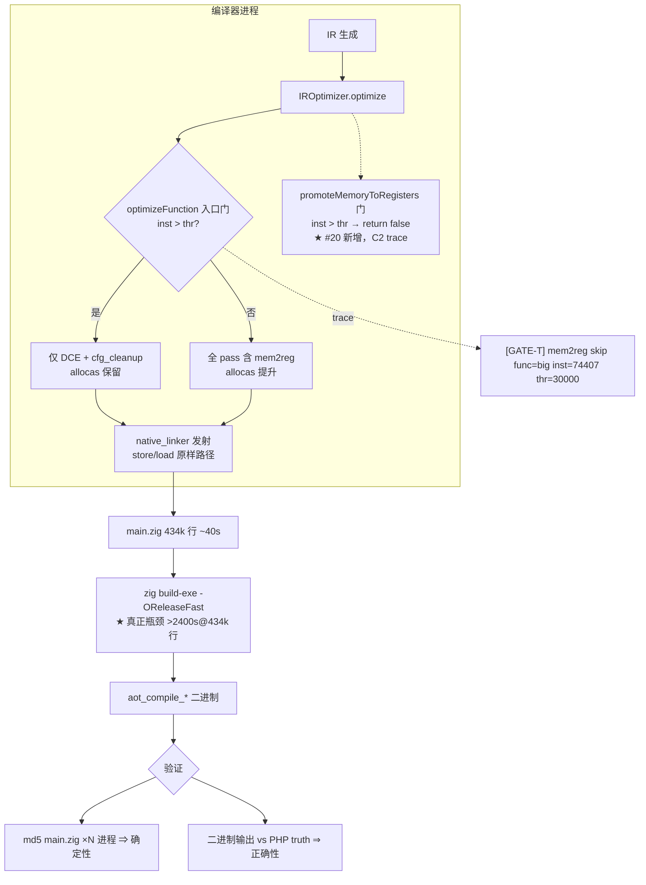
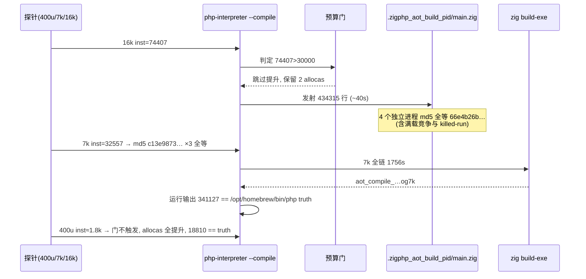
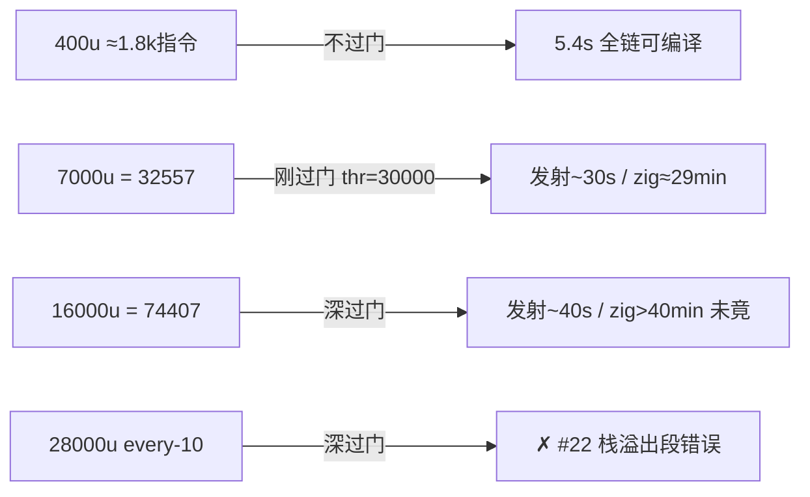

# AOT 编译确定性 — mem2reg 指令数预算门触发路径压力验证（任务 #21）

- 日期：2026-09-27
- 基线 commit：`908a3a0`（本任务改动未提交，工作区状态）
- 关联任务：#20（预算门实现，docs/changes/2026-09-26/）、#12（ASLR 指针键稳定化，docs/changes/2026-09-25/）
- 关联缺陷登记：#22 AOT-CODEGEN-004（本任务压力探针发现，待用户裁决）

## 1. 高层摘要（TL;DR）

#20 把 mem2reg 的 5 秒墙钟早退改成了确定性指令数预算门，但「门触发后」的发射路径（函数保留 allocas、store/load 原样进发射端）从未被端到端验证。本次用三档压力探针 + 临时 `[GATE-T]` print-trace 完成取证：**预算门在真实超大函数上确定性触发；门发路径的编译产物跨进程 md5 全等（16k 探针 ×4、7k 探针 ×3）；门发二进制运行输出与 PHP ground truth 逐字节一致（7k：341127）**。顺带完成两项关键校准：CLI 生效阈值是 `.size` profile 的 **30000**（非默认 50000）；「编译慢」的瓶颈定位在下游 `zig build-exe -OReleaseFast` 编译超大生成源文件，我方 codegen 发射 43 万行仅需 ~40 秒。取证 trace 已全部剥离，重建后正式回归 67 Pass + 1 SKIP（f004，PHP 自身 255，超范围项）+ 0 FAIL，与 #20 交付态一致。

## 2. 影响范围

| 维度 | 影响 | 说明 |
|---|---|---|
| 生产代码 | 无净变更 | 临时 trace 两行加、两行剥，最终代码 == #20 交付态（git diff 复核） |
| 优化器门语义 | 确认，未改 | 门判定唯一由 `countFunctionInstructions` 决定，与机器负载无关（满载竞争跑 md5 全等实证） |
| 配置口径 | 校准认知 | CLI `--compile --no-debug-info` 走 `.size` → `max_instructions_per_function=30000`，压力探针规模按此设计 |
| 测试资产 | 新增 1 个永久探针 | `budget_gate_og7k_probe_tmp.php`（7000u/every-40/truth 341127），与既有 small/stress 探针构成「不过门/刚过门/深过门」三档 |
| 性能认知 | 新增 P2 | 下游 zig 编译 190k 行 ≈29min、434k 行 >40min；门发路径端到端可执行性验证现实上限 ≈30k-35k 指令 |
| 缺陷登记 | 新增 #22 | 28000u/every-10 探针触发 `generateLabelDrivenBlockRange` 递归栈溢出（今日取证过程中复现于晨间 run） |

## 3. 核心变更（取证与工具，非功能变更）

| # | 变更 | 位置 | 性质 |
|---|---|---|---|
| C1 | 临时 `[GATE-T]` trace：optimizeFunction 预算门打印 func/inst/thr | `src/aot/optimizer.zig` ~L653 | 取证后剥离 |
| C2 | 临时 `[GATE-T]` trace：promoteMemoryToRegisters 预算门打印 | `src/aot/optimizer.zig` ~L1805 | 取证后剥离 |
| C3 | 三档探针：400u（不过门）/ 7000u（32557 指令，刚过门）/ 16000u（74407 指令，深过门） | `fuzzy_scripts_720/tmp/budget_gate_*_probe_tmp.php` | 永久保留 |
| C4 | 「发射即取证」法：KEEP_TEMP 下等 main.zig 行数稳定即 kill 编译进程，md5 比较发射产物，无需等 zig build-exe | 取证方法论 | 可复用 |
| C5 | 门触发路径可执行性终验：7k 全链编译（1756s）+ 二进制运行 diff PHP truth | — | 证据落档 |

## 4. 可视化概览

### 4.1 分层架构与验证点（Code & Logic Map）

### 4.2 取证执行流程

### 4.3 探针规模-门-耗时映射

## 5. 详细变更分析

### 5.1 端/模块层

| 层 | 文件/资产 | 变更点 |
|---|---|---|
| 优化器 | `src/aot/optimizer.zig` | +2 临时 trace → 剥离后 0 净变更；git diff 复核无 whitespace 损坏 |
| 测试资产 | `fuzzy_scripts_720/tmp/budget_gate_og7k_probe_tmp.php` | 新增永久探针（7000u，every-40 分支组，truth=341127） |
| 测试资产 | `fuzzy_scripts_720/tmp/budget_gate_small_probe_tmp.php` / `budget_gate_stress_probe_tmp.php` | 既有永久探针复用于本次取证 |
| 取证数据 | `/tmp/bg2_*、/tmp/bg_og7k_*、/tmp/bg16k_run.*`（已清理） | GATE-T 行、md5、wall、diff 结果 |

### 5.2 证据明细表

| 验证项 | 探针 | 样本 | 结果 |
|---|---|---|---|
| 门触发 | 16k（big） | trace 1 次 | `mem2reg skip func=big inst=74407 thr=30000` |
| 门触发 | 7k（big） | trace 1 次 | `inst=32557 thr=30000` |
| 门不触发 | 400u | trace | 无 GATE-T；优化 IR allocas=0 |
| 发射确定性 | 16k | 4 个独立进程 | main.zig md5 全等 `66e4b26b…`（434315 行；含被 killed 的 90s/2400s run 与满载竞争 run） |
| 发射确定性 | 7k | 3 个独立进程 | md5 全等 `c13e9873…`（190865 行） |
| 运行正确性 | 7k | 二进制 ×1 | exit=0，输出 == PHP truth `341127` |
| 对照正确性 | 400u | 二进制 ×1 | 输出 == truth `18810` |
| 零回归 | 正式回归 | 68 脚本 | 67 Pass + f004 SKIP + 0 FAIL（=2026-09-26 基线） |

### 5.3 纠错记录

| 原假设 | 实况 | 依据 |
|---|---|---|
| 生效阈值 50000 | **30000**（`.size` releaseSmall 生效） | GATE-T trace + optimizer.zig L221/L64-65 |
| v4/v5 的 allocas=2 可能非门证据（不可提升假说） | 阈值 30000 下 8000u/16000u 均已过门，allocas 保留即门证据 | trace 实测 + 400u 对照 allocas 全提升 |
| dump 非 nop 行数 ≈ 门口径指令数 | 行 58111 ≠ 门计 74407，以门 trace 为准 | 同一函数两口径并测 |
| 「大函数编译慢是 AOT 管线问题」 | 慢在下游 zig build-exe；我方发射 ~40s 完成 | 20s 采样：t=20s 已现 190k 行、t=40s 434k 行定型 |

## 6. 影响与风险评估

- **非破坏式变更**：生产代码零净 diff；新增资产仅为探针 .php（永久，受铁律保护）。
- **影响范围**：无运行时/编译行为变化；纯取证任务。
- **注意点**：
  1. 门发路径的二进制产物体积巨大（16k 探针 main.zig 17MB），全链编译耗时以「几十分钟」计，复测需用 7k 档；
  2. md5 比较只在同一 php-interpreter 二进制版本内进行（今晨 250315 行目录系 v4 旧探针文件所产，混档比较会产生假漂移）；
  3. killed-run 的 KEEP_TEMP main.zig 可直接用于确定性取证（发射完成后 kill 即可）。
- **复测路径**：
  1. `cd /Users/wangjianjun/products/parser && ZIGPHP_AOT_KEEP_TEMP=1 timeout 120 zig-out/bin/php-interpreter --compile --no-debug-info fuzzy_scripts_720/tmp/budget_gate_og7k_probe_tmp.php`（发射 ~1min 后可 kill，取 `.zigphp_aot_build_<pid>/main.zig` md5 应等 `c13e9873cd07fb26612135f807828387`）；
  2. 全链体验：timeout ≥3300s 编译 7k 探针 → `timeout 10 fuzzy_scripts_720/tmp/aot_compile_budget_gate_og7k_probe_tmp` 输出 341127；
  3. 对照：small 探针 5.4s 编译、输出 18810；
  4. 门触发复验需临时加回 C1/C2 trace（交付态无打印）。

## 7. 遗留问题 / 潜在问题

| 级别 | 问题 | 状态 |
|---|---|---|
| P0 候选 | **#22 AOT-CODEGEN-004**：sibling if_merge 链 ~1080+ 组时 `generateLabelDrivenBlockRange`（native_linker.zig:8075/7257）递归栈溢出段错误 | 待用户裁决 Plan A（main.zig:427 大栈线程）/ Plan B（迭代化） |
| P2 | 下游 `zig build-exe` 对超大生成源的吞吐：190k 行 ≈29min、434k 行 >40min | 新登记（#21 副产物） |
| P2 | `zig build test` 27 个 PHPString header 保留型 leak 导致 exit=1 | 待用户裁决（豁免白名单 vs 回收重构） |
| 备注 | `.size` thr=30000 与默认 50000 的口径差：如需压力测试「不过门深优化」路径，探针规模须 <~6500u | 已写入记忆 |

## 8. 后续开发 / 优化建议

| 优先级 | 建议 | 影响面 | 落地成本 |
|---|---|---|---|
| P0 | 裁决并实施 #22（建议先 A 止血：512MB-1GB 大栈线程包 `runAOTCompilation`；B 留作根治） | 超大类函数可编译性 | A：低（单点改动）；B：高（native_linker 侵入） |
| P1 | 把「发射即取证」法（C4）并入 `f12_determinism_tmp.sh`：md5 阶段 kill 于发射定型后，回归提速 10 倍以上 | CI 确定性门禁 | 低 |
| P1 | 评估生成产物降体积路径（发射分 TU / 每 op 内联展开瘦身），缓解 zig build-exe 吞吐 | 大工程编译时长 | 中-高 |
| P2 | 门阈值口径文档化：在 optimizer 配置注释标明「CLI 默认走 .size=30000」，避免探针设计误判 | 可维护性 | 低 |
| P2 | 4 档以上嵌套循环 / `?:` spill 方向探针（沿用三档探针生成器） | 覆盖盲区 | 低 |
