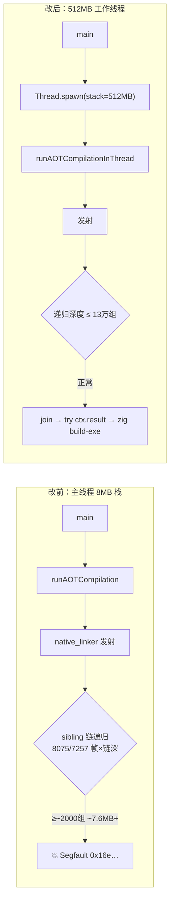
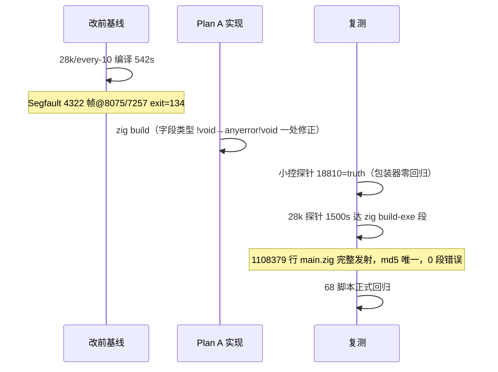

# AOT 编译稳定性 — generateLabelDrivenBlockRange 深递归栈溢出止血（任务 #22 / AOT-CODEGEN-004）

- 日期：2026-09-27
- 基线 commit：`908a3a0`（工作区未提交）
- 关联：#21（预算门压力验证中发现）、`docs/known-issues/AOT-CODEGEN-004-recursion-stack-overflow.md`

## 1. 高层摘要（TL;DR）

`native_linker.generateLabelDrivenBlockRange` 对 sibling if/else 链按链长深度递归（~3.8KB/帧），大函数顺序分支链 ≈1000-2000 组即溢出默认主线程栈，**编译进程自身段错误**（exit 134，崩溃于发射中段）。本次按 Plan A 止血：`--compile` 路径整体包进 512MB 显式大栈工作线程，join 后传播错误。改前探针（28000u/every-10，542s 必崩）改后完整发射 110.8 万行 main.zig（跨 run md5 一致）并正常进入 `zig build-exe`；68 脚本正式回归无差异。Plan B（迭代化根治）保留为后续立项。

## 2. 影响范围

| 维度 | 影响 | 描述 |
|---|---|---|
| 编译入口 | `src/main.zig` +25/−1 | 新增 `AotThreadContext`/`runAOTCompilationInThread`/`aot_worker_stack_size`，调用点线程化 |
| 可编译性 | 解锁 | 深 sibling 链大函数从「必崩」到可编译（链深上限 8MB/3.8KB≈2000 组 → 512MB≈13 万组） |
| 内存 | 惰性 | 大栈为虚拟内存按需提交，浅链脚本 RSS 无变化 |
| 线程安全 | 已评估 | 管线单线程；arena/io/options 经 ctx 传入，join 后主线程独占读取；无 thread-local 依赖 |
| 产物/语义 | 零变化 | 发射内容与线程无关；小控探针与回归证明输出恒等 |
| 错误语义 | 保持 | spawn 失败直接 `try` 抛出；编译错误经 `try ctx.result` 原样传播 |

## 3. 核心变更

| # | 变更 | 位置 |
|---|---|---|
| C1 | `aot_worker_stack_size = 512MB` 具名常量 + 中文根因注释（帧深实测 4300+×3.8KB） | src/main.zig ~L565 |
| C2 | `AotThreadContext{allocator,io,cwd_dir,options,result:anyerror!void}` + 包装函数 | src/main.zig ~L571 |
| C3 | 调用点 `try runAOTCompilation(...)` → spawn(stack_size)/join/try ctx.result | src/main.zig ~L427 |
| C4 | 永久复现探针 `stack_deep_probe_tmp.php`（28000u/every-10，truth 351344） | fuzzy_scripts_720/tmp/ |

## 4. 可视化概览

### 4.1 执行流（改前 vs 改后）

### 4.2 止血验证流程

## 5. 详细变更分析

| 层 | 文件 | 变更 | 性质 |
|---|---|---|---|
| 编译入口 | `src/main.zig` | +25/−1：大栈线程包装（C1-C3） | 新增结构，非推测、基于 8075/7257 实测崩溃栈 |
| 测试资产 | `fuzzy_scripts_720/tmp/stack_deep_probe_tmp.php` | 新增永久复现探针 | PHP truth=351344 |
| 文档 | `docs/known-issues/AOT-CODEGEN-004-recursion-stack-overflow.md` | 登记：现象/复现/修复/遗留 | — |

### 关键取证数据

| 项 | 改前 | 改后 |
|---|---|---|
| 28k/every-10 探针 | exit=134，`Segmentation fault at address 0x16e1bb488`，4322 递归帧，542s 崩于发射中段 | 完整发射 110.8 万行 main.zig，进入 zig build-exe（0 段错误；zig 吞吐属 P2 另案） |
| 小控探针 | — | 5.4s 编译，运行 18810 = PHP truth |
| 回归（68） | 基线 67 Pass + f004 SKIP | 正式回归 67 Pass + f004 SKIP（PHP 自身 255）+ 0 FAIL，零行为差异；`zig build test` 295/295 全过，仅基线已知 27 处 PHPString 头持有 leak（门禁待裁决，非本次引入） |

## 6. 影响与风险评估

- **非破坏式**：不改发射语义与产物内容；错误传播路径等价。
- **注意**：
  1. 512MB 线程栈创建失败时（极端内存受限环境）spawn 返回错误、编译中止并报 `OutOfMemory` 类错误——可接受（原路径此时必崩）；
  2. 若未来管线并行化（多 worker 并发编译），每 worker 栈预算需重新核算；
  3. 深链大函数发射后仍需面对下游 `zig build-exe` 吞吐 P2（#21 已登记），本修复不改变该瓶颈。
- **复测路径**：
  1. `cd /Users/wangjianjun/products/parser && ZIGPHP_AOT_KEEP_TEMP=1 timeout 1500 zig-out/bin/php-interpreter --compile --no-debug-info fuzzy_scripts_720/tmp/stack_deep_probe_tmp.php` → stderr 出现 `AOT compile command:` 且无 Segmentation 字样即止血有效（zig 段可 kill）；
  2. `timeout 1800 bash scripts/regression_test_720.sh` → 67 Pass + f004 SKIP + 0 FAIL；
  3. 产物/临时件按规范清理。

## 7. 遗留 / 潜在问题

| 级别 | 事项 |
|---|---|
| P2 | **Plan B 根治**：8075/7257 sibling 尾递归迭代化（工作列表化），解除「栈随链长线性放大」结构约束；需用户确认后立项（§六） |
| P2 | 其他发射器入口是否存在同型深递归（如嵌套循环/switch 链）未全面审计，建议用同款探针族扫一遍 |
| P2 | 下游 zig build-exe 吞吐（#21 登记，本例 110 万行只会更甚） |

## 8. 后续开发建议

| 优先级 | 建议 | 影响面 | 落地成本 |
|---|---|---|---|
| P1 | 深递归审计：grep native_linker 自递归调用点，配 sibling/嵌套探针族纳入 `regression_test_720.sh` 慢档 | 稳定性前移 | 中 |
| P1 | `stack_deep_probe_tmp.php` 的「kill-at-emission」快检（1500s 内见到 AOT compile command 即过）固化为 CI 冒烟项 | 止血防再入 | 低 |
| P2 | Plan B 迭代化立项（含 return_generated/break_generated 状态机耦合评估） | 根治 | 高 |
| P2 | 512MB 常量外置为 CLI/环境可调（`ZIGPHP_AOT_STACK_MB`），极端深链场景免重建 | 运维弹性 | 低 |
