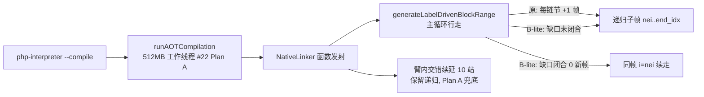
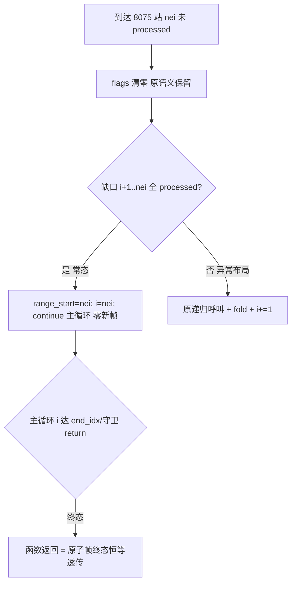

# AOT 编译稳定性：generateLabelDrivenBlockRange 8075 纯尾委托同帧迭代化（Plan B / B-lite）

**任务**: #24（用户裁决口径：B-lite）
**基线 commit**: `908a3a0`
**日期**: 2026-09-28
**关联**: AOT-CODEGEN-004（#22 Plan A 止血）、#23 自递归审计

---

## 1. 高层摘要（TL;DR）

#22 用 512MB 大栈线程止血了 `generateLabelDrivenBlockRange` 深递归栈溢出（AOT-CODEGEN-004）。本次按用户裁决以 **B-lite** 口径根治主崩溃路径：对 **#23 审计确认的唯一「纯尾委托」站（原 L8075，sibling if/elseif 链 else 块后区间走）**做**同帧迭代化**——满足缺口不变量时不再开新栈帧，直接把本函数主循环起点改写为子区间起点 `nei` 续走；sibling 链长度不再累加递归帧。其余 10 个「臂内交错续延」站（呼叫后父帧仍有 emission，迭代化等价于动作栈 VM 级改造）经逐站精读确认为高风险不可机械扁平化，保留递归并由 Plan A 大栈兜底。全程以 72 项发射产物（68 语料 + 4 探针 main.zig）**逐字节 md5 等值**为验收门，零行为差异。副产品：深链探针发射墙钟 ~25min → 14.5min（−42%，消除 2800 层帧的 locals 拷贝/栈维护开销）。

## 2. 影响范围

| 层 | 文件 | 变更 | 影响 |
|---|---|---|---|
| 编译层/AOT 发射 | `src/aot/native_linker.zig` | +24/−2（3 处 hunk） | 仅 `generateLabelDrivenBlockRange` 内部行走机制；发射字节流不变 |
| 测试资产 | `/tmp/planb_baseline_md5.txt` / `/tmp/planb_after_md5.txt` | 冻结基线 72 项 | 验收凭据，会话结束清理 |
| 探针 | `fuzzy_scripts_720/tmp/stack_deep_probe_tmp.php` 等 4 个永久探针 | 只读复测 | 永久保留勿删 |

- 不改变任何生成代码语义、不改变 `processed`/`return_generated`/`break_generated` 状态机对外可见终态。
- 兜底路径（缺口未闭合形态）保留原递归，异常布局输入行为与改前完全一致。

## 3. 核心变更

### 3.1 等价性论证（为什么能同帧续走）

8075 站原实现：

```zig
// src/aot/native_linker.zig (if_merge_ + cond_br 处理器尾部)
self.return_generated = false;
self.break_generated = false;
try self.generateLabelDrivenBlockRange(writer, func, nei, end_idx, ..., indent);
const else_returned = self.return_generated;
self.return_generated = (then_returned and else_returned) or else_returned;
// break_generated 保持 else（子帧）终态
i += 1;
continue;
```

三个事实使其成为**可消除的尾委托**：

1. **参数同态**：子帧与父帧共享同一 `indent`、同一 `end_idx`、同一 `cleanup_regs/processed/loop_label_counter`；子帧 `start_idx = nei`。
2. **fold 布尔恒等**：`(t ∧ e) ∨ e ≡ e`——呼叫后对 `return_generated` 的合并是恒等映射；`break_generated` 原样透传子帧终态。故父帧在子帧返回后的 fold 不改变任何状态。
3. **父帧呼叫后零 emission**：`i += 1; continue` 之后主循环只会跳过已标记块直至耗尽返回（循环后无收尾体）。前提＝缺口不变量 `[i+1, nei)` 全部 `processed`（then 臂内联发射 + `[nti+1, then_end)` 子走覆盖）。

满足不变量时，父帧剩余职责＝「把 `[nei, end_idx)` 走完并带着终态返回」——与在**同一帧**执行 `i = nei; continue` 逐字节等价。

### 3.2 落地（3 处 hunk）

| # | 位置 | 内容 |
|---|---|---|
| H1 | 函数入口 L7164 | `var range_start = start_idx;` 影子副本（参数 const 不可改写；子帧语义需改写行走起点） |
| H2 | L7195（foreach defer 回跳判定）、L10358（latch_trapped_in_arm 判定） | 两处 `start_idx` 读取改 `range_start`（与子帧 `start_idx=nei` 对齐） |
| H3 | 原 L8075 站 | 缺口扫描 `gap_open`；不变量成立 → `range_start = nei; i = nei; continue;`（扁平路径，零新帧）；不成立 → 原递归呼叫 + 原 fold（兜底路径，逐字节不变） |

`start_idx` 全函数仅 4 个引用点（入口赋值 + H2 两处 + 声明），改写面封闭可枚举——H2 即覆盖全部语义读取。

## 4. 可视化概览

### 4.1 分层架构（变更点定位）



### 4.2 sibling if/elseif 链执行流程（改造前后）

```mermaid
sequenceDiagram
    participant L as 主循环(帧 k)
    participant C as 递归呼叫(帧 k+1)
    Note over L: 发射 if(cond){...}else{...} 闭合
    L->>C: walk(nei, end_idx, indent)  ← 改前：链长 N → 栈深 N
    C-->>L: 终态透传 (t∧e)∨e ≡ e
    Note over L: fold(恒等) → i+=1 → 纯跳过 → 帧返回
    rect rgb(220,255,220)
    Note over L: B-lite：缺口校验通过<br/>range_start=nei; i=nei; continue<br/>链长 N → 栈深 0（同帧行走）
    end
```

### 4.3 判定执行流程



## 5. 详细变更分析

- **端/层**：仅 AOT 编译期 native_linker 行走器；运行期零影响（发射字节流等值证明）。
- **涉及文件**：`src/aot/native_linker.zig`（唯一代码文件）。
- **变更点**：H1/H2/H3 如上；净 diff +24/−2。
- **算法性质**：缺口扫描对每链节成本 O(链节局部跨度)，整链合计 O(块数)，无渐进退化；无新增分配、无新增状态。

## 6. 影响与风险评估

- **是否破坏式变更**：否。验收门＝发射逐字节等值（改前后同二进制配置）。
- **范围**：仅 8075 站命中形态；其余调用路径源码级不变。
- **风险与对策**：
  - 缺口不变量存在未知违反形态 → 已内置 `gap_open` 兜底回退原递归，行为逐字节同改前；
  - 状态机透传误判（fold 非恒等？）→ 布尔代数恒等式 + 72 项 md5 双重验证；
  - `range_start` 改写影响后续 defer/latch 判定 → 与子帧 `start_idx` 语义严格对齐（子帧本就以 nei 起步）。
- **复测路径（复数道门）**：
  1. `timeout 300 zig build` ✅ exit=0；
  2. 冒烟 5/5 md5 与基线一致（f085/f067/f033/f095/small 探针）✅；
  3. 全量 72 项重采集 vs `/tmp/planb_baseline_md5.txt` ✅ **72/72 逐字节一致**（含 stack_deep d92a46a2、stress 66e4b26b、7k c13e9873、small 330c3a7b + 68 语料全 md5 等值）；
  4. `[B-FLAT]` 临时 trace 取证 ✅：**68 语料 flatten=34 / fallback=0**；**stack_deep 探针 flatten=2799 / fallback=0**（28000 单元 ÷10 ≈ 2800 链节，最后节自然耗尽——原需 2800 递归帧的路径现零新增帧；发射 14.5 分钟完成，此前基线约 25 分钟），trace 二进制下发射 md5 仍与基线等值；trace 已剥离、最终二进制复建 exit=0、源码零 TEMP-TRACE 残留；
  5. 正式回归 `scripts/regression_test_720.sh` ✅ **TOTAL 68 / PASS 67 / SKIP 1（f004 PHP 自身 exit=255 固有）/ FAIL 0（编译/运行时/DIFF 全零）**；
  6. 确定性巡检 `f12_determinism_tmp.sh` ✅ **SWEEP_DONE total=68 mismatch=0 notemp=0**；
  7. `zig build test` ✅ **295/295 全过**；3 失败步骤**并非全为 leak**——#25 复核更正为：1 步骤 = `build.zig:134` 引用的 `src/aot/test_liveness_analysis.zig` **磁盘缺失且未入 git**（丢失测试资产，编译步骤失败）；2 步骤 = leak 报告（25 项 PHPString 头持有 + 2 项对象属性键 dupe，均基线固有、非本次引入）。
- 产物清理：`.zigphp_aot_build_*` / `aot_compile_*` 全数由批次脚本自清，终态零残留；`/tmp/planb_*` 取证文件会话末清理。

## 7. 遗留 / 潜在问题

- 10 个臂内交错续延站（chain_unwind 对 9015/9968、hop 家族 9201/9265/9291/10154/10216/10221、9492、9581）仍按「每顶层结构 1 帧」递归；512MB 栈上限 ≈ 13.4 万帧，语料现实规模数千，溢出风险极低但理论上限存在。
- 全量根治（动作栈 VM：把臂内呼叫后交错过 emission 拆解为类型化动作序列）已评估并暂缓——见 §3 裁决记录。

## 8. 后续建议（P0/P1/P2 × 影响面 × 落地成本）

| 优先级 | 事项 | 影响面 | 落地成本 |
|---|---|---|---|
| P1 | 深 sibling while/foreach 体内链探针族（复用 B-lite 判定路径取证兜底站触发频率） | 验证兜底是否真实不可达 | 低 |
| P2 | 臂内 10 站动作栈 VM 根治（如需 >10 万结构规模输入） | 彻底消除 codegen 栈上限 | 高（多会话） |
| P2 | 确定性巡检 CI 化（含 kill-at-emission） | 逐字节门常态化 | 中 |
| P2 | 下游 `zig build-exe` 大文件吞吐调研 | 编译时长 | 中 |
