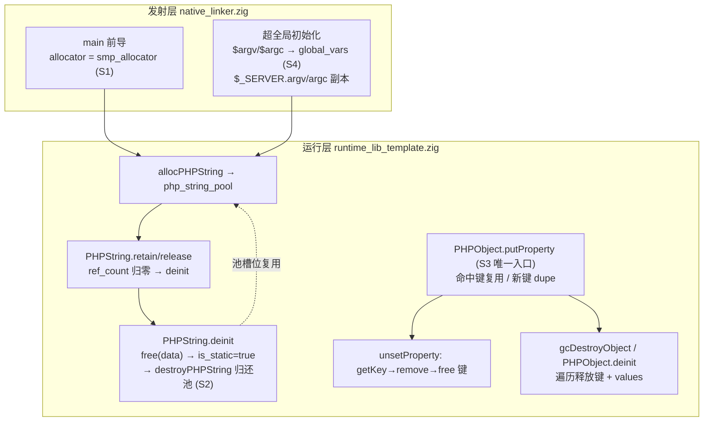
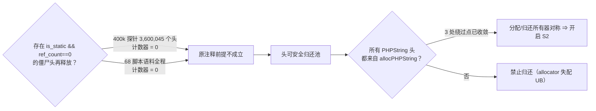
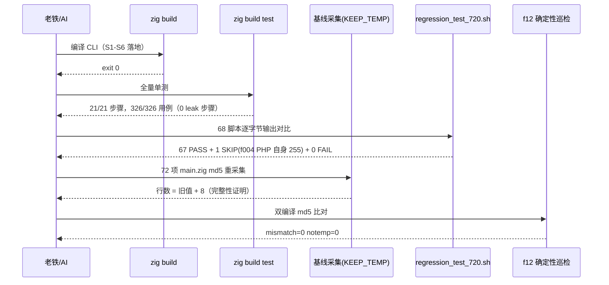

# AOT 运行时内存/性能根治（PHPString 头归还池 + 属性键所有权统一）与发射前导变更后的基线重冻结

**变更类型**: 运行期内存安全与性能根治（S1/S2/S3）+ CLI 能力补全（S4）+ 测试基础设施修复（S5/S6）+ 基线重冻结（S7）
**日期**: 2026-09-29
**基线 commit**: `24634df`（本次改动全部未提交，按规范由老铁提交）

---

## 1. 高层摘要（TL;DR）

上一轮（2026-09-28 #25）取证确认了两个「被文档当作设计内代价」的生产级负向：**PHPString 头永久持有**（400k 迭代字符串循环 RSS 9.4MB→153.9MB，斜率 +360B/迭代）与**属性键 dupe 无主**（2 处真泄漏）。本轮按裁决两步走做完：

- **S1 止血**：发射 `main` 的底账分配器 `page_allocator` → `std.heap.smp_allocator`。sys 时间 7.1s → 0.00s。
- **S2 根治**：`PHPString.deinit` 末尾把头归还 `php_string_pool`，并把三处绕过池的头分配收敛到 `allocPHPString`。头增长斜率 **360B/迭代 → 0**（100k 与 400k 峰值 RSS 完全相同 = 2.98MB），墙钟 9.5s → 0.71s。
- **S3 根治**：新增属性写入唯一入口 `putProperty`，令 `PHPObject.properties` 的键**一律归对象所有**，并在三条销毁路径各自回收一次。属性键泄漏步骤清零，同时消除「释放字面量键」与「clone 共享键二次释放」两类潜在 UAF。
- **S4 能力**：发射前导补绑 `$argv` / `$argc` 全局，实测与 PHP CLI 逐字节等值。
- **S5/S6 负向**：perf 报告「静默失败」根因不是目录耦合，而是**并发测试二进制共用固定临时目录名互删** + `createDirPath(...) catch {}` 吞错；丢失的 `test_liveness_analysis.zig` 按文档 7 个回归点重写并入库。
- **S7**：发射前导净增 8 行 ⇒ 72 项 `main.zig` 逐字节 md5 冻结基线整体重采集，并**首次入库持久化**（`fuzzy_scripts_720/baseline_main_zig_md5.tsv`）。

验收：`zig build` 0 ⇒ 全量 `zig build test` **21/21 步骤成功、326/326 用例通过**（原 25 个头泄漏步骤消失）⇒ 正式回归 **67 PASS + 1 SKIP + 0 FAIL** ⇒ 确定性巡检 **mismatch=0** ⇒ 基线行数与旧冻结值差恰为 +8。

## 2. 影响范围

| 影响面 | 描述 | 等级 |
| --- | --- | --- |
| AOT 产物运行期内存 | 字符串头由「永久持有」改为池化复用；长运行脚本 RSS 从线性增长变为常量（实测斜率归零） | 高（正向） |
| AOT 产物墙钟 | 400k 字符串迭代 9.5s → 0.71s；对 PHP 解释器的差距 105× → 3.9× | 高（正向） |
| AOT 产物对象属性 | 属性键所有权单一化；`unsetProperty`/`gcDestroyObject`/`PHPObject.deinit` 三条路径各释放一次，无重复 | 高（正向，消除潜在 UAF） |
| CLI 取参能力 | `$argv`/`$argc` 从「恒未定义」到与 PHP 等值 | 中（能力补齐） |
| 全部 AOT 产物源码 | 发射前导 +8 行（分配器 1→4 行、`$argv/$argc` 绑定 +2 行、注释 +5 行） | 中（破坏式：冻结基线整体位移） |
| 单元测试门禁 | `zig build test` 从「1 编译失败 + 2 leak 步骤」到 21/21 全绿；新增 7 个 liveness 用例 | 高（正向） |
| 测试基础设施 | 两处 `createDirPath catch {}` 改 `try`（fail-fast）；两个回归检测用例的临时目录带 pid | 低（仅测试/工具路径） |

## 3. 核心变更

| 编号 | 变更 | 文件 | 关键实现 |
| --- | --- | --- | --- |
| S1 | 底账分配器换带尺寸分级的缓存分配器 | `src/aot/native_linker.zig:1863`（发射模板） | `const allocator = std.heap.smp_allocator;`，并注释「page_allocator 让每个短串缓冲与每个 MemoryPool 块各自 mmap/munmap」 |
| S2a | 头归还池 | `src/aot/runtime_lib_template.zig` `PHPString.deinit` | `is_static = true` 之后**最后一次写**调 `destroyPHPString(self, allocator)`（`MemoryPool.destroy` 会覆写槽位首字节作空闲链指针） |
| S2b | 分配/归还对称 | 同上，`php_strrchr` / `php_stristr` / `php_interpolate` | `allocator.create(PHPString)` → `allocPHPString`；补 `errdefer` 释放缓冲或归还头 |
| S3a | 属性写入唯一入口 | 同上，`PHPObject.putProperty` | 命中已有键复用原自有键指针；新键 `dupe` + `errdefer free`；值语义与 `StringHashMap.put` 逐位一致 |
| S3b | 键回收三点 | `setProperty` 尾部、`unsetProperty`、`gcDestroyObject` | `unsetProperty` 先 `getKey` 再 `remove` 后 `free`；`gcDestroyObject` 在 `properties.deinit()` 前遍历释放键 |
| S3c | 20 个写站点收敛 | SPL 内部对象（12 处字面量键）、`php_clone`（2 处共享键）、`initWithMeta` 默认属性、数组转对象、`php_object_get_ref` | 全部改走 `putProperty`；数组转对象用 `defer free(key_str)` 释放格式化临时键 |
| S4 | `$argv`/`$argc` 全局绑定 | `src/aot/native_linker.zig` 发射前导 | 先 `global_vars.put` 取得 `argv_arr` 首份所有权，再写 `$_SERVER` 副本（顺序决定 COW 分叉与否） |
| S5 | 目录创建不再吞错 + 测试目录带 pid | `src/benchmark/regression_detector.zig`、`src/benchmark/ci_integration.zig` | `try createDirPath(...)`；新增 `testScratchDir(buf, prefix)` 把 `std.c.getpid()` 拼进目录名 |
| S6 | 恢复丢失的 liveness 单测 | `src/aot/test_liveness_analysis.zig`（新写，7 用例） | 含终止指令操作数「只进指令级活跃集、不进块出口集」这一不对称判据的永久断言 |
| S7 | 基线重冻结并入库 | `fuzzy_scripts_720/baseline_main_zig_md5.tsv`（72 行） | 采集为一次性 `/tmp` 脚本（KEEP_TEMP 逐个编译 + 行数稳定判据），跑完即删；采集法已写进 TSV 头部注释，**持久复验入口**改为 `fuzzy_scripts_720/tmp/s7_baseline_spotcheck_tmp.sh` |

## 4. 可视化概览

### 4.1 分层与所有权流（Code & Logic Map）

### 4.2 S2 安全前提的取证决策流

### 4.3 验收阶梯执行流（时序）

## 5. 详细变更分析

### 5.1 涉及文件

| 层 | 文件 | 变更 |
| --- | --- | --- |
| 发射层 | `src/aot/native_linker.zig` | +8 行发射前导（S1 分配器、S4 全局绑定），diff 10 行 |
| 运行层 | `src/aot/runtime_lib_template.zig` | 130 行改动（S2 归还池与对称化、S3 `putProperty` 与 20 站点收敛、3 条销毁路径键回收） |
| 工具层 | `src/benchmark/regression_detector.zig` | `init` fail-fast + `testScratchDir` + 两用例目录带 pid（18 行） |
| 工具层 | `src/benchmark/ci_integration.zig` | `CIRunner.init` 报告目录 fail-fast（4 行） |
| 测试资产 | `src/aot/test_liveness_analysis.zig` | 新建（7 用例，恢复 2026-07-18 交付资产） |
| 基线资产 | `fuzzy_scripts_720/baseline_main_zig_md5.tsv` | 新建（72 项 md5，首次入库） |
| 复检工具 | `fuzzy_scripts_720/tmp/f12_determinism_tmp.sh` | 复用（68 脚本双编译 md5 自比对，判据 `mismatch=0 notemp=0`） |
| 复检工具 | `fuzzy_scripts_720/tmp/s7_baseline_spotcheck_tmp.sh` | 新建（5 个量级实时编译，逐行比对冻结基线的行数 + md5，判据 `SPOT_DONE ok=5 bad=0`） |
| 缺陷登记 | `docs/known-issues/AOT-MEM-001-*.md`、`AOT-RUNTIME-001-*.md`、`AOT-PROC-001-*.md` | 新建 3 份 |

### 5.2 关键不变量（改动得以成立的前提）

1. **`MemoryPool.destroy` 是最后一次写**：池会把空闲链指针写进槽位起始字节，故 `destroyPHPString` 必须排在 `data` 释放、计数递减、`is_static = true` 之后。
2. **合法静态串与僵尸头的签名可区分**：静态串恒为 `ref_count == 1`（`initStatic`/`StaticStringEntry`）或 `999999`（`EMPTY_STRING`）；僵尸头才是 `is_static && ref_count == 0`。实测后者为 0。
3. **`is_static = true` 早退保护覆盖全部池外头**：`EMPTY_STRING`（编译期全局）、两处字面量全局、`StaticStringEntry.php`（内联于 entry，按内容驻留、有界）都因 `deinit` 体被 `if (!self.is_static)` 包住而永不进入 `destroyPHPString` ⇒ 不会出现「非池指针被池回收」。
4. **属性键单一所有权**：`StringHashMap` 键由调用方管理（`put` 命中已有键保留原指针、`remove` 不释放键、`deinit` 只回收桶数组），所以 dupe 必须成对出现在写入点，释放必须成对出现在**全部**销毁点。
5. **`ClassMeta.properties` / `static_properties` 是另一张表**（类元数据，键为类生命周期内的名字），不受 S3 契约约束，已核实非遗漏点。

### 5.3 实测数据

**内存/性能（同一测量法 `/usr/bin/time -l`，400k 迭代，输出与 PHP 逐字节等值）**

| 场景 | 墙钟 | sys | 峰值 RSS |
| --- | --- | --- | --- |
| AOT 改前（page_allocator + 头不归还） | 9.5s | 7.1s | 153.9MB（+360B/迭代） |
| AOT S1 后（未归还池） | 0.79s | 0.06s | 147MB |
| AOT S1+S2 后 | 0.71s | 0.00s | **2.98MB（100k 与 400k 相同 ⇒ 斜率 0）** |
| PHP 8.5 解释器 | 0.18s | 0.02s | 22.46MB |

整数对照循环 400k：AOT 0.45s / 2.98MB，输出 `239999800000` = PHP 等值 ⇒ 字符串路径的额外代价仅 0.26s/40 万次迭代（约 9 次串操作/迭代 ⇒ ~72ns/操作）。

**门禁**

| 门禁 | 结果 |
| --- | --- |
| `timeout 900 zig build` | exit 0 |
| `timeout 900 zig build test` | `21/21 steps succeeded; 326/326 tests passed`（原 25 个 `allocPHPString@357` 泄漏步骤 + 2 个属性键泄漏步骤全部消失）。**末次全量代码改动后复跑**：`build.zig` 从不引用 `runtime_lib_template.zig`（它只在 AOT 编译期被 `copyRuntimeLib` 从磁盘读），故该模板的纯空行回补不进入此门禁，复跑结果仍为 326/326 |
| `bash scripts/regression_test_720.sh` | TOTAL 68 / PASS 67 / SKIP 1（f004，PHP 自身 exit=255，超范围） / FAIL_COMPILE 0 / FAIL_RUNTIME 0 / FAIL_DIFF 0 |
| 基线重采集 | 72 项；4 个长期探针行数 = 2026-09-28 冻结值 + 8，逐一对齐 |
| 确定性巡检 | 实测 `SWEEP_DONE total=68 mismatch=0 notemp=0`（每脚本双编译取 `main.zig` md5 比对；含 f124 112965 行在内全部落在 120s 窗口内，无 NOTEMP 假阴性） |
| 冻结基线抽查 | 实测 `SPOT_DONE ok=5 bad=0`：f031(5838)/f010(16111)/f042(29420)/f067(47364)/f113(104334) 五个量级实时编译，行数与 md5 均与 `baseline_main_zig_md5.tsv` 逐字节相等 ⇒ 基线可由当前工作树复现 |

## 6. 影响与风险评估

| 项 | 评估 |
| --- | --- |
| 是否破坏式变更 | **对产物源码是**：每个 AOT 产物 `main.zig` 前导 +8 行 ⇒ 旧 md5 基线全部作废，已用 S7 重冻结替代并入库。**对语义不是**：68 脚本逐字节输出仍与 PHP 等值，0 FAIL。 |
| 最大残余风险 | **读已释放头**：归还池后，若仍有路径持有已释放 `*PHPString` 并读取，读到的是被复用的合法头，**safe-mode 不会 panic**，单测也抓不到 ⇒ 唯一有效检测器是 68 脚本逐字节输出回归（已通过）。 |
| 次Risk | `PHPObject.deinit` 与 `gcDestroyObject` 都释放键，若未来新增第四条销毁路径而忘记释放 ⇒ 泄漏（不会 UAF）；若两处误调两次 ⇒ UAF。已以「键只在 `putProperty` 一处 dupe、在三处 free」的显式契约约束。 |
| 需注意 | 批次编译期间**禁止编辑 `runtime_lib_template.zig`**（`copyRuntimeLib` 每次编译从磁盘读取，会污染后续脚本的编译输入）。本轮我曾在此规则下误动一次（纯空行回补，不影响语义与 main.zig 基线），已记录为流程教训。 |
| 复测路径 | ①产物已按宪法§三.7 清空，故先编译永久探针再计时：`timeout 300 zig-out/bin/php-interpreter --compile --no-debug-info fuzzy_scripts_720/tmp/leak_header_slope_probe_tmp.php` ⇒ `timeout 120 /usr/bin/time -l fuzzy_scripts_720/tmp/aot_compile_leak_header_slope_probe_tmp 400000`（应 2.98MB 级、输出 18866670）；②`timeout 300 zig-out/bin/php-interpreter --compile --no-debug-info fuzzy_scripts_720/tmp/argv_support_probe_tmp.php` 后 `aot_compile_... alpha 42 gamma`（应 `argc=4 n=0 cnt=4`）；③`bash scripts/regression_test_720.sh`；④`bash fuzzy_scripts_720/tmp/f12_determinism_tmp.sh`（须 `mismatch=0 notemp=0`）；⑤`bash fuzzy_scripts_720/tmp/s7_baseline_spotcheck_tmp.sh`（须 `SPOT_DONE ok=5 bad=0`，即冻结基线可由当前工作树复现） |

## 7. 遗留问题 / 潜在问题

| 编号 | 问题 | 状态 |
| --- | --- | --- |
| L1 | `.gitignore:16` 的 `test_*` 通配会吞掉新建 `src/**/test_*.zig`（本次资产丢失事故根因）；`AOT-PROC-001` 已给出三档方案 | **待老铁裁决**（改 `.gitignore` 属配置变更；`git add -f src/aot/test_liveness_analysis.zig` 需人工提交） |
| L2 | SPL 内部对象同一键重复写入时，被覆盖的旧值未 `release`（S3 前即存在，属既有语义，非本轮引入） | 登记 P2，未动 |
| L3 | `alloc_counters` 看不到「头已归还池但仍被 Value 引用」这一档，监控盲点仍在 | 登记 P2 |
| L4 | `zig build test` 中 3 个测试二进制 exit 非零但用例全通过（构建记为 `w`）；`--summary all` 显示 `21/21 steps succeeded` | 判为 Zig 0.16 在子进程协议结束后写 stderr 的表现，非用例失败；留观察 |
| L5 | `src/benchmark/test_regression_properties.zig`（7 用例，`test_prop_37_*`）**不在** `build.zig` 的 `test_files` 里，任何 `zig build test` 都不执行它 | 登记 P1（测试资产闲置，非丢失） |
| L6 | `$_SERVER['SCRIPT_FILENAME']` 仍取第一个 CLI 参数（AOT 下为产物路径），改前既有行为 | 登记 P2 |
| L7 | 臂内 10 处 sibling 站仍「每顶层结构 1 帧」（#24 遗留 P2），Plan A 512MB 栈上限约 13.4 万帧 | 未动 |

## 8. 后续开发 / 优化建议

| 优先级 | 建议 | 影响面 | 落地成本 |
| --- | --- | --- | --- |
| P0 | `.gitignore` 增 `!src/**/test_*.zig` 并把 `test_liveness_analysis.zig` 强制入库；把 `baseline_main_zig_md5.tsv` 纳入 CI 比对 | 防资产二次丢失 / 基线可追溯 | 1 行 + 1 命令 |
| P1 | 把 `test_regression_properties.zig` 接入 `build.zig` 的 `test_files`（先解 L5 的目录耦合，其用例同样用固定相对目录名） | +7 属性用例进入门禁 | 小 |
| P1 | 把确定性巡检（`f12_determinism_tmp.sh` + 基线比对）提升为 CI 步骤：一次双编译即可同时产出「确定性」与「基线一致性」两类结论 | 发射回归可自动化 | 小 |
| P2 | 池级 busy/free 计数进 `ZIGPHP_ALLOC_STATS`，闭合 L3 监控盲点 | 可观测性 | 中 |
| P2 | 字符串路径热点再压：当前 400k 迭代 0.71s vs PHP 0.18s，差距主要在每迭代多次 `PHPString` 头 + 缓冲生命周期；候选是短串内联（SSO）或 NaN-box 立即数串 | 性能（3.9× → 目标 ≤1×） | 大（运行层改造） |
| P2 | `putProperty` 增加「同键覆盖是否 release 旧值」的显式策略参数，统一 SPL 与用户对象语义（L2） | 内存精确性 | 中 |
| P2 | 臂内 10 站动作栈 VM 全量根治（仅当出现 >10 万 sibling 结构输入才立项） | 编译期鲁棒性 | 极大 |
