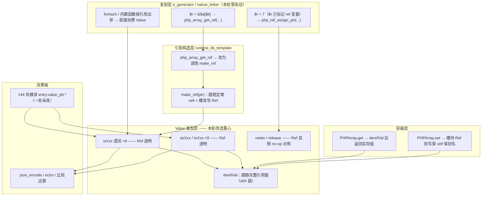
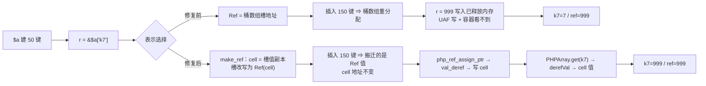
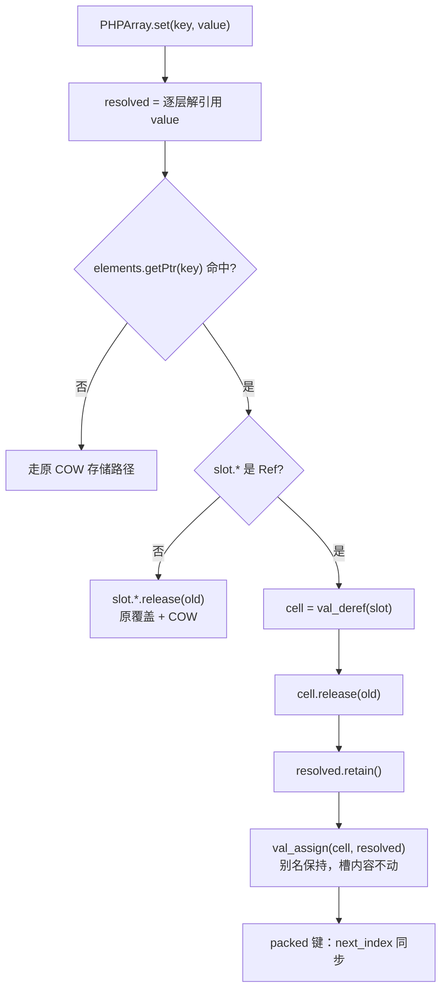
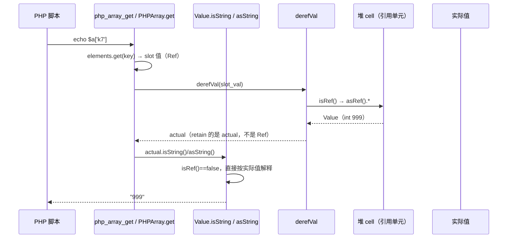

# AOT 引用语义修复：D0 吞写止血 + D2 容器引用装槽（方案 A）

**日期**: 2026-09-30
**关联缺陷**: [AOT-REF-001](../../known-issues/AOT-REF-001-container-ref-slot-dangling.md)
**用户裁决**: 「D0 和 D2 方案 A 一起修，D1 先不动」
**改动面**: 纯运行时模板 `src/aot/runtime_lib_template.zig`（162 增 / 63 删），发射侧零改动

---

## 1. 高层摘要（TL;DR）

AOT 的引用表示是「一个指向 `Value` 槽的裸指针」。这个表示对**变量槽**成立（变量槽地址稳定），对**容器元素槽**不成立（扩容即搬迁），并且当引用变量的目标退化成了普通值时，写入路径会**静默丢弃整条赋值语句**。本轮修掉其中两条：

- **D0（止血）**：`php_ref_assign_ptr` 在目标不是 Ref 时原先什么都不做，返回 null ⇒ 语句凭空消失。现改为「释放旧值 + retain 新值 + 直写目标槽」，写入落到变量本身。
- **D2（根治）**：`php_array_get_ref` 不再把容器槽地址交给调用方，而是复用 `make_ref` 为元素建一个**稳定堆 cell**、把 cell 的 Ref **写回槽**，返回同一个 cell Ref。数组扩容搬迁桶数组时，被搬迁的是这个 Ref 值本身，cell 地址永不变 ⇒ UAF 写消失、写回可见。
- **配套（D2 的必要条件）**：把解引用下沉到 `Value` 类型层（9 个类型谓词 + 6 个取值器 + 3 个宽松转换 + `PHPArray.get/set/retain`），使引用对 PHP 侧的值消费路径**透明**（等价 Zend `ZVAL_DEREF`）。这样 **144 处裸读 `entry.value_ptr.*` 的消费站点一处都不用改**。

实测：D2 专属探针与 PHP 逐字节等值（`k7=999|ref=999`、`b1=777|ref=777`；修复前是 `k7=7|ref=999`、`b1=20|ref=777`）；68 脚本官方回归 **FAIL_DIFF 1 → 0**；72 项冻结基线抽查 5/5 逐字节等值 ⇒ **发射零漂移**。D1（属性/静态属性真引用）按裁决保留，其判据从「整句消失」改善为「写入落到变量、容器侧仍值语义」。

## 2. 影响范围

| 维度 | 影响 | 量化 |
|---|---|---|
| 正确性 | 消除生产级 UAF 写（写入已释放桶数组）；消除赋值语句静默丢失 | 4 个永久探针 / 2 类失效形态 |
| 内存安全 | 引用单元从「容器槽地址」改为「独立堆 cell」，生命周期与容器解耦 | `php_array_get_ref` 产出形态 1 处切换 |
| 语义收敛 | 引用值流入 `isXxx` / `asXxx` / `toXxx` 时按被引用值判定，`json_encode` 不再把引用槽输出成 `null` | f044 判据恢复 |
| 性能 | 每次 `&$arr[$k]` +1 次 8B cell 分配；读侧多一层指针跳转 | 语料中该语法共 12 处命中，均在低频路径 |
| 发射产物 | **无变化**（模板以文本形式拷入构建目录，不进 `build.zig` 依赖图） | 冻结 md5 抽查 5/5 等值 |
| 单测 | 不触碰 `zig build test` 输入（编译器源码未改） | 预期步骤/用例数不变 |
| 破坏性 | 否：只把错误行为向 PHP 真值收敛，未删公开 API | — |

## 3. 核心变更

| # | 变更 | 位置 | 性质 |
|---|---|---|---|
| 1 | `php_ref_assign_ptr` 补非 Ref 目标分支（release + retain + 直写） | `runtime_lib_template.zig:8022` | 新增语义，止血 |
| 2 | `php_array_get_ref` 改用 `make_ref` 装槽，删除 `has_active_refs`/`convertToMixed` 锚定需求 | `:4851` | 根治（替换表示） |
| 3 | 新增值形态解引用 `derefVal(val) Value`（链长上限 64 跳，防自引用环） | `:3044` | 新增基础设施 |
| 4 | 类型谓词 Ref 透明：`isNull/isBool/isInt/isBigInt/isFloat/isString/isArray/isFunction/isResource` | `:2444–:2517` | 语义下沉（`isRef`、`isMissing` 有意保持不透明） |
| 5 | 取值器 Ref 透明：`asBool/asInt/asFloat/asString/asFunction/asResource`（`asString` 原为野读） | `:2521–:2594` | 修野读 |
| 6 | 宽松转换 Ref 透明：`toBool/toInt/toFloat`（原会落到兜底分支得恒 true / 0 / 错值） | `:2681–:2782` | 补兜底 |
| 7 | `Value.retain` 对 Ref 早退，与既有 `release` 的 Ref no-op 对称 | `:2624` | 防计数漂移 |
| 8 | `PHPArray.get` 读出即 `derefVal` 后 retain 实际值 | `:2120` | 读路径 |
| 9 | `PHPArray.set` 目标槽若持 Ref 则**写穿引用单元**（保别名），否则走原覆盖路径；`next_index` 在写穿分支同步维护 | `:2149` | 写路径 |
| 10 | `make_ref` 语义复用说明补注（既有实现，无逻辑改动） | `:3055` | 文档化 |

## 4. 可视化概览

### 4.1 分层架构（业务目标 × 分层）



### 4.2 业务流程（`$r = &$a['k7']` → 扩容 → 写入）



### 4.3 执行流程（写侧：引用槽上的 `set`）



### 4.4 上下层时序（读路径：从 `echo` 到 cell）



## 5. 详细变更分析

### 5.1 变更文件清单

| 文件 | 类型 | 行数变化 | 说明 |
|---|---|---|---|
| `src/aot/runtime_lib_template.zig` | 运行时模板 | +162 / -63（全文件 30803 行） | 本轮唯一功能改动文件；含同批未提交的 S 系列内存修复 |
| `docs/known-issues/AOT-REF-001-container-ref-slot-dangling.md` | 缺陷文档 | 状态转 CLOSED（D0/D2）+ §3.1 复测表 + §6 成本更正 | — |
| `fuzzy_scripts_720/tmp/ref001_probe_run_tmp.sh` | 验收脚本 | 新增 | 4 探针 AOT vs PHP 真值逐字节比对 |
| `fuzzy_scripts_720/tmp/*.php` ×4 | 永久探针 | 不变 | PHP 源脚本受保护铁律，禁止删除 |
| `src/aot/ir_generator.zig` / `native_linker.zig` | 发射侧 | **本轮未动** | D1 属发射侧，按裁决保留 |

### 5.2 变更点与代码对应

```zig
// runtime_lib_template.zig:8022 —— D0 止血
pub fn php_ref_assign_ptr(ref_ptr: *Value, new_val: Value) !Value {
    if (ref_ptr.isRef()) { /* 原有写穿分支 */ }
    // 目标槽并非 Ref（降低阶段把属性/静态属性引用退化成了普通值）时，写入必须落到变量本身。
    ref_ptr.release(runtime_allocator);
    _ = new_val.retain();
    val_assign(ref_ptr, new_val);
    return Value.initNull();
}
```

```zig
// runtime_lib_template.zig:4851 —— D2 根治：引用装槽
const slot = arr.getPtr(key) orelse blk: {
    try arr.set(allocator, key, Value.initNull());
    break :blk arr.getPtr(key).?;
};
// 返回指向稳定堆单元的 Ref；扩容搬迁的是这个 Ref 值，单元地址不变
return make_ref(slot, allocator);
```

```zig
// runtime_lib_template.zig:3044 —— 值形态解引用（读路径统一入口）
pub fn derefVal(val: Value) Value {
    var current = val;
    var hops: u8 = 0; // 上限防护：异常自引用环不得变成无限递归
    while (current.isRef() and hops < 64) : (hops += 1) {
        current = current.asRef().*;
    }
    return current;
}
```

### 5.3 关键设计判断

| 判断点 | 依据 |
|---|---|
| 为何在 `Value` 层做 deref 而不是改 144 处消费站点 | 消费站点数量 O(内置函数)，类型层数量 O(类型系统)。后者一次生效、不可能漏，且不会因新增内置函数而重新腐化 |
| 为何 `isRef` / `isMissing` 保持不透明 | `isRef` 是 deref 的守卫本身，若透明则 deref 无限；`isMissing` 服务于发射侧未初始化判定，与引用无关 |
| 为何 `retain` 必须同步早退 | 谓词透明后 `PHPArray.get` 会对读出的实际值 retain；若 Ref 也参与计数而 `release` 对 Ref 是 no-op，则计数只增不减 ⇒ 假性泄漏 |
| 为何 `set` 要写穿而不是覆盖 | 覆盖槽内容会切断 `$r` 与 `$a[$k]` 的别名（PHP 语义要求共享），写穿 + 槽保持 Ref 才两侧同步 |
| 为何不再需要 `has_active_refs`/`convertToMixed` | 那套机制的目的是「锚住槽地址」；装槽后引用锚的是 cell 而非槽地址，锚定需求从根上消失。**但 foreach/by-ref 出参路径仍在用它**（它们还交出裸槽指针，见 §7） |

## 6. 影响与风险评估

| 项 | 评估 |
|---|---|
| 是否破坏式 | 否。未删函数、未改签名、未改发射；行为单向向 PHP 真值收敛 |
| 主要风险 | 「读路径仍漏 deref」：表现为把引用当值输出。当前唯一检测器是 68 脚本逐字节回归（safe-mode 对读已释放槽不 panic）。本轮实测由 0 FAIL_DIFF 收口，f044（`json_encode` 走类型谓词）即该风险的实例，已被谓词层修复消解 |
| 内存 | cell 无回收路径（与 `make_ref` 既有策略一致）：上限受「曾成为引用的元素个数」约束，但数组换代时旧 cell 不释放 ⇒ 长时间运行有增量。登记 AOT-REF-002，量化待补测 |
| 性能 | 读侧多一层指针跳转 + 每次取引用一次小分配。谓词新增的 `isRef()` 是一次位测试早退，热路径（`isString`/`isArray`）开销可忽略；S1/S2 已建立的 RSS/斜率门禁未被本轮触碰（本轮无扩容型热点） |
| 复测路径 | ①`bash fuzzy_scripts_720/tmp/ref001_probe_run_tmp.sh`（期望 `same=1 differs=3`，differs 全部落在属性侧）；②`bash scripts/regression_test_720.sh`（68/67/0/0/0/1 SKIP）；③`bash fuzzy_scripts_720/tmp/s7_baseline_spotcheck_tmp.sh`（`ok=5 bad=0`）；④`bash fuzzy_scripts_720/tmp/f12_determinism_tmp.sh`（`total=68 mismatch=0 notemp=0`） |

## 7. 遗留 / 潜在问题

| 编号 | 问题 | 性质 | 处置 |
|---|---|---|---|
| **D1** | `generateRefAssignment`（`ir_generator.zig:4482-4680`）把属性/静态属性源当普通值读，且 `$obj->p = &$v` 落入 `else => {}`（:4676）丢整句 | 语义能力缺口（P0） | **用户裁决本轮不动**；修复会改 f110/f044 发射 ⇒ 需重冻结基线 |
| R-1 | `php_array_iter_value_ref`（:7978-7988）与 `php_array_walk`（:25552-25562）仍返回 `Value.initRef(容器槽指针)` | **已探针实证**：by-ref foreach「取引用→扩容→写」AOT `k1=1` vs PHP `k1=888`；`array_walk` 回调内追加 120 键后写 `$val` ⇒ AOT `b0=0` vs PHP `b0=4242`（无扩容对照 `x=4242 y=4242` 等值 ⇒ 失效点确为槽搬迁） | 登记 AOT-REF-002，各 1 行 `make_ref` 可收口，**需裁决是否扩范围** |
| R-7 | 同批隔离探针暴露 **AOT-CODEGEN-005**：foreach 体内后置单语句 `if-break` 整臂丢失（当前置存在无-else 兄弟 if 块时）、且该前置块内嵌套 `for` 塌缩为仅初始化 | 静默丢语句，编译/运行 rc=0 无告警；发射实锤 `main.zig:758/776` then 臂为空 | 属发射侧，另立工单，未获授权不改码 → [AOT-CODEGEN-005](../../known-issues/AOT-CODEGEN-005-foreach-body-if-arms-lost.md) |
| R-2 | `php_object_get_ref`（:19196）交出 `entry_ptr`；该函数在语料与探针中发射次数为 0 | 死能力 + 同源风险 | 与 D1 同批处理更合理 |
| R-3 | 引用 cell 与 `php_make_ref_from_value`（:12749）的 cell 均无回收路径 | 有界泄漏（随引用元素数增长），退出时不归还 | 需先量化 RSS 斜率，再决定是否引入带计数的 `RefCell`（改动 `asRef()` 返回类型，站点 34 处） |
| R-4 | `val_deref`（:3036）无链长上限，而新增 `derefVal` 有 64 跳防护 | 自引用环可致挂死（理论） | 建议同批补上限 |
| R-5 | `ArrayIterator.current` 缓存 `key_ptr`/`value_ptr`，`deinit` 把 `ref_lock_count` 清零而非 -1 | 迭代中数组增长 ⇒ 野读；锁计数被抹平 | 归 AOT-REF-002 |
| R-6 | `RefWrapper` 为死脚手架（2 处定义 / 0 处构造 / `deinit` 永不调用） | 死代码 | 删除须走 §六.3 确认机制，暂保留 |

## 8. 后续开发建议

| 优先级 | 建议 | 影响面 | 落地成本 |
|---|---|---|---|
| P0 | **R-1 单行收口**：`php_array_iter_value_ref` 改 `make_ref(value_ptr, allocator)`，让 foreach by-ref 也持稳定单元；随后 `php_array_iter_init_ref` 里的 `convertToMixed` 锚定可评估移除 | 纯模板；消除最后一类容器侧 UAF | 低（1–3 行 + 全量回归） |
| P0 | **D1 能力补齐**（已裁决延后）：属性/静态属性真引用发射 + `php_object_get_ref`/`php_object_set_ref` 接通；先证明漂移只落在 f110/f044 再走重冻结 | 发射侧 + runtime | 中（80–120 行）+ 基线重冻结一道门 |
| P1 | **R-3 量化再决策**：扩一个 `=&` 循环压测探针，取 `memory_get_usage` 与 RSS 斜率；若不可接受，引入 `{ Value, ref_count }` 的 `RefCell` 并统一 `asRef()` 出口 | 34 处 `asRef()` 站点 | 中高；收益是引用生命周期完整 |
| P1 | **R-4**：`val_deref` 补链长上限，与 `derefVal` 对称 | 1 函数 | 极低 |
| P2 | 为 `Value` 层 Ref 透明补一组 AOT 侧单测（构造 `initRef(cell)` 后断言谓词/取值器/`PHPArray.get/set` 行为），把「读路径漏 deref」从回归级检测前移到单测级 | 测试资产 | 低，防复发收益高 |
| P2 | R-6 死代码处置（需用户裁决） | — | — |
