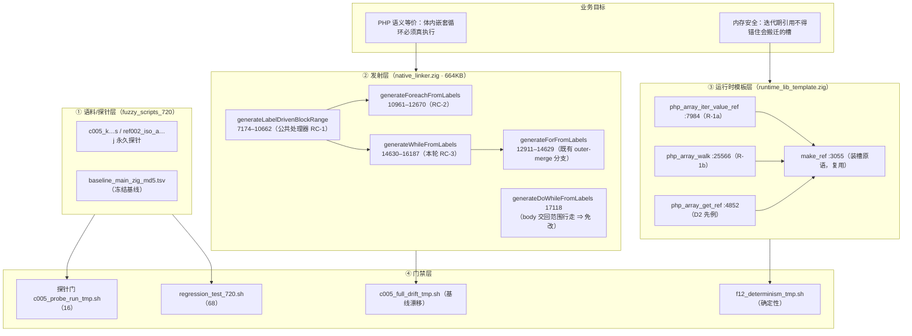
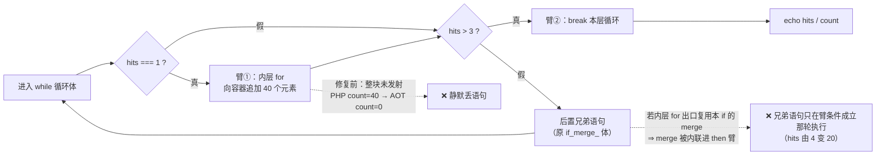
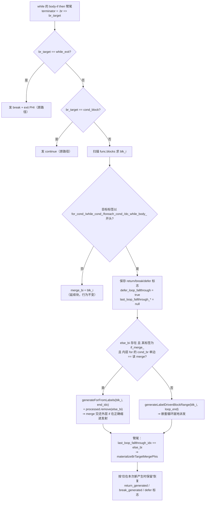
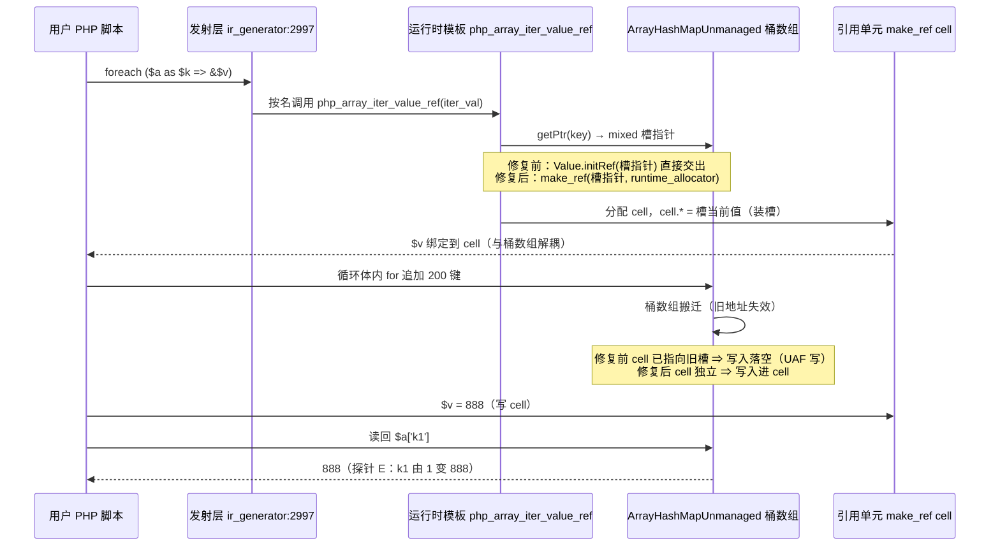

# AOT 发射侧臂内嵌循环丢失收口（CODEGEN-005 RC-3）+ 迭代期引用装槽（REF-002 R-1a/R-1b）

**提交**: `b21cdfd2826a42d645c27691b31065e6a3561f50`（2026-09-30 20:07 +0800）
**范围**: 仅 2 个 Zig 源文件，`+86 / −3` 行
**工单**: [AOT-CODEGEN-005](../../known-issues/AOT-CODEGEN-005-foreach-body-if-arms-lost.md)（CLOSED）、[AOT-REF-002](../../known-issues/AOT-REF-002-iter-ref-slot-dangling.md)（R-1a/R-1b 落地实证）

---

## 1. 高层摘要（TL;DR）

本轮把两条 P0/P1 已知问题一次性收口进同一个提交：

1. **AOT-CODEGEN-005 RC-3（发射侧静默丢语句，新发现）**：`generateWhileFromLabels` 在 body-if 的 then 臂尾遇到 `.br` 时，对「非 exit、非 cond」的目标**一律只记 `merge_bi`**，缺少 foreach / for / 范围行走三处都有的「目标命中嵌套循环头 ⇒ 就地派发该循环」的分支。后果是 `while` 体内「前置无 else 的 `if` + 臂内嵌 `for`/`foreach`/`while`」**整块不发射**，编译与运行全程 `rc=0`、无告警，只有输出与 PHP 不一致。修法是在该处理点移植循环头派发表，并加「内层 for 的 exit 复用本 if 的 `if_merge_` ⇒ 改交自包含 `generateForFromLabels`」的救援分支。
2. **AOT-REF-002 R-1a/R-1b（内存安全）**：`php_array_iter_value_ref` 与 `php_array_walk` 两处仍以 `Value.initRef(容器裸槽指针)` 交出引用。迭代期间容器增长会让 `ArrayHashMapUnmanaged` 搬迁桶数组 ⇒ 引用悬垂，写入落到已释放槽（UAF 写 + 写丢失）。两处统一改为与 D2 同口径的 `make_ref(slot, allocator)` 装槽。

**全门实测（同日，同一二进制 + 同一模板）**：16 探针门 `same=16/16 differs=0`；`zig build` / `zig build test` RC=0；官方 68 回归 **PASS=67 / FAIL_COMPILE=0 / FAIL_RUNTIME=0 / FAIL_DIFF=0 / SKIP=1(f004)**；冻结基线全量漂移 **`total=68 ok=68 diff=0 notemp=0 norow=0`**；确定性巡检 **`mismatch=0`**；基线抽查 **`ok=5 bad=0`** ⇒ **零漂移、零回归、无需重冻结基线**。

---

## 2. 影响范围

| 维度 | 影响 | 量化 |
|---|---|---|
| 正确性（发射） | `while` 体臂内嵌循环整块静默丢失被修复；`for`/`foreach`/`do-while` 侧由 RC-1（公共处理器）与既有派发表覆盖 | 复现形态 4 个（N/P/Q/R）+ 同族 5 个（K/L/M/O/S）全部转逐字节等值 |
| 内存安全 | by-ref `foreach`、`array_walk` 的 `&$val` 不再锚住迭代期容器槽地址 | 消除 2 个裸槽 Ref 产出点；模板内 `Value.initRef(` 指向容器槽的产出点由 3 降至 1（R-2 `php_object_get_ref` 发射次数为 0，不可达） |
| 正常形态影响面 | RC-3 判据只在「`.br` 目标标签命中 `for_cond_`/`while_cond_`/`foreach_cond_`/`do_while_body_`」时改变行为；非循环头目标保持原 `merge_bi` 路径 | 语料 68 脚本 `main.zig` md5 **逐个不变**（diff=0）⇒ 经验零外溢 |
| 运行时性能 | 持引用迭代新增每轮一次引用单元装槽 | 实测 200k 元素微基准：ReleaseFast by-value 10.8–12.1ms → by-ref 23.1–23.7ms（**+2.0x**，≈+60ns/轮）；ReleaseSmall +1.5x |
| 编译期性能 | RC-3 为发射期结构判据（标签前缀比较 + 既有块索引扫描内新增分支） | 68 脚本编译耗时未见可观测变化（回归全程 RC=0，无超时新增） |
| 基线/资产 | `fuzzy_scripts_720/baseline_main_zig_md5.tsv` **未改动**；新增永久探针 5 个（P/Q/R/S + 性能探针） | 见 §5.1 |

---

## 3. 核心变更

| # | 文件 | 位置 | 变更 | 类型 |
|---|---|---|---|---|
| C1 | `src/aot/native_linker.zig` | :15209–15291（`generateWhileFromLabels` → body-if then 臂尾 `.br` 处理点，hunk `@@ -15209,7 +15209,83 @@`） | 移植循环头派发表：① 目标标签命中四类循环头 ⇒ 在 then 缩进内派发 `[blk_i, loop_end)`；② 派发期 `defer_loop_fallthrough=true` 并清空 `last_loop_fallthrough_*`；③ 内层 for 出口复用本 if 的 `if_merge_` 时改交 `generateForFromLabels(blk_i, end_idx)` 并 `processed.remove(else_bi)`；④ 臂尾按 `last_loop_fallthrough_idx == else_bi` 物化来源边 PHI | 发射侧 +76 行 |
| C2 | `src/aot/runtime_lib_template.zig` | :7988（改动语句；函数 `php_array_iter_value_ref` 起 :7974，hunk `@@ -7981,7 +7981,11 @@`） | `return Value.initRef(value_ptr);` → `return try make_ref(value_ptr, runtime_allocator);` | 模板 +4 行 |
| C3 | `src/aot/runtime_lib_template.zig` | :25569（改动语句；函数 `php_array_walk` 起 :25549，hunk `@@ -25559,7 +25563,10 @@`） | `args_buf[0] = Value.initRef(@constCast(entry.value_ptr));` → `args_buf[0] = try make_ref(@constCast(entry.value_ptr), allocator);` | 模板 +3 行 |

**刻意保守的两点**（不是遗漏）：
- C2 **未改函数签名**。发射侧完全按名字与该调用的形状工作：`ir_generator.zig:2993-3001` 发射的是**单参数**调用（`func_name = "php_array_iter_value_ref"`，args 只有 `body_iter`），`native_linker.zig:5200` 也按同一函数名识别「`php_array_iter_value_ref` → store 到 alloca」的引用变量模式（配套 :19457 的引用重绑定判定）。`make_ref` 返回值仍是 Ref 形态的 `Value`（:3067 `Value.initRef(cell)`）⇒ 上述两条识别路径无需改动。若改成显式传 allocator，要同步动 IR 与发射层 ⇒ 会引发全量基线漂移，收益为零，故走模板全局 `runtime_allocator`（:57 定义，`initRuntime`（:437）的 :441 绑定）。
- C1 **不含 RC-2 的 `blk_i >= loop_end` 前提**。该前提在 while 侧被实测**否证**（见 §5.3）。

---

## 4. 可视化概览

### 4.1 分层架构（业务目标 × 分层）

### 4.2 业务流程（`while` 体内臂内嵌 `for`：PHP 语义 vs 修复前 AOT）

### 4.3 执行流程（发射期：`.br` 目标派发决策）

### 4.4 上下层时序（R-1a：by-ref foreach 的取引用 → 扩容 → 写）

---

## 5. 详细变更分析

### 5.1 变更文件清单

| 文件 | 层 | 改动 | 备注 |
|---|---|---|---|
| `src/aot/native_linker.zig` | 发射层 | RC-3，+76 行（:15209–15291） | 超大文件（664KB），改前已 grep 既有派发表并镜像 for 侧实证分支 |
| `src/aot/runtime_lib_template.zig` | 运行时模板层 | R-1a +4 / R-1b +3 行 | 纯模板改动 ⇒ 按规程免 `zig build test`、零基线漂移；本轮因发射侧同批改动仍全量跑 |
| `fuzzy_scripts_720/tmp/c005_p_while_nested_foreach_tmp.php` | 测试资产（新增，永久） | while + 臂内嵌 foreach | PHP 真值 `P hits=4 count=4` |
| `fuzzy_scripts_720/tmp/c005_q_while_nested_while_tmp.php` | 测试资产（新增，永久） | while + 臂内嵌 while | 真值 `Q hits=4 count=40` |
| `fuzzy_scripts_720/tmp/c005_r_while_else_nested_for_tmp.php` | 测试资产（新增，永久） | while 的 **else** 臂内嵌 for | 真值 `R hits=4 count=11` |
| `fuzzy_scripts_720/tmp/c005_s_dowhile_nested_for_tmp.php` | 测试资产（新增，永久） | do-while + 臂内嵌 for | 真值 `S hits=4 count=40`，**免改即通过** |
| `fuzzy_scripts_720/tmp/ref002_r1a_perf_tmp.php` | 测试资产（新增，永久） | R-1a 成本微基准 | by-value / by-ref 双路径对比 |
| `fuzzy_scripts_720/tmp/c005_probe_run_tmp.sh` | 门禁 harness | 探针列表 15 → 16；`total` 改为实时计算 | 消除「加探针忘改计数」的自证误差 |
| `docs/known-issues/AOT-CODEGEN-005-*.md` | 文档 | 状态 CLOSED、新增 §4 RC-3、§4 P2 行与 §7 裁决表实测化 | — |
| `docs/known-issues/AOT-REF-002-*.md` | 文档 | R-1a/R-1b 实证、判据缺口诚实记录、探针门计数更正 | — |

**未改动**：`fuzzy_scripts_720/baseline_main_zig_md5.tsv`（漂移为 0，无需重冻结）、`scripts/batch_test_aot.sh`（其 `timeout`→`gtimeout` 回退仍待裁决，本机无 `gtimeout`）。

### 5.2 变更点与代码对应

| 判据/机制 | 代码位置 | 作用 |
|---|---|---|
| 循环头派发（四类标签前缀） | native_linker.zig:15226–15234（其 WHY 注释 :15212–15225） | 与范围行走 :8500 的 `.br` 派发列表对齐；非循环头目标保持 `merge_bi` 原行为 |
| `defer_loop_fallthrough = true` + 清空 `last_loop_fallthrough_*` | :15235–15244 | f124 修复 12 同款「臂内联保护」，防止内层循环出口被判为外层 if 的 fallthrough |
| `for_exit_is_outer_merge_lw` 判定 | :15245–15261 | 三条结构判据：`else_bi` 存在 + 其标签为 `if_merge_` + 内层 for 的 `cond_br` 单边等于该块 |
| outer-merge 救援派发 | :15262–15264 | 交自包含 `generateForFromLabels(blk_i, end_idx)` 并卸载被预标记的共享 merge |
| 一般路径派发 | :15266 | `generateLabelDrivenBlockRange(blk_i, loop_end, …)`，then 缩进 |
| 臂尾 PHI 物化 | :15271–15286 | `materializeBrTargetMergePhis` 补来源边，避免 then 路径闭合后读到陈旧 merge 寄存器 |
| 标志回收 | :15287–15288 | 「仅本次新产生才覆盖」：`if (!self.return_generated) self.return_generated = saved_rg_lw;`（break 同理），防抑制尾部增量 |
| R-1a 装槽 | runtime_lib_template.zig:7984–7988 | `make_ref(value_ptr, runtime_allocator)` |
| R-1b 装槽 | runtime_lib_template.zig:25566–25569 | `make_ref(@constCast(entry.value_ptr), allocator)`（`allocator` 为该函数形参） |

### 5.3 关键设计判断

1. **RC-2 的前提不能照搬到 while 侧（实测否证）**。foreach 侧的触发条件是「`loop_end` 被截空 ⇒ 派发区间为空」，因此 RC-2 带 `blk_i >= loop_end` 前提。while 侧用 `--dump-zig-path` + 花括号深度取证：N 探针 IR 块序 `entry0 / while_cond_0=1 / while_body_1=2 / while_exit_2=3 / if_then_3=4 / if_merge_4=5 / for_cond_5=6 / for_body_6=7`，`loop_last_be` 经迭代扩展（含间接回边）推到 7 ⇒ `loop_end=8` **已覆盖** for 块。保留该前提会漏掉全部 P/N 形态（实测 `count=0`）。真正的致损条件是「内层 for 的出口复用本 if 的 `if_merge_` ⇒ merge 体（后置兄弟语句）被内联进 then 臂」，表现为 `hits=20 count=40` 的中间态。
2. **do-while 侧免改**：`generateDoWhileFromLabels` 把 body 交回 `generateLabelDrivenBlockRange(writer, func, body_idx + 1, cond_idx, …)`（:17155），循环头派发表本已生效 ⇒ S 探针零代码通过，验证「缺失点唯在 while 生成器」。
3. **装槽口径与 D2 对齐**（`php_array_get_ref` :4852–4873 已实证）：`make_ref` 分配独立 cell，引用与桶数组地址解耦；不改签名以守住基线零漂移。
4. **诚实记录：R-1b 缺有效验收判据**。`ref_iter_slot_stale_probe_tmp` 的 `array_walk` 段修复前后逐字相同（`visited=60 b0=0 count=180`）：`b0=0` 由「AOT 的 `array_walk` 只访问调用时 60 个元素」+「回调内向 `$b` 追加 120 键使全局 `$b` COW 换代（写回旧容器、读回新容器）」共同解释，与槽地址悬垂无关 ⇒ 该探针不构成 R-1b 判据。R-1b 改动按「消除裸槽 Ref」的同源机理保留（正向、可观测面为零），**须另建隔离探针**（回调内只写 `$val` 不追加）单独取证。

---

## 6. 影响与风险评估

| 项 | 判定 | 说明 |
|---|---|---|
| 是否破坏式变更 | **否** | 发射侧改动被结构判据约束在「臂尾 `.br` 指向嵌套循环头」形态；语料 68/68 `main.zig` md5 不变。模板侧仅改 by-ref 取值路径 |
| 影响范围 | 发射层 while 生成器 1 处 + 运行时模板 2 处 | 未触碰 `loop_last_be`/`loop_end` 主定义、未触碰优化器 |
| 特别注意点 1 | **break 边判定过宽**是 RC-1/RC-3 族的固有外溢风险 | RC-3 用标签前缀（四类循环头）而非索引匹配；缓解：非循环头目标完全走原 `merge_bi` 分支，且 16 探针（含 A/B/H/I 等正常形态）逐字节不变 |
| 特别注意点 2 | `processed.remove(else_bi)` 卸载共享 merge | 若判据③误命中，会让该块永不发射 ⇒ 判据严格要求 `if_merge_` 标签 + `cond_br` 单边等于该块（与 for 侧 :13645 完全同形） |
| 特别注意点 3 | 标志回收语义 | `return_generated`/`break_generated` 采用「仅本次新产生才保留」，否则嵌套循环生成的 break 会污染外层状态、抑制 `continue` 与增量发射 |
| 性能 | by-ref 迭代 +2.0x（ReleaseFast，实测） | 微基准 200k 元素：by-value 10.8/12.1/10.8ms，by-ref 23.7/23.1/23.2ms ⇒ 约 +60ns/轮（cell 分配 + 读侧 deref + 迭代起始形态锚定聚合成本，未做分项归因）。PHP 同探针 by-value 1.35ms / by-ref 3.69ms |
| 内存 | 每轮引用增加 1 个 `Value` cell，且引用 cell 不参与 retain/release 回收 | 即 R-6（已登记，未修）：上界 = 「曾成为引用的元素个数」；长时运行 by-ref 循环有增量泄漏风险 |
| 复测路径 | ① `bash fuzzy_scripts_720/tmp/c005_probe_run_tmp.sh` ⇒ `total=16 same=16 differs=0`；② `bash scripts/regression_test_720.sh` ⇒ FAIL_DIFF=0；③ `bash fuzzy_scripts_720/tmp/c005_full_drift_tmp.sh` ⇒ `diff=0 norow=0`；④ `bash fuzzy_scripts_720/tmp/f12_determinism_tmp.sh` ⇒ `mismatch=0`；⑤ `bash fuzzy_scripts_720/tmp/s7_baseline_spotcheck_tmp.sh` ⇒ `ok=5 bad=0` | 均须从项目根执行、带 `timeout`；批次期间禁止 `zig build`、禁止编辑模板、禁止并发编译 |

---

## 7. 遗留 / 潜在问题

| # | 问题 | 性质 | 状态 |
|---|---|---|---|
| L1 | 持引用迭代的**元素集合语义**：PHP 的 by-ref `foreach` 与 `array_walk` 会访问迭代期间追加的元素（D/E `hits=60`、`visited=180`），AOT 停在调用时集合（`hits=20`、`visited=60`） | 语义缺失，非引用悬垂；按 §五 属 AOT 侧待修 | **待立项**（新缺陷族，非 REF-002 范围） |
| L2 | 回调内向被遍历容器追加 ⇒ 全局变量 **COW 换代**，写回旧容器 / 读回新容器 | 与 L1 同探针暴露 | 待立项 |
| L3 | R-1b 无有效验收判据（§5.3-4） | 取证缺口 | 待建隔离探针 |
| L4 | R-2（`php_object_get_ref` 裸槽 Ref，发射次数 0）/ R-3（`ArrayIterator.current` 缓存 `Entry` 内含 `key_ptr`/`value_ptr`）/ R-4（`ref_lock_count = 0` 而非 `-= 1`）/ R-5（`val_deref` 无跳数上限）/ R-6（引用 cell 不回收） | 已登记 | **待裁决是否同批** |
| L5 | AOT 该 foreach 微基准绝对值高于 PHP 约一个量级（by-value 10.8ms vs 1.35ms，ReleaseFast） | 既有性能特征，**非本次引入**；须先确认 PHP 侧 opcache/JIT 前提才可定性 | 待查（勿据此立项） |
| L6 | `scripts/batch_test_aot.sh` 工作区里 `timeout`→`gtimeout` 回退未提交，本机无 `gtimeout` ⇒ 该脚本当前不可用 | 工具链 | **待裁决** |

---

## 8. 后续开发建议（优先级 / 影响面 / 落地成本）

| 优先级 | 建议 | 影响面 | 落地成本 |
|---|---|---|---|
| **P0** | 立项修复 L1+L2：把「持引用迭代的 live-set 语义」与「回调内 COW 换代」拆成两条工单，判据分别取 D/E（`hits`）与 `array_walk`（`visited`）；这是当前唯一有 PHP 真值差引用的 AOT 语义缺口 | 运行时模板迭代器 + 赋值下沉路径 | 中（需先定义 COW 换代下的引用归属） |
| **P1** | 发射期金丝雀扩展（CODEGEN-005 §4 P1，待裁决）：`if_merge_`+`cond_br` 处理器里若双臂均已 processed 且本次未发任何 `break/continue/return` ⇒ `[AOT-CANARY]` 报警 | 1 处判据，防同类静默回归 | 低（≈8 行） |
| **P1** | 把 F/J/N/P/Q/R 六个形状纳入 `fuzzy_scripts_720` 生成模板 | 检测力从「语料没踩到」升级为「语料常踩」 | 低（脚本）+ 需重冻结一次基线 |
| **P1** | R-1b 隔离探针（L3）+ R-6 引用 cell 回收方案（与 `make_ref` 生命周期一起设计，勿单点补丁） | 取证闭环 + 长跑内存上界 | 中 |
| P2 | 同族扫描工具化：把「四类循环头 × 四种外层（foreach/for/while/do-while）× then/else 臂」做成参数化探针矩阵（本轮手工补 S 即为此形态） | 覆盖 32 组合，替代逐个手工发现 | 中（≈半天） |
| P2 | `foreach` 路径性能专项（L5，先补前提核实）：装箱/查表路径优化前需先固定基线口径 | 编译产物绝对性能 | 高 |
