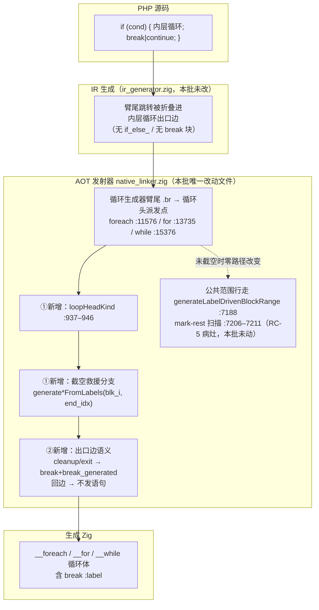
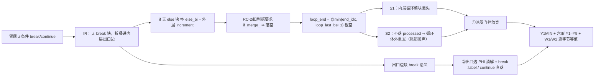
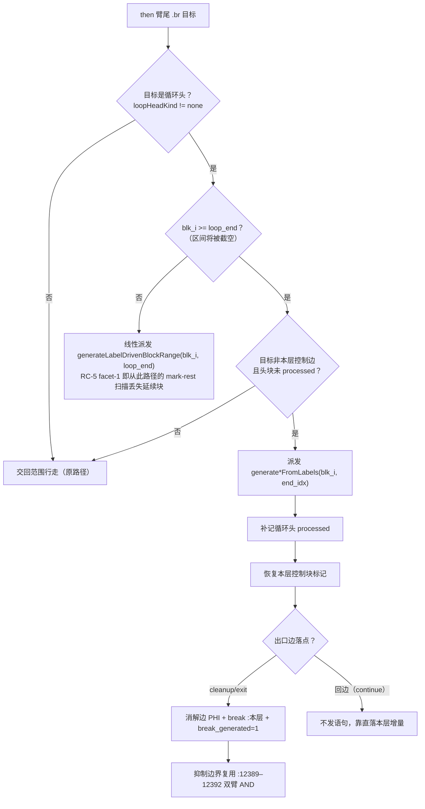
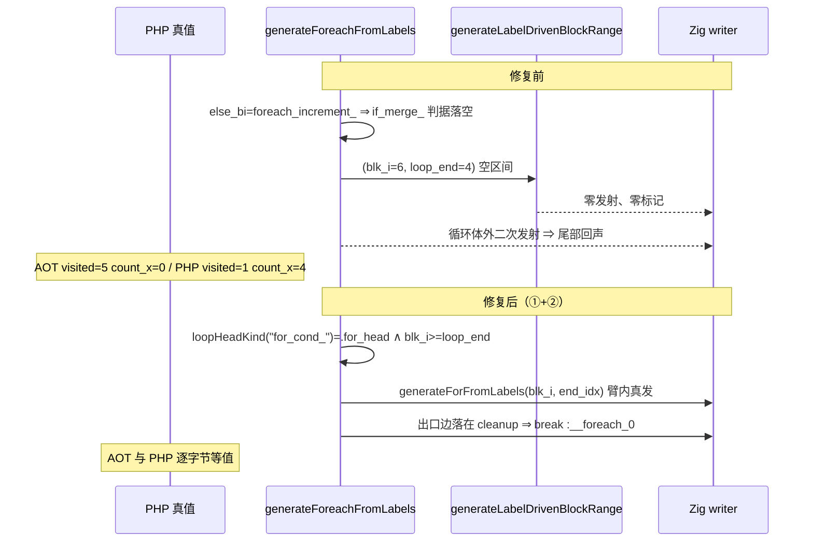

# AOT 臂尾裸 `break`/`continue` 出口边语义 —— AOT-CODEGEN-005 RC-4（①+②）

> 批次日期：2026-10-01 ｜ 代码态：**工作区未提交**（`src/aot/native_linker.zig` git blob `4b569afd`）｜ 基线提交：`b21cdfd`（RC-1/RC-2/RC-3）
> 工单：[AOT-CODEGEN-005 §4 RC-4](../../known-issues/AOT-CODEGEN-005-foreach-body-if-arms-lost.md)

---

## 1. 高层摘要（TL;DR）

`if (…) { <内层循环>; break; }` / `{ <内层循环>; continue; }` 这类**臂尾无条件跳转**在 IR 里没有对应块 —— 该语句被 IR 生成器**折叠进内层循环的出口边**。而 foreach / for / while 三个生成器的臂尾 `.br → 循环头` 派发点，救援判据只覆盖「内层出口复用本 if 的 `if_merge_`」这一子集；本形态的 if **没有 else 块** ⇒ 判据落空 ⇒ 回落到被 `loop_end` 截空的公共范围行走 ⇒ **起点 ≥ 终点 ⇒ 空区间 ⇒ 零发射零标记** ⇒ 内层循环整块静默丢失（症状 S1），并因不落 `processed` 而在**循环体外被重发一遍**（症状 S2 尾部回声）。

本批两步落地、缺一不可：

- **① 派发门控放宽**：三处站点各补一条「区间将被截空」救援分支，新增共用谓词 `loopHeadKind` 取代三处各写一遍的前缀串（DRY）。
- **② 出口边语义**：内层出口落在外层 cleanup/exit ⇒ 消解该边 PHI + 发 `break :<本层标签>` + 置 `break_generated`；落在外层回边（裸 `continue`）⇒ **不发语句**，靠直落本层增量。

改动为**纯新增 +145/−0 行**（四段 hunk，全部为新增分支，既有 RC-2/RC-3 救援路径逐字未动）⇒ 正常布局（未截空）零路径改变。

**验收结论（六项全门实测通过，语料零漂移，未重冻结基线）**：17 探针等值门 `same=17/17`、RC-4 诊断门红点全部可归因、官方 68 回归 `FAIL_DIFF=0`、基线漂移 `diff=0`、确定性巡检 `mismatch=0`、抽查 `ok=5 bad=0`、`zig build test` 326/326。

**同批暴露的新缺陷（未修，待裁决）**：RC-5 —— 臂尾裸 `continue` 且 if **有**真实延续块时，后置兄弟语句在任一路径都不发射。已**取证到行**（`generateLabelDrivenBlockRange` 的 mark-rest 扫描 :7206–7211）并拆为两个互不耦合的 facet。

---

## 2. 影响范围

| 维度 | 内容 |
|---|---|
| 受影响组件 | `src/aot/native_linker.zig`（AOT 发射器，664KB 超大文件）**单文件**；运行时模板 `runtime_lib_template.zig` **未触**（md5 保持 `008b7b639f1069cb73e443064e115ed1`） |
| 变更规模 | 实测 `git diff --stat` = **1 file changed, 145 insertions(+), 0 deletions**；四段 hunk：共用谓词 `+14 @:934` / foreach `+58 @:11576` / for `+39 @:13735` / while `+34 @:15376` |
| 覆盖语句形态 | foreach / for / while 三侧「if 臂内含循环 + 臂尾裸 `break`/`continue`」；顶层与函数上下文同等生效 |
| 上游缺陷解锁 | **AOT-REF-003 的 F4b/F5 复测阻塞解除**（W2 首次逐字节等值）；崩溃面收窄到 W3 单形（`rc=139`，属运行时模板 P0，另案裁决） |
| 语料影响 | 68 脚本 **零漂移**（`total=68 ok=68 diff=0 notemp=0 norow=0`）⇒ 未重冻结 `baseline_main_zig_md5.tsv` |
| 是否破坏式 | **否**（纯新增分支；未删除、未改写任何既有行） |
| 性能影响 | 无运行期成本；发射期新增判据仅在「区间将被截空」这一异常形态触发，正常布局走原路径 |
| 未覆盖 | RC-5 两 facet（延续块丢失 / 臂尾 `continue` 未翻译）、REF-003 W3 段错误 —— 均**未修** |

---

## 3. 核心变更

| # | 变更点 | 位置（当前树） | 判据与语义 |
|---|---|---|---|
| 1 | 新增共用谓词 `loopHeadKind`（+ `LoopHeadKind` enum） | :937–946（hunk @:934，+14） | 前缀 ⇒ 类别：`foreach_cond_`→`.foreach`；`for_cond_`→`.for_head`；`while_cond_`/`while_body_`/`do_while_body_`→`.while_head`；其余 `.none`。口径取自公共处理器 :7535–7539 的 `ah_is_*`，**取代三处各写一遍的前缀串** |
| 2 | foreach 侧「区间将被截空」救援分支（①） | :11576–11633（+58） | 前提三道：`blk_i >= loop_end` ∧ `loopHeadKind(target) != .none` ∧ 目标非本层控制边 ∧ 头块未 `processed` ⇒ 交自包含 `generateForeachFromLabels(blk_i, end_idx)`；派发后补记循环头 `processed`，并**恢复被内层乱序回落卸载的本层控制块**（increment/cleanup/exit）标记；`processed.remove(else_bi)` 仍严格限定 `if_merge_`（探针 H 教训，RC-2 原路径逐字未动） |
| 3 | for 侧同款救援分支（①） | :13735–13773（+39） | 同一骨架，控制块词汇换成 `exit_idx`/`loop_idx`/`cond_idx`，defer 保存点为 `defer_loop_fallthrough` |
| 4 | while 侧同款救援分支（①） | :15376–15409（+34） | 同上；与 RC-3 的循环头派发表共存，互不遮蔽 |
| 5 | 出口边 `break` 语义（②） | 三处派发点之后公共位置（foreach :11637 起，+ 各自 hunk 内） | 按 `last_loop_fallthrough_src_idx` 判定内层出口边落点：落在外层 **cleanup/exit** ⇒ 消解该边 PHI + `break :<本层标签>` + 置 `break_generated`；落在外层**回边**（裸 `continue`）⇒ 不发语句 |
| 6 | `break_generated` 抑制边界守既有机制（②） | 复用 :12389–12392「双臂 AND」 | 本形 else 边是回边、不参与 AND ⇒ 尾部增量与 `continue` 照常发射（**CODEGEN-003 修复 4 的同款约束，禁止改动**） |

> 说明：三处 ① 分支形近而词汇表不同，**DRY 上应抽成共用例程**，但那是横跨三个生成器的签名改造，风险高于本批收益 ⇒ 已单列 P2「必须单独成批」（工单 §4 修复方案表末行、§6 末条）。

---

## 4. 可视化概览（Mermaid）

### 4.1 分层架构图（变更落点）

### 4.2 业务流程（缺陷 → 症状 → 修复）

### 4.3 执行流程（发射期判定顺序）

### 4.4 上层→底层时序（Y1MIN 修复前后）

---

## 5. 详细分析

### 5.1 涉及文件清单

| 文件 | 变更 | 说明 |
|---|---|---|
| `src/aot/native_linker.zig` | +145/−0（未提交） | 四段纯新增 hunk |
| `docs/known-issues/AOT-CODEGEN-005-foreach-body-if-arms-lost.md` | 工单收口 | §4 RC-4 三行 + **新增 §4「RC-5 取证细则」**、§5 验收门新增 1b/1c、§6 风险新增归因折中披露、§7 行 7–11 |
| `docs/known-issues/AOT-REF-003-...crash.md` | 同步更正 | W2 误读更正、崩溃面收窄到 W3 |
| `fuzzy_scripts_720/tmp/c005_rc4_min_y1_tmp.php` | **永久探针（勿删）** | Y1MIN 单形，等值门成员 |
| `fuzzy_scripts_720/tmp/c005_rc4_min_y6_tmp.php` | **永久探针（勿删）** | RC-5 主形复现体 |
| `fuzzy_scripts_720/tmp/c005_rc4_break_after_nested_loop_tmp.php` | **永久探针（勿删）** | Y1–Y6 六形 |
| `fuzzy_scripts_720/tmp/c005_rc5_merge_loss_tmp.php` | **永久探针（勿删，本批新增）** | RC-5 八形 F-A…F-H |
| `fuzzy_scripts_720/tmp/c005_rc4_probe_run_tmp.sh` | 诊断门（4 探针） | 末行 `RC4_PROBE_DONE` |
| `fuzzy_scripts_720/tmp/c005_rc5_probe_run_tmp.sh` | **诊断门（本批新增）** | 末行 `RC5_PROBE_DONE file=…` |
| `fuzzy_scripts_720/tmp/c005_probe_run_tmp.sh` | 等值门 16→**17 形** | 纳入 Y1MIN |
| `scripts/batch_test_aot.sh` | 与本批无关的残留改动 | 工作区把 HEAD 的 `timeout` 改为 `gtimeout`（:73/:83/:87 三处），**是否回退待单独裁决，不随本批提交** |

### 5.2 复现与判据（真值 = `/opt/homebrew/bin/php` 8.5.8）

| 形态 | PHP 真值 | 修复前 AOT | 修复后 AOT |
|---|---|---|---|
| Y1MIN | `visited=1 count_x=4` | `visited=5 count_x=0`（S1+S2） | **逐字节等值** |
| 六形 Y1–Y5 | 各形 `visited=1`、`key=k0`、`tail=none` | 全 `visited=5`、`count_x=0`、tail echo 两份 | **全部等值** |
| `ref003_crash_attr` W1 | 等值 | 等值 | 等值 |
| `ref003_crash_attr` W2 | `visited=1 count=205 g199=199` | 内层 for 被丢到循环外，二次执行凑出同值 | **首次真正的臂内等值** |
| `ref003_crash_attr` W3 | 正常输出 | `rc=139` | `rc=139`（**REF-003 运行时模板 P0，本批不修**） |
| Y6MIN | `visited=5 hit=3 count_x=4` | `hit=0` | `hit=0`（**RC-5，先于本批存在**） |

### 5.3 分步落地与归因（本批采用的取证纪律）

| 步 | 态 | 实测 | 结论 |
|---|---|---|---|
| ① 单独 | 仅派发门控放宽 | Y1MIN `visited=5 count_x=4`（S1 复原、S2 回声消失，`visited` 仍错）；16 探针门 `same=16/16 differs=0` | ① **零回归**；`visited=5` 是**预期中间态**（臂尾 `break` 语义要靠 ②）——若误判为修复失败会错 rollback ①，故显式登记 |
| ①+② | 合并态 | Y1MIN 等值、六形 Y1–Y5 等值、W1/W2 等值、`zig build test` 326/326 | 收口 |
| 全门 | 合并态 | 六项一次跑完（见 §5.4） | 闭环 |

**归因折中（须披露）**：原计划「①→② 各自过全门」，实际只有 ① 单独过 16 探针等值门；68 回归 / 漂移 / 巡检**只在合并态跑一轮**（理由：① 单独态留有已知错误 `visited=5`，以其为基线跑全门无意义）。预案：② 的改动小而局部，注释掉三处 `if (lft_is_break_*)` 块重编即可二分定位。

### 5.4 验收门（六项，全绿）

| # | 门 | 判据 | 实测末行 |
|---|---|---|---|
| A | 17 探针等值门 | 全形与 PHP 逐字节等值 | `PROBE_DONE total=17 same=17 differs=0` |
| B | RC-4 诊断门 | Y1MIN 等值 + 六形仅 Y6 差异 + `ref003_crash_attr` 仅崩在 W3 | `RC4_PROBE_DONE total=4 same=1 differs=3`（3 红点全部可归到 RC-5 / REF-003） |
| C | 官方 68 回归 | `FAIL_COMPILE=0 / FAIL_RUNTIME=0 / FAIL_DIFF=0` | `TOTAL 68 / PASS 67 / SKIP 1`（f004 `PHP_error_exit=255`），`regression_failures.tsv` 仅 1 行 |
| D | 冻结基线漂移 | 语料未覆盖该形状 ⇒ 理想零漂移 | `DRIFT_DONE total=68 ok=68 diff=0 notemp=0 norow=0` |
| E | 确定性巡检 | 同脚本二次编译逐字节一致 | `SWEEP_DONE total=68 mismatch=0 notemp=0` |
| F | 基线抽查 | 5 个冻结 md5 复验 | `SPOT_DONE ok=5 bad=0`（f067 `47364`/`ad2f742d…`、f113 `104334`/`dab7d3a6…`） |
| — | 编译/单测 | 发射侧改动必须跑单测 | `timeout 240 zig build` 通过（61.53s）、`zig build test` 21/21 步骤、326/326 用例 |

⇒ **语料零漂移 ⇒ 未重冻结基线**（`baseline_main_zig_md5.tsv` 保持原状）。

### 5.5 临时 trace 的插入与剥离（RC-5 取证，不污染交付）

取证手法：在 foreach-if 的 `loop_end`/then/else 索引、臂尾 `.br` 目标、三条派发路径、`merge_bi` 兜底、`else_is_coalesce`、coalesce merge 延后发射、`generateLabelDrivenBlockRange` 的「剩余块整段标记」分支共 7 处挂 `std.debug.print`（站点 `[RC5T1]…[RC5T7]`）。

还原链条（实测）：`/tmp` 整份备份 → 插 trace `zig build` **61.85s** → 取证 → 还原（md5 `9dff465ff6276ceb03c971e1212ca835`，`git diff --stat` 回到 +145/−0）→ `zig build` **61.53s** → 等值门复跑 `same=17/17` 且 stderr 无 `RC5T` 残留 ⇒ 交付态无 trace。

---

## 6. 风险

| 项 | 评估 |
|---|---|
| 是否破坏式 | **否**。四段 hunk 全为新增分支，未删改任何既有行；触发面被「`blk_i >= loop_end`（仅截空形态）」约束在乱序异常布局内 ⇒ 正常布局零路径改变 |
| 触到语义的深度 | ② 触的是 **`break`/`continue` 语句发射**而非仅派发终点，风险高于 RC-1/RC-2；缓解：抑制边界复用 :12389–12392 的「双臂 AND」既有机制，守 CODEGEN-003 修复 4 的约束，未新增全局标志 |
| 静默失效族 | 空区间「零发射零标记」与 #18 金丝雀同源。建议配套发射期断言（`.br → 循环头` 派发后目标仍不在 `processed` ⇒ 打 `[AOT-CANARY]`），**是否与修复同批待裁决** |
| 三写重复 | ① 分支在 foreach/for/while 各写一遍（+58/+39/+34）⇒ DRY 未收口，已列 P2 单独成批，禁止夹带 |
| 未修的已知红点 | RC-5 两 facet + REF-003 W3。等值门**结构上看不到** RC-5 facet-1（正对照 F-A 的延续块就是 increment，落在被吞区间之前 ⇒ 零丢失），只能靠新增的 RC-5 诊断门盯住 |
| 提交态风险 | 代码 + 工单文档目前**未提交**；若批次期间他人 `zig build` 会基于未审阅的发射侧改动 ⇒ 建议尽快按 §3 口径单独成批提交 |
| 归因风险 | 见 §5.3「归因折中」——② 未单独过全门，合并态若出红点需按预案注释三处 `if (lft_is_break_*)` 二分 |

---

## 7. 遗留问题

| ID | 问题 | 状态 |
|---|---|---|
| RC-5 facet-1 | 臂尾 `continue` + if 有真实延续块 ⇒ 延续块被 mark-rest 扫描（:7206–7211）吞进 `processed` ⇒ 后置兄弟语句任一路径不发射（F-B/F-D/F-E）。**原候选归属「`else_is_coalesce` 判据过宽」已被 F-D 否证** | ⏳ 待裁决（**一行代码未改**）；修法 P0 方案 A / P2 方案 B |
| RC-5 facet-2 | while 内层（F-F）与 for 外层（F-H）的臂尾裸 `continue` **未进入**出口边翻译机制（无 `[RC5T7]`、`brk=0`、`lft=null`）⇒ `continue` 丢失、then 路径过执行 | ⏳ 待裁决（P1，需先定位「为何 `last_loop_fallthrough_idx` 为空」） |
| REF-003 P0 | `php_array_iter_next` 在迭代期数组增长后**段错误**（`rc=139`），W3 单形。本批三点序列把崩溃点定位到「搬迁后的下一次 `next()` 推进」而非槽读取 | ⏳ 待裁决后才动 `runtime_lib_template.zig` |
| CODEGEN-005 行 3 | 金丝雀扩展 + 把 F/J 形状纳入语料生成模板（代价：基线重冻结一次） | ⏳ 待裁决 |
| 语料检测力 | F2/F3/W1–W3/Y1–Y6/T1–T4/CODEGEN-003 R1–R4 形状未进 `fuzzy_scripts_720` 模板 ⇒ 官方 68 回归抓不到本族缺陷 | ⏳ 待裁决 |
| `scripts/batch_test_aot.sh` | `gtimeout`→`timeout` 三行（:73/:83/:87）仍未提交，与本批无关 | ⏳ 待裁决是否随批 |

---

## 8. 后续开发 / 优化建议

| 优先级 | 建议 | 影响面 | 落地成本 |
|---|---|---|---|
| **P0** | 把本批（+145/−0）与工单文档**单独成批提交**，提交消息注明「①派发门控放宽 + ②出口边语义」与六门实测值，避免与 RC-5/REF-003 混提导致回归无法归因 | 单文件发射侧 | 极低（已全门绿） |
| **P0（待裁决）** | **RC-5 facet-1 方案 A**：臂尾线性派发返回后，若本 if 的延续块（`merge_bi`/`else_bi`）被 :7206–7211 连带标记 ⇒ 卸载标记交还既有共享发射（即把 RC-2 的 `_ = processed.remove(ei_lh)` :11575 推广到「线性派发 + 任意延续块」）。**卸载前须校验该块真可达**，否则退回 `tryGenerateFromLabels` 未处理块告警 | 只触臂尾折边 + 有延续块的 if；F-B/F-D/F-E 转绿，正对照不变 | 预计小（单点卸载 + 一处判据）；**未报价**，复测 ≈1 分钟 |
| P1 | RC-5 facet-2 另立取证：在 while/for 侧定位「为何 `last_loop_fallthrough_idx` 为空」⇒ 再谈修复 | while/for 两侧臂尾语义 | 取证 ≈0（探针已在永久集内），修复未报价 |
| P1 | 发射期 `[AOT-CANARY]`：`.br → 循环头` 派发后目标仍未落 `processed` ⇒ 报警，把静默失效族纳入 #18 闸门 | 1 处判据 | 低（≈8 行） |
| P1 | 语料检测力：把 F/J/Y/W/T/R 族形状补进 `fuzzy_scripts_720` 生成模板 | 测试资产 | 低；**需重冻结基线一次** |
| P2 | **DRY 收口**：三处 ① 分支抽共用例程（参数化「本层控制块集合 + break 边判据 + defer 保存点」） | 横跨三个生成器的签名改造 | 中（≈−60/+40）；**必须单独成批、单独过全门** |
| P2 | **mark-rest 扫描根治**：由「整段标记到 `end_idx`」改为按 CFG 反向可达性只标记真不可达块 | 该扫描是所有循环/if 的公共出口 ⇒ 回归面 = 全套 | 高；**禁止与功能修复混提** |
| P2（性能向） | 发射期把 `loopHeadKind` 的前缀串比较换成编译期已知的块标签枚举/首字符分派，减少热路径 `startsWith` 次数（当前每臂尾 br 最多 5 次比较） | 仅发射器耗时，不影响产物 | 低；需等值门 + `zig build` 计时对照 |

---

## 附：本批与工单的引用关系

- 工单：`docs/known-issues/AOT-CODEGEN-005-foreach-body-if-arms-lost.md`（§4 RC-4 三行为本批权威记录，§4「RC-5 取证细则」为遗留缺陷记录，§5 六门为复测路径，§7 行 7–11 为裁决状态）
- 关联工单：`docs/known-issues/AOT-REF-003-byref-iteration-liveset-and-iterator-relocation-crash.md`（W2 更正 + 崩溃面收窄）
- 复测顺序（固定）：孤儿进程排查 → `timeout 240 zig build` → 门 A → 门 B → 门 C → 门 D → 门 E → 门 F → `timeout 120 zig build test`
