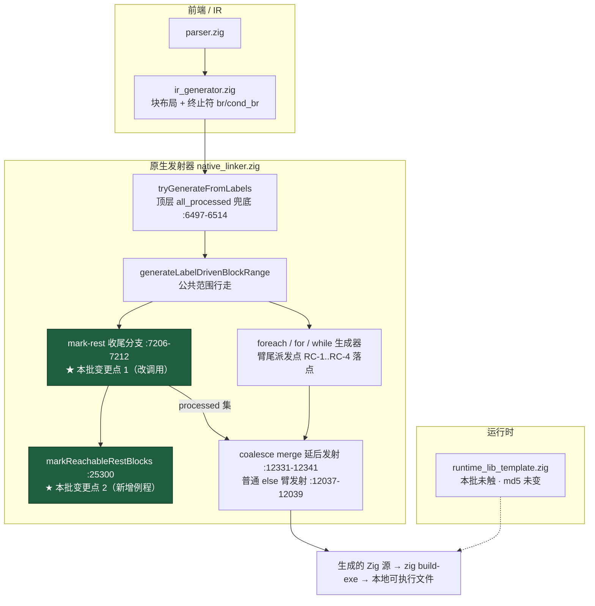
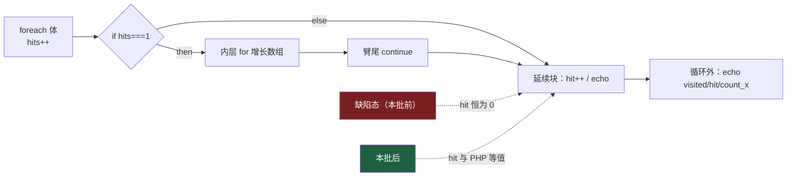
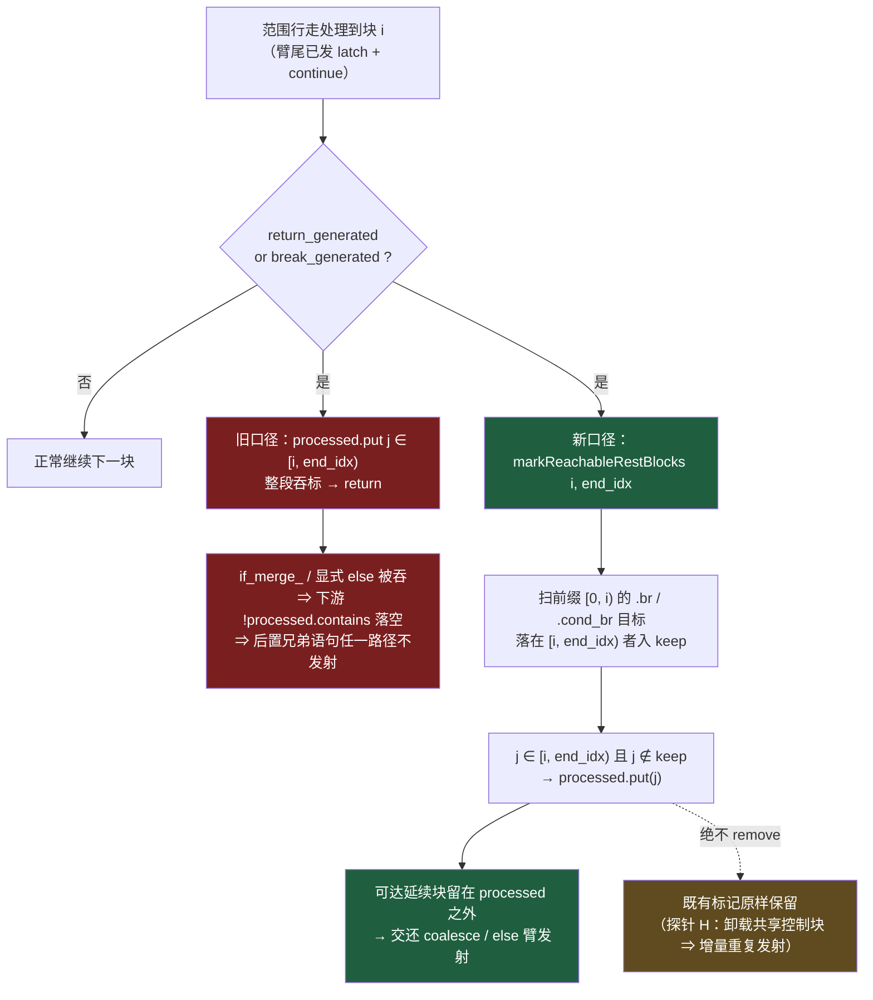

# AOT 臂尾 `continue` 之后延续块丢失的根治 —— AOT-CODEGEN-005 RC-5 facet-1（方案 B）

> 批次日期：2026-10-03 ｜ 代码态：**工作区未提交**（`src/aot/native_linker.zig`）｜ 基线提交：`0ff09cf`（RC-4 ①+②）
> 代码 blob 三代（同日，实测）：**落地态 v2** `45969ff9` ⇒ +54/−3；**注释口径校正版** `9c5e82862ee6ae9a8792a427a4479e6e109b3af5` ⇒ +56/−5（新增 +2/−2 全为 RC-3 注释行内的悬空行号引用校正）；**注释派发表指向修正版** `310536e5e3365e6e8d4fa77a2c7f6e4393b14995` ⇒ 仍 +56/−5（把 RC-3 注释内旧引 `:11502`/`:13622` 由「判据」改为实测**循环头派发表** `:11516–:11525` / `:13694–:13703`）。三代**非注释差异始终为零**、文件行数始终 32492；`timeout 240 zig build` 实测 RC=0（墙钟 v2 69s、第二代 63.75s）。本文档**文件名保留 `45969ff9`** 以维持既有引用稳定，当代口径以本节为准。
> 工单：[AOT-CODEGEN-005 §4 RC-5 / §7 行 12](../../known-issues/AOT-CODEGEN-005-foreach-body-if-arms-lost.md)

---

## 1. 高层摘要（TL;DR）

`if (…) { <内层循环>; continue; }` 之后**同一 if 的真实延续块**（承载后置兄弟语句的 `if_merge_`，或显式 `else` 臂）在任一路径都不发射 —— 静默丢语句（编译成功、`rc=0`、仅输出与 PHP 不一致）。

根因**不在派发点，而在公共收尾**：臂尾内联发射外层 latch + `continue` 会置 `break_generated=1`，同时把范围行走起点回退到 latch 之后、**延续块之前**；随后 `generateLabelDrivenBlockRange` 的 mark-rest 收尾「`return`/`break` 已生成 ⇒ 剩余块**整段**标记 `processed` 并返回」把延续块一并吞掉 ⇒ 下游两条发射路径（coalesce merge 延后发射、普通 `else` 臂发射）的 `!processed.contains(...)` 判据**双双落空**。

本批按用户裁决走**方案 B（根治）**：mark-rest 收尾不再按位置整段吞标，改按 **CFG 可达性**只标记确证不可达的块 —— 新增例程 `markReachableRestBlocks`，凡被「已发射前缀」的 `.br`/`.cond_br` 边指向的剩余块一律留在 `processed` 之外，交还既有下游发射。

**方法学是本批的真正产出**：先用**非行为**影子插桩把「新规则会保留哪些块」在 73 份脚本上量出来（68 语料 **0 处**、4 个探针命中、被保留块全是 `if_merge_*`/`if_else_*`），再**照实测口径实现**；v1 自行加了两条未经实测的扩展（正向闭包 + `.switch_` 种子）即打出语料编译失败，收回口径后消除（详见 §6）。

**验收**：17 形等值门 `same=17/17`、RC-5 八形门 facet-1 三形转等值、RC-4 诊断门由 `same=1` 提升到 `same=3`（唯一红点归 REF-003）、f007 复测等值 ⇒ facet-1 关闭。**facet-2（F-F while / F-H for 的 then 路径过执行延续块；准确口径为**臂尾未把外层 latch 续进到臂缩进** —— 出口边记录权缺失。原登记「`continue` 未翻译」已由同日只读静态取证否证，**同日 trace 取证轮亦已闭环**，机制与修法口径实测到行，见 CODEGEN-005 §4 ⑤）本批不覆盖**，只剩修法实施为待裁决项。

---

## 2. 影响范围

| 维度 | 内容 |
|---|---|
| 受影响组件 | `src/aot/native_linker.zig`（AOT 发射器，664KB 超大文件）**单文件**；运行时模板 `runtime_lib_template.zig` **未触**（md5 实测保持 `008b7b639f1069cb73e443064e115ed1`） |
| 变更规模 | 实测 `git diff --numstat` = **54 insertions / 3 deletions**；两段 hunk：调用点 `@@ -7204,9 +7204,9`（等长替换，净 0 行）+ 新增例程 `@@ -25280,6 +25280,57`（+51 行） |
| 触发面 | **公共收尾**（`generateLabelDrivenBlockRange` 的 `return`/`break` 分支）⇒ 逻辑上触及所有循环/if 的块标记语义；实测差异面见下一行 |
| 实测差异面（影子扫描，非推测） | `RC5B_DONE total=73 fail=0 scripts_with_swallow=4` ⇒ **68 语料脚本 0 处命中**；命中仅 4 份探针共 **6 个收尾点**（`c005_rc5_merge_loss_tmp` 3 点、`c005_rc4_min_y6_tmp` / `c005_rc4_break_after_nested_loop_tmp` / `ref003_crash_attr_tmp` 各 1 点），**每点从剩余 5 块中只放行 1 块**（`swallowed=1 tot=5`），放行块名 5 处为 `if_merge_*`、1 处为 `if_else_39` ⇒ 无控制块/循环块，与「只放行延续块」的设计意图逐字吻合 |
| 修复解锁 | Y6MIN（RC-5 主形）与八形门 F-B / F-D / F-E **转逐字节等值**；RC-4 诊断门的六形文件整体等值（原「仅 Y6 行差异」）⇒ §5 判据 1b/1c 同步收紧 |
| 语料影响 | 官方 68 回归 + 冻结基线漂移 + 确定性巡检**待本批全门回填**（§5 表行 C…G）；影子口径预期为零漂移 |
| 是否破坏式 | **否**（未删除任何发射路径；仅把「无条件整段吞标」替换为「按可达性选择性吞标」）。但**行为变更面比 RC-4 宽**（RC-4 四段 hunk 全为新增分支，本批改写了既有分支），故全套门不可省 |
| 性能影响 | 无运行期成本（纯发射期）。发射期新增成本 = 每个「臂尾已发 `return`/`break`」的收尾点多一次前缀扫描 + 一个临时 `AutoHashMap`，复杂度 O(`sweep_start` + 区间长度)，实测 `timeout 240 zig build` **69s**（与 RC-4 落地态同量级）⇒ 无可测退化 |
| 未覆盖 | **RC-5 facet-2**（F-F / F-H 的过执行；trace 实测口径为**内层未把「出口边 = 外层 latch」交还外层** ⇒ 臂尾无从续进 latch，见 CODEGEN-005 §4 ⑤。取证已闭环，**只剩修法实施待裁决**）、**REF-003 P0**（W3 `rc=139` 段错误） —— 均未修，且与本批无耦合 |

---

## 3. 核心变更

| # | 变更点 | 位置（当前工作区树） | 判据与语义 |
|---|---|---|---|
| 1 | mark-rest 收尾由「整段吞标」改调可达性例程 | :7206–7212（调用点 :7209，−3/+3 等长替换） | 原 `for (i..end_idx) \|j\| try processed.put(j, {})` ⇒ `try self.markReachableRestBlocks(func, i, end_idx, processed)`。**保留**外层 `if (self.return_generated or self.break_generated)` 门与 `return` 语义，仅改标记范围 |
| 2 | 新增例程 `markReachableRestBlocks` | :25300–25334（+51 行，含 17 行口径注释） | 第一遍扫**已发射前缀** `[0, sweep_start)`：其 `.br` / `.cond_br` 目标若落在 `[sweep_start, end_idx)` ⇒ 记入 `keep`；第二遍只对**不在 `keep`** 的块 `processed.put` ⇒ 仍可达的块留在标记集之外 |
| 3 | 口径边界一：**不做前向闭包** | 例程注释 :25292–25294 | 闭包版会把「保留块的后继中没有发射消费者的块」留在 `processed` 之外 ⇒ 撞顶层 `!all_processed` 兜底（实测 :6497–6514：校验循环 :6498–6503、判定 :6505、打印 `[AST-DIRECT-FAIL]` :6506、`return false` :6513）⇒ `AstDirectGenerationFailed`（f007 实测）⇒ 只认**直接**前驱 |
| 4 | 口径边界二：**只走 `.br`/`.cond_br`，不看 `.switch_`** | 例程注释 :25295–25296 | 与影子扫描口径逐字一致；这是本批唯一被量过的范围。取边写法复用同文件既有惯用法 `@as(usize, blk.index)`（对照 `hasPredecessorInRange` :25262–25281） |
| 5 | 口径边界三：**只「不加标记」，绝不 `remove`** | 例程注释 :25297–25298 | 探针 H 教训：卸载 foreach 预标记的 increment/cleanup/exit ⇒ 外层增量重复发射。新规则天然安全 —— 它只**省略**新增标记，从不撤销既有标记 |
| 6 | v1 多余机制删除（收敛为最小实现） | 原 `RestReachEdge`（嵌套类型）/ `collectRestReachEdge` | 由 +92/−3 收敛到 +54/−3；**删除对象是本批 v1 自己新写的代码**，未触任何既有行（§六 之「删代码须先问」不适用于自产未提交代码，但仍在此显式登记） |
| 7 | 文档与门判据收紧 | 工单 §4/§5 判据 1b、1c/§7 行 12；`c005_rc5_probe_run_tmp.sh` 头注释 | facet-1 三形从「已知红点」移入「必须等值」；八形门的**单文件整体比对局限**登记在册（facet-2 修好前整体恒为 `DIFFERS`，须逐形读输出行） |

> **同源站点审计（只读）**：全树 120 处 `processed.put` 中**区间吞标只有本处一处**，其余均为单索引标记；:16220 的 `for (cond_idx..end_idx)` 是找 exit 边源块的**只读**扫描。⇒ 「扫描越界吞块」已根治到唯一站点，无需向 for/while/do-while 生成器扩散。

---

## 4. 可视化概览（Mermaid）

### 4.1 分层架构图（变更落点）

### 4.2 业务流程图（PHP 语义 ↔ 应然发射）

### 4.3 执行流程图（mark-rest 收尾的判定变化）

### 4.4 调用时序（自顶向下，含新旧分叉）

```mermaid
sequenceDiagram
    participant TL as tryGenerateFromLabels
    participant RG as generateLabelDrivenBlockRange
    participant CG as generateForeach/For/WhileFromLabels
    participant MR as markReachableRestBlocks (新增)
    participant EM as coalesce / else 臂发射
    TL->>RG: (0, blocks.len, cleanup, processed)
    RG->>CG: 体内 if 派发（臂尾 .br → 循环头）
    CG->>CG: 线性派发 → 内联发 latch + continue<br/>置 break_generated=1，起点回退
    CG->>RG: 返回公共范围行走（起点 < 延续块索引）
    Note over RG: return/break 已生成 ⇒ 进入 mark-rest 收尾
    rect rgb(31, 40, 60)
        RG--xRG: 旧：整段 processed.put [i,end_idx) ⇒ 延续块被吞
        RG->>MR: 新：markReachableRestBlocks(func, i, end_idx, processed)
        MR->>MR: 前缀 .br/.cond_br 目标 → keep 集
        MR->>MR: 区间内 j ∉ keep → processed.put(j)
        MR-->>RG: 返回（延续块仍未标记）
    end
    RG->>EM: 行走继续到延续块
    EM->>EM: !processed.contains(mi/ei) 成立 ⇒ 发射后置兄弟语句
    RG-->>TL: all_processed 仍成立 ⇒ 不触发 AST-DIRECT-FAIL
```

---

## 5. 详细变更分析

### 5.1 端 / 模块层

| 层 | 文件 | 变更 | 说明 |
|---|---|---|---|
| 发射器 | `src/aot/native_linker.zig` :7206–7212 | 改写 3 行为 3 行（含 2 行注释）| mark-rest 收尾改调可达性例程；`return_generated`/`break_generated` 门与提前 `return` 语义不变 |
| 发射器 | `src/aot/native_linker.zig` :25300–25334 | 新增 +51 行（含 17 行口径注释）| `markReachableRestBlocks`：两遍扫描，临时 `keep` 集 `defer keep.deinit()` |
| 发射器（v1 残留清除） | 同文件 | 删除 v1 自写的 `RestReachEdge` / `collectRestReachEdge` | 未触既有代码 |
| 诊断门 | `fuzzy_scripts_720/tmp/c005_rc5_probe_run_tmp.sh` | 头注释更新 | 判据收紧 + 登记「八形合一文件」的整体比对局限 |
| 工单 | `docs/known-issues/AOT-CODEGEN-005-…md` | §4 标题与 RC-5 行、§5 判据 1b/1c、§修复方案表、§7 行 12、§1 读数时点注、行号折算律 | 见 §5.4 行号口径 |
| 前批文档 | `docs/changes/2026-10-01/…RC4…md` | 提交态风险行 + 遗留问题 facet-1 行 | 以 `git show --numstat 0ff09cf` 核对后更正提交组成 |
| 运行时 | `src/aot/runtime_lib_template.zig` | **零改动** | md5 复验 `008b7b639f1069cb73e443064e115ed1` |

### 5.2 数据 / 判定层（新规则的三条边界）

| 边界 | 内容 | 依据 |
|---|---|---|
| 种子集 | 仅「位置 `< sweep_start` 的前驱块」的 `.br`/`.cond_br` 目标 | 影子扫描实测口径；68 语料零命中 |
| 闭包 | **不传递**（不沿保留块继续走） | v1 闭包版 ⇒ f007 `AstDirectGenerationFailed`（顶层兜底 :6497–6514，判定 :6505） |
| 撤销 | **永不** `processed.remove` | 探针 H（`else_bi` 恰为 `foreach_increment_`）⇒ 重复发射 |

### 5.3 全门验收

| 门 | 判据 | 实测 | 结论 |
|---|---|---|---|
| A 17 形等值门 | `PROBE_DONE total=17 same=17 differs=0` | `same=17 differs=0` | ✅ |
| B RC-4 诊断门 | `same=3 differs=1`，唯一红点 = `ref003_crash_attr`（W1/W2 等值、输出止于 W2、`rc=139`） | `RC4_PROBE_DONE total=4 same=3 differs=1` | ✅（红点归 REF-003；六形与 Y6MIN 转等值） |
| B2 RC-5 八形门 | 六形等值，仅 F-F/F-H 为 facet-2 已知红点 | F-A/F-B/F-C/F-D/F-E/F-G 逐形等值（`F-B`、`F-D` 均 `visited=4 hit=2 count_x=4`；`F-E` 为 `E3 E4` + `count_x=4`）；`F-F` PHP `hit=2` vs AOT `hit=4`、`F-H` PHP `hit=1` vs AOT `hit=3` | ✅ facet-1 关闭（整体 `DIFFERS` 由 facet-2 造成，属预期） |
| B3 f007 单脚本 | v1 回归点必须复原 | `COMPILE_RC=0`、`RUN_RC=0`、`OUTPUT_IDENTICAL`、stderr 无 `[AST-DIRECT-FAIL]`/`[AOT-CANARY]` | ✅ |
| C 官方 68 回归 | `FAIL_COMPILE=0 / FAIL_RUNTIME=0 / FAIL_DIFF=0 / SKIP=1(f004)` | `TOTAL 68 / PASS 67 / FAIL_COMPILE 0 / FAIL_RUNTIME 0 / FAIL_DIFF 0 / SKIP 1`；`regression_failures.tsv` 仅 1 行 `SKIP\|f004_oop_deep_inheritance_magic.php\|PHP_error_exit=255` | ✅ |
| D 冻结基线漂移 | `total=68 ok=68 diff=0 notemp=0 norow=0` | `DRIFT_DONE total=68 ok=68 diff=0 notemp=0 norow=0` ⇒ **语料零漂移，未重冻结基线** | ✅ |
| E 确定性巡检 | `SWEEP_DONE total=68 mismatch=0 notemp=0` | **2026-10-03 v2 实测** `SWEEP_DONE total=68 mismatch=0 notemp=0`（68 语料逐脚本两次 KEEP_TEMP 编译 ⇒ `main.zig` md5 逐一相同） | ✅ 编译期确定性零漂移 |
| F 基线抽查 | `SPOT_DONE ok=5 bad=0` | **2026-10-03 v2 实测** `SPOT_DONE ok=5 bad=0`，五例（f031/f010/f042/f067/f113）实时 `main.zig` 的**行数与 md5 双双等于**冻结基线 tsv 记录（例：f042 `29420 / a96ab31ab7fc386ba34c7429a3708b25`，f113 `104334 / dab7d3a61ea9723886d2319553ce32c7`） | ✅ 冻结基线逐字节可复现 |
| G `zig build test` | 全步骤 RC=0（v1 态实测 21/21 步骤、326/326 用例，需在 v2 二进制复跑） | **2026-10-03 v2 实测** `Build Summary: 21/21 steps succeeded; 326/326 tests passed`，`SUMMARY_RC=0`（同批另两次 `timeout 1800 zig build test` 亦 `RC=0`）。噪声说明：日志含一行 `failed command: ./.zig-cache/o/55e298300f7347fe4f670dbeb02073ec/test ... --listen=-` —— 该行为 `ci_integration.test.CIRunner` 内部**嵌套再调用**自身二进制时泄漏的 stderr，**非本批引入**：开批前 13:08 的批次基线日志同位置同文本逐字一致，且该二进制直接单独复跑为 `All 3 tests passed`（RC=0），构建总步数亦报 21/21 全成功 | ✅ |
| H 注释代次发射中性复跑 | 注释校正不得改变任何生成码 | **2026-10-03 实测**。第二代 `9c5e8286`（门 A+B 复跑）：`PROBE_DONE total=17 same=17 differs=0`、`GATE_A_RC=0`、`RC4_PROBE_DONE total=4 same=3 differs=1`、`GATE_B_RC=0`。第三代 `310536e5`（基线抽查+门 A 复跑）：`SPOT_DONE ok=5 bad=0` / `SPOT_RC=0`，五例 `main.zig` 行数与 md5 逐一**等于**冻结基线 —— f031 `5838` / `06e6ec761e06a357c34eba022bd853f8`，f010 `16111` / `f8d8e64b83bd46b968cef42f6dc7c160`，f042 `29420` / `a96ab31ab7fc386ba34c7429a3708b25`，f067 `47364` / `ad2f742d3a9d31562c40b57a199619ac`，f113 `104334` / `dab7d3a61ea9723886d2319553ce32c7`；随后 17 形逐条 `IDENTICAL`（rc=0）⇒ `PROBE_DONE total=17 same=17 differs=0`、`GATE_A_RC=0` | ✅ 两次纯注释改动均**零发射漂移**（与门 E/F 的 v2 读数同形） |
| 构建 | `timeout 240 zig build` | RC=0，**69s**（v1/v2 两次一致）；注释二代实测墙钟 **63.75s**，三代 RC=0 | ✅ |

### 5.4 行号口径（供后续 grep 校验）

- 当前工作区树 = `0ff09cf` + 本批 +56/−5（其中功能改动 +54/−3，其余 +2/−2 为注释行内行号引用校正）；折算律：`<934` 不变、`934–11561` +14、`11562–13662` +72、`13663–15264` +111、`15265–25279` +145、`≥25280` +196（本批首段 hunk 等长 ⇒ 不改前半折算律）。
- **同日两次注释口径校正（`45969ff9` → `9c5e8286` → `310536e5`，+54/−3 → +56/−5 后不再变）为逐行等长替换，未插入或删除任何行**（三代文件行数始终 32492）⇒ 上述折算律与本文登记的**全部实测锚点在三代 blob 下同时成立**，无需二次折算；门 E/F/A 在二、三代复跑逐字节同形（见 §5.3 行 H），证零发射漂移。
- 本批实测锚点：调用点 :7209、例程 :25300、`hasPredecessorInRange` :25262、`isLoopContinueTarget` :924、`LoopHeadKind` :937、`loopHeadKind` :939–946、顶层兜底 :6497–6514、`processed.put` 全树 120 处（区间吞标唯一一处即 :25328–25331）。

---

## 6. 影响与风险评估

| 项 | 评估 |
|---|---|
| 是否破坏式 | **否**：未删除任何既有发射路径，未撤销任何既有标记语义；输出层面只可能**多发**（把原先被吞的可达块交还下游），且实测该「多发」在 68 语料上**一处都没发生** |
| 变更宽度 | 比 RC-4 宽：RC-4 四段 hunk 全为新增分支（未截空形态零路径改变），本批改的是**公共收尾分支** ⇒ 因此全套门（回归 + 漂移 + 巡检 + 抽查 + 单测）一项都不能省 |
| 反向风险（新规则的漏） | 只认**直接**前驱 ⇒ 若某延续块仅经「区间内第二跳」可达（前缀 → 块 A → 块 B，且 A 本身已被吞），B 仍会被吞。此风险由 v1 实测**反向**限定：闭包版会撞 `!all_processed` ⇒ 宁窄勿宽，且窄口径经影子扫描与全门验证。**若将来出现该形态，正确解法是给无消费者的保留块补 `processed` 标记的对称规则，而不是回到整段吞标** |
| 与 facet-2 的关系 | 零耦合：facet-2 的 F-F/F-H 读数为 `brk=0`、`lft=null`（从未进入 mark-rest 分支）⇒ 本批既没修它也不可能掩盖它；八形门逐形读数保持可归因 |
| 与 REF-003 的关系 | 零耦合：REF-003 是运行时模板的迭代器数据模型问题（`rc=139`），本批纯发射侧；W3 崩溃在本批前后表现完全一致 |
| 性能 | 发射期多一次前缀线性扫描 + 一个短命 hash 表（`defer deinit`，分配器为 `self.allocator`）⇒ 构建 69s 与基线同量级；生成码逐字节未变（除被正确补发的延续块）⇒ 运行期零影响 |
| 复测路径 | ① `timeout 240 zig build`；② `bash fuzzy_scripts_720/tmp/c005_rc5_probe_run_tmp.sh` 逐形比对（期望：仅 F-F/F-H 差异）；③ `bash fuzzy_scripts_720/tmp/c005_rc4_probe_run_tmp.sh`（期望 `same=3`，唯一红点 `ref003_crash_attr`）；④ `bash scripts/regression_test_720.sh` + `bash fuzzy_scripts_720/tmp/c005_full_drift_tmp.sh`（期望零漂移） |
| 特别注意 | 影子插桩与 v1 机制**已全部剥离**：全树无 `[RC5B-SHADOW]` / `RC5T` 残留；永久打印（`[AOT] KEEP_TEMP notice`、`[AST-DIRECT-FAIL]`、`[AOT-CANARY]`、`[AOT-STATS]`）逐条保留；`.php` 源脚本一个未删 |

---

## 7. 遗留 / 潜在问题

| ID | 问题 | 状态 |
|---|---|---|
| RC-5 facet-2 | F-F（while 内层）/ F-H（for 外层）的 **`hit` 过执行**。原登记「臂尾裸 `continue` 未翻译」**已由 2026-10-03 只读静态取证否证**（IR 层内层出口边正确指向外层回边 `foreach_increment_2`）；同日 **trace 取证轮**给出实测口径 —— **内层循环没把「出口边 = 外层 latch」交还外层**：`last_loop_fallthrough_idx` 的非空赋值全树只有 foreach :12529/:12687 与 for :14640，而 for 的记录分支还要求 `defer_loop_fallthrough`（F-H 实测 0 ⇒ 落到 :14677-:14682 的「标记 + `return exit_idx+1`」早退，不记录），`generateWhileFromLabels`（:14741–:16332）**根本没有记录点**且 :14989 无条件预标记吞掉外层 latch ⇒ 臂 range 走不到 latch，`iter_next`/`continue` 只能在体尾（臂外）发射 | ✅ **取证闭环（静态 + trace）**，⏳ **修法实施待裁决**。修法模板由正控制 F-B 的读数给出：`defer=1` ⇒ 记录 `lft=3` ⇒ 臂 range 从 latch 续走 ⇒ 在**臂缩进**内联发射 latch + `continue :__foreach_0`（F-B main.zig:988/:1066，体尾另有一份供 false 边）。**已否证的候选**：在臂尾补发显式 `continue`（迭代推进在体尾 ⇒ 裸 continue 会跳过推进 ⇒ 死循环/漏元素）。**F-H 与 F-F 判为同类机制、不同站点**（推翻本行早先「不同因、禁止并案」的静态推断），但仍须分站点对门 |
| 八形门粒度 | 八形合于一份 `.php` ⇒ 整体比对在 facet-2 修好前恒为 `DIFFERS` | ✅ **关键三形已拆出并永久保留**（`c005_rc5fb_only_tmp.php` 正控制 / `c005_rc5ff_only_tmp.php` / `c005_rc5fh_only_tmp.php`，facet-2 的 trace 轮即以此三形为准，逐形可比对）；其余五形（F-A/F-C/F-D/F-E/F-G）仍可按同口径各拆一份，属可选优化 |
| 「间接可达即被吞」 | §6 反向风险行 | ⏳ 潜在（当前语料与探针未见）；出现时按 §6 的对称规则处理 |
| REF-003 P0 | 迭代器持 `Elements.Iterator` 值 ⇒ 插入搬迁后 `next()` 段错误（W3）；另有 live-set 语义差（F2）与 `array_walk` 换代（L2） | ⏳ 待裁决：设计稿见 REF-003 §7.1/§10，选项已细化为 **α′**（`ArrayIterator` 加模式位 + 可选键序列字段 ⇒ 纯模板批，工单推荐先做）/ **α″**（新建 `ByRefArrayIterator` + `*_ref` 入口 ⇒ 须改 `ir_generator` 四处共用站点，属发射侧批）/ **β**（改共享 `Elements.Iterator`，回归面为全部迭代路径）；原「α 只改 ref 路径 ⇒ 按值侧字节不变」的说法已被 IR 站点实测推翻（四个 `_valid`/`_key`/`_next`/`_free` 为按值与持引用共用）。建议顺序：α′ 复测通过后再决定是否升级；三者禁止混批；并拆 P0-a 止血 / P0-b live-set |
| CODEGEN-005 行 3 | 发射期 `[AOT-CANARY]`（`.br → 循环头` 派发后目标仍不在 `processed` ⇒ 报警）+ 把 F/J/Y/W/T/R 形状纳入 `fuzzy_scripts_720` 模板 | ⏳ 待裁决（后者需重冻结基线一次） |
| DRY 收口 | 三处 ① 分支三写（+58/+39/+34） | ⏳ 待裁决：必须单独成批、单独过全门 |
| `scripts/batch_test_aot.sh` | 工作区 `timeout`→`gtimeout` 三行未提交 | ⏳ 待裁决是否随批（`/opt/homebrew/bin` 下二者都在 ⇒ 属可移植性问题，非功能损坏） |

---

## 8. 后续建设性建议（优先级 / 影响面 / 落地成本）

| 优先级 | 建议 | 影响面 | 落地成本 |
|---|---|---|---|
| **P0** | 本批按「单独成批」提交（**+56/−5**，blob `310536e5`；其中功能改动 +54/−3、注释锚点校正 +2/−2 已实测发射中性 + 工单 §4/§5/§7 + 本变更文档），**不夹带** facet-2、REF-003、DRY、`batch_test_aot.sh` | 提交历史可归因；符合 §六 与工单裁决口径 | 0（等你一句话） |
| **P0 → 部分完成（2026-10-03）** | 八形门拆单形探针：**关键三形已拆出并永久保留**（`c005_rc5fb_only_tmp.php` 正控制 + `c005_rc5ff_only_tmp.php` + `c005_rc5fh_only_tmp.php`，已作为 facet-2 各轮取证与逐形门禁的唯一读源）⇒ facet-1 的等值集合已可逐形门禁 | 仅测试资产；不动发射侧 | 剩余五形（F-A/F-C/F-D/F-E/F-G）为 **P2 可选**（≈5 个新 `.php` + 循环门，≈10 分钟） |
| ~~P1~~ **已完成（2026-10-03）** | ~~facet-2 取证（按工单 §4 取证计划：三处线性回落分支 + `writeBrInLoopContext` 各 1 条 trace，只编单文件）~~ ⇒ **trace 轮已跑完**（11 条 `[F2T-*]` 非行为 trace + `generateLabelDrivenBlockRange` 逐块 walk；只编三份单形探针；实测成本 = 插桩态与还原态各 1 次 `zig build`，还原态 **62s**；结论与两处修法站点见 CODEGEN-005 §4 ⑤）⇒ **下一步是按 ⑤ 口径实施修法**，而非再取证 | while/for/foreach 三侧臂尾语义 + `processed` 标记所有权；是本工单**最后一个**已知静默面 | 取证已花完；**修复未报价**，且须先按 facet-1 的 process rule (a) 做全量影子实测（73 脚本级）再实现 |
| **P1** | 发射期 `[AOT-CANARY]` 兜底：把「零发射零标记」族（RC-4/RC-5 同源）纳入 #18 闸门 | 防同类静默回归；不改语义 | 低（≈8 行）；需一并过全门 |
| **P1** | **复用既有 helper 收口新增例程**：`markReachableRestBlocks` 的前缀扫描 + `keep` 两个 `AutoHashMap` 可整段替换为既有 `hasPredecessorInRange`（:25262）的逐块判定 —— 保留条件「存在前驱 `src < sweep_start` 且边为 `.br` / `.cond_br`」与该 helper 的语义**逐字等价**（同两类边、同样跳过 `src == target`、同样按块序即位置序）。改写后标记循环只剩三行：遍历 `sweep_start` 到 `end_idx`，先以该块为目标、前驱区间取 `0` 到 `sweep_start` 调用 helper，命中则跳过不加标记，否则 `processed.put` | 实测收益：源码 −≈35 行/+≈3 行、**零堆分配**（现每命中一次建两个 map）；实测代价对比：本批 6 处命中站点的 `sweep_start` 为 4、18、21、26、34、38，区间均为 5 块 ⇒ helper 版最坏 5 × 38 = 190 次判定，相对发射期后续 `zig build-exe` 的墙钟完全可忽略；复杂度由「前缀 + 区间」线性变「区间 × 前缀」，仅病态大函数（CODEGEN-004 量级）才需重新评估 | 低（**但属发射侧行为等价重写** ⇒ 必须单独成批并重跑 17 形等值门 + RC-4/RC-5 诊断门 + 68 回归 + 基线漂移 + 巡检 + 抽查 + `zig build test`，禁止与功能修复混批） |
| **P2** | DRY 收口三处 ① 分支为共用例程（参数化控制块集合 + break 边判据 + defer 保存点） | 横跨三个生成器签名 | 中（≈ −60/+40）；单独成批 |
| **P2** | 语料检测力：把 Y/W/T/F/J/R 形状写进 `fuzzy_scripts_720` 生成模板 | 使官方 68 回归**具备抓到本族缺陷的能力** | 低（模板改动）+ 基线重冻结一次 + 全门 |
| **P2** | 把「发射侧公共语义改动 ⇒ 先影子插桩量差异面，且**实现必须逐字等于实测口径**（禁止任何未经实测的扩展）」固化为前置步骤（可写入 `constitution/PART3_DEVELOPMENT.md`） | 流程资产：本批 f007 事故**不是**缺影子扫描（扫描已做），而是 v1 在实测口径之外自行加了闭包 + `.switch_` 两条扩展 ⇒ 该步的价值恰在「不越界」这一半 | 0（文档） |
| **P2** | **锚点带代次标注**：本批 RC-4(`+145`)/RC-5(`+51@≥25283`) 使工单行号跨代漂移。已完成的实测刷新 —— CODEGEN-002 全部当前态锚点 + CLOSED 在 17 形门复测、TYPE-001 四个 helper 与 7 处裸拷贝、CODEGEN-005 的 coalesce 判据 :12331–12341 与顶层兜底 :6497–6514、REF-003 的 `ArrayIterator` :7760-7766 与 `_next` :8051；并在 CODEGEN-005 §4 顶部加了「锚点几何校验」注记（含 8 条旧→当前对照）。**任务 #49 已于同日完成（历史锚点全量重测）**：CODEGEN-005 §2 三条 ⇒ RC-1 `:7306` 判定实起 `:7320`（谓词 `:901`/`:924` 仍有效）、RC-2 `:11528` ⇒ `:11542`（判据 `:11556–:11573`）、RC-3 `:15183` ⇒ `:15323`（救援 `:15356–:15373`）；MEM-001 `:1863` ⇒ `:1894`；REF-001 `:3803` ⇒ `:3831`，原「`:2458`」在 `908a3a0`/`125aa78`/当前树三代次中均无对应语句 ⇒ **作废**并改指 `runtime_lib_template.zig:20310` 定义 + `native_linker.zig:23949`/`:23954` 发射点；REF-002 `:5200` ⇒ `:5203–:5241`（消费点 `:19602`），并给未标文件的 `:3067` 补明属模板文件；CODEGEN-004 `:8075` ⇒ `:8153`/`:8178`，原「`:7257` 同型递归调用」经三代次逐行比对**证伪**（该行在三代次中分别是一条 `writer.print`、一个 `for (block.instructions.items)`、一条注释），崩溃日志引文保留为历史日志并声明不得再作定位依据，遗留 10 站给出统一 **+103** 映射（`9015→9118` 等，实测函数内自递归 21 处、同 `end_idx` 尾递归 11 处）。**复核为全部正确**的锚点：`ir_generator.zig`（`2993-3001` / `4547+` / `4568-4573` / `4619-4625` / `4676-4678`，该文件本批未改动）与 `runtime_lib_template.zig`（`7893-7899` / `7988` / `3055` / `3067` / `25569` / `2077-2081` / `7760-7766`）。**源码注释侧**的两处悬空引用（RC-5 口径注释 `:6511`、RC-3 注释 `RC-2 :11502` 与 `generateForFromLabels(:13622)`）已随注释校正版 blob `9c5e8286` 一并改为实测锚点 | 文档可信度：避免按失效行号改超大文件（`native_linker.zig` 现 32492 行） | 低（纯 grep；不改源码） |
