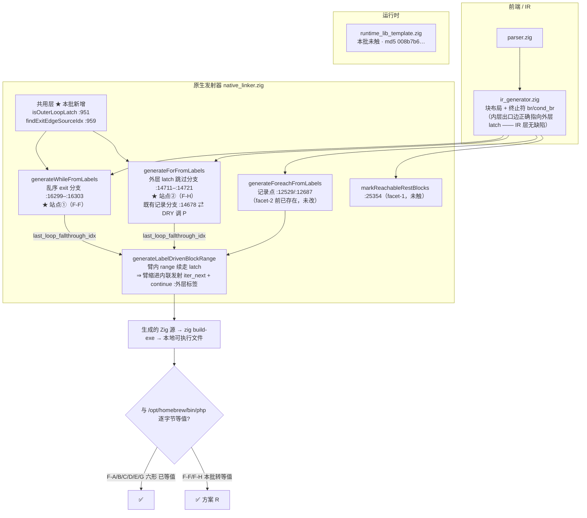
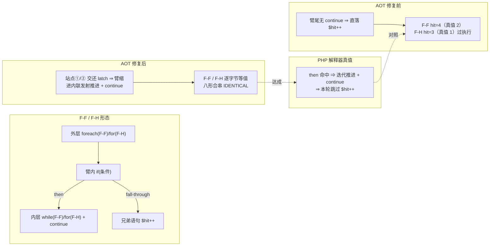
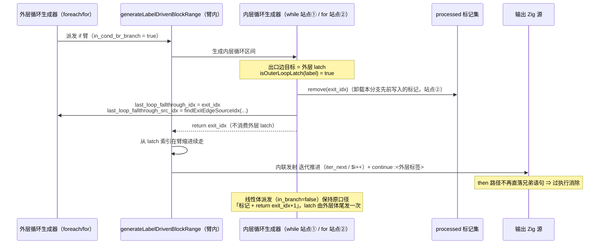
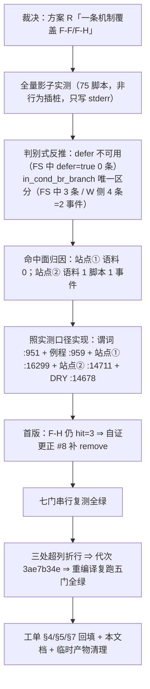

# AOT 臂尾未把外层 latch 续进臂缩进的根治 —— AOT-CODEGEN-005 RC-5 facet-2（方案 R）

> 批次日期：2026-10-04 ｜ 代码态：**工作区未提交**（`src/aot/native_linker.zig`）｜ 基线提交：`0ff09cf`（RC-4 ①+②）
> 代次链（实测 blob）：facet-1 落地态 `310536e5`（+56/−5，32492 行）⇒ **facet-2 首版** `6fdd1280`（+110/−23，32528 行）⇒ **当前代次（三处超列折行）`3ae7b34e`（+128/−23，32546 行）**；facet-2 自身净增 **+72/−18**。`timeout 240 zig build` 实测 **63s** RC=0。
> 工单：[AOT-CODEGEN-005 §4「facet-2 落地记录」/ §5 判据 1c / §7 行 15](../../known-issues/AOT-CODEGEN-005-foreach-body-if-arms-lost.md)；前批：[2026-10-03 facet-1（方案 B）](../2026-10-03/AOT臂尾continue延续块丢失根治_CODEGEN-005RC5方案B_2026-10-03_45969ff9.md)

---

## 1. 高层摘要（TL;DR）

`if (…) { <内层循环>; continue; }` 这类形态里，**内层循环为 `while`（F-F）或外层为 `for`（F-H）时，臂尾的迭代推进（`iter_next` / `$i++`）与 `continue` 只在循环体尾（臂缩进之外）发射一次，臂尾本身"直落"到 if 之后的兄弟语句** ⇒ `then` 路径**过执行**延续块：F-F PHP `hit=2` vs AOT `hit=4`、F-H PHP `hit=1` vs AOT `hit=3`（编译成功、`rc=0`，仅输出与 PHP 不一致）。

根因**不在臂尾判据，而在"出口边记录权"**：全树 `last_loop_fallthrough_idx` 的非空赋值只有 foreach 两处与 for 一处，`generateWhileFromLabels`（约 1600 行体）**从不记录**，for 的**外层 latch 跳过早退分支**也不记录 ⇒ 外层臂内 range 拿不到"这段区间属于我"的交还，只能把外层 latch 当内层循环的收尾消费掉 ⇒ 臂缩进内无从续走 latch。

本批按用户裁决走**方案 R（一条机制覆盖 F-F/F-H）**：把"出口边 = 外层 latch"作为**交还协议**统一实现 —— 新增共用谓词 `isOuterLoopLatch` 与出口边源块查找 `findExitEdgeSourceIdx`，在 while 的乱序 exit 分支（**站点① :16299–:16303**）与 for 的外层 latch 跳过分支（**站点② :14711–:14721**）各补一条「在 if 臂内派发时：卸载本分支自己写入的 latch 标记 + 记录出口边 + `return exit_idx`」，线性体派发（`in_branch=false`）保持原消费口径不变。

**方法学（本批第二条真正产出）**：沿用 facet-1 立下的 process rule (a) —— 先跑 **75 脚本全量非行为影子插桩**（68 语料 + 7 永久探针，只写 stderr、不经 `writer` ⇒ 生成码不变），**判别式由数据反推而非设计推演**：`defer_loop_fallthrough` 在候选站点② 的 16 条读数里 `defer=true` 为 **0 条**（旧"放宽 defer 置位面"的候选连触发都触发不了，实测否证）；`in_cond_br_branch` 是唯一区分量 ⇒ 判别式取 **`isOuterLoopLatch(label) && in_cond_br_branch`**。按脚本归因得出**语料回归面 = 1 脚本 / 1 事件**（`f028_dp_knapsack_lcs_lis`），站点① 语料 **0 命中**。

**验收（七门全绿，均在该二进制串行实测）**：门A 17 形 `same=17/17`；门B RC-4 诊断 `same=3 differs=1`（唯一红点归 REF-003 的 `rc=139`）；**RC-5 八形合串 `IDENTICAL`**（F-F/F-H 转逐字节等值，六形未回退）+ 三份单形探针 `c005_rc5fb/rc5ff/rc5fh` 全 `IDENTICAL`；官方 68 回归 `67 PASS + 1 SKIP / FAIL_* = 0`；漂移门 `diff=0` ⇒ **语料零漂移、未重冻结基线**；巡检 `mismatch=0`；抽查 `ok=5 bad=0`；`zig build test` **`21/21 steps / 326/326 tests` RC=0**。⇒ **RC-5 两个 facet 全部闭环，待提交。**

---

## 2. 影响范围

| 维度 | 内容 |
|---|---|
| 受影响组件 | `src/aot/native_linker.zig`（AOT 发射器，664KB 超大文件）**单文件**；`ir_generator.zig`、`runtime_lib_template.zig` **未触**（模板 md5 实测保持 `008b7b639f1069cb73e443064e115ed1`） |
| 变更规模 | `git diff --numstat`（相对 HEAD，含 facet-1）= **128 insertions / 23 deletions**；**facet-2 自身 = +72/−18**。文件 32546 行，blob `3ae7b34e` |
| 本批 hunk（7 段中的 facet-2 四段） | `@@ -947,0 +948,35`（新增 `isOuterLoopLatch` + `findExitEdgeSourceIdx`）、`@@ -14643,18 +14678,7`（既有记录分支改调共用例程，**DRY −17/+7**）、`@@ -14679,0 +14704,19`（**站点②** for 交还分支）、`@@ -16249,0 +16293,11`（**站点①** while 交还分支）。其余两段 `+7242`/`+25337` 与一段注释行属 facet-1 |
| 触发面 | 两个**循环生成器的出口边处理**（`generateWhileFromLabels` 乱序 exit、`generateForFromLabels` 外层 latch 跳过）⇒ 逻辑上触及所有"臂内嵌循环"的块标记所有权；实测差异面见下一行 |
| **实测命中面（影子扫描 75 脚本，非推测）** | `SH5_DONE total=75 scripts_with_hits=31`、207 条读数（`FR` 17 / `FS` 16 / `W1` 50 / `W2` 41 / `W3` 7）。**站点① 触发集 = 2 脚本，全是探针**（`c005_rc5ff_only_tmp`、`c005_rc5_merge_loss_tmp`）⇒ **68 语料 0 命中**；**站点② 触发集 = 3 脚本**（`c005_rc5fh_only_tmp`、`c005_rc5_merge_loss_tmp`、语料唯一命中 `f028_dp_knapsack_lcs_lis`）⇒ **整个语料回归面 = 1 脚本 / 1 事件**，三条站点② 事件的臂缩进 `ilen` 均为 12 |
| 修复解锁 | F-F（内层 while）与 F-H（外层 for）**转逐字节等值** ⇒ RC-5 八形合串整份 `IDENTICAL`；§5 判据 1c 由"允许两红点"的**非等值门升级为严格等值门**（六形 + F-F/F-H 全部不得差异，另立三份单形探针为永久门） |
| 语料影响 | 官方 68 回归 `FAIL_DIFF=0`、冻结基线漂移 `diff=0`（含对 `f028` 的单形 md5 复验 `24741 / 6daa5bd7117a977bfa6d3171eee2c2b6` == 冻结记录）⇒ **零漂移，未重冻结** |
| 是否破坏式 | **否**（站点①/② 均为**新增分支**，原「标记 + `return exit_idx+1`」/「消费成自身收尾」口径在 `in_branch=false` 路径上逐字保留；DRY 段是等价改写，实测 `main.zig` 逐字节不变）。但改的是**块标记所有权**，与 facet-1 同属共享语义层 ⇒ 全套门不可省 |
| 性能影响 | 无运行期成本（纯发射期）。发射期新增成本 = 命中"出口边是外层 latch 且在臂内派发"时一次 `processed.remove` + 一次候选源块扫描（O(3) 候选）；实测 `timeout 240 zig build` **63s**（与 facet-1 代次 63.75s 同量级）⇒ **无可测退化** |
| 未覆盖 | **REF-003 P0**（W3 `rc=139` 段错误，八形门唯一红点，属运行时模板层，与本批零耦合）、`markReachableRestBlocks` 与三处 ① 分支的 **DRY 三写收口**（≈−60/+40，另批）、发射期 `[AOT-CANARY]`、语料增补 Y/W/T/F/J/R（须重冻结）—— 均未做 |

---

## 3. 核心变更

| # | 变更点 | 位置（当前工作区树，blob `3ae7b34e`） | 判据与语义 |
|---|---|---|---|
| 1 | 新增共用谓词 `isOuterLoopLatch` | :951（`:948` hunk 内） | 块标签以 `for_loop_` 或 `foreach_increment_` 开头 ⇒ 该块是**外层循环的 latch/回边**，迭代推进归外层所有。口径来源：影子扫描里站点① 命中的 latch **全部**是 `foreach_increment_*`、站点② 全部是 `for_loop_*`，无第三种形态 |
| 2 | 新增共用例程 `findExitEdgeSourceIdx` | :959（同 hunk） | 在候选块索引里找**真正 `.br`/`.cond_br` 到 exit 块**的那条边的源块索引，供外层在臂尾物化该边的 merge PHI；找不到回退 `fallback_idx`。写法复用原 for 记录分支的内联 `blk_src:` 扫描 |
| 3 | **DRY**：既有 for 记录分支改调共用例程 | :14678（`@@ -14643,18 +14678,7`） | 原 17 行内联源块扫描 ⇒ 一次调用（−17/+7）。**实测发射中性**：改动前后 `f028` 等脚本 `main.zig` md5 与冻结基线一致，八形门等值 |
| 4 | **站点②**：for 外层 latch 跳过分支补"卸载 + 记录 + 交还" | :14711–:14721（`:14704` 为口径注释） | `if (self.in_cond_br_branch)` ⇒ `_ = processed.remove(exit_idx)` + `last_loop_fallthrough_idx = exit_idx` + `last_loop_fallthrough_src_idx = findExitEdgeSourceIdx(...)` + `return exit_idx`；`in_branch=false`（线性体派发）**必须**维持原「标记 + `return exit_idx + 1`」—— latch 由外层自身体尾发一次，交还会让外层增量重复执行（`$i` 跳号，既有反例） |
| 5 | **站点①**：while 乱序 exit 分支补"记录 + 交还" | :16299–:16303（`:16293` 为口径注释） | 插在既有 `_ = processed.remove(exit_idx)` 之后、resume 到 `extended_end`/`end_idx` 之前：`if (isOuterLoopLatch(shared_merge_blk.label) and self.in_cond_br_branch)` ⇒ 记录出口边（`exit_src_idx orelse cond_idx`）+ `return exit_idx` |
| 6 | 口径边界一：**判别式只用 `in_cond_br_branch`，不碰 `defer_loop_fallthrough`** | 站点①/② 注释 | 实测 FS 16 条读数中 `defer=true` 为 **0 条** ⇒ 该面既非 F-H 的触发条件、放宽它又会改写 f161 缺陷B / xp8 幻影输出守卫前提（回归面远大于收益） |
| 7 | 口径边界二：**`remove` 只作用于本次接管消费的 latch** | 站点② 注释 | 承接 facet-1 行 12 的"不得卸载共享控制块既有标记"约束（探针 H 反例：卸载 foreach 预标记的 increment/cleanup/exit ⇒ 外层增量重复发射）。本批 remove 的目标恰是"我们即将接管的 latch 块"，不触碰其它块 |
| 8 | 自证更正一：首版站点② 缺 `remove` ⇒ F-H 仍 `hit=3` | — | 只补"记录 + `return exit_idx`"时 F-B/F-F 已等值但 F-H 未修；根因是**跳过分支自己先前 `put(exit_idx)`** 的标记让外层臂 range 一见 `processed.contains` 就跳过 latch。补上与 F-B 模板（:14668）同形的卸载后三形全等值 |
| 9 | 自证更正二：预测"f028 会报 DIFF"被实测否证 | — | f028 是站点② 的语料唯一命中，据此预期漂移门报 `DIFF`；实测 `DRIFT_DONE total=68 ok=68 diff=0`，单形 md5 复验同值 ⇒ **影子命中面 ≠ 发射差异面**，安全性判定以漂移门为准（此条按"预测未成立"留存，禁止反述为"命中即漂移"） |
| 10 | 排版代次：三处超列（152/156 列）按 Zig 100 列风格折行 | 站点①/② 调用与例程签名 | **未跑 `zig fmt`**（该文件既有 fmt 债：>100 列行 4939→4957 条，全量 fmt 会产生约 400 行无关 diff）。折行后在**重编译二进制**上复跑门A/门B/八形/三单形/抽查全绿 ⇒ 发射中性 |
| 11 | 门判据收紧 + 工单回填 | 工单 §4「facet-2 落地记录」/§5 1c/§7 行 15 | 八形门从"允许 F-F/F-H 两红点"改为**严格等值门**；三份单形探针（`c005_rc5fb/rc5ff/rc5fh`）永久化为单形门 |

---

## 4. 可视化概览（Mermaid）

### 4.1 分层架构图（变更落点）



### 4.2 业务流程（缺陷形态 → 真值 → 修复后）



### 4.3 执行流程（交还协议，站点①/② 同一口径）



### 4.4 上层→底层时序（变更点相对数据流）



---

## 5. 详细变更分析

### 5.1 分层与变更点

| 层 | 文件 / 函数 | 变更 | 行号（落地代次） |
|---|---|---|---|
| 发射器 · 共用工具 | `native_linker.zig` 顶层函数 | 新增 `isOuterLoopLatch`（标签前缀谓词）、`findExitEdgeSourceIdx`（出口边源块查找） | :951 / :959（`:948` hunk +35） |
| 发射器 · for 生成器 | `generateForFromLabels` 既有记录分支 | 内联 `blk_src:` 17 行扫描 ⇒ 调共用例程（DRY −17/+7） | :14678 |
| 发射器 · for 生成器 | `generateForFromLabels` 外层 latch 跳过分支 | **站点②**：臂内派发 ⇒ 卸载 latch 标记 + 记录出口边 + `return exit_idx` 交还；体尾派发保持原「标记 + 跳过」 | :14711–:14721（注释 :14704） |
| 发射器 · while 生成器 | `generateWhileFromLabels` 乱序 exit 分支 | **站点①**：latch + 臂内派发 ⇒ 记录出口边 + `return exit_idx`；其余保持原消费 | :16299–:16303（注释 :16293） |
| 发射器 · 公共收尾 | `markReachableRestBlocks` 及其调用点 | facet-1 已落地，本批**未触** | :25354 / :7244 |
| 门与文档 | `c005_rc5_probe_run_tmp.sh` 判据、工单 §4/§5/§7、本文档 | 八形门升级为严格等值门；影子读数与两条自证更正留存 | — |

### 5.2 关键落地代码

```zig
// src/aot/native_linker.zig :951 —— 共用谓词（NativeLinker 结构体内）
    fn isOuterLoopLatch(label: []const u8) bool {
        return std.mem.startsWith(u8, label, "for_loop_") or
            std.mem.startsWith(u8, label, "foreach_increment_");
    }
```

```zig
// src/aot/native_linker.zig :16299 —— 站点①（generateWhileFromLabels 乱序 exit 交还）
                if (isOuterLoopLatch(shared_merge_blk.label) and self.in_cond_br_branch) {
                    self.last_loop_fallthrough_idx = exit_idx;
                    self.last_loop_fallthrough_src_idx = exit_src_idx orelse cond_idx;
                    return exit_idx;
                }
```

```zig
// src/aot/native_linker.zig :14711 —— 站点②（generateForFromLabels 外层 latch 交还）
            if (self.in_cond_br_branch) {
                _ = processed.remove(exit_idx);
                self.last_loop_fallthrough_idx = exit_idx;
                self.last_loop_fallthrough_src_idx = findExitEdgeSourceIdx(
                    func,
                    &[_]usize{ cond_idx, body_idx, loop_idx },
                    exit_idx,
                    exit_block,
                    cond_idx,
                );
                return exit_idx;
            }
            try processed.put(exit_idx, {});
            return exit_idx + 1;
```

### 5.3 验收读数（facet-2 落地二进制，串行、无并发编译）

| 门 | 命令 | 实测 |
|---|---|---|
| A · 16+1 形等值门 | `fuzzy_scripts_720/tmp/c005_probe_run_tmp.sh` | `PROBE_DONE total=17 same=17 differs=0` |
| B · RC-4 诊断门 | `c005_rc4_probe_run_tmp.sh` | `RC4_PROBE_DONE total=4 same=3 differs=1`，唯一红点 `ref003_crash_attr_tmp`（W1/W2 等值、输出止于 W2、`rc=139`）⇒ 归 REF-003 |
| **C′ · RC-5 八形门（本批升级为等值门）** | `c005_rc5_probe_run_tmp.sh` | 合串 **`IDENTICAL`**；三份单形探针 `c005_rc5fb/rc5ff/rc5fh` 全 `IDENTICAL`（F-F/F-H 转等值，六形未回退） |
| C · 官方回归 | `scripts/regression_test_720.sh` | `TOTAL 68 / PASS 67 / FAIL_COMPILE 0 / FAIL_RUNTIME 0 / FAIL_DIFF 0 / SKIP 1`（`regression_failures.tsv` 仅 `SKIP\|f004_oop_deep_inheritance_magic.php\|PHP_error_exit=255`） |
| D · 冻结基线漂移 | `c005_full_drift_tmp.sh` | `DRIFT_DONE total=68 ok=68 diff=0 notemp=0 norow=0` ⇒ **零漂移，未重冻结**（f028 单形 md5 复验同值） |
| E · 确定性巡检 | `f12_determinism_tmp.sh` | `SWEEP_DONE total=68 mismatch=0 notemp=0` |
| F · 基线抽查 | `s7_baseline_spotcheck_tmp.sh` | `SPOT_DONE ok=5 bad=0`（f031/f010/f042/f067/f113 行数与 md5 均等于冻结记录） |
| G · 单测 | `timeout 120 zig build test` | `Build Summary: 21/21 steps succeeded; 326/326 tests passed`，RC=0（`failed command: ./.zig-cache/o/55e2…/test … --listen=-` 为 `ci_integration.test.CIRunner` 自调用泄漏的既有 stderr 噪声，非失败） |
| 编译 | `timeout 240 zig build` | 63s，RC=0；`git diff --numstat` = +128/−23（facet-2 净增 +72/−18），`SH5-` 残留 0 |

---

## 6. 影响与风险评估

| 项 | 评估 |
|---|---|
| **是否破坏式** | **否**。站点①/② 是新增分支且只在 `in_cond_br_branch=true` 时改变行为；`in_branch=false` 逐字保留原口径。DRY 段为等价改写，实测发射不变 |
| **核心风险 = 块标记所有权** | 交还协议要求 `processed.remove(exit_idx)` —— 卸载标记历史上引发过探针 H 反例（外层增量重复发射、`$i` 跳号）。**控险口径**：remove 目标恰是"本次由我们接管消费的 latch"，且只在臂内派发路径执行；实测门 D `diff=0` + f028 单形 md5 等于冻结 ⇒ 未出现重复发射 |
| **命中面 vs 差异面** | 影子命中面（1 语料脚本 / 1 事件）**大于**实际差异面（0，逐字节等值）。结论口径已入工单：**安全判定以漂移门为准，禁止以命中面反推风险等级** |
| **未放宽的面** | `defer_loop_fallthrough` 置位面未动（f161 缺陷B / xp8 幻影输出守卫前提保持）；`markReachableRestBlocks`（facet-1 公共收尾）未动；foreach 记录点未动 |
| **性能** | 运行期零新增成本。发射期新增一次 `remove` + O(3) 候选扫描，仅在命中形上执行；`zig build` 63s（与上代次同量级）⇒ 无退化 |
| **确定性** | 门E `mismatch=0`（68 脚本两轮比对）⇒ 未引入跨 run 漂移 |
| **排版代次** | 三处折行为纯排版，重编译二进制上复跑五门全绿 ⇒ 发射中性。**未做全文件 `zig fmt`**（既有 fmt 债，全量 fmt 会造约 400 行噪声 diff） |
| **复测路径（体验流程）** | ① `timeout 240 zig build`；② `timeout 900 bash fuzzy_scripts_720/tmp/c005_rc5_probe_run_tmp.sh`（看合串 `IDENTICAL`）；③ `timeout 300 bash fuzzy_scripts_720/tmp/c005_rc5ff_only_tmp` 相关三份单形门；④ `timeout 1800 bash scripts/regression_test_720.sh`；⑤ `timeout 1800 bash fuzzy_scripts_720/tmp/c005_full_drift_tmp.sh` |
| **特别注意点** | 本批**不得**与 REF-003 模板改造、facet-1 提过的 `markReachableRestBlocks` DRY 三写收口、`scripts/batch_test_aot.sh` 的 `gtimeout`→`timeout` 混提；提交边界 = `native_linker.zig`（facet-1 + facet-2）+ 工单 + `docs/changes/2026-10-04/` 自成一批 |

---

## 7. 遗留问题 / 潜在问题

| # | 问题 | 状态 | 说明 |
|---|---|---|---|
| 1 | **REF-003 P0**（持引用迭代 live-set + 迭代器迁址崩溃） | 待裁决 | 八形/RC-4 两门的**唯一红点**（`rc=139`），属运行时模板层，与本批零耦合；设计稿已完成（任务 #47），改造需用户裁决（任务 #40） |
| 2 | **RC-5 覆盖面仅探针级** | 已知缺口 | 语料 68 脚本中**没有** F-F/F-H 形态（站点① 语料 0 命中），故修复的语料证据只有"零漂移"而非"语料转绿"。真实业务脚本里的同类形态覆盖不足 ⇒ 需语料增补（Y/W/T/F/J/R 族），且增补须走重冻结 |
| 3 | **交还协议为两站点而非一处统一机制** | 技术债 | F-F 与 F-H 判为"同类机制、不同站点"，站点①/② 各写一份判断。若第三种循环（do-while）出现同族形态，需第三个站点 ⇒ 应收敛为"出口边交还"单一入口（与 `markReachableRestBlocks` 的 DRY 三写收口可并批） |
| 4 | **`native_linker.zig` 格式债** | 未处理 | `zig fmt --check` 对本文件**长期失败**（既有 >100 列行 4957 条）。本批只手折自己新增的三处，未按宪法"全文件 fmt"处理（会产生约 400 行无关 diff），需单独立项 |
| 5 | **影子扫描不可复跑** | 已登记 | 一次性插桩已还原移除、原始读数与扫描脚本已清理，全部内容转录进工单 §4。后续若需新读数须按该节方法重插 |
| 6 | 门G stderr 噪声 | 既有 | `ci_integration.test.CIRunner` 自调用把 `failed command: … --listen=-` 泄到 stderr；不影响 RC=0 判定，但会在 CI 日志里造成误读，宜加 `--` 静音或过滤 |

---

## 8. 后续开发 / 优化建议

| 优先级 | 建议 | 影响面 | 落地成本 |
|---|---|---|---|
| **P0** | **提交本批**（`native_linker.zig` facet-1 + facet-2 + 工单 + 本文档自成一批）—— 当前 32546 行的未提交发射器改动是最大单点风险，工作区丢失即失去两 facet 全部成果 | 单文件 + 3 份文档 | 极低（一次 commit，待用户明示「提交」） |
| **P0** | **REF-003 P0 迭代器改「键序列 + 位置下标」模型**（任务 #40，设计稿 #47 已就绪）—— 现存两门的唯一红点即它 | 运行时模板（`runtime_lib_template.zig`）+ 引用语义全套门 | 高（需重冻结基线评估；须先跑同法影子实测） |
| **P1** | **交还协议统一化**：把站点①/② 的 `isOuterLoopLatch && in_cond_br_branch ⇒ 记录 + 交还` 抽成单一例程（如 `handBackOuterLatch`），与 `markReachableRestBlocks` 的三写 DRY 收口并批（估 ≈−60/+40） | 三侧循环生成器共用层 | 中（发射中性需逐门复验，成本主要在验证） |
| **P1** | **do-while 侧同族审计**：`generateDoWhileFromLabels` 是否存在"出口边 = 外层 latch"却不记录的路径（本批未证伪，属遗留 #3 的前置排查） | while 族对称闸门 | 低～中（只读取证 + 一份新探针） |
| **P1** | **发射期 `[AOT-CANARY]` 金丝雀**：对"臂尾应有 continue 却直落"的形态在发射期打印告警，把本类缺陷从"输出 diff 才暴露"前移到编译期暴露 | 发射器诊断通道 | 中（需门脚本同步忽略噪声行） |
| **P2** | **语料增补 Y/W/T/F/J/R 族**（含 F-F/F-H 同类真实业务形态），完成后重冻结 `baseline_main_zig_md5.tsv` | 测试面 | 高（68→约 90 脚本，全门 + 重冻结） |
| **P2** | `scripts/batch_test_aot.sh` 的 `gtimeout`→`timeout`（本机无 coreutils gtimeout，现为静默降级路径）；AOT-PROC-001 `.gitignore` 测试资产吞没；TYPE-001 P2 审计；REF-002 R-2/R-4/R-5/R-6 | 工具链 / 旁支工单 | 低～中 |
| **P2** | **性能视角**：站点② 的 `findExitEdgeSourceIdx` 候选集固定为 3（`cond/body/loop`），若未来 latch 形态增多，宜在 IR 层为出口边预存 `src_idx`（一次性构建期成本换发射期 O(1)），避免发射期反复扫边 | 发射器热路径（编译期） | 低（当前无退化，属前瞻） |

---

**提交态声明**：本文档所述代码变更**均在工作区、尚未提交**（基线 `0ff09cf`）。本轮临时产物（影子插桩与其捕获、一次性扫描脚本、`/tmp` 编译捕获与门日志、KEEP_TEMP 目录 `.zigphp_aot_build_*`、全部 `aot_compile_*` 产物）已按宪法 §三.7 清理，**零 `.php` 原始脚本删除**（永久探针 `c005_rc5{fb,ff,fh}_only_tmp.php`、`c005_rc5_merge_loss_tmp.php` 与四份门脚本全部在册）。
