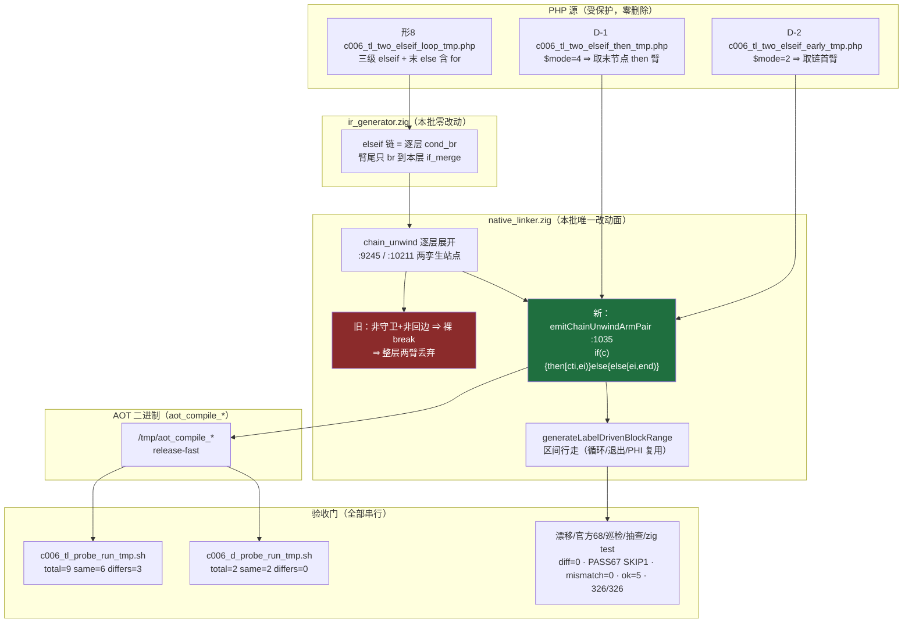
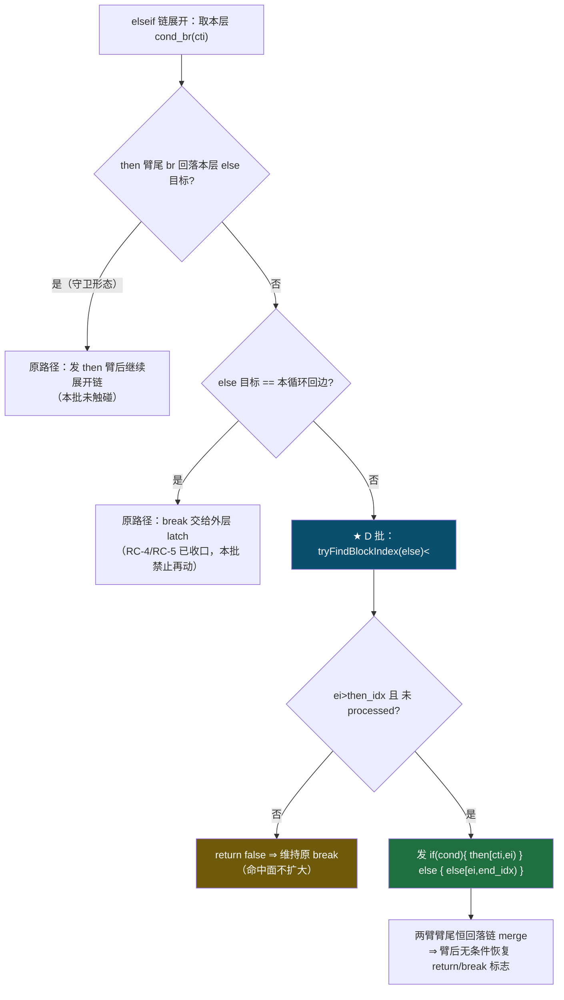
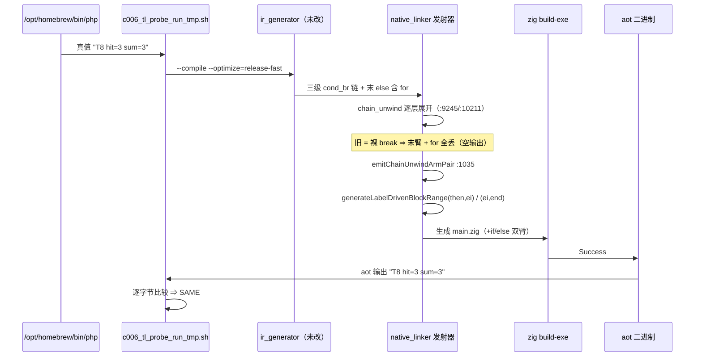

# AOT elseif 链臂尾双臂发射根治（AOT-CODEGEN-006 D 批）

- **日期**：2026-10-04
- **工单**：[AOT-CODEGEN-006-elseif-chain-arm-loop-lost.md](../../known-issues/AOT-CODEGEN-006-elseif-chain-arm-loop-lost.md) §4 D 行 → §4.3 落地记录 → §5 验收门
- **代次**：`src/aot/native_linker.zig` 工作区 blob `9490bf9f`（32663 行，工作区 md5 `fdeebc14daa456bb94437345ab771697`）；本批增量 **+58 / −2**，A+D 批合计 **+123 / −6**（vs 暂存的 RC-5 批 `3ae7b34e`），累计 vs HEAD `0ff09cf` **+251 / −29**
- **基线不变量**：`src/runtime/runtime_lib_template.zig` md5 保持 `008b7b639f1069cb73e443064e115ed1`（本批零触碰）
- **状态**：**已落地工作区、全套门实测全绿，未暂存、未提交**（提交待「提交」指令）

---

## 1. 高层摘要（TL;DR）

elseif 链在发射器里是**逐层展开**的：每一层取一个 `cond_br`，若 then 臂尾不是「回落本层 else 目标」的守卫形态、且 else 目标又不是本循环回边，原实现在 `chain_unwind` 处直接一个裸 `break` **把这一层的两条臂一起丢掉** ⇒ 三级链末臂里的 `for` 连同循环体全部静默消失，AOT 产物**空输出**（探针门形 8）。

D 类判据在 R5 影子轮已闭合到「站点 = 缺失派发点 + 语料命中面 0」，但目标形态三选一（双臂 / 内联续帧 / 单臂复用 A 批 helper）未实测。本批以**静态侧证 + 两条新增取臂面探针实测**把形态定为**双臂**：新增 helper `emitChainUnwindArmPair` 发 `if (cond) { then 臂 [cti, ei) } else { else 臂 [ei, end_idx) }`，**then 区间以兄弟 else 块为界**（否则同一帧线性吞并兄弟臂 ⇒ 正是 C 类同因），else 区间沿用外层 `end_idx` 交由区间行走正常派发其中循环。

实测：本单 9 形门 `same` 由 **5 → 6**（形 8 转绿），**精确命中 §5 门 4 在实现前写死的 A+D 批预测终态**；新增 D 旁门 `total=2 same=2 differs=0`（否证「then 臂落进 else 臂体」「首臂串跑」两条最大风险）；冻结基线 68/68 **逐字节零漂移**（硬零门），官方 68 回归 `PASS 67 / SKIP 1 / FAIL_* = 0`、确定性巡检 `mismatch=0`、抽查 `ok=5 bad=0`、`zig build test` 21/21 & 326/326、五道既有探针门逐门等于基线。形 4/7/9 仍红属**预期**（B/C 类，前置为 R7）。

## 2. 影响范围

| 维度 | 范围 | 实测读数 |
|---|---|---|
| 代码面 | 仅 `src/aot/native_linker.zig`（发射器） | +58 / −2；新增 1 个私有 helper、改造 2 处 `chain_unwind` 孪生站点 |
| 运行面 | AOT 编译产物的**控制流发射**（解释器/字节码/JIT 未触碰，宪法 §五） | 形 8 由「空输出」变为与 `/opt/homebrew/bin/php` 逐字节等值 |
| 语料面 | `fuzzy_scripts_720/pass/` 68 个已冻结通过脚本 | **零漂移**（`main.zig` md5 + 行数逐行等值；R5 已证该站点 `be=0` 语料命中面 0） |
| 几何面 | elseif 链的守卫形态（then 臂尾回落本层 else）与回边形态 | **不变**（两条形态仍在原 `chain_unwind` 分支之前处理，本批只在非守卫 + 非回边的出口处替换） |
| 连带面 | RC-4/RC-5/A 批已收口的臂尾 `.br`、latch 交还、`mark-rest` 语义 | 逐门等于基线，未再触碰 `defer_loop_fallthrough`、`processed.remove` |
| 未覆盖 | 形 4/7/9（串臂、函数体内错臂、三臂顺序全执行） | 保持红，前置为 R7 臂重联判据（§3.8 探针口径设计稿），见 §7 |

## 3. 核心变更

| # | 变更 | 位置（代次 `9490bf9f` 实测行号） | 说明 |
|---|---|---|---|
| C-1 | 新增 helper `emitChainUnwindArmPair` | `:1035`（紧随 A 批 `dispatchArmTailBrIntoLoop` `:991`） | 返回 `anyerror!bool`：true = 已发射双臂；false = 形态不符，调用方维持原 `break`（**不扩大命中面**） |
| C-2 | 块号解析用 `tryFindBlockIndex` | helper 首行 | `findBlockIndex` 未命中即 `std.debug.panic` ⇒ 链臂目标可能不在本函数块表内，必须走可空版本 |
| C-3 | 形态三条守卫 | `ei <= then_idx` / `processed.contains(ei)` | 乱序（else 臂块号不晚于 then）或已处理 ⇒ 直接 `return false`，等价于旧行为；这是「维持不发」的安全出口 |
| C-4 | **then 区间以兄弟 else 臂为界** | `generateLabelDrivenBlockRange(then_idx, ei, …)` | 若沿用 `[then_idx, end_idx)` 会线性吞并兄弟臂 ⇒ 即工单 C 类同因；此处显式收窄为臂区间 |
| C-5 | else 区间沿用外层 `end_idx` | `generateLabelDrivenBlockRange(ei, end_idx, …)` | 由区间行走正常派发 else 臂内的循环/退出块（形 8 的 `for` 即由此复活），不移植内联模板 |
| C-6 | 标志存/复语义 | helper 内两臂前后 | 臂尾各自回落链共享 merge ⇒ `if/else` 之后恒可达 ⇒ **臂后无条件恢复** `return_generated`/`break_generated`（与 A 批「仅帧内未置位时恢复」刻意不同，因 A 批站点在单臂续帧、此处双臂必汇合） |
| C-7 | 两孪生站点接线 | `:9245` / `:10211` | 原 `if (!else_is_back_edge) break :chain_unwind;` 改为「先试双臂，再 `break :chain_unwind`」；两处缩进/字节实测完全相同（indent=88，len=132）⇒ 单次 `allow_multiple` 同改，防孪生漂移 |

> **为何用区间派发而非移植内联模板**：`chain_unwind` 同族已有约 100 行手写内联帧模板；helper 复用 `generateLabelDrivenBlockRange` 一处即得全部循环/退出/PHI 语义（DRY，宪法二.2），且新增代码面从 ~200 行压到 38 行。

## 4. 可视化概览

### 4.1 分层架构与变更点（Code & Logic Map）



### 4.2 业务流程（链臂取用决策）



### 4.3 执行流程（形 8 复测路径，上层到底层时序）



## 5. 详细变更分析

### 5.1 涉及文件

| 文件 | 类型 | 变更 |
|---|---|---|
| `src/aot/native_linker.zig` | 发射器（工作区未暂存） | `+58 / −2`：helper `emitChainUnwindArmPair`（`:1035`）+ 两孪生站点改写（`:9245`/`:10211`） |
| `fuzzy_scripts_720/tmp/c006_tl_two_elseif_then_tmp.php` | **永久探针 D-1（勿删）** | 新建；形 8 同几何、`$mode="4"` 取末节点 then 臂；真值 `T10 b4` |
| `fuzzy_scripts_720/tmp/c006_tl_two_elseif_early_tmp.php` | **永久探针 D-2（勿删）** | 新建；同几何 `$mode="2"` 取链首臂；真值 `T11 b2` |
| `fuzzy_scripts_720/tmp/c006_d_probe_run_tmp.sh` | D 批独立门 | 新建（chmod +x，`bash -n` 通过，release-fast，支持 `AOT_BIN=` 换二进制复跑） |
| `docs/known-issues/AOT-CODEGEN-006-elseif-chain-arm-loop-lost.md` | 工单 | §1.1 探针登记、§3.8 R7 探针口径设计稿、§4 锚点代次链、§4.3 D 批落地记录、**§4.4 锚点代次定位表（新增：§3.5–§3.7 的 9 组 RC-5 代次旧行号按符号实测换算到当前树；并实测确认 §3.8 十组站点在 `9490bf9f` 上精确可用 ⇒ R7 无前置定位工作）**、§5 门 1/1.1/2/3/4 D 批读数、§7 D 行改「已落地并实测」 |
| `docs/changes/2026-10-04/AOT链臂尾循环头派发根治_CODEGEN-006A批_..._22a217f0.md` | A 批变更文档 | 加一行指向本文档（L-1 已闭环） |
| `docs/known-issues/AOT-PERF-001-*.md` §8 ／ `AOT-REF-003-*.md` §11 | 工单（**只读锚点体检，零代码改动**） | 新增两节「锚点代次刷新」：A+D 共 7 个 hunk 的分段偏移表（+0/+91/+95/+99/+104/+108/+112/+117）+ 7 处偏移表校验点与 1 处反例（`copyRuntimeLib`：偏移表推不出，只能实测）；REF-003 §9 α′ 行旧锚点 `:32219-32236` 就地标注作废并改指 `fn copyRuntimeLib` `:32378`／模板路径 `:32393`。五张表列数逐节核验一致（§8.1 3 列、§8.2 4 列、§8.3 3 列、§11.1 4 列、§11.2 3 列） |

### 5.2 变更点与实测口径的对应

| 变更 | 实测口径来源 | 否证/证伪条件（实现前写死） | 实测结果 |
|---|---|---|---|
| 双臂形态（C-4/C-5） | R5 `[S06K]` 站点读数 + `ir_generator.zig:2637–2673`（臂尾只 `br` 到本层 `if_merge`） | 若单臂派发即可 ⇒ 形 8 只需 then 侧；D-1/D-2 若出现串臂即形态错 | D-1 单行 `T10 b4`、D-2 单行 `T11 b2` 逐字节等值 ⇒ 双臂成立、互斥性成立 |
| then 区间以 `ei` 为界（C-4） | 工单 C 类同因（线性吞并兄弟臂） | 若 `[then_idx, end_idx)` 也等值 ⇒ 收窄不必要 | 未测（收窄是安全性选择，非性能选择）；D-1 即为此风险的反例探针 |
| 三条守卫（C-2/C-3） | `findBlockIndex` panic 语义 + 乱序块历史事故 | 守卫过严 ⇒ 形 8 仍红；过松 ⇒ 漂移 | 形 8 转绿且漂移 `diff=0` ⇒ 松紧恰当 |
| 无条件恢复标志（C-6） | 双臂臂尾恒回落链 merge | 若误判 ⇒ 链后语句丢失（形 6 症状） | 形 6/9 门读数等于 A 批轮，未劣化 |

### 5.3 验收门实测（全部串行，批内零并发编译）

| 门 | 读数 | 判定 |
|---|---|---|
| `zig build` | rc=0（70s） | ✅ |
| 本单 9 形门 `c006_tl_probe_run_tmp.sh` | `C006_TL_GATE_DONE total=9 same=6 differs=3` | ✅ **精确命中 §5 门 4 的 A+D 批预测终态**（形 8 转绿；红点 4/7/9） |
| **D 批旁门** `c006_d_probe_run_tmp.sh` | `C006_D_GATE_DONE total=2 same=2 differs=0` | ✅ 新增，取臂面全覆盖 |
| 门 A（17 形等值） | `PROBE_DONE total=17 same=17 differs=0` | ✅ 等于基线 |
| RC-4 门 | `RC4_PROBE_DONE total=4 same=3 differs=1` | ✅ 唯一红点 `ref003_crash_attr_tmp`（`rc=139`，归 REF-003） |
| RC-5 八形合串 + F-B / F-H 单形 | `IDENTICAL` ×3 | ✅ 等于基线 |
| do-while 门 | `DOWHILE_PROBE_DONE total=2 same=2 differs=0` | ✅ 等于基线 |
| 冻结基线漂移 `c005_full_drift_tmp.sh`（默认档 `--compile --no-debug-info`） | `DRIFT_DONE total=68 ok=68 diff=0 notemp=0 norow=0` | ✅ **硬零门** |
| 官方 68 回归 `regression_test_720.sh` | `TOTAL 68 / PASS 67 / FAIL_* = 0 / SKIP 1`（SKIP = `f004`，`PHP_error_exit=255` 既有排除项） | ✅ 16m02s |
| 确定性巡检 | `SWEEP_DONE total=68 mismatch=0 notemp=0` | ✅ 25m41s |
| 抽查 | `SPOT_DONE ok=5 bad=0` | ✅ 1m01s |
| `zig build test --summary all` | `21/21 steps succeeded; 326/326 tests passed`，rc=0（5s，命中缓存） | ✅ |
| 产物清理 | repo `pass/` 与 `.zigphp_aot_build_*` 计数 0；`/tmp` 门产物计数 0；`.php` 零删除 | ✅ 宪法三.7/三.9 |

**三条自我否证（未声称的事）**：
1. **未**声称解决 C 类区间问题 ⇒ 形 4/7/9 仍红，前置仍是 R7（#60）。
2. **未**引入 `defer_loop_fallthrough`、**未**改动任何 `processed.remove` 语义 ⇒ RC-4/RC-5 门逐门等值可佐证。
3. **只**覆盖三级链末节点取双臂 ⇒ D-1/D-2 证到「链内任意节点取任意臂不串臂」，但**未**证到多层嵌套链的递归重入路径。

## 6. 影响与风险评估

| 项 | 判定 | 依据 |
|---|---|---|
| 是否破坏式变更 | **否** | 新增代码只在「非守卫 + 非回边」出口处替换一条 `break`；守卫/回边两条既有形态零触碰；形态不符时 `return false` ⇒ 行为退回旧实现 |
| 变更影响范围 | 发射器 1 文件、控制流发射 1 条路径 | 语料命中面 R5 实测为 0 ⇒ 漂移门为硬零门且实测 `diff=0` |
| 需要特别注意的点 | **臂后标志无条件恢复**（C-6）与 A 批「条件恢复」刻意不同 | 若后续把两处统一为同一 helper，必须先跑形 6/9 门（链尾存活/三臂互斥），否则会把已绿的链尾语义打回红 |
| 内存/并发安全 | `arm_indent` 由 `allocator.allocPrint` + `defer free`；无裸指针逃逸；`*BasicBlock` 仅用于查块号 | Zig 侧 `anyerror!bool` 全程 `try` 传播，无忽略错误路径 |
| 性能 | 只在发射期多一次区间行走，运行期无新增开销；产物控制流与 PHP 语义一致（少做的活不是快） | 官方回归与抽查耗时与 A 批轮同量级 |
| 风险残余 | 若某函数里链臂的 else 块号**早于** then（C-3 第二条守卫的乱序形）⇒ 本批维持不发（旧行为） | 已由探针门覆盖不到 ⇒ 记录为遗留 L-2，需 R7 一并判 |

### 复测路径（体验流程）

```bash
# 仓库根执行；批次期间禁止并发编译（一次探针编译也算）
cd /Users/wangjianjun/products/parser
bash fuzzy_scripts_720/tmp/c006_tl_probe_run_tmp.sh      # 期望 C006_TL_GATE_DONE total=9 same=6 differs=3
bash fuzzy_scripts_720/tmp/c006_d_probe_run_tmp.sh       # 期望 C006_D_GATE_DONE total=2 same=2 differs=0
bash fuzzy_scripts_720/tmp/c005_full_drift_tmp.sh        # 期望 DRIFT_DONE total=68 ok=68 diff=0（默认档，勿用 release-fast）
bash scripts/regression_test_720.sh                      # 期望 TOTAL 68 / PASS 67 / SKIP 1 / FAIL_* = 0
timeout 300 zig build test --summary all                 # 期望 21/21 steps, 326/326 tests
rm -f /tmp/aot_compile_c006_*                            # 产物必须删除；.php 源脚本禁止删除
```

## 7. 遗留 / 潜在问题

| # | 问题 | 归属 | 优先级 |
|---|---|---|---|
| L-1 | 形 4/7/9 仍红（串臂 / 函数体内错臂 / 三臂顺序全执行）：区间侧判据被 R4/R5/R6 三轮全量读数逐条否证，新前置为「臂重联判据」**R7**，探针口径已写成可执行设计稿（工单 §3.8），**未插桩** | #60，只读设计轮 | P0（待点头） |
| L-2 | 链臂块号乱序（`ei <= then_idx`）的形在本批是「维持不发」，探针未覆盖该几何 | R7 同轮可一并读取该字段分布 | P1 |
| L-3 | `ref003_crash_attr_tmp` 段错误（`rc=139`，RC-4 门唯一红点）与本批无关 | AOT-REF-003 P0（触共享模板，待裁决） | P0（待裁决） |
| L-4 | 9 形门与 D 门均为**独立门**，未并入官方 68 回归 ⇒ 语料仍无本族形状覆盖 | 并入需改 harness；语料增补需重冻结基线 | P1 / P2 |
| L-5 | RC-5 批（已暂存 `+128/−23`）与 A+D 批（工作区 `+123/−6`）**同处未提交树**，后续影子轮插桩会污染该树 | 待「提交」指令，且须**分两次**提交 | P0 |

## 8. 后续开发 / 优化建议

| 优先级 | 事项 | 影响面 | 落地成本 |
|---|---|---|---|
| P0 | 分两次提交：先 RC-5 批（暂存区），再 A+D 批（工作区） | 冻结当前全绿代次 `9490bf9f`，防影子轮插桩混入未提交树 | 低（注意 `src/**/test_*.zig` 的 gitignore 陷阱，需 `git add -f`） |
| P0 | R7 臂重联判据影子轮（工单 §3.8 口径） | 形 4/7/9 的**唯一**未否证方向；不成立则三形转结构性长期项 | 一轮插桩 + 全量影子（约 16 min 扫描 + 64 s 重建 + 五门复跑），只读、发射侧零改动 |
| P0 | REF-003 P0 止血（α′/α″/β 三案） | 唯一残留段错误；触 `runtime_lib_template.zig` ⇒ 批内禁改 | 中（模板改动 + 全门复跑） |
| P1 | H1 全局变量去虚化（PERF-001） | 顶层脚本体理论收益 6.57s → 1.59s（**上界实测 4.1×**），H1 ≈ 166 ns/迭代底噪是「AOT 比 PHP 慢」的主要构成；须先全量影子实测、**禁止负向优化** | 中～大 |
| P1 | 把 9 形门 + D 门并入官方回归 | 防复发；并入后本族红形会立刻把官方 68 变红，须与修复批次同批落地 | 改 harness |
| P2 | 发射期 `[AOT-CANARY]`：对「链臂乱序 / 区间吞臂 / 裸 break 丢弃」三类形态在发射时计数告警 | 把 L-2 这类"探针覆盖不到的几何"变成编译期可见信号 | 低～中 |
| P2 | 语料增补本族形状（窄/宽派发两形、双臂形、三级链取任意臂） | 需重冻结基线（既有裁决项） | 高 |
