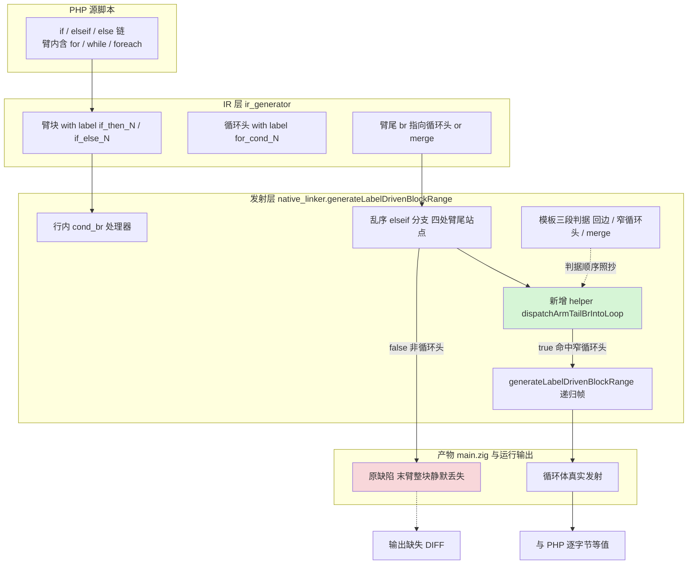
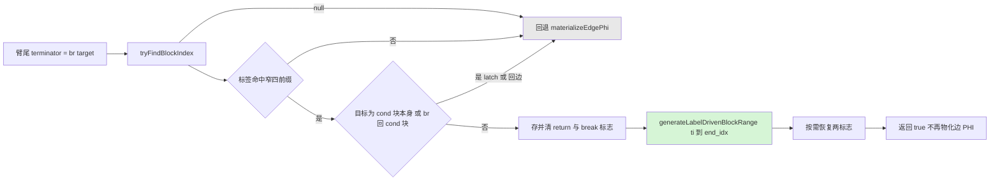
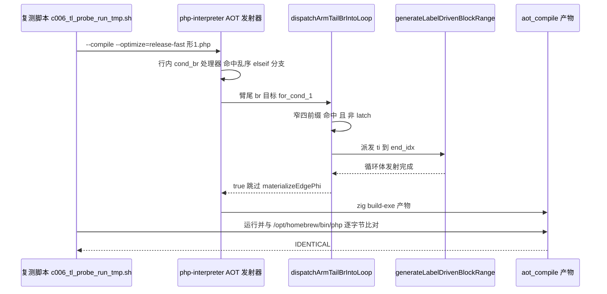

# AOT elseif 链臂尾循环头派发根治（AOT-CODEGEN-006 A 批）

- **日期**：2026-10-04
- **工单**：[AOT-CODEGEN-006-elseif-chain-arm-loop-lost.md](../../known-issues/AOT-CODEGEN-006-elseif-chain-arm-loop-lost.md) §4.1 蓝图 → §4.2 落地记录
- **代次**：`src/aot/native_linker.zig` 工作区 blob `22a217f0`（32607 行，`git diff --stat` = **+65 / −4**）；基线为 RC-5 批次 blob `3ae7b34e`（32546 行，已暂存未提交）
- **状态**：**已落地工作区、全套门实测全绿，未暂存、未提交**（提交待「提交」指令）

---

## 1. 高层摘要（TL;DR）

AOT 发射器在 if/elseif/else 链的**乱序（out-of-order）分支**里处理臂尾终止符时，只按 CFG 边物化 PHI，**从不判断臂尾 `.br` 的目标是「汇合点」还是「循环头」**。目标为循环头时，那条循环被留在臂外、整段静默消失 ⇒ PHP 与 AOT 输出逐字节不等（探针门形 1/5/6 + `perf001` mode=1 同源）。

本批新增一个 helper `dispatchArmTailBrIntoLoop`，把已存在于同一处理器内的**三段判据**（回边 / 窄循环头派发 / merge）的②段照抄进四处臂尾站点，谓词按三轮影子实测（R4 88 脚本 / R5 96 / R6 114）**收窄为窄四前缀**（`for_cond_` / `while_cond_` / `foreach_cond_` / `do_while_body_`），并显式排除回边与增量块（latch）。

实测结论：**语料面精确为 0**（本单 9 形门 `same` 由 2 升至 **5**、红点只剩 4/7/8/9；冻结基线 68/68 **逐字节零漂移**），四道既有探针门与官方 68 回归、确定性巡检、`zig build test` 全部不劣化。连带兑现 AOT-PERF-001：顶层全局循环首次真正执行，**H1 全局按名寻址净成本实测 ≈ 166 ns/迭代**。

## 2. 影响范围

| 维度 | 范围 | 实测读数 |
|---|---|---|
| 代码面 | 仅 `src/aot/native_linker.zig`（发射器） | +65 / −4；新增 1 个私有 helper、改造 4 处臂尾站点 |
| 运行面 | AOT 编译产物的**控制流发射**（解释器/字节码/JIT 模式未触碰，§五） | 9 形门 1/5/6 三形由「臂整体丢失」变为与 PHP 逐字节等值 |
| 语料面 | `fuzzy_scripts_720/pass/` 68 个已冻结通过脚本 | **零漂移**（`main.zig` md5 + 行数逐行等值） |
| 性能面 | 函数内局部循环、数组写循环 | 无变化（1.59s/2.46s vs 旧 1.66s/2.56s，在量测噪声内） |
| 连带面 | AOT-PERF-001 探针 mode=1 读数 | 由「空跑作废」改为「有效」，H1 首次可分离量测 |
| 未覆盖 | 形 4/7/8/9（串臂、三级链、三臂顺序） | 保持红，属 D 批与 R7 前置，见 §7 遗留（**D 批追记**：形 8 已由 D 批转绿，现余 4/7/9） |

## 3. 核心变更

| # | 变更 | 位置（落地后代次行号） | 说明 |
|---|---|---|---|
| C-1 | 新增 helper `dispatchArmTailBrIntoLoop` | `:991`（`findExitEdgeSourceIdx` 之后、`writeBrInLoopContext` 之前） | 返回 `bool`：true = 已按循环头派发整段区间，调用方不得再物化边 PHI；false = 维持原状 |
| C-2 | 块号解析用 `tryFindBlockIndex` | helper 首行 | `findBlockIndex` 未命中即 `std.debug.panic`，臂尾目标可能不在本函数块表内 ⇒ 必须走可空版本 |
| C-3 | 窄四前缀谓词 | helper | 逐条 `std.mem.startsWith`；**禁用宽集 `isLoopHeadLabel`**（实测其 `foreach_increment_`/`for_body_`/`for_loop_` 三面命中 f044/f067/f160 三个通过脚本） |
| C-4 | 回边 / latch 排除 | helper | `ti == current_loop_cond_block`，或目标自身 `.br` 回 cond 块 ⇒ `return false`（该形态已由 RC-4/RC-5 收口，本单禁止再动） |
| C-5 | 标志存/复 + 派发 | helper | 保存并清零 `return_generated`、`break_generated` 后调 `generateLabelDrivenBlockRange(ti, end_idx, …)`；回来后仅在帧内未置位时恢复（照抄同处理器 :9704–:9721 模板②） |
| C-6 | 四站点接线 | `:9106` then 臂 / `:9151` else 臂 / `:10068` then 孪生 / `:10112` else 孪生 | `ooo_arm_has_br = true;` 保留在原位，随后 `if (!try dispatch…) try materializeEdgePhi(...)` ⇒ 非循环头路径**逐字节行为不变** |

## 4. 可视化概览

### 4.1 分层与变更点（Code & Logic Map）



### 4.2 执行流程（臂尾派发决策）



### 4.3 上层到底层时序（形 1 复测路径）



## 5. 详细变更分析

### 5.1 涉及文件

| 层 | 文件 | 变更 |
|---|---|---|
| 编译器 / 发射层 | `src/aot/native_linker.zig` | +65 / −4（helper 1 个 + 站点 4 处） |
| 工单 | `docs/known-issues/AOT-CODEGEN-006-elseif-chain-arm-loop-lost.md` | 新增 §4.2 落地记录；§4 加锚点代次补记；§5 第 1/2/3 条改为实测已达；§6 作废判定改为已回填；§7 A 行闭环、D 行改列前置取证 |
| 工单 | `docs/known-issues/AOT-PERF-001-默认优化档位与函数级状态机回退.md` | 新增 §3.1 mode=1 有效读数回填（三 mode AOT/PHP 对照 + H1 净成本 166 ns/迭代） |
| 数据 | `fuzzy_scripts_720/regression_report.md`、`regression_failures.tsv` | 由官方 harness 复跑刷新（`FAIL_* = 0`，SKIP 项仍为 `f004`） |
| 运行层 | `src/aot/runtime_lib_template.zig` | **未触碰**（md5 保持 `008b7b639f1069cb73e443064e115ed1`） |

### 5.2 变更点与实测口径的对应

| 蓝图条目（§4.1） | 落地 | 依据 |
|---|---|---|
| 谓词①块号解析 | ✅ | 与 :9662–:9671 同法的指针等值扫描，经 `tryFindBlockIndex` 收口 |
| 谓词②回边/latch 不改 | ✅ | R4 `[S06A]` 实测：语料 5 事件的 `foreach_increment_*` 全落此类 |
| 谓词③窄四前缀 | ✅ | R4 宽/窄分野读数；三条例外形态（`if_then_+if_merge_` 等）114 脚本读数为 0 ⇒ **按规约 (a) 未写入** |
| ④派发 | ✅ | 模板② :9704–:9721 逐段照抄 |
| ⑤`defer_loop_fallthrough` / `lfi_is_join` 交还 | ❌ 未落地 | 模板② 本身不设 defer；交还路径未被任何影子轮读为必要，且 defer 设置面属 RC-5「禁止加宽」硬约束 ⇒ 不引入未实测泛化（该取舍换来语料零漂移，实测证实） |

## 6. 影响与风险评估

| 项 | 判定 | 证据 |
|---|---|---|
| 是否破坏式变更 | **否**（对既有通过面） | 冻结基线 68/68 逐字节等值；官方 68 回归 `FAIL_COMPILE/RUNTIME/DIFF = 0`；确定性巡检 `mismatch=0`；`zig build test` 21/21 步 & 326/326 例通过 |
| 行为变化面 | 仅「臂尾 `.br` 落窄循环头」的链臂 | 9 形门红→绿集合恰为 {1,5,6}，与 §3.5 预测的站点命中形**逐形一致**；未出现预测外转绿或劣化 |
| 标记权风险 R-2 | 未触发 | helper 不卸载任何既有 `processed` 标记，只走 `generateLabelDrivenBlockRange` 自身标记路径 |
| 递归深度风险 R-3 | 未显形 | 臂内联上下文再嵌一帧 ⇒ 门 A 17 形 `17/17`、官方回归无新增 CODEGEN-004 族段错误（最大语料脚本编译与运行 rc 均为 0） |
| 误吞兄弟臂 R-1 | 未触发 | 形 9 输出与本批前**逐字节一致**（仍红，红因未变）；形 4/7 红因亦不变 |
| 需要特别注意 | ①派发区间沿用调用方 `end_idx`（帧上界），未另求臂上界 ⇒ 与 B/C 的区间问题是**同一未闭合前置**；②`defer` 交还缺位是刻意选择，若后续语料出现「臂尾进循环头且共享 merge」需重开影子轮 | §4.2「尚未达成的门」 |

### 复测路径（体验流程）

```bash
# 仓库根执行
timeout 560 zig build
timeout 600 bash fuzzy_scripts_720/tmp/c006_tl_probe_run_tmp.sh   # 期望 total=9 same=5 differs=4
timeout 300 bash fuzzy_scripts_720/tmp/c005_probe_run_tmp.sh      # 期望 total=17 same=17
timeout 300 bash fuzzy_scripts_720/tmp/c005_full_drift_tmp.sh     # 期望 total=68 ok=68 diff=0
timeout 3000 bash scripts/regression_test_720.sh                  # 期望 FAIL_* = 0 SKIP 1
# PERF 连带复测
./zig-out/bin/php-interpreter --compile --optimize=release-fast --no-debug-info \
  --output=/tmp/aot_compile_perf001_hotspot_probe_tmp fuzzy_scripts_720/tmp/perf001_hotspot_probe_tmp.php
time /tmp/aot_compile_perf001_hotspot_probe_tmp 1                 # 现应输出 M1 g=... h=...（原为空输出）
rm -f /tmp/aot_compile_perf001_hotspot_probe_tmp                  # 产物必须删除
```

## 7. 遗留 / 潜在问题

| # | 问题 | 归属 |
|---|---|---|
| ~~L-1~~ | ~~形 8（三级链末臂丢失）仍在~~ **已闭环（2026-10-04 D 批）**：`chain_unwind` 非守卫分支的裸 break 改为双臂发射（helper `emitChainUnwindArmPair` `:1035`，站点 `:9245` / `:10211`，D 批代次 `9490bf9f` 实测；A 批代次下的旧锚点 `:9196` / `:10157` 已因插入 helper 漂移而作废）。形 8 转绿、本单门 `same=6`、漂移 `diff=0` ⇒ 详见 [AOT链臂尾双臂发射根治_CODEGEN-006D批_2026-10-04_9490bf9f.md](./AOT链臂尾双臂发射根治_CODEGEN-006D批_2026-10-04_9490bf9f.md) | **D 批已交付**（工作区未暂存） |
| L-2 | 形 4/7/9 仍在：区间侧（上界 + 指针归属）判据被 R4/R5/R6 三轮全量读数**逐条否证**；新前置为「臂重联判据」R7 | #60，只读设计轮 |
| L-3 | `ref003_crash_attr_tmp` 段错误（RC-4 门唯一红点） | AOT-REF-003 P0，与本批无关 |
| L-4 | 本批与 RC-5 批次同在工作区/暂存区**未提交** | 待「提交」指令 |

## 8. 后续开发 / 优化建议

| 优先级 | 事项 | 影响面 | 落地成本 |
|---|---|---|---|
| P0 | 提交 RC-5 + A 批（**D 批追记**：现为 RC-5 已暂存 + A/D 同处工作区，须分两次提交；两道硬零漂移门均已达） | 冻结当前全绿代次，防止后续影子轮与修复轮混在同一未提交树 | 低（`git add -f` 注意 `src/**/test_*.zig` 的 gitignore 陷阱） |
| ~~P0~~ | ~~D 类发射形态取证轮~~ **已交付（D 批，2026-10-04）**：形态定为双臂并落地实测，形 8 转绿、漂移 `diff=0` ⇒ 见 [D 批变更文档](./AOT链臂尾双臂发射根治_CODEGEN-006D批_2026-10-04_9490bf9f.md) | 已支出 |
| P0 | R7 臂重联判据影子轮 | 形 4/7/9 的**唯一**未否证方向；不成立则三形转结构性长期项 | 一轮插桩 + 全量影子 |
| P1 | 把 9 形门并入官方回归 | 防复发；需与修复批次同批落地否则官方 68 立刻变红 | 改 harness |
| P1 | H1 全局变量去虚化（PERF-001） | 顶层脚本体理论收益 **6.57s → 1.59s（4.1×）**，166 ns/迭代底噪是「AOT 比 PHP 慢 20×」的主要构成 | 中～大，须先全量影子实测 |
| P2 | 语料增补本族形状（窄/宽派发两形与双臂形） | 需重冻结基线 | 高 |
