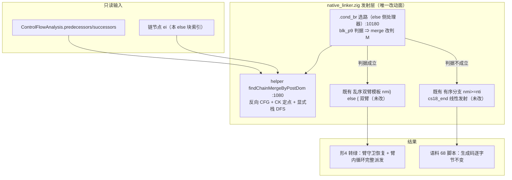
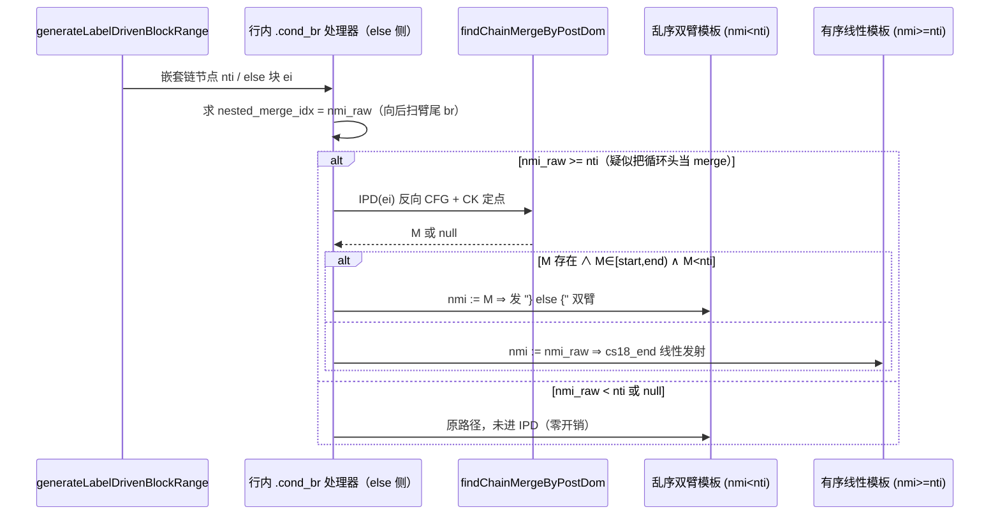
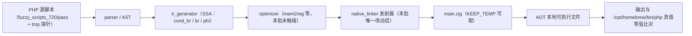
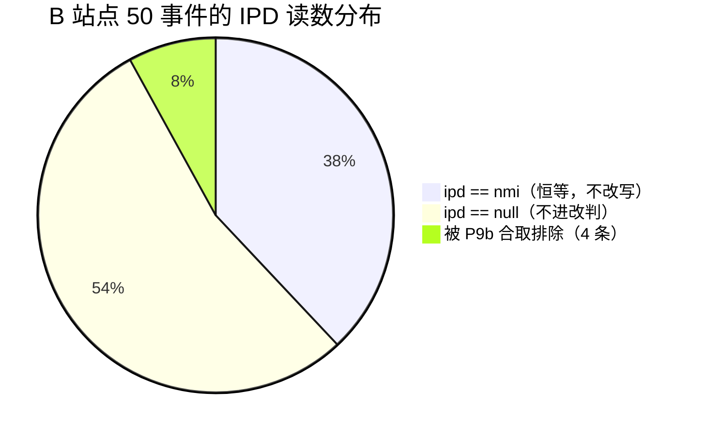

# AOT-CODEGEN-006 R9-B 批：链臂结构 merge（IPD）落地变更摘要

> 代次：`native_linker.zig` md5 `0e38b018b24b9ba0aa358f8d26a7f012` / 32796 行（vs D 批 `9490bf9f`/32663 行 `+134/−1`；vs HEAD `0ff09cf` 累计 `+385/−30`）
> 日期：2026-10-05 ｜ 工单：`docs/known-issues/AOT-CODEGEN-006-elseif-chain-arm-loop-lost.md`（§3.14 / §4.5 / §5 / §7）
> 状态：**工作区已落地，未暂存、未提交**（待「提交」指令）

---

## 1. 高层摘要（TL;DR）

elseif/else 链臂内嵌循环丢失（CODEGEN-006）的 B 类根因是：`.cond_br` 选路把「then 臂尾 `br` 进的循环头」误认成链的共享 merge（`nested_merge_idx`），于是走有序分支、以 `[nti, end_idx)` **线性吞掉兄弟 else 臂**，双臂退化为顺序代码 ⇒ 臂守卫坍缩。

本批用**图结构量**取代**块序启发**：新增只读 helper `findChainMergeByPostDom`，在【反向】CFG 上跑 Cooper-Harvey-Kennedy 定点（显式栈后序 DFS），求链节点 `ei` 的**直接后支配块（IPD）** = 该节点出发的全部路径必经首块 = 语义上的 merge。R9 影子轮实测该判据**绿语料命中面 0/68**、九形面仅 1（形 4），据此落地：判据成立时把 merge 由 `nmi` 改判为 `M`，选路交**下方既有**的 `nmi < nti` 乱序双臂模板 ⇒ 不新增发射形态、不触碰 IR/optimizer、不需重冻结基线。

结果：**本单门 `same=6` → `same=7`（形 4 转绿、无新红）**，全量漂移逐字节 `diff=0`（硬零门），官方 68 回归 `PASS 67 / SKIP 1 / FAIL_* = 0`，`zig build test` 326/326，编译开销四脚本差值均在噪声内 ⇒ 非负向优化。

---

## 2. 影响范围

| 维度 | 读数 | 说明 |
|---|---|---|
| 受影响源码文件 | 1（`src/aot/native_linker.zig`） | helper 区 117 行 `:1073`–`:1189` + B 站点 17 行替换 1 行 `:10180`–`:10196` |
| IR / optimizer / runtime 模板 | **0** | 只读 CFG，不改 `Terminator`、不改 `runtime_lib_template.zig` |
| 冻结基线 | **无漂移**（`DRIFT_DONE total=68 ok=68 diff=0 notemp=0 norow=0`） | 判据的语料命中面实测为 0 ⇒ 68 个 `pass/` 脚本生成码逐字节不变 |
| 探针门 | 九形门 1 形转绿（4）；D 旁门/c005 17 形/RC-4/RC-5/do-while/ref001 逐门等于基线 | 唯一既有红点 `ref003_crash_attr_tmp` 归 REF-003，与本批无关 |
| 编译期开销 | 全语料 IPD 实际调用 **24 次**，最大帧 41 块 | 四脚本 real 秒 before/after 差 −0.09/−0.03/−0.04/−0.01 ⇒ 噪声内 |
| 未覆盖 | 形 7（`IPD=null`）、形 9（C 站点判据语料面 5/10） | 结构性无覆盖 / 判据不可落地，另立前置 |



---

## 3. 核心变更

| # | 变更点 | 位置（当前树实测） | 内容 | 性质 |
|---|---|---|---|---|
| 1 | 新增 IPD helper | `native_linker.zig:1080`（`:1073`–`:1189`） | 虚拟出口 `V = blocks.len`；反向图 children(`V`)=无后继块、children(`b`)=`predecessors`；显式栈后序 DFS 得反向 RPO；CK 定点 `ipd[b] = intersect(后继们)`，后继未定则跳过、无后继视作 `V`；`ipd[node] ∈ {NONE, V, node}` ⇒ 返回 `null` | 只读、零新增递归 |
| 2 | B 站点 merge 改判 | `native_linker.zig:10180`–`:10196` | 原 `if (nested_merge_idx) \|nmi\|` 绑定改名 `nmi_raw`，派生 `const nmi = blk_p9: {…}`：`nmi_raw >= nti ∧ M=IPD(ei) 存在 ∧ M∈[start_idx,end_idx) ∧ M<nti` ⇒ `nmi = M`，否则 `nmi = nmi_raw` | 两条分支体逐字未改 ⇒ 判据不成立时生成码逐字节不变 |
| 3 | 链节点取 `ei` | B 站点内 | `ei` 即持有 `nested_cb` 的 else 块索引，与影子轮的指针扫描读数逐字一致 ⇒ 零额外遍历 | 简化 |
| 4 | 懒计算守卫 | B 站点内 | IPD 仅在 `nmi_raw >= nti` 时求值 ⇒ 绿形（全部 `nmi < nti`）与 `nmi == null` 路径不进 IPD | 防负向优化 |
| 5 | 工单记账 | `AOT-CODEGEN-006-*.md` §3.14/§4/§4.5/§5/§7 | 代次链推进到 `0e38b018`/32796，行号映射规则（B 站点前 +117、后 +133）、门读数、覆盖边界、遗留四项、新待裁决行 | 文档 |



---

## 4. 可视化概览（Code & Logic Map）

### 4.1 分层



### 4.2 业务流程（本单语义）

```mermaid
flowchart TD
    S["elseif 链：if/elseif/else + 臂内嵌循环"] --> Q{"链 merge 判据"}
    Q -->|旧：块序向后扫臂尾 br| X1["误取循环头 for_cond_7 ⇒ 线性吞兄弟臂 ⇒ 臂守卫坍缩（形 4 红）"]
    Q -->|新：图结构 IPD(ei)| X2["取语义 merge if_merge_2 ⇒ 走乱序双臂模板 ⇒ 臂互斥恢复（形 4 绿）"]
    X2 --> V["生成码复证：} else { 内有 if (reg_7.toBool()) { 守卫 + __for_0: while(true){…break :__for_0;}"]
```

### 4.3 执行流程（判据命中面）



---

## 5. 详细变更分析

### 5.1 涉及文件清单

| 层 | 文件 | 变更 |
|---|---|---|
| 发射器 | `src/aot/native_linker.zig` | `+134/−1`（helper 117 行 + B 站点 17 替换 1） |
| 工单 | `docs/known-issues/AOT-CODEGEN-006-elseif-chain-arm-loop-lost.md` | 新增 §3.14、§4.5；§4 代次链推进；§5 门 1/1.1/2/3/4.1/5 补 R9-B 实测；§7 落地行 + 新待裁决行 |
| 永久探针（**勿删**） | `fuzzy_scripts_720/tmp/c006_tl_elseif_loop_tmp.php` 等九形、`c006_d_*` 双臂取臂面 | 本批复用，未改 |
| 门脚本 | `fuzzy_scripts_720/tmp/c006_tl_probe_run_tmp.sh`、`c006_d_probe_run_tmp.sh`、`c005_*`、`c005_full_drift_tmp.sh` | 本批复用，未改 |

### 5.2 R9 影子轮 → 落地判据的推导链（关键取证）

| 站点 | 读数 | 结论 |
|---|---|---|
| S10A/S10D（`merge_bi = blk_i` 处） | 631 事件（`ipd=null` 170）；374/375 与现口径逐字一致 | 既有 merge 判定**本身可信**，问题只在 B 站点 |
| S10B（B 站点，原 `:10063`） | 50 事件：`ipd==nmi` 19、`ipd=null` 27、分歧 4 条 | 4 条分歧逐条被合取排除（`f032` ipd>nti、`f044` ipd∉帧[20,21)、`f067` ipd>nti、`f124` ipd>nti）⇒ **语料面 0/68** |
| S10C（C 站点，形 9 相关） | 5 个通过脚本命中（f051/f056/f095/f102/f124） | 语料面 **5/10 ≠ 0** ⇒ 形 9 不落地（第五次同位置否证） |
| 九形 B 站点分解 | 绿 1/3/5/6/8：`node=2 ipd=3 nmi=3` ⇒ 恒等；形 4：`ipd=3 nmi=6(for_cond_7)` 帧[0,9) ⇒ 命中；形 7：`ipd=null` | 覆盖面精确 = 形 4 一形 |

### 5.3 门读数（两批串行门全绿，2026-10-05）

```text
c006_tl_probe_run_tmp      C006_TL_GATE_DONE  total=9 same=7 differs=2   ← 形4 转绿，红＝形 7/9
c006_d_probe_run_tmp       C006_D_GATE_DONE   total=2 same=2 differs=0
c005_probe_run_tmp         PROBE_DONE         total=17 same=17 differs=0
c005_rc4_probe_run_tmp     RC4_PROBE_DONE     total=4 same=3 differs=1   ← 唯一红点归 REF-003
c005_rc5_probe_run_tmp     RC5_PROBE_DONE     IDENTICAL
c005_dowhile_probe_run     DOWHILE_PROBE_DONE total=2 same=2 differs=0
ref001_probe_run_tmp       PROBE_DONE         same=1 differs=3           ← 等于 2026-09-30 登记基线
c005_full_drift_tmp        DRIFT_DONE         total=68 ok=68 diff=0 notemp=0 norow=0
官方 68 回归               TOTAL 68 / PASS 67 / SKIP 1(f004) / FAIL_COMPILE 0 / FAIL_RUNTIME 0 / FAIL_DIFF 0
确定性巡检                 SWEEP_DONE total=68 mismatch=0 notemp=0
基线抽查                   SPOT_DONE ok=5 bad=0
zig build test --summary   21/21 steps、326/326 tests
timeout 560 zig build      rc=0
插桩残留                   grep -cF S10 = 0、grep -c R9_DUMP = 0
```

### 5.4 编译开销实测（同机单轮 `--compile --no-debug-info`，real 秒）

| 脚本 | IPD 调用数 | 落地后 | D 批基线 | 差值 |
|---|---|---|---|---|
| `f044_json_deepops_merge_diff` | 1 | 10.52 | 10.61 | −0.09 |
| `f067_json_parser_schema_path_diff` | 1 | 12.59 | 12.62 | −0.03 |
| `f102_memory_gc_marksweep_refcount_gen` | 3 | 11.08 | 11.12 | −0.04 |
| `f173_concurrency_primitives_sim` | 1 | 12.65 | 12.66 | −0.01 |

---

## 6. 影响与风险评估

| 项 | 判定 | 依据 |
|---|---|---|
| 是否破坏式变更 | **否** | 判据不成立时 `nmi = nmi_raw`，两条分支体逐字未改 ⇒ 生成码逐字节不变；漂移门 `diff=0` 为直接证明 |
| 内存安全 | 无新增风险 | helper 内 `ControlFlowAnalysis` 由 `defer cfg.deinit()` 归还；局部数组走 allocator，无跨调用逃逸 |
| 递归/栈安全 | 显式栈 DFS，**不新增自递归** | 规避 AOT-CODEGEN-004（`generateLabelDrivenBlockRange` 自递归栈溢出）同类风险 |
| 性能 | 编译期：语料 24 次调用、差值噪声内；运行期：**零影响**（只改发射选路） | §5.4 实测 + 官方 68 `PASS 67` 无退化 |
| 确定性 | `mismatch=0` | IPD 是 CFG 的纯函数，不引入迭代序/时间依赖 |
| 主要风险点 | ①同形站点三处（`:9227`/`:9667`/`:10622`）未取数 ⇒ 后续若盲目对称改，可能引入语料漂移；②`nmi == null` 路径未接 IPD ⇒ 存在同类误 merge 可能仍未收；③IPD 无函数级缓存 ⇒ 高链密度脚本（数百链节点）会重跑 CK | 已登记 §7 待裁决 c/d/e |
| 特别注意 | 本批**只**覆盖三级链中「then 臂尾 `br` 进循环头被误当 merge」一种形态；形 7（臂守卫坍缩 + `ret` 出口）与形 9（C 站点帧平铺）**不得**宣称已修 | §3.14 覆盖边界 |
| 复测路径（体验流程） | `bash fuzzy_scripts_720/tmp/c006_tl_probe_run_tmp.sh` ⇒ 期望 `total=9 same=7 differs=2`；`bash fuzzy_scripts_720/tmp/c005_full_drift_tmp.sh` ⇒ 期望 `diff=0`；`ZIGPHP_AOT_KEEP_TEMP=1` 复取形 4 `main.zig` ⇒ 期望 `} else {` 内有 `if (reg_7.toBool()) {` 守卫与完整 `__for_0: while (true)` | 已实测通过 |

---

## 7. 遗留问题 / 潜在问题

| 优先级 | 事项 | 影响面 | 落地成本 |
|---|---|---|---|
| **P0（待裁决）** | 形 7：链节点 `IPD=null`（then 臂 `ret` ⇒ 仅虚拟出口后支配），结构 merge 路线无覆盖，需回到 §3.10「臂守卫坍缩」本体另立新判据 | 1 形 | 1 轮取证 + 视读数 |
| **P0（待裁决）** | 形 9：需 C 站点判据，R9 实测语料面 5/10 ≠ 0 ⇒ 按规约 (a) 不落地 | 1 形 | 1 轮新判据设计 |
| **P1（待裁决）** | 同形选路站点 `:9227`/`:9667`/`:10622` 是否对称改判（当前无读数） | 未测 | 1 轮合并插桩 ≈40 min |
| **P1（待裁决）** | `nmi == null` 共享 merge 路径是否接 IPD（`FIRE_NULLNMI` 语料面 0 ⇒ 保守不改） | 语料全路径，风险最高 | 1 轮插桩 + 硬零漂移门 |
| **P2** | IPD 函数级缓存（per-function memo，改动局限 helper 内） | 仅编译期，当前无实测退化 | ≈20 min |
| **P2** | 推广到 `generateIfFromLabels` 族同类站点 | 波及另一发射器家族 | 半天～1 天 |
| 既有 | #63 冻结基线与 11 个门脚本未入库；#40 REF-003 P0 止血；PERF-001 三项裁决；PROC-001 `.gitignore` 负向规则 | 跨工单 | 各自登记 |

---

## 8. 后续开发建议

1. **把「结构量替代块序」立为发射层原则**：`nested_merge_idx` 一类向后扫块的启发是 B 类缺陷的共同来源，建议后续所有 merge 判定统一走 IPD/DOM 类结构量（配 per-function 缓存），并在发射期加 `[AOT-CANARY]` 断言「链节点有且仅有一个 merge」，把这类坍缩变成编译期可观测。
2. **R10 取证轮建议**：形 7 用「臂守卫坍缩」侧的新命题（then 臂 `ret` 时链的第二级 `cond_br` 终止符为何不被派发），探针应装在**内联发射器的 terminator 分派**上（§3.10 结论），而非区间侧 —— 前四轮否证的共同原因是装错层。
3. **回归资产化**：九形门 + D 旁门并入官方 harness（现为独立门，防复发），并与修复批次同批落地以免官方 68 变红。
4. **语料增补**：补「三级链末节点取双臂」「臂内 for + 臂尾裸 break」「then 臂 ret 收尾」三形进 `pass/`，需重冻结基线（既有裁决项）。
5. **性能侧**：本批证明 IPD 路线成本可忽略，可继续推进 PERF-001 H1（全局按名寻址 ≈166 ns/迭代）的槽位化改造。
