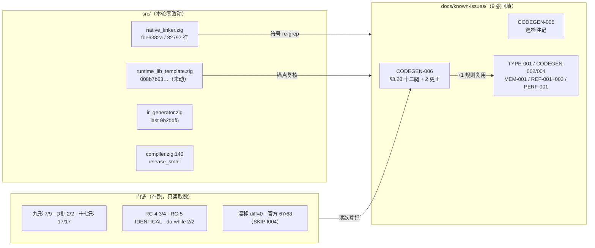
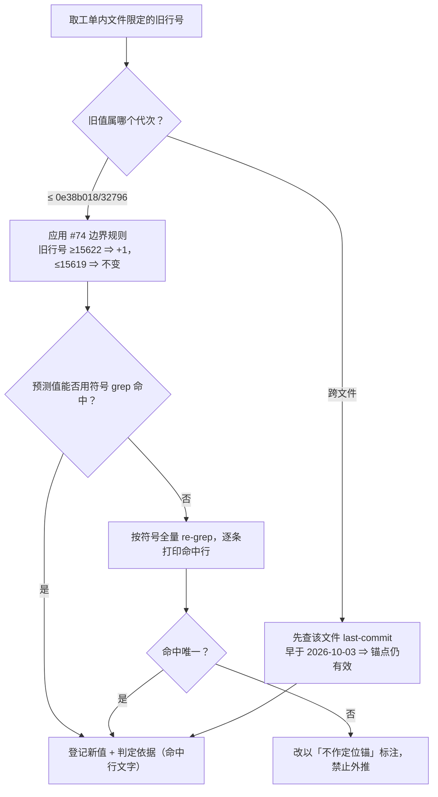
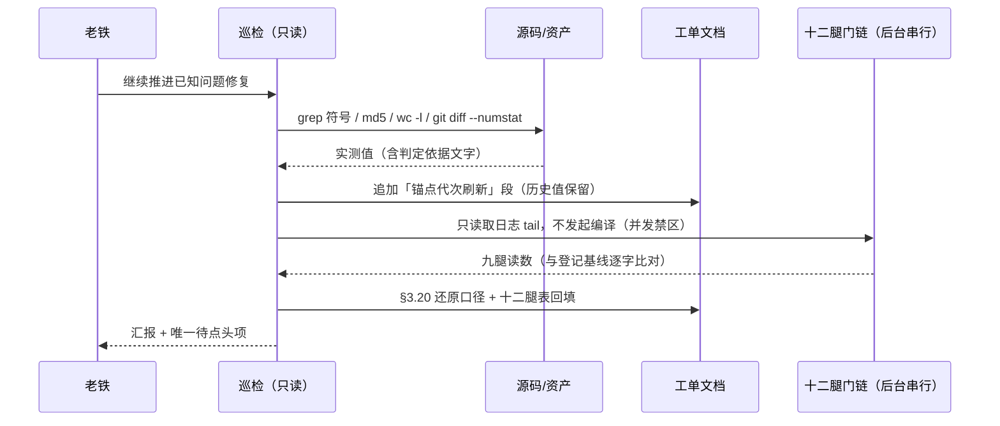

# 工单锚点与资产只读巡检（2026-10-05，代次 `fbe6382a`／32797 行）

## 1. 高层摘要（TL;DR）

本轮为**纯只读巡检 + 文档回填**：`src/` 一行未动（`native_linker.zig` 仍为工作区代次 `fbe6382a`、32797 行，`git diff --numstat` 恒为 #74 纯注释批的 `5 4`；`runtime_lib_template.zig` md5 全程 `008b7b639f1069cb73e443064e115ed1`），未启动任何 `zig build` 或 AOT 编译（十二腿门链在跑，属并发禁区，故本轮全部取证手段为读）。

做了四件事：

1. **建立并验证「#74 +1 边界规则」**：实测未提交的 #74 注释批 `git diff --numstat` = `5 4`（净 +1 行）；`-U0` 口径 hunk 为 `@@ -15620,2 +15620,3 @@` 与 `@@ -25597,2 +25598,2 @@`，`-U2` 口径逐行实读为 `@@ -15618,6 +15618,7 @@` 与 `@@ -25595,6 +25596,6 @@` ⇒ 第一段是**旧 `:15620`–`:15621` 两行注释被三行替换**，故规则为：**当前代次 vs 已提交的 `0e38b018`，旧行号 ≥ `:15622` 一律 +1，`≤ :15619` 未变**（`:15620`/`:15621` 这两个旧行号在新代次已指向别的文字，禁止直接引用）。规则以代表锚点双向复核（调用点 `:7452` 未变、`fn markReachableRestBlocks` 定义 `:25604 → :25605`、doc 注释起行旧 `:25595` → 新 `:25596`）。
2. **9 张工单回填当代次锚点 + CODEGEN-006 两处更正**：写「锚点代次刷新／代次再刷新」表的是 **8 张**（TYPE-001、CODEGEN-002、CODEGEN-004、MEM-001、REF-001、REF-002、REF-003、PERF-001），**第 9 处**为 CODEGEN-005 的新节「资产与锚点巡检注记」；**CODEGEN-006 不写「刷新」标题**（它落的是 §3.20「还原与十二腿门链」收尾段 + 两处更正，其锚点更新依据是既有的 §4.6 代次表）。全部按符号 re-grep 实测、附判定依据，历史值一律保留不改写。
3. **两处自证更正**：① CODEGEN-006 的「A 批未提交」状态行已失效（该批随 `497edc6` 提交），据实更正；② TYPE-001 的「致损形态发射点 0 处」原口径无实测支撑 ⇒ 改为形状限定表述（`reg_{d} = reg_{d}.toInt|toFloat|toBool` 直赋形态 = **0**，而 `reg_{d}.toInt()` 9 / `.toFloat()` 1 / `.toBool()` 11 处存在但均为包裹态或原生上下文）。
4. **资产与状态巡检**：39 项被引用的探针/门脚本 **38 在位 / 1 缺席**（缺席项 `c005_sh5_shadow_tmp.sh` 是一次性轮次脚本，按宪法「测试产物必须删除」逐轮清理，不属资产流失）；历史工单状态复核 —— CODEGEN-002/003/004/005 的 CLOSED 判据在本轮门链读数下仍成立，REF-001（D1）、REF-002（R-2/R-4/R-5/R-6）、REF-003（OPEN）、PERF-001（三项待裁）、TYPE-001（P2）维持待裁。

## 2. 影响范围

| 维度 | 影响 | 说明 |
|---|---|---|
| 编译器源码 | **零影响**（发射中性） | 未编辑 `src/**`，未编译；漂移腿 `diff=0` 从旁证二进制代次未变 |
| 已知问题工单 | **9 张**追加/更正 | 已跟踪 5 张（CODEGEN-002 `+17/−0`、CODEGEN-005 `+13/−0`、CODEGEN-006 `+199/−1`、PERF-001 `+22/−0`、TYPE-001 `+17/−0`）+ 未入库 4 张（CODEGEN-004、MEM-001、REF-001/002/003，追加在 untracked 文件内，`git diff` 不显） |
| 检索成本 | **下降** | 每张工单的当代次行号可直接查表，避免每轮重复 grep；`≥ :15622` 的 +1 规则一次说明、多单复用 |
| 一致性风险 | **消除 1 处误导** | CODEGEN-006 的「未提交」状态行会让后续判断把 #74 误当作 RC-5 的未落地部分 |
| 新增文档 | 1 份（本文件） | 无代码变更文档所需的编译/测试证据链，门链读数引用工单 §3.20 |
| 未触碰 | 语料、基线、门脚本 | 未重冻结基线；`regression_failures.tsv` 仍仅 1 行 `SKIP\|f004` |

## 3. 核心变更

| # | 变更 | 位置 | 类型 |
|---|---|---|---|
| 1 | 「锚点代次刷新」表：`writePtrAwareAssign :1090→:1333`、retain `:1133→:1376`、`writePhiAssignWithRetain :1139→:1382`、`generatePhiValueAssignment :18098→:18403`、`generatePhiAssignments :31727→:32032`，8 处调用点新值，7 处裸拷贝新值；计数复核（117 处调用、9 处 `= phi(...)`、15 处裸拷贝减去 8 处函数内 = 7） | `AOT-TYPE-001-fix-plan.md` | 追加 + 口径更正 |
| 2 | 结构化流转门/回退锚点刷新：`17397→17702`、门 `17507→17812`、回退 `17524–17528→17830–17832`（快照 `17819`）、`24574→24879`、`isMergeBlock 27193→27498`、修复① `27392→27697`、修复② `27475→27780`（两处以工单自身「AOT-CODEGEN-002 修复」注释为判定依据）；`:2375` 标注「不作定位锚」 | `AOT-CODEGEN-002-structured-cf-continue-bug.md` | 追加 |
| 3 | B-lite 站点刷新：`8075→8396`（内部区间 `8408–8415` / `8416–8420` / `8417–8419`）、兜底递归 `8178→8421`、函数边界 `7188–10651→7431–10936`、11 处同 `end_idx` 尾站点集合以 awk 过滤重导（计数与登记一致）；`:7257` 标注「未验证，禁止作锚」 | `AOT-CODEGEN-004-recursion-stack-overflow.md` | 追加 |
| 4 | mark-rest 三件套 `:7449/:7452/:7453` + 例程定义 `:25605`；「代次失效告警」在当前代次维持成立；`c005_sh5_shadow_tmp.sh` 缺席定性为一次性脚本；其余 55 处裸行号**明确免于逐条重测**（工单 CLOSED、永久门为 17 形探针，本轮 `total=17 same=17 differs=0`） | `AOT-CODEGEN-005-foreach-body-if-arms-lost.md` | 追加（新节「资产与锚点巡检注记」） |
| 5 | ① §3.20「还原与十二腿门链」由占位改为实测（还原四条自证 + 十二腿读数表，前九腿已录）；② 状态行更正（A/D/R9-B 已提交为 `497edc6`，工作区仅剩 #74）；③ §3.20 编译判据引用改为「`:16550`（判据行）⇒ `:16551`（写入行）」双行口径 | `AOT-CODEGEN-006-elseif-chain-arm-loop-lost.md` | 追加 + 两处更正 |
| 6 | 底账分配器 `1894→2137`（唯一 `smp_allocator` 命中）；S2/S3 模板锚点未漂移 | `AOT-MEM-001-phpstring-header-and-property-key-retention.md` | 追加 |
| 7 | `php_object_get_ref :3831→:4074`、静态属性发射 `23949/23954→24254/24259`；模板 `:20310` 与 `ir_generator :4564` 未变（附各文件 last-commit 证据）；**口径更正**：§9 行 2 所引模板 `:7984`/`:25562` 落在 WHY 注释内，可执行的 `make_ref` 语句实为 `:7988`/`:25569`（与 REF-002 登记值一致） | `AOT-REF-001-container-ref-slot-dangling.md` | 追加 + 口径更正 |
| 8 | 迭代引用识别段 `5203–5241→5446–5484`（含子行 `5453–5459`、`5465–5473`、挂载 `5481/5483`）、消费点 `19602→19907`；模板 `7988/25569` 与 `ir_generator 2993–3001` 未变；自校正一处旧值笔误（`5240`，非 `5440`） | `AOT-REF-002-iter-ref-slot-dangling.md` | 追加 |
| 9 | `copyRuntimeLib 32378→32512`、模板路径 join `32393→32527`、站点② `14828–14838→14961–14971`、站点① `16416–16420→16550–16554`、谓词 `951/959` 未变；§11.2 builtin 段 `4273–4282→4391–4399`，并以 `grep -c` **实测 = 0** 复确认「死登记状态未变」 | `AOT-REF-003-byref-iteration-liveset-and-iterator-relocation-crash.md` | 追加 |
| 10 | 以 #74 +1 规则逐项复测：三处 `setSourceLocation 19687/20775/23172`、状态机 `19280/31999`、200KB 门 `32446`、**否决位更正为六枚**（`17725–17730`，§8.4 漏记 `has_foreach`）、AST-direct 门 `17772`（条件**不含** `!has_recursive_call`）/ 调用 `17776`、结构化门 `17817` / 调用 `17825`、`copyRuntimeLib 32512/32527`、站点② 与 `fn generateForFromLabels :13268`、`fn generateWhileFromLabels :15034` **未变**；并登记「§4 H3 行的处置」取代旧值 `19436/20524/22921` | `AOT-PERF-001-默认优化档位与函数级状态机回退.md` | 追加 + 漏记更正 |

## 4. 可视化概览

### 4.1 分层与取证面（Code & Logic Map）

### 4.2 单锚点刷新流程（本轮统一口径）

### 4.3 上下层时序（取证 → 登记 → 门链）

## 5. 详细变更分析

### 5.1 端 / 层

| 层 | 本轮动作 |
|---|---|
| 数据层（工单文档） | 9 张追加/更正，均为**新增段落**，历史读数不覆写（历史误读记录按既有纪律保留并加注） |
| 业务层（取证方法） | 统一为「符号 grep → 命中行文字 → 判定依据」三段式；跨文件锚点先查 last-commit 再判有效性 |
| 端（编译器发射） | 未触达 |

### 5.2 涉及文件列表

| 文件 | 状态 | 本轮变化 |
|---|---|---|
| `src/aot/native_linker.zig` | M（#74 注释批 `5 4`） | 仅读取与 grep 复测 |
| `src/aot/runtime_lib_template.zig` | clean | 仅 md5 复核 |
| `src/aot/ir_generator.zig` / `compiler.zig` / `ir.zig` | clean | 仅 last-commit + 锚点复核 |
| `docs/known-issues/AOT-CODEGEN-006-elseif-chain-arm-loop-lost.md` | M | §3.20 十二腿回填 +2 段、状态行更正、判据双行口径 |
| `docs/known-issues/AOT-CODEGEN-005-foreach-body-if-arms-lost.md` | M | 新节「资产与锚点巡检注记」（`+13/−0`） |
| `docs/known-issues/AOT-TYPE-001-fix-plan.md` | M | 刷新表 + 致损形态口径更正（`+17/−0`） |
| `docs/known-issues/AOT-CODEGEN-002-structured-cf-continue-bug.md` | M | 刷新表（`+17/−0`） |
| `docs/known-issues/AOT-PERF-001-…状态机回退.md` | M | §8.5 代次再刷新 + §4 H3 处置（`+22/−0`） |
| `docs/known-issues/AOT-CODEGEN-004-…md`、`AOT-MEM-001-…md`、`AOT-REF-001/002/003-…md` | untracked（属 PROC-001 待入库队列） | 各追加刷新段 |

### 5.3 变更点描述（关键实测值）

- **#74 边界规则**：`git diff --numstat` = `5 4`；`-U2` 实读两段 hunk = `@@ -15618,6 +15618,7 @@`（旧 `:15620`–`:15621` 两行注释 → 三行）与 `@@ -25595,6 +25596,6 @@` ⇒ **旧行号 ≥ `:15622` +1、≤ `:15619` 不变**；实例 `:7452` 不变、`:25604→:25605`、doc 注释起行 `:25595→:25596`。
- **CODEGEN-006 出口判定区**当代次逐行：`:14923` 位置支、`:14951` 增量标签支、`:14961` `in_cond_br_branch` 交还支（`:14970 return exit_idx`）、`:14977 processed.put` + `:14978–:14981` 指令发射、`:14996–:15021` `.br` 处理（`:14999–:15003` `target_is_loop_header`、`:15005–:15010` 指针匹配）、`:15026 return exit_idx + 1`。§4.7 插入点「`:14975` 与 `:14977` 之间」经实文复测**成立**（`:14975` 为增量标签支的 `}`）。
- **三侧记录器不对称**（形 9 根因面）：foreach 无条件记录 `:12812–:12814` + 走查器帧内停走 `:7471–:7477`；for 仅 `:14923` 或 `:14951`+`:14961`；while 仅 `:16550`⇒`:16551`；**三者皆不跟随 exit 块的 `.br`**。消费者已存在：`:8865–:8895`（五条 `lfi_is_join` 判据在 `:8871`）。
- **资产巡检**：38/39 在位；`isLoopHeadLabel` 定义实测 `:25641`；`findChainMergeByPostDom :1080`、`isOuterLoopLatch :951`、`findExitEdgeSourceIdx :959` 未漂移。
- **残留风险量化**（非猜测）：各单裸 `:NNNN` 引用数 —— CODEGEN-006 181、REF-003 76、CODEGEN-005 56、REF-002 40、CODEGEN-004 31、REF-001 28、TYPE-001 15、PERF-001 14，其余 ≤ 3；本轮只对「文件限定 + 落地关键」的 25 个唯一锚点与 CODEGEN-006 的 14 个落地锚点逐条实测，其余以「代次失效告警 + #74 边界规则」兜底。

## 6. 影响与风险评估

| 项 | 评估 |
|---|---|
| 是否破坏式变更 | **否**。零源码改动、零编译、零产物；文档为纯追加与两处口径更正 |
| 影响范围 | 9 张工单可读性 + 后续取证定位速度 |
| 需特别注意 | ① **`+1` 规则有边界**：仅在「当前工作区 vs `0e38b018`」这一对代次间成立，#74 一旦提交或再插行即失效，须重取 hunk 几何；② 文档中「历史值」与「当代次值」并存，引用时**必须看段落标题的代次标注**；③ `AOT-CODEGEN-004` 的 `:7257`、`AOT-CODEGEN-002` 的 `:2375` 已明确标注**不可作定位锚**；④ REF-001/REF-002 的模板锚点差异是「注释行 vs 语句行」之差，取用一律以 REF-002 的 `:7988`/`:25569` |
| 复测路径（体验流程） | ① `grep -ln '锚点代次刷新\|代次再刷新\|资产与锚点巡检' docs/known-issues/*.md` ⇒ **命中 9 个文件**（TYPE-001、CODEGEN-002/004/005、MEM-001、REF-001/002/003、PERF-001）；② `grep -n '还原与十二腿门链' docs/known-issues/AOT-CODEGEN-006-*.md` ⇒ 命中 §3.20 收尾段（CODEGEN-006 本身不写「刷新」标题，它落的是十二腿表 + 两处更正，故不计入①）；③ `md5 -q src/aot/native_linker.zig` = `fbe6382a…`、`wc -l` = 32797、`git diff --numstat src/aot/native_linker.zig` = `5 4`；④ 十二腿读数见 CODEGEN-006 §3.20 表 |

## 7. 遗留 / 潜在问题

1. **裸行号未逐条刷新**（有意决策，已量化）：约 400 处 `:NNNN` 裸引用中仅 39 处实测；若某张工单重新开工，其落地锚必须按 §4.2 流程重取。
2. **8 张工单未入库**（实测 `git status --porcelain docs/known-issues/` 的 `??` 行：`AOT-CODEGEN-003`、`AOT-CODEGEN-004`、`AOT-MEM-001`、`AOT-PROC-001`、`AOT-REF-001`、`AOT-REF-002`、`AOT-REF-003`、`AOT-RUNTIME-001`）⇒ 本轮追加的刷新段有 **5 处写进了 untracked 文件**（CODEGEN-004、MEM-001、REF-001/002/003），若发生 `git clean -fd` 将连文档一起丢失（该路径已有 PROC-001 登记过一次真实丢失）；**待「提交」指令**。
3. **门链后三腿未收**（确定性巡检 / 基线抽查 / `zig build test`）：读数待补入 §3.20 表第 10–12 行。
4. **`/private/tmp` 取证残留**：`r15_*` 脚本与日志、`nl_r15_backup.zig`、两个陈旧 `.zigphp_aot_build_73554/73612` 目录尚未清理（门链未完，暂留备份作还原对照）。
5. **形 9 修复仍未落地**：R15 读数支持落地，但 §4.7 三处改动属发射侧，**未获「落地」指令前禁止动手**；坑 4（交还后兄弟臂发射）只能以九形门 stdout 判定。

## 8. 后续开发 / 优化建议

| 优先级 | 建议 | 影响面 | 落地成本 |
|---|---|---|---|
| **P0** | 待门链三腿收口 → 回填 §3.20 表第 10–12 行 → 按宪法清理 `r15_*` 产物与两个陈旧 build 目录（保留 `nl_r15_backup.zig` 至提交为止），零 `.php` 删除 | 取证卫生、防误删 | 极低（1 轮，无编译） |
| **P0** | #81 落地批（待点头）：按 §4.7 模板插入「一跳记录」+ for 侧「帧内停走」成对改动；验收 `same=8 differs=1`（形 9 转绿、形 7 仍红）+ 十二腿等值登记基线；若形 9 转为「臂丢失」即判第十次否证并回滚 | 形 9 一类真实语料（臂顺序执行） | 中（1 次 `zig build` + 十二腿 ≈50 min） |
| **P1** | 把「工单锚点必须带代次标注 + 边界规则须实测 hunk」写入 `constitution/PART3_DEVELOPMENT.md`，并把本轮的「命中行文字作判定依据」定为强约束 | 全部后续工单取证质量 | 低（纯文档） |
| **P1** | 将 9 张工单的「刷新表」收敛为单一 `docs/known-issues/ANCHOR_REGISTRY.md`（按符号为键、代次为列），避免每批提交后 9 处重复回填 | 检索一致性、DRY | 低-中（一次性汇总 + 后续每批只改一处） |
| **P2** | 提交 #74 与 untracked 资产（含 160 枚探针、11 个门脚本、冻结基线）——需「提交」指令 | 防资产流失（PROC-001 已登记一次真实丢失） | 低 |
| **P2** | 形 7（`c006_tl_fncontext_loop_tmp`）另案：其 `for` 子生成器从未进入出口判定区（R15 事件数 0）⇒ 属 §3.10 臂守卫坍缩命题，需独立取证轮，不与 #81 混做 | 九形门最后红点 | 中（1 轮插桩取证） |
| **P2** | 三处「① 记录支」同形代码（foreach `:12812`、for `:14961`、while `:16551`）收敛为共用 helper，与 `findExitEdgeSourceIdx` 同一风格；须独立成批并以十七形 + 九形等值门自证发射中性 | DRY、后续维护 | 中（发射侧重构，风险中等，须全门） |
