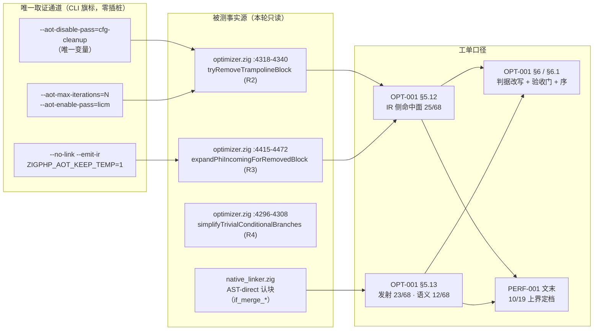
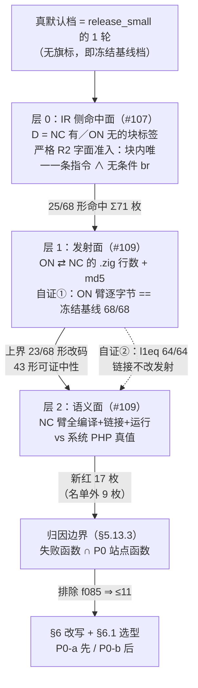
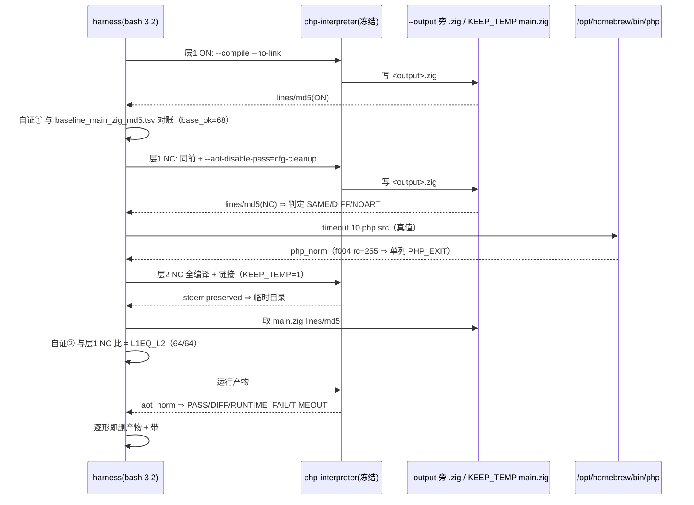

# §6 P0 判据的落地前三面影子实测（#106 输出侧 `nc` 面 ／ #107 IR 侧命中面 ／ #109 真默认档生成码 + 运行面）

**工单**：[AOT-OPT-001](../../known-issues/AOT-OPT-001-licm-multi-iteration-silent-wrong-values.md) §5.10.1／§5.12／§5.13／§6／**新增 §6.1**；[AOT-PERF-001](../../known-issues/AOT-PERF-001-默认优化档位与函数级状态机回退.md) 文末更新日志
**日期**：2026-10-06　**任务号**：#106／#107／#109（harness 内自记轮次 #104／#107／#109）
**性质**：只读实测、零插桩、**零源码改动**、非门控　**代次戳**：`optimizer.zig` `252234ef…`/6877、`native_linker.zig` `fbe6382a…`/32797（numstat `5 4` = #74 纯注释批）、`ir_generator.zig` `cb53c2da…`、冻结二进制 `1f15e4ce…`（**未重建**，收尾逐枚复验等值）

---

## 1. 高层摘要（TL;DR）

老铁，这三轮只做一件事：**在动手改一行代码之前，把 §6 P0（收紧 `cfg_cleanup` 删块判据）的代价量到三面**。结论是一条**否证**加一条**翻转**：

1. **否证**：§6 主修行原来挂着一条论据 —— 「默认档本环从不触发（`optimizer.zig:4319` 已挡）⇒ 理论上发射中性、冻结基线不动」，这是 P0 唯一「不动基线」的理由。#107 在 **IR 侧**把它打掉（真默认档 **25/68** 形命中判据、Σ71 枚 `phi`），#109 在**发射侧 + 语义侧**给出定价（发射上界 **23/68**、语义风险上界 **12/68**、反向 **43 形可证逐字节不变**）。⇒ P0 的验收门 ②「默认档 68 回归 + `DRIFT_DONE diff=0`」**按字面不可能通过**，已改写为三条子门 + 新增一条发射侧诊断门。
2. **翻转（本轮最重要的一条）**：同一枚 `--aot-disable-pass=cfg-cleanup`，在「≥2 轮 × 19 枚红形」面上**新转绿 10 枚、零新红**；在「真默认档 × 68 语料」面上**新红 17 枚**（3 砸编译 + 3 运行崩含 SIGSEGV `f178` + 10 输出错值 + 1 超时），其中 **9 枚在 #94 红名单之外**。⇒ 「把块留着」在基线档**不是保守动作**，「关/绕 `cfg_cleanup`」这条旁路的**符号由档位决定**，两个方向都不能当逃生口。
3. **收益（省下的钱）**：10/19 这个因果上界现在在**轮 2／轮 3／轮 5／`release-fast` 四处同数**，且在**签名侧与输出侧同时成立** ⇒ PERF-001 的任何档位提案可以直接引用它作为固定天花板；P0 判据**不需按轮数分档写**。
4. **序（新增 §6.1）**：发射侧「静默改可见」诊断（P0-a）**零 CFG 改动 ⇒ 结构性零新红风险**，删块判据（P0-b）**碰 CFG**。⇒ 建议 **P0-a → P0-b → 再谈抬档**。**三轮均未获动手许可，门控状态不变。**

**成本（全部实测，非估算）**：#106 `452s`／38 臂 ⇒ **11.9 秒／臂**；#107 `4s`／125 条双臂计数 ⇒ **0.03 秒／臂**（本单最廉价通道）；#109 `724s`／68 形（两层三臂 + PHP 真值）⇒ **10.7 秒／形**。

---

## 2. 影响范围

| 范围 | 影响 | 等级 |
|---|---|---|
| `docs/known-issues/AOT-OPT-001…md` | §5.10.1（由「未闭合」改记为**已闭合**）、§5.12（新建，#107 三面读数 + 口径演化 + 5 条禁令）、**§5.13（新建，#109 两层读数 + 4 子节）**、§6 主修行**按实测重写**（删掉被否证论据、验收门 ② 拆三条、新增门 ③）、**§6.1 新建**（选型建议表）、§7 新增 10 枚资产行、更新日志 2 条 | 文档面 |
| `docs/known-issues/AOT-PERF-001…md` | 文末新增一条更新日志块（三面收口 → 给「先修 P0 再抬档」这条序预付的代价、旁路在基线档亦否决、硬依赖定为档位无关常量、P0-a/P0-b 可执行拆分） | 文档面 |
| `fuzzy_scripts_720/tmp/` | 新增永久资产 **10 枚**（3 支 harness + 1 支分析器 + 6 份落盘/归档），全部禁删 | 资产面 |
| `src/`（编译器） | **零改动**（四枚戳逐枚复验等值、二进制未重建、`git status --short src/` 仅 ` M src/aot/native_linker.zig` = #74 纯注释批） | 无 |
| 语料 / `.php` 源 | **零删除、零改动**（`fuzzy_scripts_720` = 375、仓库全局 = 573、`pass` 语料 = 68，收尾复验） | 无 |
| 运行时行为 / 生成码 / 冻结基线 | **未触碰**（P0 未落地 ⇒ 基线仍逐字节有效；`base_ok=68 base_miss=0` 反而**再坐实一次**基线） | 无 |

⚠ **破坏式判定**：本批**非破坏式** —— 无一行产品代码改动、无一次基线重冻结。它改变的是**下一步修复的定价与顺序**，因此对 §6 的文本是破坏式的（一条写死的论据被删）。

---

## 3. 核心变更

| # | 变更 | 旧口径（已作废/加限） | 新口径（实测） |
|---|---|---|---|
| 1 | §6 P0 主修行的「影响面」格 | ~~「默认档本环从不触发 ⇒ 理论上发射中性、冻结基线不动」~~ | IR 侧 **25/68**（Σ71）＋ 发射上界 **23/68** ＋ 语义风险 **12/68**（排除 `f085` ⇒ ≤11）＋ 可证中性 **43 形** |
| 2 | §6 验收门 ② | 「默认档 68 回归 + `DRIFT_DONE diff=0`」 | 三条：**(a)** 默认档 68 输出回归逐枚对系统 PHP 真值绿（硬门）／**(b)** `diff=0` **只对 `rt=0` 的 43 形**／**(c)** 其余 ≤23 形逐枚登记 + **定向重冻结** |
| 3 | §6 验收门（新增 ③） | 无 | 落地批必须同批给出「保留臂块 ⇒ 发射侧 `unprocessed blocks: if_merge_*`」诊断，否则拦删风险以**静默砸编译**显形 |
| 4 | P0 判据本体 | 「若 `phi` 存在以该块为入边、**且取值与其它入边不同** ⇒ 拒删」 | 补两条改写：①「与其它入边不同」在本语料三面 `causeless=0` ⇒ **恒真谓词**（要么删这半句、要么保留并注恒真）；②取数必须在 `expandPhiIncomingForRemovedBlock` **改写之前** |
| 5 | `#103` 遗留的「未闭合半边」 | 轮 2/3 的**输出侧** `nc` 面未测 | **#106 闭合**：判定面 19/19 与轮 5 逐名等值、`GREEN_BY_CLOSING_CFG=10` 四处同数、残留 8 枚正合预期 |
| 6 | 「关 `cfg_cleanup`」的安全性 | ≥2 轮红形面上「新转绿 10、零新红」 | 加限定：**该结论只在 ≥2 轮红形面成立**；基线档 68 语料上同旗标**新红 17** ⇒ 符号翻转，禁止跨档搬用 |
| 7 | 「发射侧对 `cfg_cleanup` 硬依赖」 | `release-fast` 首见、轮数无关 | **档位无关常量**（真默认档 1 轮同样砸编译）＋ 第三枚形 `f085` |
| 8 | §6 两行的动手次序 | 「同批并列」 | **§6.1 新表**：P0-a 发射侧诊断（零 CFG 改动）→ P0-b 删块判据（碰 CFG） |
| 9 | 漂移判定口径 | 存在按行数的比较 | **一律走 md5**：#109 实测 `f028` 两臂同 24,741 行而 md5 不同 ⇒ 行数口径会漏检 |
| 10 | `eff` 分母口径 | `NO_TEMP` 混装两种成因 | 新增 `CFAIL_NO_TEMP`（链接前即失败 ⇒ 根本没有 `main.zig`），实测恰为 `f124`/`f134` |

---

## 4. 可视化概览（Code & Logic Map）

### 4.1 分层：取证通道 → 优化器/发射侧事实 → 工单口径

### 4.2 业务流程：P0 判据落地前的「三面定价」漏斗

### 4.3 执行流程：#109 单层单形的时序（含三条自证取数点）

### 4.4 逻辑映射：读数 → 源码锚点（不改代码，只标注证据落点）

| 读数 | 锚点（实文，代次 `252234ef`/6877） | 用途 |
|---|---|---|
| R2 的字面准入 = 「跳板形」定义 | `optimizer.zig:4319` `instructions.items.len != 0 ⇒ return false`、`:4323` `term != .br ⇒ return false` | #107 严格口径的当量：终止符是独立字段 ⇒ IR 文本上 = 块内唯一一条指令且为无条件 `br` |
| 判据取数时点 | `optimizer.zig:4415-4472`（R3 改写 phi 入边） | P0 的「与其它入边不同」谓词**必须**在此之前取，否则入边已被改成同源、判据失明 |
| 恒真谓词 | 同上（R3 把双入边改成**同一前驱**） | `causeless=0` 的机制解释：改写后不可能出现「D 入边与他边等值但结构不同」的样本 |
| `unprocessed blocks: N:if_merge_*` | `native_linker.zig` AST-direct 生成器（门 `:17772`/调用 `:17776`，见 PERF-001 §8.5） | 三枚 `COMPILE_FAIL` 的失败形态 ⇒ 门 ③ 的取证依据 |

---

## 5. 详细变更分析

### 5.1 按层

| 层 | 变更 | 文件 |
|---|---|---|
| 文档（工单口径） | §5.10.1 闭合、§5.12 新建、§5.13 新建（4 子节）、§6 主修行重写 + 门 ② 拆三条 + 门 ③ 新增、**§6.1 新建**、§7 加 10 枚资产行、更新日志加 2 条、头部任务线与累计轮数刷新 | `docs/known-issues/AOT-OPT-001-licm-multi-iteration-silent-wrong-values.md`（881 行） |
| 文档（跨工单） | 文末更新日志块（三面收口 → PERF-001 的四条直接后果） | `docs/known-issues/AOT-PERF-001-默认优化档位与函数级状态机回退.md`（376 行） |
| 取证通道（新增） | 3 支 shell harness + 1 支 python 分析器 | `…/tmp/opt001_roundcfg_out_tmp.sh`、`opt001_droppedphi_face_tmp.sh`、`opt001_droppedphi_tmp.py`、`opt001_defaultlevel_emission_tmp.sh` |
| 落盘证据（新增） | 6 份表/归档（含 2 份**作废宽口径**归档，保留禁删、禁止引用其数） | `opt001_roundcfg_out_tmp.tsv`(+`.smoke2`/`.rec`)、`opt001_droppedphi_face_tmp.tsv`(+`.r1-round2-full`/`.r2-round2-stricttramp`/`.r3-defaultlevel-stricttramp`/`.rec`/`.superseded-loose-defaultlevel`)、`opt001_defaultlevel_emission_tmp.tsv`(+`.r1-full-68`/`.rec`) |
| 数据层 | 无（未写任何 `.php` 源、未动 `pass/` 语料、未动 `baseline_main_zig_md5.tsv`） | — |

### 5.2 关键读数（逐枚，供引用）

**#106（输出侧 `nc` 面，19 形 × 2 臂 = 38 臂）**
`ROUND_OUT_DONE total=19 compile_fail=4 php_exit=0 rows=38`／`arm r2nc: PASS=11 DIFF=5 TIMEOUT_10S=1 COMPILE_FAIL=2`（`r3nc` 同）／`eff: EFFECTIVE=16 NO_EFFECT=1 NO_TEMP=0 CFAIL_NO_TEMP=2`／`GREEN_BY_CLOSING_CFG r2nc=10 r3nc=10`／`NEWLY_RED_vs_CTRL = <空>`。
计划外新读数：**`nc` 轴自身幅值面** `r2nc ≠ r3nc` 的形 = {`f061`,`f135`,`f171`,`f176`}，而 `r3nc ≡ li5nc` 在 17 条可读臂上逐字节全等 ⇒ **仍在轮 2→3 漂移的形集合随 `cfg_cleanup` 轴移动**（与控制侧 {`f117`,`f124`,`f171`,`f176`} 只交两枚）⇒ **禁止把控制臂的「四枚用轮 3」名单搬到 `nc` 臂**。

**#107（IR 侧 P0 命中面，三面严格读数）**

| 面 | 形 | `tramp>0` | **`refuse_tramp>0`** | Σ`tramp` | Σ`refuse_all` | Σ`refuse_tramp` | Σ`causeless` | Σ`phi_in_D` |
|---|---|---|---|---|---|---|---|---|
| 轮 2 + `licm`（红形） | 19 | 18 | **17** | 182 | 278 | 69 | **0** | 21 |
| 轮 2 + `licm`（语料） | 68 | 54 | 30 | 283 | 659 | 104 | **0** | 23 |
| **真默认档**（语料） | 68 | 52 | **25** | 209 | 621 | 71 | **0** | 1 |

**#109（真默认档两层，68 形）**
层 1：`l1_same=15 l1_diff=50 l1_noart=3`、`base_ok=68 base_miss=0`、ΣΔ = **−4,677**、Σ|Δ| = 6,237、负 24／正 25／**Δ=0 而 md5 异 1**（`f028`）。
交叉表：`DIFF∧rt>0` **21** ＋ `NOART∧rt>0` **2**（`f085`/`f124`）＋ `SAME∧rt>0` **2**（`f037`/`f160`）= 25；`DIFF∧rt=0` 29、`SAME∧rt=0` 13、`NOART∧rt=0` 1 ⇒ **`rt=0` 共 43 形**。
层 2：`pass=50 diff=10 runtime_fail=3 compile_fail=3 timeout=1 php_exit=1`、`l1eq_ok=64 l1eq_neq=0`、`L2_RED_NC_PASS=11/19`。
归因：`f085` `RTree::insertNode` ⇄ 唯一站点 `GeoCoder::findNearby` ⇒ **不相交**；`f124` `ContainerOrchestrator::autoscale`，6 枚站点中 2 枚同函数但汇合块不同 ⇒ **未定**；`f134` `rt=0` ⇒ **不可归因**。

### 5.3 三条禁令（新立，禁再犯）

1. **禁**把 #109 的 21/23 读成 P0 面值 —— NC 关**整条** pass，远宽于 P0 的「跳板形 ∧ 异值入边」⇒ 只能给上界。
2. **禁**把 `P0_FREE`（`f037`/`f160`，整 pass 关闭逐字节不变）写成证明 —— 部分关闭 ⇏ 整体关闭的行为。
3. **禁**跨档搬用「关 `cfg_cleanup` 是保守动作」—— 符号由档位决定（≥2 轮 = 修复向，基线档 = 破坏向）。

---

## 6. 影响与风险评估

| 维度 | 评估 |
|---|---|
| 是否破坏式 | **对外部行为否**（零源码改动、零重冻结）；**对 §6 文本是**（一条论据被删、一条门被拆成三条、新增一条门与一张序表） |
| 影响范围 | 仅 OPT-001 §6 的修复口径与 PERF-001 的裁决材料；`release_safe`/`release-fast` 的定价结论**不变** |
| 需注意点 ① | P0 若落地 ⇒ 它**无条件作用于基线档**，`rt=0` 的 43 形之外没有「不动基线」的保证；定向重冻结名单上限 23 枚 |
| 需注意点 ② | 「发射侧对 `cfg_cleanup` 的硬依赖」已定为**档位无关常量** ⇒ 拦删类改动必须以**同批诊断**为前提，否则风险以静默砸编译显形 |
| 需注意点 ③ | 漂移判定一律 md5（`f028` 实证行数口径漏检）；跨 harness/跨表对账用**全名**；awk 明细列带 `key=` 前缀时**先 `sub` 再比较** |
| 需注意点 ④ | 归因仍有 11 枚 `UNDETERMINED`（`rt>0 ∧ 非绿` 减去已排除的 `f085`）⇒ P0 的真实语义风险面**目前只有上界，没有面值** |
| 复测路径（体验流程） | ①`SKIP_LAYER2=1 bash fuzzy_scripts_720/tmp/opt001_defaultlevel_emission_tmp.sh` ⇒ 层 1 秒级，看 `DEFLEM_DONE` 与七张交叉表；②`ONLY='^f016\|^f061\|^f085' bash …` ⇒ 定点复算（落 `.rec`，**跑完立刻 `cp` 归档**，`.rec` 每次整体重写）；③`LICM=0 FACES="corpus" bash opt001_droppedphi_face_tmp.sh` ⇒ 复现 #107 的 25/68；④`bash opt001_roundcfg_out_tmp.sh` ⇒ 复现 #106 的 38 臂 |

---

## 7. 遗留 / 潜在问题

| # | 遗留 | 状态 | 成本 |
|---|---|---|---|
| 1 | **#110 逐枚归因协议（非门控，可下轮做）**：对 `rt>0 ∧ 非绿` 的 11 枚做「NC ⇄ ON 的 `main.zig` 按顶层 `fn` 区间取 md5 ⇒ 漂移函数集合 ∩ P0 站点函数集合」，不相交判 `NOT_P0_ATTRIBUTABLE`、相交判 `UNDETERMINED` | 协议已写（§5.13.4） | 2 × 12 秒／形 ≈ 4.5 分钟 |
| 2 | `f124` 型**同函数不同汇合块**无法由只读通道判定（`UNDETERMINED`）⇒ 需门控插桩轮 | 等裁决 | — |
| 3 | 迭代定点**未证**：`f113`/`f171` 到轮 4 生成码仍变 | 已登记（#101 §5.8.6） | 需 ≥6 轮或插桩 |
| 4 | #104 逐枚拆分（3 枚不可 CLI 字段）需改 `optimizer.zig` 预设 | **门控**，协议已交付（§5.11） | 3 枚 × 3 臂 ≈ 10 分钟 |
| 5 | `f085` 是**基线档红名单外**的形 ⇒ 若 P0 落地后它转红，属**新增**红，须与 #94 名单一起重排 | 待 P0 落地裁决 | — |

---

## 8. 后续开发 / 优化建议

| 优先级 | 建议 | 影响面 | 落地成本 |
|---|---|---|---|
| **P0-a（先做）** | 发射侧「静默改可见」诊断：`native_linker.zig` phi 臂拷贝路径加守卫 + 诊断，触发条件按 **C6／C9 自身结构**取数，**禁以 C1 为前置** | 零 CFG 改动 ⇒ 结构性零新红；覆盖面 17/19（含 `f061`/`f072`/`f134` 三枚 C1 全盲形）；同时是 P0-b 的前置可视化工具 | 小（一处守卫 + 一条诊断）；验收 = 最廉价饱和档（`--aot-max-iterations=2`）19 形面「错值 → 编译期报错」逐枚可枚举 |
| **P0-b（后做）** | R2 删块判据收紧（`optimizer.zig:4318-4340`），按 §6 两条改写（恒真半句处理、取数在 R3 之前） | 碰 CFG：发射上界 23/68、语义风险 12/68、43 形可证中性 | 判据小、验收大（三条门 + ≤23 枚定向重冻结 + 与 P0-a 同批诊断）；⚠ **序不能反** |
| **P1** | 先跑 #110 归因轮把 P0-b 的 12 枚风险**定面**再裁决（把「上界」换成「面值」） | 直接决定 P0-b 是否需要逐枚白名单 | 非门控、只读，≈4.5 分钟 |
| **P1** | 冻结基线表加一列 `refuse_tramp`，让 `DRIFT_DONE` 天然区分「可证中性 43」与「需登记 ≤23」 | 未来任何 IR 判据类改动的验收成本一次性下降 | 小（表结构 + 一次生成） |
| **P2** | 把「跨档符号翻转」写进 `optimizer.zig` 的 `cfg_cleanup` 注释块（纯注释批，发射中性自证，走 #74 通道） | 防止后来者把 `--aot-disable-pass=cfg-cleanup` 当逃生口 | 极小（注释） |

**门控声明**：本批三轮**未获任何动手许可**，OPT-001 §6/§6.1 的 P0-a、P0-b，P1，PERF-001 §7 三项裁决，#104 开轮，REF-003 #40，CODEGEN-006 #81/#84 —— **全部仍等老铁点头**；本批亦**未提交**（#74 纯注释批 `fbe6382a`/32797 仍未入库）。
