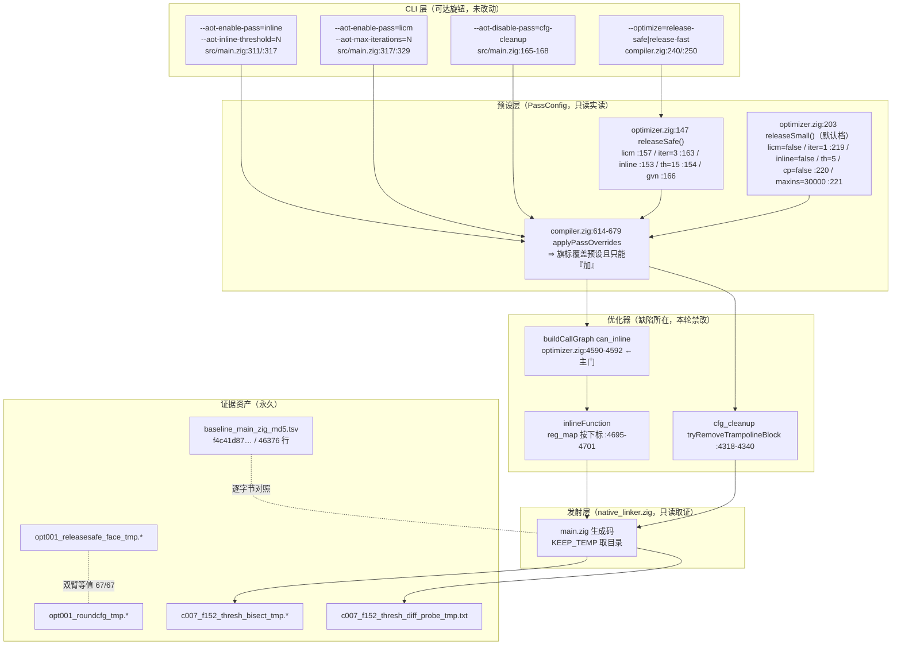
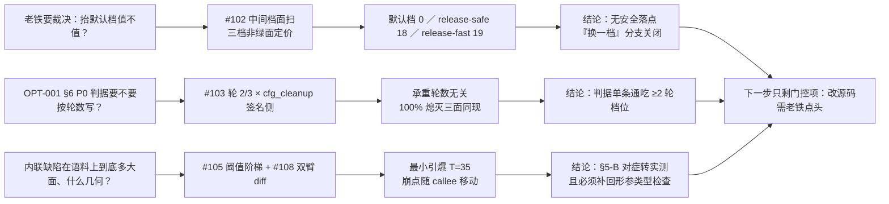
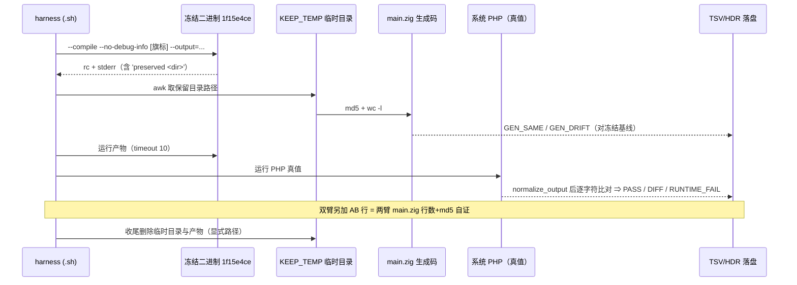

# 中间档面扫与内联引爆阈值定价（AOT-OPT-001 §5.9–§5.11 + AOT-CODEGEN-007 §3.7）

> 任务号：**#102 / #103 / #104 / #105 / #108** ｜ 日期：2026-10-06 ｜ 代次：`fbe6382a`
> 性质：**五轮全部为只读实测 + 一份门控设计交付 ⇒ 零源码改动、零提交**

---

## 1. 高层摘要（TL;DR）

| # | 一句话 | 关键读数（全部实测） |
|---|---|---|
| #102 | 默认档与 `release-fast` 之间**没有安全落点** —— 中间档 `release-safe` 逐形红面已扫并定量 | 非绿 **18/67**（`diff=17 runtime_fail=1`），名单与饱和档 `li5` 的 18 枚**逐枚全等**；A/B 两臂生成码 **67/67 逐字节相同** ⇒ 中间档 = 「轮 3 + `licm`」+ 一整套在本语料**惰性**的额外字段 |
| #103 | `cfg_cleanup` 的**承重与轮数无关** ⇒ OPT-001 §6 P0 判据**不需按轮数分档** | 轮 2／轮 3／轮 5 三面同为「关 `cfg_cleanup` ⇒ 当期签名命中 **100% 熄灭**（17/17）」；`f124`/`f134` 的关档编译失败同样轮数无关 ⇒ 「发射侧硬依赖」由「5 轮特有」升格为常量 |
| #104 | 逐枚拆分「默认 ↔ 中间档」差集 = **门控设计交付，未开轮** | 实读 `PassConfig` 25 枚字段 × 4 份预设 ⇒ 真差集**只有 3 枚**（`copy_propagation`/`gvn`/`max_instructions_per_function`），另 6 枚档间零差 ⇒ 协议 + 三臂法已写死，开轮需改 `optimizer.zig` |
| #105 | `f152` 的**最小内联引爆阈值 = 35**（非门控、纯 CLI 轴） | 13 枚阈值／14 臂：`T ≤ 34` 的 9 行逐字节 == 冻结基线（`f4c41d87…`／46376 行），`T=35` 首次漂移即崩 ⇒ `green_T_max=34 red_T_min=35` |
| #108 | 崩点机制**取证到发射层**，且原「二选一」问法被实测否证 | 相邻阈值双臂 `main.zig` diff（零插桩）钉死 callee 身份：`35/40`=`collect()`（TypeError「string given」）、`45`=`compose`/`pipe`、`50`=`partial()`（SIGSEGV）⇒ **崩点随 callee 移动**，`partial` 的变参几何不是必要条件 |

**给老铁的实际决策价值**：抬档议题现在只剩一条序 —— **先修 OPT-001 §6 P0，再谈抬档**；`release-safe` 这条「折中档」退路已被实测关闭（不是推断）。内联侧新增一条**修复时必须一起做**的要求：**补回被内联丢弃的形参类型检查**。

---

## 2. 影响范围

| 维度 | 影响 | 说明 |
|---|---|---|
| 源码 | **零改动** | `optimizer.zig` `252234ef…`/6877 未动；`native_linker.zig` `fbe6382a…`/32797 仍为 #74 纯注释批（`git diff --numstat` = `5 4`）；`ir_generator.zig` `cb53c2da…`、`compiler.zig` `af4901da…` 未动 |
| 二进制 | **未重建** | 冻结 `zig-out/bin/php-interpreter` md5 `1f15e4ce9b5c9cdaaef7cabf5efb9c76` 全程为同一枚 |
| 语料 | **零增删** | `.php` 计数 `fuzzy_scripts_720`=375／仓库全局=573／`pass` 语料=68，五轮前后相同 |
| 冻结基线 | **未动** | 所有 `BASE_SAME` 判定均以 `baseline_main_zig_md5.tsv` 的默认档基线（`f4c41d87…`）为对照 |
| 文档 | 3 张工单 + 本变更文档 | OPT-001（§5.9／§5.10／§5.11／§5.9.7 销账／§7 资产 8 行／更新日志）、CODEGEN-007（§3.7／§6.2／§7.3 更正／§7.5 部分结案／更新日志）、PERF-001（§7 裁决项 1 关闭「换一档」＋更新日志新块） |
| 新增永久资产 | **8 枚** | 见 §5.1 文件清单（`fuzzy_scripts_720/tmp/`，全部禁删） |
| 成本 | 见下表 | 一律为 harness 自记墙钟，非估算 |

**实测成本汇总（报价以读数为准）**

| 轮 | 规模 | 墙钟 | 单价 |
|---|---|---|---|
| #102 | 67 形 × 2 臂（含链接 + 运行 + 比对 PHP 真值） | `ELAPSED=1475s` | **22.0 秒／形**、**11.0 秒／臂** |
| #103 | 19 形 × 5 臂 = 95 臂（`--no-link` 签名侧） | `ELAPSED=14s` | ⚠ 与 #102 主跑批**并发** ⇒ 受争用读数，只作量级 |
| #105 | 13 枚阈值／14 臂（两批合并） | `114s + 63s = 177s` | **12.6 秒／臂** |
| #108 | 2 臂 + diff（身份取证） | ≈ 26 秒 | 未自记墙钟 ⇒ 登记为口径缺口 |

---

## 3. 核心变更

| # | 变更 | 类型 | 落点 |
|---|---|---|---|
| C1 | **中间档实测销账**：把 #101 遗留给 PERF-001 的「`release_safe` 面扫未做」做完 ⇒ 「换一档」分支从「实测推论」升级为**实测关闭** | 读数 + 文档 | OPT-001 §5.9（含 §5.9.1–§5.9.7）、PERF-001 §7 裁决项 1 |
| C2 | **轮数无关性复验**：`cfg_cleanup` 承重扩测到轮 2／轮 3 ⇒ P0 判据免按轮数分档；同时立「三面禁令」（签名熄灭 ≠ 与 `cfg_cleanup` 无关） | 读数 | OPT-001 §5.10 |
| C3 | **门控设计交付**：`PassConfig` 全字段 × 四预设差集查表 + 三臂差分协议（含**自证臂**）＋ 取数通道与成本口径 | 设计（未开轮） | OPT-001 §5.11 |
| C4 | **阈值阶梯钉死**：`f152` 最小引爆 `inline_threshold` = 35，并**更正主门归属**（`can_inline` `:4590-4592` 而非 `very_small` `:4664`） | 读数 + 自我更正 | CODEGEN-007 §3.7、§7.3 |
| C5 | **发射层机制四条**：def/use 分裂、caller 同格串扰（`reg_1` = `"--- Currying ---\n"`）、绑定即死码、**内联丢弃形参类型检查** | 取证 | CODEGEN-007 §3.7／§7.5 |
| C6 | **问法否证**：原「`.param` 错绑 **vs** 变参/spread 帧计数错配」的二选一被否证（`collect` 无变参无 `use` 同样崩） | 否证 | CODEGEN-007 §7.5 |
| C7 | **取数纪律三条**（跨 run 用全名防 join fan-out；跨 harness 比明细先比窗口参数；汇总前验判定行条数） | 规约 | OPT-001 §5.9.5 |
| C8 | **旧估算否证**：§5.8.6 遗留 5 的「输出面约 17 分钟」**低估 45%** ⇒ 真值 24.6 分钟；#106 的成本按 11.0 秒／臂重定价为 ≈7.0 分钟 | 更正 | OPT-001 §5.9.6／§5.10 末、PERF-001 更新日志 |

---

## 4. 可视化概览

### 4.1 分层架构图（本轮触及的层与证据流）



### 4.2 业务流程（这三轮在回答什么业务问题）



### 4.3 执行流程（单臂如何取数 ⇒ 为何可信）



### 4.4 变更点与业务代码映射（上层 ⇒ 底层）

```mermaid
graph TD
    subgraph 文档层
        W1["OPT-001 §5.9 / §5.10 / §5.11 / §7 / 更新日志"]
        W2["CODEGEN-007 §3.7 / §6.2 / §7.3 / §7.5 / 更新日志"]
        W3["PERF-001 §7 裁决项 1 + 更新日志新块"]
    end
    subgraph 工具层
        T1["c007_f152_thresh_bisect_tmp.sh<br/>THRESHOLDS=13 值 / normalize_output"]
        T2["opt001_releasesafe_face_tmp.sh<br/>A/B/AB 三行一组"]
        T3["opt001_roundcfg_tmp.sh + ir_stale_hoist_tmp.py<br/>四枚 Δ 区间口径"]
    end
    subgraph 证据层
        E1["c007_f152_thresh_diff_probe_tmp.txt<br/>被内联体逐字 + reg_367 出现清单"]
        E2["*.tsv / *_hdr.txt<br/>代次戳 4 枚"]
    end
    subgraph 被测源码（只读锚点）
        S1["optimizer.zig:4590-4592 主门<br/>:4664 次门（实测惰性）"]
        S2["optimizer.zig:4695-4701 reg_map 按下标"]
        S3["optimizer.zig:147 / :203 两预设<br/>25 枚字段差集 = 3"]
        S4["native_linker.zig :2995 callee 帧类型检查<br/>（内联副本缺失）"]
    end
    W1 --> T2 --> E2
    W1 --> T3 --> E2
    W2 --> T1 --> E1
    E1 --> S1
    E1 --> S2
    E1 --> S4
    W1 --> S3
    W3 --> S3
```

---

## 5. 详细变更分析

### 5.1 涉及文件清单

| 层 | 文件 | 变更 | 性质 |
|---|---|---|---|
| 文档 | `docs/known-issues/AOT-OPT-001-licm-multi-iteration-silent-wrong-values.md` | §5.9（7 小节）／§5.10／§5.11／§5.9.7 遗留① 销账／§7 资产 +8 行／硬结论 1 枚举更正／更新日志新块 | 只读结论回填 |
| 文档 | `docs/known-issues/AOT-CODEGEN-007-function-inlining-param-args-lost.md` | §3.7 新增／§6.2 复测路径新增／§7.3 主门更正／§7.5 形 D 重写／更新日志新块 | 只读结论回填 |
| 文档 | `docs/known-issues/AOT-PERF-001-默认优化档位与函数级状态机回退.md` | §7 裁决项 1「换一档」关闭／文末更新日志新块 | 只读结论回填 |
| harness | `fuzzy_scripts_720/tmp/opt001_releasesafe_face_tmp.sh`／`.tsv`／`_hdr.txt` | 新增（永久，禁删） | 双臂面扫 |
| harness | `fuzzy_scripts_720/tmp/opt001_roundcfg_tmp.sh`／`.tsv` | 新增（永久，禁删） | 逐轮 × `cfg_cleanup` |
| harness | `fuzzy_scripts_720/tmp/c007_f152_thresh_bisect_tmp.sh`／`.tsv`／`_hdr.txt` | 新增（永久，禁删） | 阈值阶梯 |
| 证据 | `fuzzy_scripts_720/tmp/c007_f152_thresh_diff_probe_tmp.txt` | 新增（永久，禁删） | 生成码逐字证据 |
| 源码 | **无** | 零改动（`git status --short src/` 仍仅 ` M src/aot/native_linker.zig` = #74 注释批） | — |

### 5.2 读数细节（按模块）

**#102（OPT-001 §5.9）**

```bash
#fuzzy_scripts_720/tmp/opt001_releasesafe_face_tmp_hdr.txt
armA=--compile --no-debug-info --optimize=release-safe
armB=--compile --no-debug-info --aot-enable-pass=inline --aot-inline-threshold=15 --aot-enable-pass=licm --aot-max-iterations=3
```

```text
#fuzzy_scripts_720/tmp/opt001_releasesafe_face_tmp.tsv（末四行汇总）
SUMMARY_A|armA|gen_same=1|gen_drift=66|pass=49|diff=17|runtime_fail=1|compile_fail=0
SUMMARY_B|armB|gen_same=1|gen_drift=66|pass=49|diff=17|runtime_fail=1|compile_fail=0
SUMMARY_AB|ab_same=67|ab_diff=0|ab_na=1|total=68|skip=1
ELAPSED=1475s
```

- 唯一一枚 `gen_same=1` 是 **`f031_builder_fluent_immutable`**（5838 行，md5 `06e6ec761e06a357c34eba022bd853f8`，A/B 两臂均 PASS）⇒ 中间档下它逐字节 == 冻结基线；同一形在 #94 的 `release-fast` 臂是 `GEN_DRIFT`（5812 行 `7fe9b8c113bba265996f6c7c67409c09`），在「默认档 + 只有内联旗标」臂又回到 `BASE_SAME` ⇒ 它的漂移承重环在 `ReleaseFast` 独有轴，不在中间档轴。
- **`f152` 不是那枚 `gen_same`**：中间档下 `f152_closure_arrow_higher_order` 为 `GEN_DRIFT`（46372 行 `9c028f855df234694093875d596e59ee`，A/B 两臂同号），但**判定 PASS**（绿）。与 #105 的关系是**一致而非同一读数**：#105 的 `T=15` 行是「默认档 + 只有内联旗标」的单变量臂 ⇒ `BASE_SAME`；本臂多叠了 `licm` + 轮 3 ⇒ 生成码确实漂移但仍不出错 ⇒ 两者共同点是「`T=15` 的内联轴未把受害 callee 放进来（主门 cost ≤ 15 < 35）」，差异由轮数轴承担。
- 可观测性：`RUNTIME_FAIL` 仅 `f160` 一枚，与 `li5` 同数同形 ⇒ 「`ReleaseSafe` 保留 panic ⇒ 看起来更红」未发生。

**#103（OPT-001 §5.10）**

| 臂 | 可读行 | 签名命中 | BLIND | 无行 |
|---|---|---|---|---|
| `r2` | 19 | 17 | 2 | 0 |
| `r2nc` | 17 | **0** | 17 | 2（`f124`/`f134` 编译失败） |
| `r3` | 19 | 17 | 2 | 0 |
| `r3nc` | 17 | **0** | 17 | 2 |

分类计数 `A_HIT=13 A+B_HIT=2 B_HIT=2 BLIND=2` 两面全等；`r2` vs `r3` 的幅值差集合 = {`f117`, `f124`, `f171`, `f176`} 与 #101 完全一致 ⇒ 判定面轮 2 封顶、幅值面轮 3 封顶**双双复验**。

**#104（OPT-001 §5.11）**：`releaseSafe()` `:147-171` 与 `releaseSmall()` `:203-222` 逐枚对照 ⇒ 真差集 3 枚；6 枚档间零差（五枚显式 `false` == 结构体默认，另 `sccp` 两档同 `true` —— ⚠ 后者理由是「档间同值」而非「等于默认」，本轮已就此更正一处枚举与计数不符的写法）。

**#105/#108（CODEGEN-007 §3.7）**

| `T` | gen vs base | 判定 | 行数 | md5 | 新内联 callee |
|---|---|---|---|---|---|
| 0,15,20,25,30,31,32,33,**34** | `BASE_SAME` | PASS | 46376 | `f4c41d87…` | 无 |
| **35**, 40 | `BASE_DRIFT` | RUNTIME_FAIL（`exit=255` TypeError） | 46798 | `8117a372…` | `collect()` |
| 45 | `BASE_DRIFT` | RUNTIME_FAIL（`exit=139`） | 47101 | `1c59a293…` | `compose`/`pipe` |
| 50 | `BASE_DRIFT` | RUNTIME_FAIL（`exit=139`） | 47849 | `ed742689…`（= #94 C 臂） | `partial()` |

```text
#fuzzy_scripts_720/tmp/c007_f152_thresh_diff_probe_tmp.txt（T=34 → 35 新增体内关键两行）
    reg_368 = reg_1.*;
    reg_369 = try runtime.php_object_new_with_constructor("FuncCollection", &[_]runtime.Value{reg_368}, runtime.runtime_allocator);
```

### 5.3 自我更正清单（本轮共 5 处，全部回填正文）

| # | 原写法 | 更正后 | 依据 |
|---|---|---|---|
| 1 | `inline_threshold` 敏感性归到 `shouldInline` 的 `very_small`（`:4664`，「4 的台阶」） | **主门 = `can_inline` 的逐值比较 `:4590-4592`**；`:4664` 是次门且本语实测惰性 | 34→35 逐整数翻面，直接与「4 的台阶」矛盾 |
| 2 | 形 D 归因「`.param` 错绑 **还是** 变参/spread 帧计数错配」 | 二选一被否证：`collect` 无变参无 `use` 同样崩 ⇒ 崩点随 callee 移动 | #108 双臂 diff |
| 3 | §5-A「收窄内联门 = 可回退的**同效替代**」 | A 属**遮掩而非修复**：缺陷与 cost 阈值无因果，换语料即罩不住 | 阶梯显示门限只是「恰好」在 35 放进第一枚受害 callee |
| 4 | §5.8.6 遗留 5「输出面约 17 分钟量级」 | **低估 45%** ⇒ 真值 24.6 分钟；#106 按 11.0 秒／臂重定价 ≈7.0 分钟 | #102 `ELAPSED=1475s` |
| 5 | §5.11 硬结论 1「6 枚是可证 no-op」只列 5 枚 | 逐枚枚举 6 枚，并对 `sccp` 标明 no-op 理由是「档间同值」而非「等于结构体默认」 | 实读 `:151`/`:207`/`:78` |

另有一处**过程否证**（不计入读数）：#108 首轮探针因 `--output` 父目录不存在而静默 `rc=1`（非编译器行为），建目录后两臂 `rc=0` 且 md5 与阶梯 TSV 对上。

---

## 6. 影响与风险评估

| 项 | 评估 |
|---|---|
| 是否破坏式变更 | **否**。零源码、零基线重冻结、零语料增删；改动全部为文档与 harness 新增 |
| 影响范围 | 只影响「抬档 / 内联」两条议题的**决策输入**；默认档行为逐字节不变（所有 `BASE_SAME` 行即证据） |
| 读数可信度 | 四道自证：① 每臂 md5/行数对冻结基线；② 双臂 `AB` 行；③ 跨 run 确定性（38 条签名行与 #101 逐枚等值，`value_diff=0`，第 3 次自证）；④ 灵敏度标定（同旗标下 §1 三形可复现，见 CODEGEN-007 §6.1） |
| 需要特别注意的点 | ①#103 的 `ELAPSED=14s` 是**并发争用下**读数，禁止与 #101 的无争用 14 秒比优劣；②跨 run 对账必须用**全名**（`f067_*` 同前缀两枚 ⇒ 短名 join fan-out）；③跨 harness 比明细列**先比窗口参数**（曾造出「15 枚不等」假读数）；④任何「0 红」读数须先验判定行条数（#102 = 206 行） |
| 风险敞口 | `f124`/`f134` 的关 `cfg_cleanup` 编译失败被证实为**轮数无关** ⇒ 「抬档时顺手关掉某个整理型 pass」这类提案的闸门成本升高（承 #98） |

### 复测路径（全部带超时；细节见各工单 §6/§7）

```bash
cd /Users/wangjianjun/products/parser
# 内联阈值阶梯（两批，13 值 / 14 臂 ≈ 177 秒）
bash fuzzy_scripts_720/tmp/c007_f152_thresh_bisect_tmp.sh "0 15 20 25 30 35 40 45 50"
bash fuzzy_scripts_720/tmp/c007_f152_thresh_bisect_tmp.sh "0 31 32 33 34"
# 期望：THRESH_BISECT_MERGED thresholds=13 arms=14 rounds=2 green_T_max=34 red_T_min=35
# callee 身份（零插桩双臂 diff，≈26 秒）：见 CODEGEN-007 §6.2
# 中间档面扫（68 形双臂 ≈ 25 分钟，禁与其他 AOT 批次并发）
nohup bash fuzzy_scripts_720/tmp/opt001_releasesafe_face_tmp.sh > /tmp/opt001_rs_run.log 2>&1 &
# 期望：SUMMARY_AB ab_same=67 ab_diff=0 / SUMMARY_A diff=17 runtime_fail=1
# 轮数 × cfg_cleanup（签名侧，19 形 × 5 臂）
bash fuzzy_scripts_720/tmp/opt001_roundcfg_tmp.sh
# 期望：ROUND_CFG_DONE total=19 arm_compile_fail=4 arm_rows=72，r2nc/r3nc 命中 0
# 产物清理（全部显式路径，禁删 .php 源与 fuzzy_scripts_720/tmp 下的永久 harness）
rm -rf /tmp/c007_f152_thresh_work /tmp/c007_probe_work /tmp/opt001_rs_work /tmp/opt001_roundcfg_sig
rm -f /tmp/c007_thresh_run.log /tmp/c007_thresh_run2.log /tmp/c007_thresh_round1.tsv /tmp/c007_merged_rows.txt /tmp/c007_f152_probe.log
rm -f /tmp/opt001_rs_run.log /tmp/opt001_roundcfg_run.log
rm -rf .zigphp_aot_build_<各轮 PID>   # KEEP_TEMP 臂留在仓库根，每轮从 .cerr 的 preserved 路径记下后逐一显式删除
# 自证：find /tmp -maxdepth 1 \( -name 'c007*' -o -name 'opt001*' \) 为空；aot_compile_* 与 .zigphp_aot_build_* 均为 0
```

---

## 7. 遗留 / 潜在问题

| # | 遗留 | 门控性 | 说明 |
|---|---|---|---|
| 1 | `T=45`/`50` 两臂 **SIGSEGV 的具体坏值**未钉 | 非门控（需运行时侧另一轮） | 别名签名已实测可见，但 `reg_4` 在 caller 帧是谁、SEGV 落在哪次解引用未证 |
| 2 | 逐 callee 的 `estimated_cost` 数值属**推导** | **门控** | 直接读 `call_graph` 需插桩 ⇒ 需点头 |
| 3 | §5.10 只测签名侧 ⇒ 轮 2/3 的**输出侧 nc 面**仍开 | 非门控（#106，≈7.0 分钟） | 「签名熄灭但输出仍红」目前只在轮 5 复验过 |
| 4 | 被 `cfg_cleanup` 丢弃块内的 **phi 节点计数**未做 | 非门控（#107，只读） | P0 发射侧修法的选型前置 |
| 5 | 默认 ↔ 中间档**逐枚**面未拆 | **门控**（#104 开轮需改 `optimizer.zig`） | 联合面已答「否」，逐枚可能互相遮蔽 |
| 6 | 49 枚绿形与 `r3` 的逐字节对账未做 | 非门控 | 曲线侧无绿形对照行 |
| 7 | `f113`/`f171` 到轮 4 生成码仍漂移 ⇒ **迭代定点未证** | 分析性 | 任何「多迭代 = 更优化」在本语料给不出证据 |
| 8 | 内联修复落地时必须**补回形参类型检查**（否则内联后静默跳过 `array` 校验独立成害） | **门控** | 已写入 CODEGEN-007 §5-B 行的实测要求 |

---

## 8. 后续开发 / 优化建议

| 优先级 | 建议 | 影响面 | 落地成本 |
|---|---|---|---|
| **P0（仍待点头）** | OPT-001 §6 主修：`tryRemoveTrampolineBlock` 删块准入收紧（**改写之前**取数；判据不得以 C1 为前置）+ 发射侧「`// PHI: reg_N` 有标记而区间内零赋值 / C9 空臂」诊断 | 抬档面修复；默认档本环从不触发 ⇒ 理论发射中性 | 小。**验收改用 `--aot-enable-pass=licm --aot-max-iterations=2` 最廉价饱和档**（红面 18 → 残留 ≤ 8）；幅值敏感子项用轮 3 |
| **P0（同批）** | CODEGEN-007 §5-B：`reg_map` 改按 `.param` **result id** 建表并丢弃该指令，**并补回形参类型检查** | 修形 B 与 `f152` 的 TypeError 侧；修不了形 A（引用形参要搬 cell）与形 C | 中-高（跨 IR 语义，逐 op 核）。属生成码改动 ⇒ 68 语料漂移门 + 基线重登记评估 |
| P1 | 先跑 **非门控 #106 + #107** 再议 §5-B/§5-C 的覆盖面：#106 给输出侧轮数面，#107 给 phi 计数（发射侧选型前置） | 只影响判据写法 | #106 ≈ 7.0 分钟；#107 只读 |
| P1 | #104 开轮（需点头）：先跑**自证臂**（6 枚零差字段一次性覆盖）⇒ 再 `gvn` ⇒ `copy_propagation` ⇒ `max_instructions_per_function` | 决定「中间档是否还藏独立机制」 | 3 枚 × 3 臂 × 11 形 ≈ 10 分钟 + 一次 `timeout 120 zig build`；**编辑只在开轮期间存在，收口即还原并 md5 自证** |
| P2 | 把「相邻阈值／相邻旗标双臂 `ZIGPHP_AOT_KEEP_TEMP=1` 生成码 diff」登记为**默认取证法**（本轮 26 秒拿到 callee 身份 vs 原设想整档抬升 25 分钟） | 取证成本 | 零（已写入 CODEGEN-007 §3.7 方法登记与 §6.2） |
| P2 | `f152` SIGSEGV 侧的运行时轮（GDB 之外的最小手段：产物 + 生成码窗口对照）与 AOT-REF-004 **分开立案**（禁互为证据） | 形 D 剩余口 | 中 |

---

**收尾自证（清理已实跑，读数为实测非估算）**：`aot_compile_*` = **0**、`.zigphp_aot_build_*` = **0**（七枚 `92601/92605/92633/92661/92821/92853/92876` 逐一显式路径删除，未用通配符）、`find /tmp -maxdepth 1 \( -name 'c007*' -o -name 'opt001*' \)` = **0 行**；`.php` 计数 **375／573／68 不变、零删除**；`optimizer.zig` `252234ef48cb47a42e6f39d1bc3e845b`/6877 逐字节未变（零源码改动）；`native_linker.zig` `fbe6382a2e0904b6740d771b88c409c7`/32797（= #74 纯注释批，未提交）；`git status --short src/` 仅 ` M src/aot/native_linker.zig` 一行；冻结二进制 `1f15e4ce9b5c9cdaaef7cabf5efb9c76` 未重建。**本轮不提交**（提交需老铁明示「提交」）。
