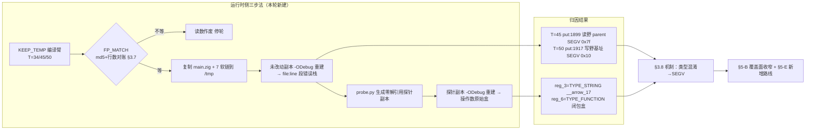
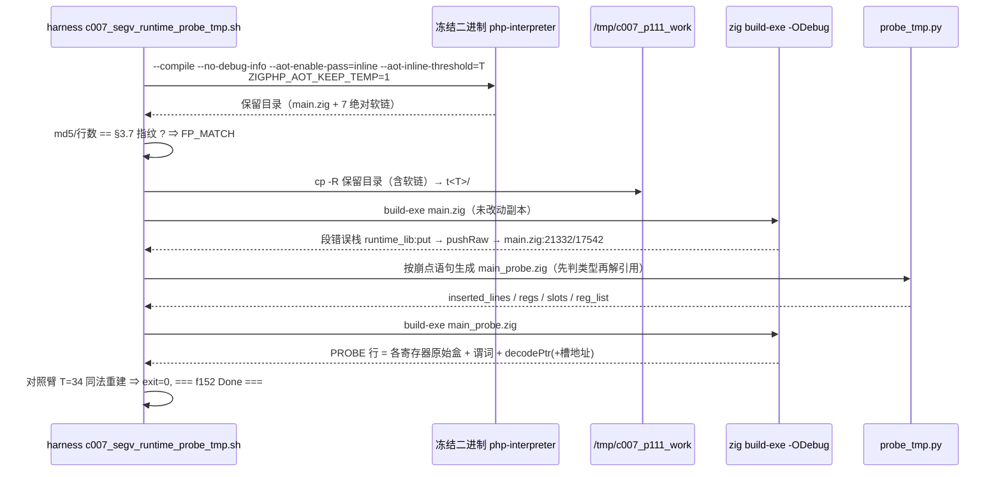
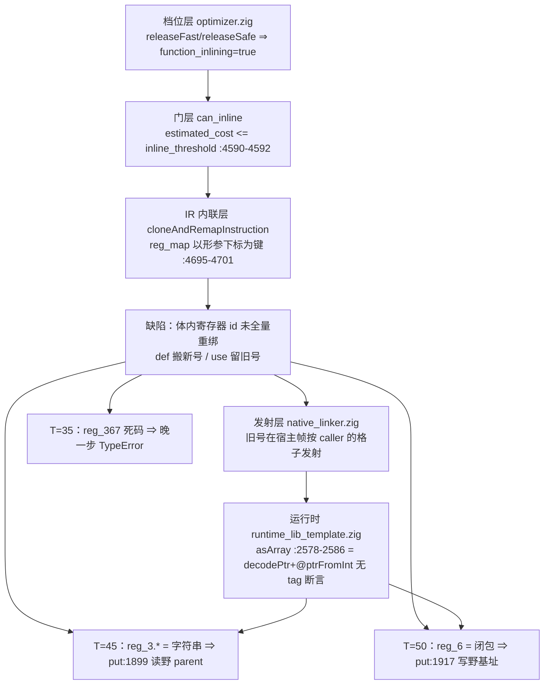
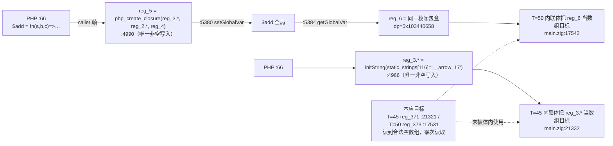
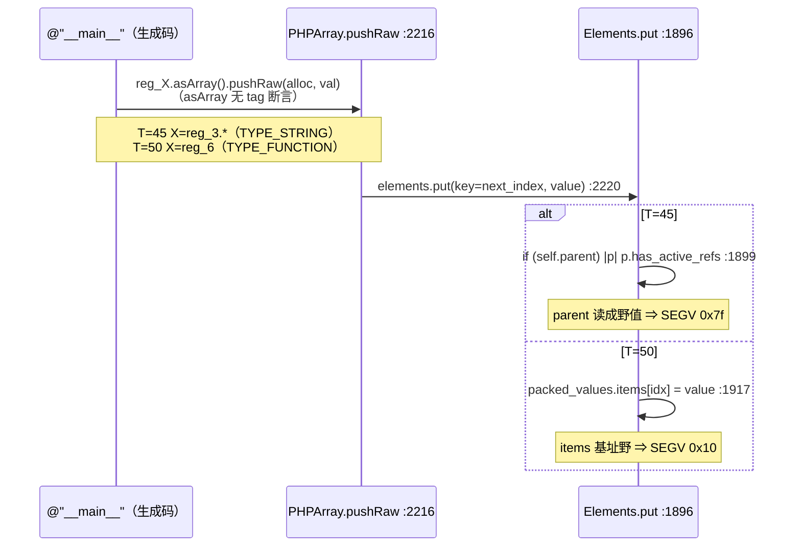
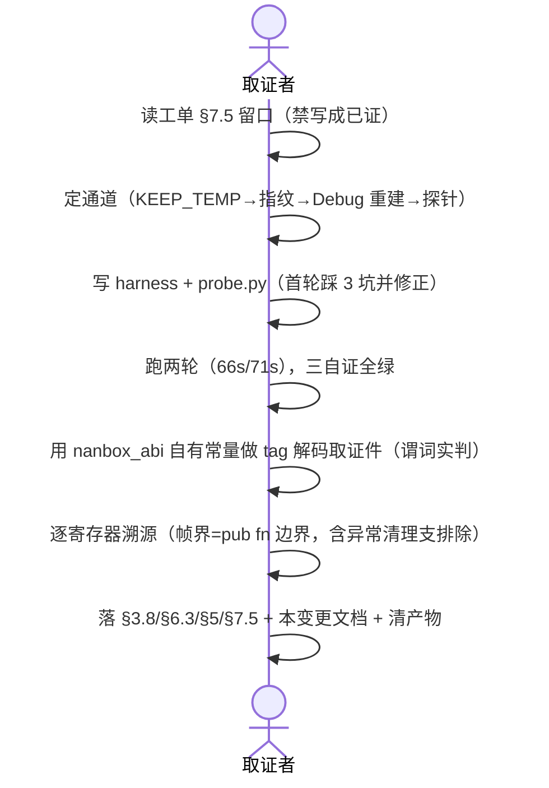

# 内联崩面运行时侧归因与 `asArray()` 无断言 · AOT-CODEGEN-007 轮次 #111（任务 #110）

**日期**: 2026-10-06 ｜ **工单**: [AOT-CODEGEN-007](../../known-issues/AOT-CODEGEN-007-function-inlining-param-args-lost.md) §3.8（新增）／§6.3（新增）／§5（B 行收窄 + 新增 E 行）／§7.5（留口闭合）
**代次锚点**: `native_linker.zig` `fbe6382a2e0904b6740d771b88c409c7`／32797 行（未改，仍为 #74 纯注释批 numstat `5 4`）· `optimizer.zig` `252234ef48cb47a42e6f39d1bc3e845b`／6877 行（未改）· `ir_generator.zig` `cb53c2da7d4fe2e1f62b728511f7c3ea` · 冻结二进制 `php-interpreter` `1f15e4ce9b5c9cdaaef7cabf5efb9c76`（未重建）
**性质**: **纯取证轮** —— 零源码改动、零插桩（探针只写 `/tmp` 副本）、非门控

---

## 1. 高层摘要（TL;DR）

`f152_closure_arrow_higher_order` 在「默认档 + 开内联」的 `T=45`／`T=50` 两臂各崩一次 SIGSEGV，此前（#105/#108）只钉到**生成码静态面**（哪枚 callee 被内联、哪个旧 id 串扰），坏值与崩落点当时明文留口「禁写成已证」。

本轮换**运行时侧通道**把留口闭合：把 `ZIGPHP_AOT_KEEP_TEMP=1` 取到的**同一份生成码**（先按 §3.7 指纹逐字节对账）在 `/tmp` 副本上用 `-ODebug` 重建，让 Zig 自带段错误处理器打印 `file:line` 栈；再按崩点语句自动生成**零解引用探针**副本取操作数原始盒。三条自证全绿（`FP_MATCH`×3、对照臂 `T=34` Debug 跑到 `exit=0`、两枚崩形截断点与 ReleaseFast 症状逐字相同）。

**读数结论**：两枚崩同属一个机制 —— 内联副本把 callee 的**数组临时量定义**重编号到新号（`reg_371`/`reg_373`，读到的是合法空数组），体内读写却仍留在 callee 的**旧 id**（`reg_3`/`reg_6`），而旧 id 在宿主帧 `@"__main__"` 是**另一枚活值且类型不同**（`T=45` = 字符串 `"__arrow_17"`、`T=50` = `$add` 的闭包盒 `TYPE_FUNCTION`）；`asArray()`（`runtime_lib_template.zig:2578-2586`）**只 `decodePtr` + `@ptrFromInt`、不校验 tag** ⇒ 字符串头／闭包头被当 `*PHPArray` 使用，`elements.parent`／`packed_values.items` 读成野值，一枚崩在 `put:1899` 的**读**、一枚崩在 `put:1917` 的**写**。

**两点直接改判**：① §5-B 的修复覆盖面被实测**收窄**——串扰与 `.param` 映射无关，**只改 `.param` 重绑消不掉这两枚崩**；② 新增**路线 E**（强转点前补 `isArray()` 守卫或发射期断言），其中运行期守卫型有性能代价 ⇒ 需老铁裁决。

**成本（实测，非估算）**：整轮跑两次 `ELAPSED=66s`／`71s`，每轮含 3 臂编译 + 3 次 Debug 重建 + 2 份探针生成 + 2 次探针构建 + 2 次运行 ⇒ ≈ **24 秒／臂**。

---

## 2. 影响范围

| 维度 | 读数 | 影响 |
|---|---|---|
| 源码 | `src/**` **零改动**（`git status --short src/` 仍只有 #74 那一条 `M native_linker.zig`） | 无发布风险 |
| 语料面 | 默认档 `function_inlining=false` ⇒ **0/68**；本轮三臂为「默认档 + 内联旗标」的取证臂 | 冻结基线不受影响 |
| 抬档红面 | `f152` 一枚（1/67），其中 **2 个阈值臂（45/50）为 SIGSEGV** | 崩因自 `T=35` 的「晚一步 TypeError」升级为「类型混淆不可控崩」 |
| 工单 | CODEGEN-007：§3.7 诚实边界①结案、新增 §3.8／§6.3、§5 表 B 行改写 + 新增 E 行、§7.5 留口闭合、状态行刷新 | 修复口径的**验收判据**变了（B 必须带反例） |
| 方法学 | 新增可复用通道：「同一生成码 `-ODebug` 重建 + 崩点探针」 | 任何「ReleaseFast 只给 `exit=139`」的崩形都可归因，代价 24 秒／臂 |
| 资产 | 新增 2 枚永久 harness + 1 枚取证件（`/tmp` 产物已全部显式路径清除） | 复测可逐字节复现 |



---

## 3. 核心变更

| # | 位置 | 变更 | 类型 |
|---|---|---|---|
| 1 | `docs/known-issues/AOT-CODEGEN-007-…md` §3.7 诚实边界① | 「SIGSEGV 具体坏值未取证」→ 删除线 + 结案，附崩点/落点/坏值指针 | 文档结案 |
| 2 | 同上 §3.8（新增，约 60 行） | 通道三步法、三条实测坑、三条自证、崩点表、操作数表、逐寄存器溯源、机制结论、两条新判据、诚实边界 5 条、成本、资产 | 文档新增 |
| 3 | 同上 §5 表 B 行 | 追加「⚠ 实测收窄」：`.param` 之外的体内全部 id 必须重绑；`T=45/50` 列为**必过反例**；须一并补回形参类型检查 | 判据变更 |
| 4 | 同上 §5 新增 E 行 | 强转点前 `isArray()` 守卫（①有性能代价需裁决）／发射期断言（②零运行时成本） | 新路线 |
| 5 | 同上 §5 标题 | 「三选一」→「A–E 五条，可叠加」 | 一致性 |
| 6 | 同上 §6.3（新增） | 三步法复测命令、期望读数、清理清单、两条使用注意 | 复测路径 |
| 7 | 同上 §7.5 第 5 条 + 留口子条 | 标题改为「运行时侧已钉死」；留口条目结案并列出**原问法被更正两处** | 文档结案 |
| 8 | 同上 状态行 + 更新日志 | 头部状态刷新；新增 #110／轮次 #111 条目（9 个子条） | 台账 |
| 9 | `fuzzy_scripts_720/tmp/c007_segv_runtime_probe_tmp.sh`（新建） | 三步法 harness，内建指纹对账 + 截断点对账 + 对照臂 | 永久资产 |
| 10 | `fuzzy_scripts_720/tmp/c007_segv_probe_tmp.py`（新建） | 崩点探针生成器：只打盒与谓词、`isArray()` 才解引用、自动识别引用槽 `reg_N.*` | 永久资产 |
| 11 | `fuzzy_scripts_720/tmp/c007_segv_runtime_probe_tmp.tsv`／`_hdr.txt` | 38 行读数（3 臂 gen/copy/dbg/probe 全链路） | 读数留档 |



---

## 4. 可视化概览

### 4.1 分层：从档到崩落点



### 4.2 业务流程（以 `f152` 源码为轴）



### 4.3 执行流程（崩落点）



### 4.4 上层→底层时序（取证本身）



---

## 5. 详细变更分析

### 5.1 读数总表（38 行 TSV 的压缩形）

| 臂 | `FP_MATCH`（md5／行数） | Debug `exit` | `CUT_MATCH` | `fault_msg` | 落点链 | 探针数 |
|---|---|---|---|---|---|---|
| `T=45` | `1c59a293…`／47101 | 134 | `--- Function Composition ---` | SEGV `0x7f` | `main.zig:21332` → `pushRaw:2220` → `put:1899` | 9 |
| `T=50` | `ed742689…`／47849 | 134 | `--- Partial Application ---` | SEGV `0x10` | `main.zig:17542` → `pushRaw:2220` → `put:1917` | 6 |
| `T=34`（对照） | `f4c41d87…`／46376（= 冻结基线） | **0** | `=== f152 Done ===` | 无 | 无（跑到底） | — |

### 5.2 操作数解码（探针原始盒 → `nanbox_abi` 常量谓词实判）

| 臂 | 寄存器 | 盒 | `val & TYPE_MASK` | 实判 | 判定 |
|---|---|---|---|---|---|
| 45 | `reg_3.*` | `0x7ffc800104f60f80` | `0x0000800000000000` | `TYPE_STRING`（`str=1`） | **错绑目标**（闭包名字面量 `"__arrow_17"`） |
| 45 | `reg_2.*` | `0x7ffd000104d302e8` | `0x0001000000000000` | `TYPE_ARRAY`（`arr=1`，`ref_count=1 next_index=0 packed_len=0`，槽 `0x16b796b88`） | 被 push 的值，合法 |
| 45 | `reg_371` | `0x7ffd000104d31440` | `TYPE_ARRAY` | 同上（合法空数组） | **本应目标**，零次读取 |
| 45 | `reg_4` | `0x7ffc000000000002` | `0` | `isBool()=1`（false） | 与崩点无因果（原问法判空） |
| 45 | `reg_372`/`reg_374` | `0x7ffc000000000001` | `0` | `isNull()=1` | nil |
| 50 | `reg_6` | `0x7ffe000103440658` | **`0x0002000000000000`** | **`TYPE_FUNCTION`**（五谓词全 0） | **错绑目标**（`$add` 闭包盒） |
| 50 | `reg_5` | `0x7ffe000103440658` | `TYPE_FUNCTION` | 与 `reg_6` **逐位相同** | 同一枚 `PHPClosure` ⇒ 盒相等自证 |
| 50 | `reg_373` | `0x7ffd0001034a0d38` | `TYPE_ARRAY` | `arr=1 ref_count=1 next_index=0 packed_len=0` | **本应目标**，零次读取 |
| 50 | `reg_4` | `0x7ffc000000000002` | `0` | bool false | 被 push 的值，合法 |

### 5.3 逐寄存器溯源（帧界 = `pub fn @` 边界）

| 臂 | 寄存器 | 声明 | 崩点前该帧全部非空写入 | 结论 |
|---|---|---|---|---|
| 45 | `reg_3`（引用槽） | `:3950 reg_3_storage`／`:3951 reg_3: *Value = &reg_3_storage` | **仅** `:4966 initString(static_strings[116])`；另 `:21330` 为崩点自身 COW 支（未进） | 字符串来源唯一 |
| 45 | `reg_2`（引用槽） | `:3682`／`:3683` | **仅** `:4962 initArray(PHPArray.init(…))` | 合法空数组来源唯一 |
| 50 | `reg_6`（普通值） | `:3582`（`:3583 _ = &reg_6;`） | **仅** `:5384 getGlobalVar("$add")`；97 处 `initNull()` 全在 `// Cleanup on exception` 支（起点 `:17091`，含曾疑的 `:17175`）⇒ 未执行 | 闭包来源唯一，与探针读数自洽 |
| 50 | `reg_5` | 同帧 | **仅** `:4990 php_create_closure(…)`（PHP `:66`）→ `:5380 setGlobalVar("$add", reg_5)` | `reg_5==reg_6` 由全局存取解释 |

### 5.4 涉及文件清单

| 层 | 文件 | 动作 |
|---|---|---|
| 文档/工单 | `docs/known-issues/AOT-CODEGEN-007-function-inlining-param-args-lost.md` | §3.7/§3.8/§5/§6.3/§7.5/状态行/更新日志 |
| 文档/变更 | `docs/changes/2026-10-06/内联崩面运行时侧归因与asArray无断言_CODEGEN-007R111_2026-10-06_fbe6382a.md` | 本文 |
| 记忆 | `.qoder/projects/…/memory/project-aot-codegen007-inlining.md` + `MEMORY.md` | 登记机制升级与判据变更 |
| harness | `fuzzy_scripts_720/tmp/c007_segv_runtime_probe_tmp.sh`／`.tsv`／`_hdr.txt`、`c007_segv_probe_tmp.py` | 新建（永久） |
| 源码 | `src/**` | **零改动** |
| 运行时（只读） | `src/aot/runtime_lib_template.zig` `:2578-2586`（`asArray`）、`:2216-2222`（`pushRaw`）、`:1896-1922`（`Elements.put`） | 引用为落点锚，未改 |
| ABI（只读） | `src/aot/nanbox_abi.zig` `:1-21`、`:36`（`decodePtr`） | 用于类型判定 |
| 优化器（只读） | `src/aot/optimizer.zig` `:4590-4592`、`:4695-4701` | 判据指向，未改 |

### 5.5 变更点业务逻辑映射（关键代码，全部为**只读引用**）

```zig
// src/aot/runtime_lib_template.zig:2578-2586 —— 无 tag 断言的强转（本轮机制的放大器）
pub fn asArray(self: Value) *PHPArray {
    if (self.isRef()) {          // 仅引用透传
        const ref_ptr = self.asRef();
        return ref_ptr.asArray();
    }
    const ptr_val = nanbox_abi.decodePtr(self.val);
    return @ptrFromInt(ptr_val); // ← 字符串盒／闭包盒同样通过：类型混淆入口
}
```

```zig
// src/aot/optimizer.zig:4695-4701 —— reg_map 键型错（本轮实测：仅治此处不足以消崩）
// for (callee.params) |_, i| 只按下标建表，callee 体却按寄存器 id 引用 ⇒ 临时量 id 从未进入映射
```

---

## 6. 影响与风险评估

| 项 | 评估 |
|---|---|
| **是否破坏式变更** | **否** —— 零源码改动；生成码、冻结基线、68 语料判定面全部不变 |
| 范围 | 仅 `f152` 一枚（默认档 0 面；取证臂为显式 `--aot-enable-pass=inline`） |
| 风险 1 | **归因通道为 Debug 重建**：分配器／UAF 行为与 ReleaseFast 可能有差（本仓历史有 Debug-vs-ReleaseFast 分歧先例）⇒ 本轮结论**只用于崩点与操作数类型**，未断言 ReleaseFast 同停 `:1899`/`:1917` |
| 风险 2 | **探针行号≠生成码行号**：插 print 后整体下移（`T=45` +14 行、`T=50` +10 行）⇒ 已强制以 `PROBE-CTX fault_line=` 回映射，复测必须照此 |
| 风险 3 | 路线 E 的①型（写点前 `isArray()` 守卫）属**新增运行时判定**，触及性能 ⇒ 按宪法 §六-7 已标为需裁决，未擅动 |
| 风险 4 | 探针会 `retain()`/读 `ref_count` —— 本轮一律只在 `isArray()` 成立后才读，避免把探针自身跑崩（已实测踩过一次） |
| 需特别注意点 | **禁止拿 exit 码当同一性判据**（Debug 崩形固定 134）；**`.php` 源零删除**；产物清理只走显式路径 |
| 复测路径（体验流程） | `bash fuzzy_scripts_720/tmp/c007_segv_runtime_probe_tmp.sh`（≈70 秒）→ 看 TSV 三行 `FP_MATCH` + `CUT_MATCH` + 对照臂 `exit=0` → 读 `dbg/trace` 与 `probe/PROBE` 行；可选跑 `tag_probe_tmp.zig` 复核类型判定 |

---

## 7. 遗留 / 潜在问题

| # | 项 | 状态 |
|---|---|---|
| L1 | 内联器**为何漏重绑 callee 临时量 id** 的具体分支 | 未读到；需 `optimizer.zig` 插桩 ⇒ **门控待点头** |
| L2 | 「类型混淆」对另 **18 枚抬档崩/红形**的语料面 | 未测（本轮只跑 `f152` 三臂） |
| L3 | 探针只读崩点**前一行** | 旧 id 更早是否也被同机制写过／读过未测 |
| L4 | ReleaseFast 侧落点行 | 未断言（Debug 通道限制） |
| L5 | 逐 callee `estimated_cost` 数值 | 仍为**推导**（整数门 + 边界），非读到 |
| L6 | `T=35` 臂的 `reg_367` 死码链 | 已在 §3.7 钉到发射层，本轮未重复归因 |

---

## 8. 后续开发 / 优化建议

| 优先级 | 建议 | 影响面 | 落地成本 |
|---|---|---|---|
| **P0** | §5-B 重绑范围扩到「callee 体内**全部**寄存器 id」，验收把 `T=45`/`50` 两臂列为**必过反例**（`fault_line` 不再出现 + `T=34` 保持逐字节等值）；同步补回 `php_check_param_type`（§3.7④） | 抬档崩面 2 枚 + 未来同类 callee；默认档 0 面 | 中（`optimizer.zig` 一处重编号逻辑，生成码改动 ⇒ 走 68 语料漂移门）；**门控待点头** |
| **P1** | 路线 **E②**：发射期为内联副本的强转点插一次性 tag 断言（编译期可见、零运行时成本），把「黑盒 SEGV」转成「可控报错」 | 取证成本从 24 秒／臂降到 0；正确路径不变 | 低（发射侧，仍需漂移门）；**门控待点头** |
| **P1** | 用同一通道补测另 18 枚抬档红形的崩落点（每枚 ≈24 秒 ⇒ 18 枚 ≈ 7 分钟 + 逐枚插桩人工） | 判定「类型混淆是否抬档崩面通用机制」 | 低-中（只读，零源码改动，非门控） |
| **P2** | 把 `-ODebug` 重建通道写进 `AGENTS.md`/工单口径：遇 `exit=139` 无栈的崩形**默认先跑该通道**，不要先插桩改源码 | 全工单取证效率 | 零（本轮已永久化 harness） |
| **P2** | 路线 A（收窄内联门）仍只是**遮掩**：本轮再证一次「缺陷与 cost 阈值无因果」，换语料即失效 ⇒ 不建议作为修复 | 决策口径 | — |

---

**取证自证清单（本轮全绿）**：① 三臂 `FP_MATCH`；② 对照臂 `T=34` Debug 跑到 `exit=0`／`=== f152 Done ===`；③ 两枚崩形 Debug 截断点与 §3.7 登记的 ReleaseFast 症状逐字相同；④ `src/**` 零改动（`git status --short src/` 仅 #74 一条）；⑤ 四枚代次 md5 复验不变；⑥ `.php` 计数 573（仓）／375（`fuzzy_scripts_720`）／68（`pass`）不变；⑦ 产物按显式路径清除，`aot_compile_*` 仓内零残留。
